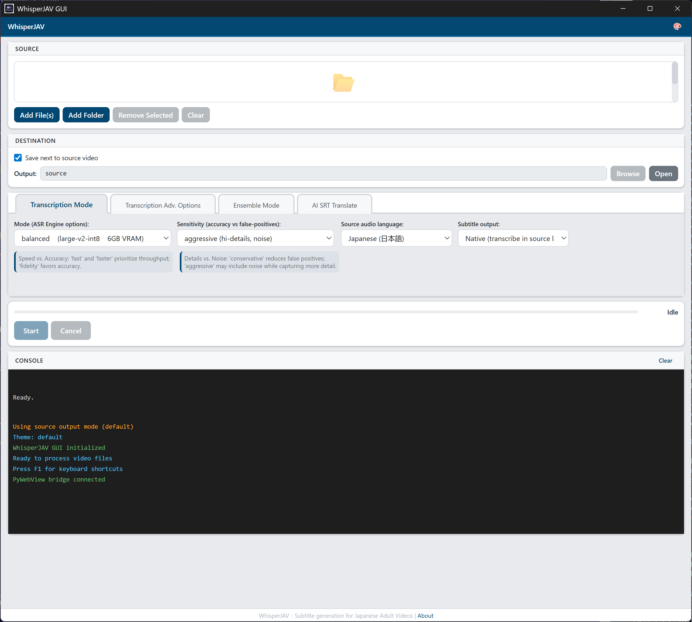
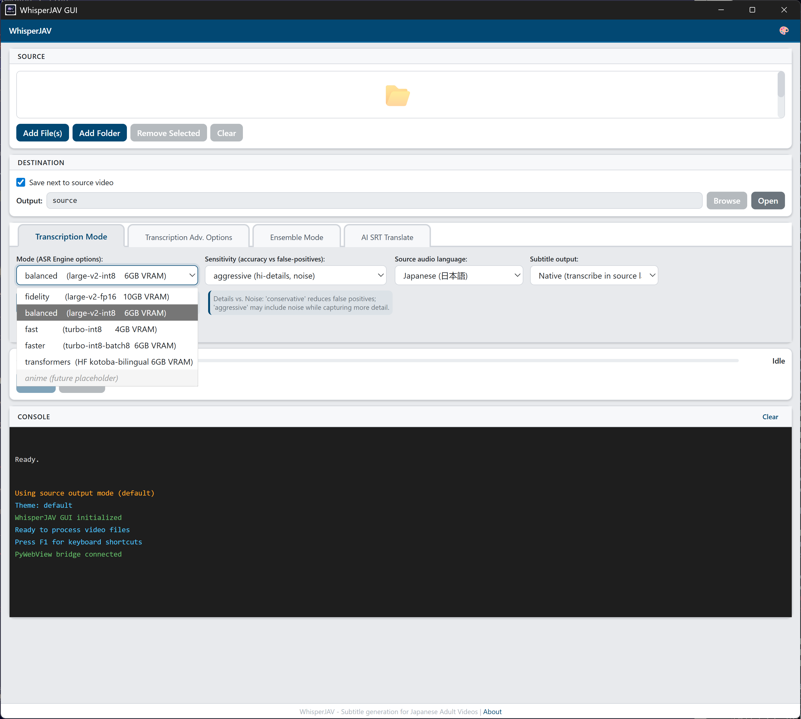
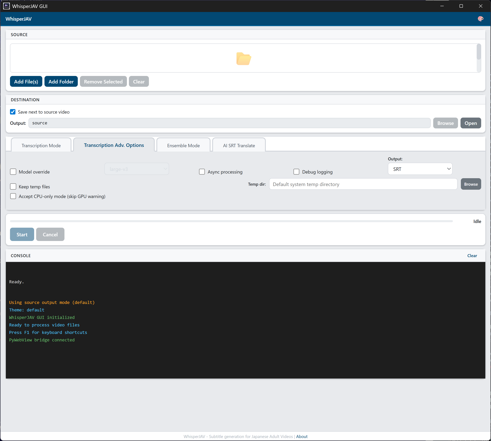
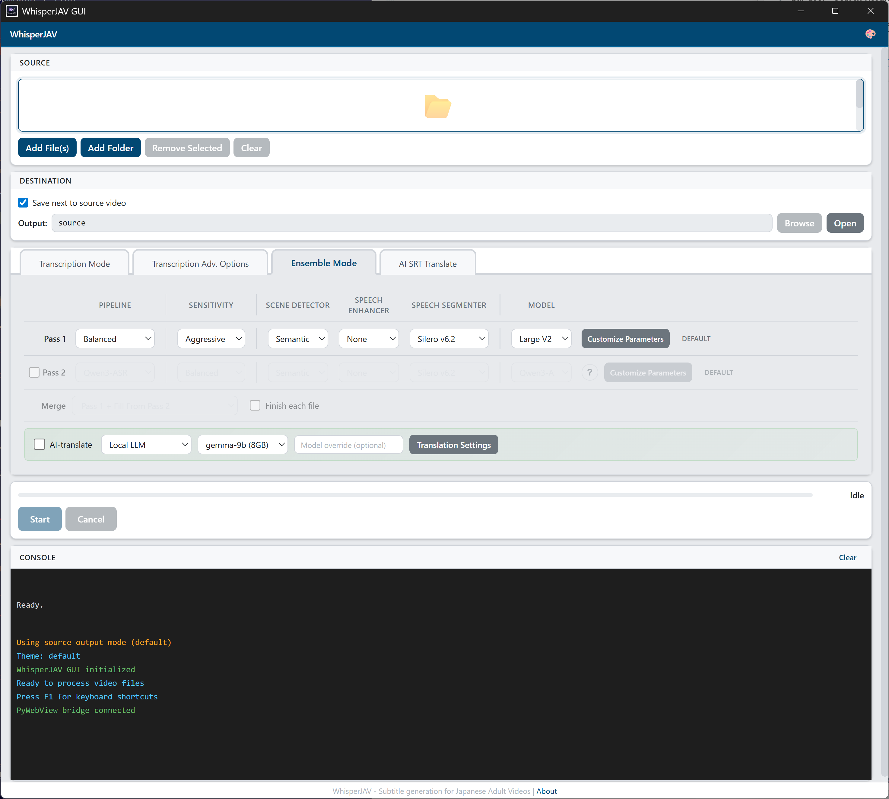
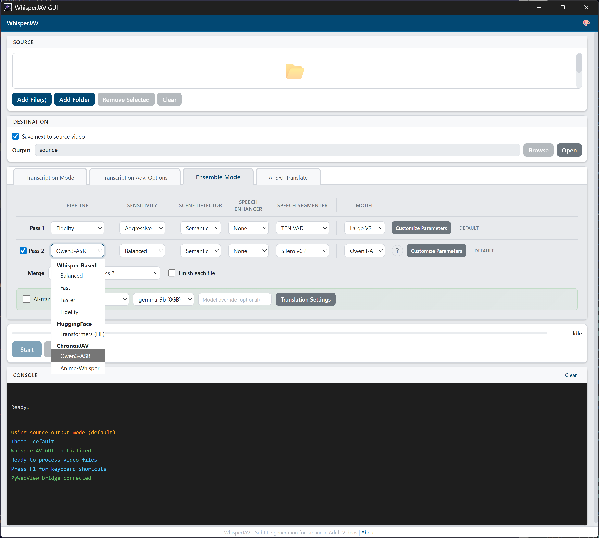
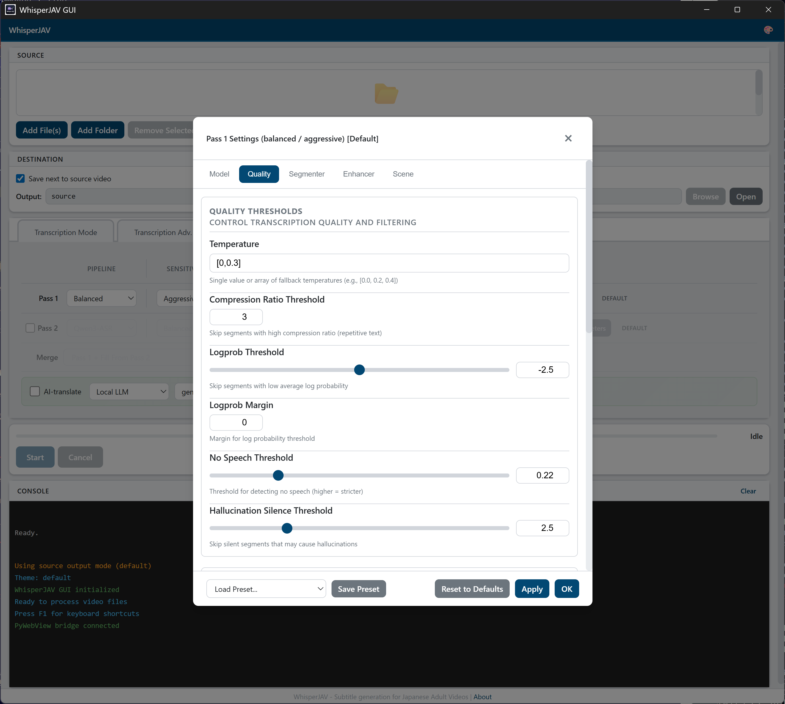
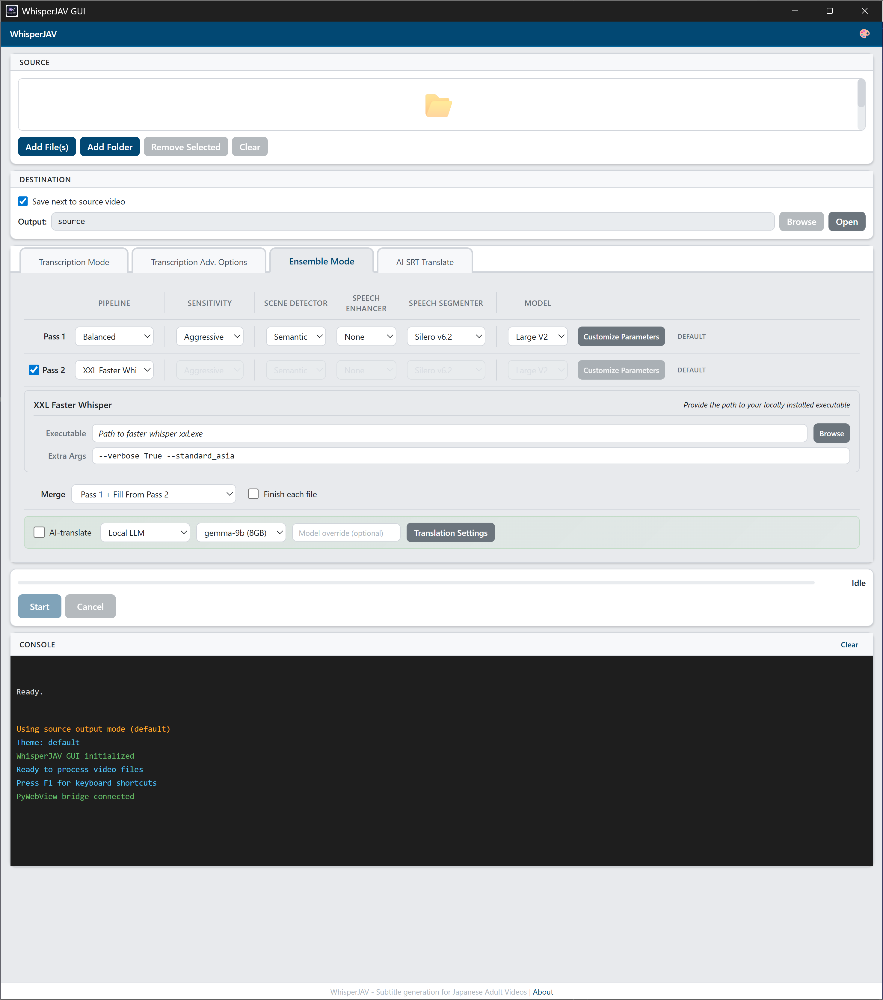
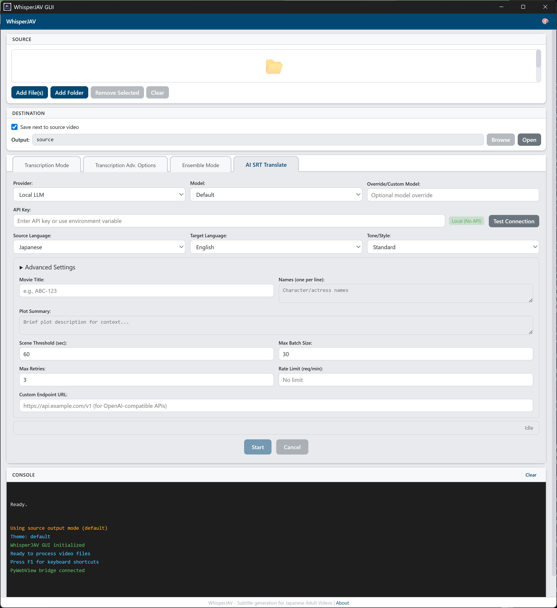
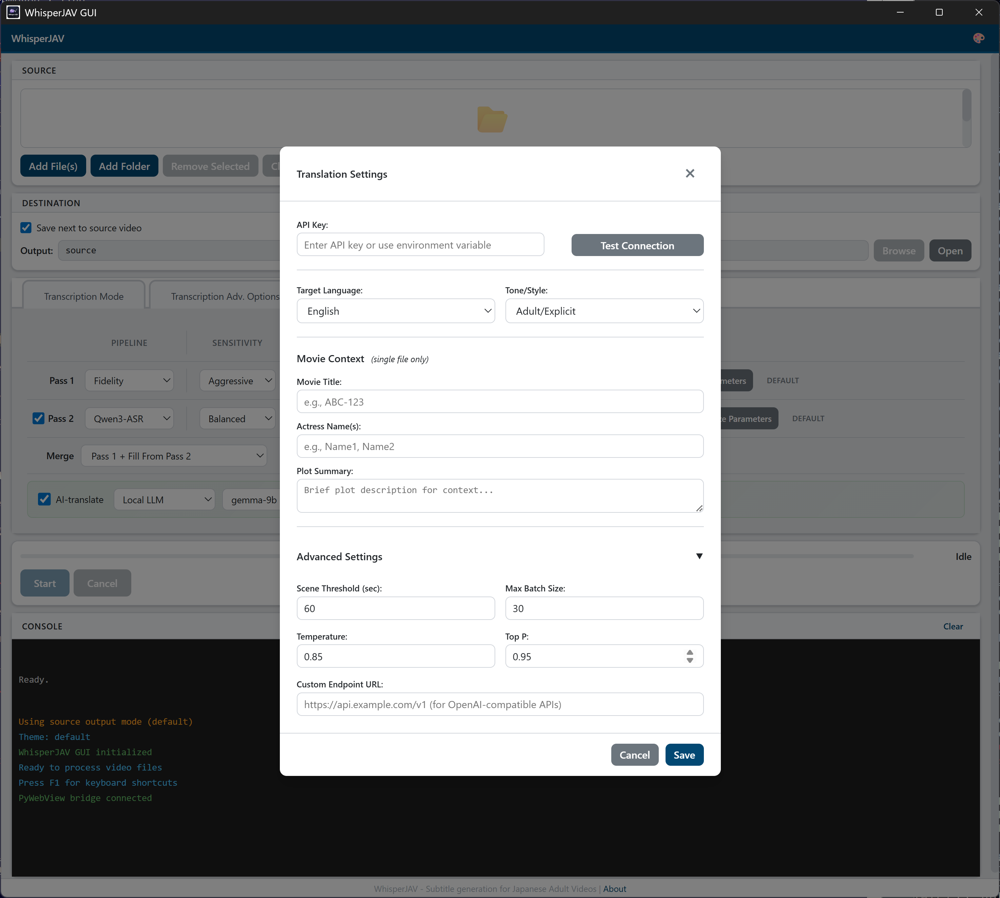

# WhisperJAV Documentation（中文站离线抓取）

- 来源：https://meizhong986.github.io/WhisperJAV/zh/
- 抓取日期：2026-10-16
- 页面数：38（成功 38，失败 0）
- 图片：10 张已下载到 `images/`（失败 0），文档中的图片引用已改为本地相对路径
- 说明：中文站仅首页已完成翻译，其余页面由站点自动回退显示英文原版，本文件按站点实际内容原样保存。目录条目为离线锚点，点击跳转到本文件中的对应章节；每节末尾有「返回目录」链接，节首注释里保留原始在线地址。

<a id="toc"></a>

## 目录（离线锚点）

- [Home](#page-home)
- [Getting Started](#page-getting-started)
- [Windows (Installer)](#page-guides-installation-windows-standalone)
- [Windows (Python)](#page-guides-installation-windows-python)
- [macOS (Apple Silicon)](#page-guides-installation-mac-apple-silicon)
- [Linux](#page-guides-installation-linux)
- [User Guide](#page-user-guide)
- [GUI Walkthrough](#page-guides-gui-user-guide)
- [Common Workflows](#page-user-guide-workflows)
- [CLI Reference](#page-user-guide-cli-reference)
- [Output Formats](#page-user-guide-output-formats)
- [Translation](#page-user-guide-translation)
- [Pipelines](#page-pipelines)
- [Ensemble Mode](#page-pipelines-ensemble)
- [ChronosJAV](#page-pipelines-chronosjav)
- [Qwen3-ASR](#page-pipelines-qwen3-asr)
- [CrispASR](#page-pipelines-crispasr)
- [升级指南](#page-upgrade)
- [Troubleshooting](#page-upgrade-troubleshooting)
- [Manual Rollback](#page-manual-rollback)
- [FAQ](#page-faq)
- [Developer](#page-developer)
- [ADR-001 YAML Config](#page-adr-adr-001-yaml-config-architecture)
- [ADR-002 Batched Pipeline](#page-adr-adr-002-batched-transcription-pipeline)
- [ADR-003 Qwen3 Integration](#page-architecture-adr-003-qwen3-asr-integration)
- [ADR-004 Dedicated Qwen Pipeline](#page-architecture-adr-004-dedicated-qwen-pipeline)
- [Module Contracts](#page-architecture-module-contracts)
- [Config Sources Hierarchy](#page-architecture-config-sources-hierarchy)
- [Semantic Segmenter Audit](#page-architecture-semantic-segmenter-audit-and-remediation)
- [WhisperSeg Tradeoff Analysis](#page-architecture-whisperseg-tradeoff-analysis-and-recommendation)
- [WhisperSeg Tradeoff Info Pack](#page-architecture-whisperseg-tradeoff-info-pack)
- [Changelog v1.9.2](#page-changelog-v1-9-2)
- [Changelog v1.9.3](#page-changelog-v1-9-3)
- [Translation Glossary](#page-translation-glossary)
- [Release v1.8.12 Merge Guide](#page-release-v1-8-12-merge-guide)
- [Release v1.8.13 Reply Drafts](#page-release-v1-8-13-reply-drafts)
- [Release v1.8.13 Step6 Guide](#page-release-v1-8-13-step6-guide)
- [Measurements v1.9.4 REQ1/REQ2](#page-measurements-v1-9-4-measurements-v194-req1-req2)


---

<a id="page-home"></a>

<!-- source: https://meizhong986.github.io/WhisperJAV/zh/ -->

# WhisperJAV

**日本成人视频 AI 字幕生成器**

WhisperJAV 是一款开源工具，利用 OpenAI Whisper 及其他语音识别模型从视频和音频文件中生成精准的日语字幕，并针对日语语言处理进行了专门优化。

---

> **翻译进行中**
> 
> 中文文档正在建设中。目前仅首页已翻译，其他页面将自动显示英文原版。
> 
> 欢迎在 [GitHub](https://github.com/meizhong986/whisperjav/issues) 上协助改进翻译。

---

## 快速入门

### 1\. 安装

**Windows（安装程序）**

从 [最新发布页面](https://github.com/meizhong986/whisperjav/releases/latest) 下载 `WhisperJAV-x.x.x-Windows-x86_64.exe`，运行即可——无需管理员权限。

[完整 Windows 安装指南](guides/installation_windows_standalone/)

**Windows（Python）**

```

git clone https://github.com/meizhong986/whisperjav.git
cd whisperjav
installer\install_windows.bat

```

[完整 Python 安装指南](guides/installation_windows_python/)

**macOS**

```

git clone https://github.com/meizhong986/whisperjav.git
cd whisperjav
python3 -m venv ~/venvs/whisperjav
source ~/venvs/whisperjav/bin/activate
./installer/install_mac.sh

```

[完整 macOS 指南](guides/installation_mac_apple_silicon/)

**Linux**

```

git clone https://github.com/meizhong986/whisperjav.git
cd whisperjav
./installer/install_linux.sh

```

[完整 Linux 指南](guides/installation_linux/)

### 2\. 启动 GUI

```

whisperjav-gui

```

或使用桌面快捷方式（Windows 安装程序）。

### 3\. 转录

1.  将视频拖入应用
2.  点击 **Start**
3.  SRT 字幕文件将生成在视频旁边

就这么简单。如需更多控制，请参阅 [GUI 用户指南](guides/gui_user_guide/)。

---

## 功能一览

| 功能 | 说明 |
| --- | --- |
| **多处理管线** | Balanced、Fast、Faster、Fidelity、Transformers——在速度与精度间权衡 |
| **集成模式** | 使用两个不同后端进行双重处理，合并获得最佳结果 |
| **BYOP XXL** | 自带管线——在集成模式 Pass 2 中使用 Faster Whisper XXL |
| **ChronosJAV** | 专用管线，搭配 anime-whisper 和 Kotoba 模型，适合动漫/JAV 内容 |
| **Qwen3-ASR** | 替代语音识别引擎，日语表现出色 |
| **AI 翻译** | 使用 Ollama、DeepSeek、Gemini、Claude、GPT 或本地大语言模型翻译字幕 |
| **语音增强** | ClearVoice 降噪、BS-RoFormer 人声分离、FFmpeg DSP 链 |
| **场景检测** | Auditok、Silero、Semantic——分割长音频以提高准确度 |
| **GUI + CLI** | 功能完整的 GUI 用于交互操作，CLI 用于自动化和脚本 |

---

## 最新动态

请查看 [最新发布说明](https://github.com/meizhong986/whisperjav/releases/latest) 了解当前版本的更新内容。

---

## 获取帮助

-   [常见问题](faq/) — 常见问题解答
-   [升级故障排除](UPGRADE_TROUBLESHOOTING/) — 解决升级问题
-   [GitHub Issues](https://github.com/meizhong986/whisperjav/issues) — 错误报告和功能请求

[↑ 返回目录](#toc)


---

<a id="page-getting-started"></a>

<!-- source: https://meizhong986.github.io/WhisperJAV/zh/getting-started/ -->

# 快速入门

WhisperJAV 可在 Windows、macOS 和 Linux 上运行。请根据你的环境选择合适的安装方式。

## 我应该选择哪种安装方式？

| 如果你... | 请使用 |
| --- | --- |
| 只想在 Windows 上开箱即用 | [Windows 独立安装程序](../guides/installation_windows_standalone/) |
| 自行管理 Python 环境 | [Windows Python 安装](../guides/installation_windows_python/) |
| 使用 Apple Silicon Mac | [macOS 指南](../guides/installation_mac_apple_silicon/) |
| 使用 Linux（Ubuntu、Fedora、Arch） | [Linux 指南](../guides/installation_linux/) |
| 使用 Google Colab 或 Kaggle | 参见仓库中的 notebook |

## 系统要求

| 组件 | 最低要求 | 推荐配置 |
| --- | --- | --- |
| **Python** | 3.10 | 3.12 |
| **GPU** | 无（CPU 可用） | NVIDIA 显卡，6GB+ 显存 |
| **内存** | 8 GB | 16 GB |
| **磁盘** | 5 GB | 10 GB（含模型） |
| **FFmpeg** | 必需 | 安装程序已内置 |

## GPU 支持

| GPU | 加速支持 | 备注 |
| --- | --- | --- |
| NVIDIA (CUDA) | 完整支持 | 性能最佳。需要驱动版本 450+。 |
| Apple Silicon (MPS) | 部分支持 | 仅 Transformers 模式可用，其他模式回退至 CPU。 |
| AMD (ROCm) | 不支持 | 请使用 CPU 模式 |
| Intel (oneAPI) | 不支持 | 请使用 CPU 模式 |
| 无 GPU | CPU 模式 | 可以运行，但速度明显较慢 |

安装完成后，使用 `whisperjav-gui` 启动图形界面，然后参照 [GUI 用户指南](../guides/gui_user_guide/) 开始使用。

[↑ 返回目录](#toc)


---

<a id="page-guides-installation-windows-standalone"></a>

<!-- source: https://meizhong986.github.io/WhisperJAV/zh/guides/installation_windows_standalone/ -->

# WhisperJAV Windows 独立安装程序安装指南

**版本：** 1.8.9 **最后更新：** 2026-03-19 **安装程序类型：** 独立 .exe（无需管理员权限）

---

## 系统要求

### 最低要求

| 组件 | 要求 |
| --- | --- |
| 操作系统 | Windows 10（64 位）或 Windows 11 |
| 内存 | 8 GB |
| 可用磁盘空间 | 8 GB（安装 + AI 模型 + 缓存） |
| 网络 | 安装过程中需要联网以下载依赖项 |
| 运行时 | Microsoft Edge WebView2（安装程序会在缺失时提示安装） |

### 推荐配置（最佳性能）

| 组件 | 推荐 |
| --- | --- |
| GPU | NVIDIA GPU，6+ GB 显存（RTX 2060 或更好） |
| GPU 驱动程序 | NVIDIA 驱动程序 570+（支持 CUDA 12.8） |
| 内存 | 16 GB |
| 存储 | SSD（处理速度显著提升） |
| 网络 | 宽带连接（用于首次下载模型） |

### GPU 兼容性

WhisperJAV 使用 NVIDIA CUDA 进行 GPU 加速转录。安装程序会自动检测您的 GPU 并安装相应版本：

| 您的 NVIDIA 驱动程序版本 | 安装的 CUDA 版本 | 兼容的 GPU |
| --- | --- | --- |
| 570 或更新 | CUDA 12.8（最优） | RTX 20xx、30xx、40xx、50xx 系列 |
| 450 - 569 | CUDA 11.8（通用） | 所有支持 CUDA 的 NVIDIA GPU |
| 无 NVIDIA GPU | 仅 CPU（较慢） | 任何系统（比 GPU 慢 6-10 倍） |

如果您没有 NVIDIA GPU，WhisperJAV 仍然可以在纯 CPU 模式下工作。处理速度会较慢（每小时视频大约需要 30-60 分钟，而使用 GPU 仅需 5-10 分钟）。

### 支持的 NVIDIA GPU

-   **GeForce：** GTX 1060+、RTX 2060+、RTX 3060+、RTX 4060+、RTX 5070+
-   **Quadro / RTX Professional：** Quadro RTX、RTX A 系列
-   **数据中心：** T4、A10、A100、H100、B100

---

## 安装前准备

### 1\. 更新 NVIDIA 驱动程序（推荐）

为获得最佳性能，请将 NVIDIA 驱动程序更新至 570 或更新版本：

1.  访问 [nvidia.com/drivers](https://www.nvidia.com/drivers)
2.  选择您的 GPU 型号
3.  下载并安装最新的 "Game Ready" 或 "Studio" 驱动程序
4.  安装后重启计算机

您可以通过以下方式检查当前驱动程序版本： - 右键点击桌面，选择"NVIDIA 控制面板" - 查看左下角的"驱动程序版本"

### 2\. 确认 WebView2 已安装

WhisperJAV 使用 Microsoft Edge WebView2 作为图形界面。大多数 Windows 10 和 11 系统已预装此组件。如果您不确定，安装程序会自动检查并在需要时提供下载链接。

手动检查方法： 1. 打开 Windows 设置中的"添加或删除程序" 2. 搜索 "WebView2" 3. 如果显示 "Microsoft Edge WebView2 Runtime"，说明已就绪

如未安装，请从以下地址下载： [https://go.microsoft.com/fwlink/p/?LinkId=2124703](https://go.microsoft.com/fwlink/p/?LinkId=2124703)

### 3\. 释放磁盘空间

确保 WhisperJAV 安装目标磁盘至少有 8 GB 可用空间。空间大致分配如下：

| 组件 | 大小 |
| --- | --- |
| 基础安装（Python + conda） | ~500 MB |
| 包含 CUDA 的 PyTorch | ~2.5 GB |
| Python 依赖项 | ~1.5 GB |
| AI 模型（首次使用时下载） | ~3 GB |
| **合计** | **~7.5 GB** |

### 4\. 临时排除杀毒软件（如有需要）

部分杀毒软件可能会标记安装程序或安装后的下载内容。如果遇到问题：

1.  临时禁用实时扫描，或
2.  为 `%LOCALAPPDATA%\WhisperJAV` 添加排除规则

---

## 安装步骤

### 步骤 1：下载安装程序

从 [GitHub Releases 页面](https://github.com/meizhong986/whisperjav/releases) 下载 `WhisperJAV-1.8.9-Windows-x86_64.exe`。

安装程序文件大小约为 150 MB。

### 步骤 2：运行安装程序

双击下载的 `.exe` 文件。**不需要**以管理员身份运行。

如果 Windows SmartScreen 显示警告： 1. 点击"更多信息" 2. 点击"仍要运行"

### 步骤 3：接受许可协议

阅读并接受 MIT 许可协议以继续。

### 步骤 4：选择安装类型

-   **仅为当前用户安装（推荐）：** 仅为当前用户安装，无需管理员权限。
-   **为所有用户安装：** 为计算机上的所有用户安装，需要管理员权限。

### 步骤 5：选择安装位置

默认安装位置为：

```

C:\Users\[用户名]\AppData\Local\WhisperJAV

```

您可以更改为任意位置。请注意以下建议： - 尽量避免路径中包含空格（例如 "Program Files"） - 除非已启用长路径支持，否则避免路径超过 46 个字符 - 避免路径中包含特殊字符（重音字母、中日韩字符）

### 步骤 6：安装选项

安装程序将显示可选设置： - **添加到 PATH：** 默认启用。允许从命令行运行 `whisperjav`，并支持后续通过 `whisperjav-upgrade` 进行升级。 - **创建快捷方式：** 在桌面创建快捷方式以便快速访问。

点击"安装"开始。

### 步骤 7：安装后配置（自动执行）

基础环境解压完成后，安装后脚本会自动运行。这是安装过程中耗时最长的部分。一个控制台窗口将显示进度：

#### 阶段 1：预检（< 1 分钟）

-   磁盘空间验证（最低 8 GB）
-   网络连接检查（到 PyPI）
-   Visual C++ Redistributable 检查（缺失时自动安装）
-   WebView2 运行时检查（缺失时提示下载）

#### 阶段 2：GPU 检测（< 1 分钟）

-   检测 NVIDIA GPU 及驱动程序版本
-   选择适当的 CUDA 版本

#### 阶段 3：PyTorch 安装（3-5 分钟）

-   下载并安装包含 CUDA 支持的 PyTorch（~2.5 GB）
-   如果未检测到 GPU，系统将询问是否安装仅 CPU 版本的 PyTorch

#### 阶段 3.5：核心 Whisper 包（2-3 分钟）

-   安装 OpenAI Whisper、Stable-TS、FFmpeg-Python（来自 GitHub）
-   这些包使用 git，对于防火墙后的用户可能触发 Git 超时处理

#### 阶段 4：Python 依赖项（3-5 分钟）

-   从需求文件安装所有剩余 Python 包
-   约 500 MB 的下载量

#### 阶段 5：WhisperJAV 应用程序（< 1 分钟）

-   从捆绑的 wheel 包安装 WhisperJAV 应用程序

#### 阶段 5.3：本地大语言模型翻译（可选，交互式）

-   系统将提示安装本地大语言模型以进行离线翻译
-   输入 "Y" 安装（推荐）或 "N" 跳过
-   如果 30 秒内未响应，默认选择 "Y"
-   如果现在跳过，之后仍可安装

#### 阶段 5.5-5.8：启动器和图标设置（< 1 分钟）

-   在安装目录中创建 `WhisperJAV-GUI.exe` 启动器
-   验证图标文件

所有阶段完成后，桌面上将创建名为 "WhisperJAV v1.8.9" 的快捷方式。

### 步骤 8：完成

安装摘要将显示： - 安装目录 - Python 版本 - PyTorch 版本和 CUDA 状态 - WebView2 状态 - 安装耗时

按 Enter 关闭安装程序窗口。

**总安装时间：** 根据网速和硬件情况，约 10-20 分钟。

---

## 首次运行体验

### 启动 WhisperJAV

双击桌面上的 **"WhisperJAV v1.8.9"** 快捷方式。或者，双击安装目录中的 `WhisperJAV-GUI.exe`。

### 首次转录：AI 模型下载

首次处理视频时，WhisperJAV 需要下载 AI 模型。这是一次性操作：

| 模型 | 大小 | 下载时间 |
| --- | --- | --- |
| Whisper Large-v3 | ~3 GB | 5-10 分钟 |

下载进度将在 GUI 中显示。初次下载后，模型将缓存在本地，无需再次下载。

模型存储位置：

```

C:\Users\[用户名]\.cache\whisper\

```

### 基本工作流程

1.  **添加文件：** 点击 "Add File(s)" 或拖放视频/音频文件
2.  **选择模式：** 选择 "Balanced" 获得最佳质量，选择 "Faster" 获得更快速度
3.  **开始处理：** 点击 "Start"
4.  **找到字幕：** 输出的 SRT 文件保存在输入文件旁边的 `_output` 文件夹中

---

## 验证安装

### 检查 GPU 加速

安装完成后，从安装目录打开命令提示符并运行：

```

python -c "import torch; print(f'CUDA available: {torch.cuda.is_available()}'); print(f'GPU: {torch.cuda.get_device_name(0) if torch.cuda.is_available() else \"None\"}')"

```

GPU 系统的预期输出：

```

CUDA available: True
GPU: NVIDIA GeForce RTX 4070

```

### 检查 WhisperJAV 版本

```

python -c "from whisperjav.__version__ import __version__; print(f'WhisperJAV {__version__}')"

```

预期输出：

```

WhisperJAV 1.8.9

```

### 检查安装日志

安装日志位于：

```

[安装目录]\install_log_v1.8.9.txt

```

此文件包含安装过程中每个步骤的详细信息，对于诊断问题非常有用。

---

## 从旧版本升级

### 自动升级检测

如果将 WhisperJAV v1.8.9 安装到与旧版本相同的目录，安装程序将：

1.  检测现有的 WhisperJAV 安装
2.  询问是否要替换
3.  确认后，将在安装前干净地删除旧版本

升级期间，`%APPDATA%\WhisperJAV` 中的用户配置将被保留。

### 通过 pip 手动升级

如果已启用 PATH（默认设置），无需重新下载安装程序即可升级：

```

whisperjav-upgrade

```

**请勿使用普通的 `pip install -U whisperjav...` 升级。** 在 Windows 上，PyPI 只提供**仅 CPU** 版的 PyTorch；CUDA 版只在 `download.pytorch.org` 上提供。因此，任何涉及 PyTorch 的依赖解析都会悄悄地把您的 GPU 版替换为 CPU 版。同一命令还会改动其他已固定版本的包。`whisperjav-upgrade` 会传入保护 GPU 相关包的约束条件。

### 保留配置

用户设置存储在：

```

%APPDATA%\WhisperJAV\whisperjav_config.json

```

此文件在升级或重新安装时不会被删除。如果您从 v1.8.0 之前的版本升级，安装程序将自动从旧位置迁移您的配置。

---

## 卸载

### 方法 1：Windows 设置（推荐）

1.  打开 Windows 设置 > 应用 > 应用和功能
2.  搜索 "WhisperJAV"
3.  点击"卸载"
4.  按提示操作

### 方法 2：卸载脚本

运行安装目录中的 `uninstall_v1.8.9.bat` 文件。此交互式脚本将：

1.  删除桌面快捷方式
2.  删除开始菜单快捷方式
3.  询问是否删除用户配置文件
4.  询问是否删除缓存的 AI 模型（~3 GB）
5.  删除安装目录

### 方法 3：手动删除

1.  **删除安装目录：**
    
    ```
    
    %LOCALAPPDATA%\WhisperJAV
    
    ```
    
    （或您自定义的安装位置）
    
2.  **删除桌面快捷方式：**
    
    ```
    
    %USERPROFILE%\Desktop\WhisperJAV v1.8.9.lnk
    
    ```
    
3.  **（可选）删除缓存的 AI 模型**以释放约 3 GB 空间：
    
    ```
    
    %USERPROFILE%\.cache\whisper
    
    ```
    
4.  **（可选）删除用户配置：**
    
    ```
    
    %APPDATA%\WhisperJAV
    
    ```
    
5.  **（可选）清理 PATH 条目：** 如果安装时启用了 "Add to PATH"，请从用户 PATH 中删除以下条目：
    
6.  `[安装目录]\Scripts`
7.  `[安装目录]\Library\bin`

---

## 故障排除

### 安装问题

#### "NVIDIA driver not found" 或 "No NVIDIA GPU detected"

**原因：** 未安装 NVIDIA GPU，或驱动程序未安装/版本过旧。

**解决方案：** - 如果您有 NVIDIA GPU，请从 [nvidia.com/drivers](https://www.nvidia.com/drivers) 下载并安装最新驱动程序 - 如果没有 NVIDIA GPU，在提示时接受仅 CPU 安装。处理速度会较慢但功能完全正常。

#### "WebView2 runtime not detected"

**原因：** 未安装 Microsoft Edge WebView2。图形界面需要此组件。

**解决方案：** 1. 安装程序将自动打开下载页面 2. 从 [Microsoft](https://go.microsoft.com/fwlink/p/?LinkId=2124703) 下载并安装 "Evergreen Standalone Installer" 3. 安装完成后，在安装程序窗口中按 Enter 继续

#### "Network connection failed"

**原因：** 无网络连接或防火墙阻止下载。

**解决方案：** - 检查网络连接 - 临时禁用 VPN 或代理 - 检查防火墙设置：允许 `python.exe`、`pip.exe`、`git.exe` 和 `uv.exe` 访问网络 - 如果在企业防火墙后，请联系 IT 部门

#### "Git connection timeout" 或 "Failed to connect to github.com"

**原因：** GitHub 被屏蔽或访问缓慢（在中国大陆防火墙后或某些 VPN 配置下常见）。

**解决方案：** - 安装程序会自动检测并配置延长的 Git 超时时间 - 等待自动重试（最多 3 次） - 如果重试失败，请尝试： - 切换到不同的 VPN 节点 - 使用 GitHub 镜像/代理 - 在网络拥堵较低的时段运行安装程序

#### "Out of disk space"

**原因：** 安装目标磁盘可用空间不足 8 GB。

**解决方案：** - 释放磁盘空间后重新运行安装程序 - 选择空间更大的其他磁盘 - 注意 AI 模型（首次使用时下载）还需要约 3 GB

#### "Installation failed after retries"

**解决方案：** 1. 检查安装目录中的 `install_log_v1.8.9.txt` 获取具体错误信息 2. 常见原因： - 杀毒软件阻止下载：为安装目录添加排除规则 - 网络超时：使用更好的网络连接重试 - 下载损坏：删除安装目录后重新开始 3. 尝试以管理员身份运行安装程序（右键 > 以管理员身份运行）

#### "Post-install script failed"

**原因：** 自动化包安装阶段发生错误。

**解决方案：** 1. 检查 `install_log_v1.8.9.txt` 确定失败的具体阶段 2. 如果在 PyTorch 安装阶段失败：检查 GPU 驱动程序版本 3. 如果在依赖项安装阶段失败：检查网络连接 4. 重新运行安装程序；它会检测到现有的不完整安装并提供替换选项

### 运行时问题

#### "GUI 无法启动"或出现空白窗口

**解决方案：** 1. 确认 WebView2 已安装（见上文） 2. 尝试从命令行启动以查看错误信息：

```

cd %LOCALAPPDATA%\WhisperJAV
python.exe -m whisperjav.webview_gui.main

```

3\. 检查杀毒软件是否阻止了应用程序

#### 处理速度非常慢

**解决方案：** 1. 查看处理开始时的控制台输出，确认是否已启用 GPU 加速 2. 如果显示 "CPU-only mode"，说明 GPU 未被使用 3. 验证 CUDA 安装：`python -c "import torch; print(torch.cuda.is_available())"` 4. 关闭其他占用 GPU 的应用程序（游戏、视频编辑器） 5. 使用 "Faster" 模式以牺牲部分精度换取更快的结果

#### "Model download stuck"

**解决方案：** - 大型模型（约 3 GB）根据网络状况需要 5-20 分钟下载 - 下载中断后可以恢复 - 如果卡住超过 30 分钟，请取消并检查网络连接 - 模型缓存在 `%USERPROFILE%\.cache\whisper\`

#### 处理过程中应用程序崩溃

**解决方案：** 1. 确保有足够内存（大型模型推荐 16 GB） 2. 尝试一次只处理一个文件 3. 使用较小的 Whisper 模型（例如 "medium" 代替 "large-v3"） 4. 查看 GUI 控制台中的错误信息 5. 在 [GitHub Issues](https://github.com/meizhong986/whisperjav/issues) 报告持续崩溃的问题

---

## 静默安装/无人值守安装

安装程序支持命令行选项以进行自动化部署：

```

WhisperJAV-1.8.9-Windows-x86_64.exe /S /D=C:\WhisperJAV

```

### 可用选项

| 选项 | 说明 | 默认值 |
| --- | --- | --- |
| `/S` | 静默模式（无 GUI） | 关闭 |
| `/Q` | 安静模式（抑制控制台输出） | 关闭 |
| `/D=<路径>` | 安装目录（必须是最后一个参数） | `%LOCALAPPDATA%\WhisperJAV` |
| `/InstallationType=AllUsers` | 为所有用户安装（需要管理员权限） | JustMe |
| `/AddToPath=0` 或 `1` | 添加到系统 PATH | 1（启用） |
| `/NoShortcuts=0` 或 `1` | 跳过快捷方式创建 | 0（创建快捷方式） |
| `/InstallLocalLLM=0` 或 `1` | 安装本地大语言模型翻译 | 提示选择 |
| `/NoRegistry=0` 或 `1` | 跳过注册表条目 | 0 |
| `/?` | 显示帮助 | \-- |

### 示例

静默安装到自定义目录：

```

cmd /C START /WAIT WhisperJAV-1.8.9-Windows-x86_64.exe /S /D=D:\WhisperJAV

```

静默安装，跳过本地大语言模型，不修改 PATH：

```

cmd /C START /WAIT WhisperJAV-1.8.9-Windows-x86_64.exe /S /AddToPath=0 /InstallLocalLLM=0

```

---

## 常见问题

### 问：需要 NVIDIA GPU 吗？

**答：** 不需要。WhisperJAV 可以在任何 Windows 10/11 系统上运行。没有 NVIDIA GPU 时将以纯 CPU 模式运行，速度约慢 6-10 倍。偶尔使用的话，CPU 模式完全可以胜任。如果经常使用或处理长视频，强烈推荐使用 NVIDIA GPU。

### 问：需要多少磁盘空间？

**答：** 总共约 8 GB：约 4.5 GB 用于安装，约 3 GB 用于 AI 模型（首次使用时下载）。如果还安装了用于翻译的本地大语言模型，则额外需要约 4-8 GB。

### 问：可以安装到网络驱动器吗？

**答：** 不推荐。WhisperJAV 需要快速的磁盘访问来处理临时文件和加载模型。建议安装到本地 SSD 以获得最佳体验。

### 问：我的数据会被发送到网络吗？

**答：** 不会。所有转录都在您的计算机本地完成。仅在安装期间（下载包）和首次运行时（下载 AI 模型）需要联网。之后，WhisperJAV 可以完全离线工作。唯一的例外是如果您使用云端翻译提供商（DeepSeek、Gemini 等），它们需要 API 密钥并会将字幕文本发送到这些服务。

### 问：可以与其他 Python 安装并存吗？

**答：** 可以。WhisperJAV 安装了自己独立的 Python 环境，不会干扰系统上现有的任何 Python 安装。

### 问：如何更新到新版本？

**答：** 下载并运行新的安装程序。如果安装到同一目录，安装程序会检测到旧版本并提供替换选项。您的用户设置会被保留。或者，如果已启用 PATH，可以运行 `whisperjav-upgrade`，它在升级时会保护您的 GPU 版 PyTorch。请勿使用普通的 `pip install -U whisperjav...`：在 Windows 上，PyPI 只提供仅 CPU 版的 PyTorch，可能会悄悄替换掉您的 GPU 版本。

### 问：支持哪些视频格式？

**答：** WhisperJAV 支持 FFmpeg 能读取的所有格式，涵盖几乎所有常见的视频和音频格式：MP4、MKV、AVI、MOV、WMV、FLV、WebM、MP3、WAV、FLAC、AAC、OGG 等。

### 问：字幕文件保存在哪里？

**答：** 字幕文件（SRT 格式）保存在输入视频文件旁边的 `_output` 子文件夹中。例如，如果视频位于 `D:\Videos\movie.mp4`，字幕将位于 `D:\Videos\movie_output\movie.srt`。

### 问：安装程序卡在 "Extracting packages"

**答：** 此阶段解压 conda 包，根据磁盘速度可能需要 2-5 分钟。虽然看起来可能像是卡住了，但实际上正在工作。可以通过任务管理器查看磁盘活动来确认。

### 问：安装完成后可以移动安装目录吗？

**答：** 不可以。移动安装目录会破坏内部路径。如果需要更改位置，请卸载后重新安装到新位置。

### 问：安装时的"本地大语言模型"选项是什么？

**答：** 这会安装 llama-cpp-python，使您能够使用计算机上的本地 AI 模型翻译字幕，无需 API 密钥或网络连接。它需要额外的磁盘空间（4-8 GB），配合 NVIDIA GPU 效果最佳。安装时可以跳过，之后需要时再添加。

### 问：我在企业防火墙/中国大陆防火墙后

**答：** 安装程序内置了对 GitHub 慢速或被屏蔽连接的检测和处理机制。它会自动配置延长的超时时间并重试失败的下载。如果安装仍然失败，请尝试使用能够访问 github.com 和 pypi.org 的 VPN 或代理。

---

## 技术详情

### 安装目录结构

安装完成后，目录结构如下：

```

%LOCALAPPDATA%\WhisperJAV\
    python.exe                    # Python 解释器
    pythonw.exe                   # Python（无控制台窗口）
    WhisperJAV-GUI.exe            # GUI 启动器
    whisperjav_icon.ico           # 应用程序图标
    install_log_v1.8.9.txt        # 安装日志
    uninstall_v1.8.9.bat          # 卸载脚本
    Lib\                          # Python 标准库
        site-packages\
            whisperjav\           # WhisperJAV 应用程序代码
            torch\                # PyTorch
            ...
    Scripts\                      # 可执行脚本
        whisperjav.exe            # CLI 入口点
        whisperjav-gui.exe        # GUI 入口点
        whisperjav-translate.exe  # 翻译 CLI
        pip.exe                   # 包管理器
        ...
    Library\
        bin\                      # FFmpeg、git 及其他工具
            ffmpeg.exe
            git.exe
            ...

```

### 日志文件位置

| 日志 | 路径 | 用途 |
| --- | --- | --- |
| 安装日志 | `[安装目录]\install_log_v1.8.9.txt` | 详细安装进度 |
| 失败标记 | `[安装目录]\INSTALLATION_FAILED_v1.8.9.txt` | 仅在安装失败时创建 |
| 卸载日志 | `%TEMP%\whisperjav_uninstall_v1.8.9.txt` | 卸载详情 |

### 网络要求

安装期间需要能够访问以下域名：

| 域名 | 用途 |
| --- | --- |
| `pypi.org` | Python 包下载 |
| `files.pythonhosted.org` | Python 包文件 |
| `github.com` | 基于 Git 的包下载 |
| `download.pytorch.org` | PyTorch CUDA wheels |
| `huggingface.co` | AI 模型下载（首次运行时） |
| `aka.ms` | VC++ Redistributable（如需要） |
| `go.microsoft.com` | WebView2 运行时（如需要） |

---

## 支持

如果您遇到本指南未涵盖的问题：

1.  检查安装日志 `install_log_v1.8.9.txt`
2.  在 [GitHub Issues](https://github.com/meizhong986/whisperjav/issues) 搜索已有问题
3.  提交新 issue，请包含：
4.  您的 Windows 版本
5.  GPU 型号和驱动程序版本
6.  安装日志文件
7.  问题描述

[↑ 返回目录](#toc)


---

<a id="page-guides-installation-windows-python"></a>

<!-- source: https://meizhong986.github.io/WhisperJAV/zh/guides/installation_windows_python/ -->

# WhisperJAV v1.8.9 -- Windows 安装指南（Python 源码安装）

本指南面向有经验的 Python 开发者，介绍如何在 Windows 上从源码安装 WhisperJAV。如果您需要独立安装程序（无需 Python），请参阅 [Releases 页面](https://github.com/meizhong986/whisperjav/releases)。

---

## 1\. 前提条件

### 必需软件

| 软件 | 版本 | 用途 | 下载 |
| --- | --- | --- | --- |
| **Python** | 3.10、3.11 或 3.12 | 运行时 | [python.org](https://www.python.org/downloads/) |
| **Git** | 任意近期版本 | 克隆仓库、安装基于 git 的包 | [git-scm.com](https://git-scm.com/download/win) |
| **FFmpeg** | 推荐 6.x 或 7.x | 音视频处理 | [gyan.dev](https://www.gyan.dev/ffmpeg/builds/) |

### GPU 加速所需

| 软件 | 版本 | 用途 | 下载 |
| --- | --- | --- | --- |
| **NVIDIA GPU 驱动程序** | 450+（CUDA 11.8）或 570+（CUDA 12.8） | GPU 计算 | [nvidia.com](https://www.nvidia.com/Download/index.aspx) |
| **Visual C++ Redistributable** | 2015-2022 (x64) | 原生库支持 | [microsoft.com](https://aka.ms/vs/17/release/vc_redist.x64.exe) |

### GUI 所需

| 软件 | 版本 | 用途 | 下载 |
| --- | --- | --- | --- |
| **Microsoft Edge WebView2** | 任意版本 | GUI 渲染引擎 | [microsoft.com](https://go.microsoft.com/fwlink/p/?LinkId=2124703) |

### Python 版本兼容性

-   **Python 3.10-3.12：** 完全支持。
-   **Python 3.9：** 不支持（因 `pysubtrans` 依赖项已移除支持）。
-   **Python 3.13+：** 不支持（`openai-whisper` 无法在 3.13+ 上编译）。

### 验证前提条件

打开命令提示符或 PowerShell 并运行：

```

python --version
git --version
ffmpeg -version
nvidia-smi

```

四个命令都应正常输出结果。如果没有 NVIDIA GPU，`nvidia-smi` 命令会失败，这是正常的 -- WhisperJAV 支持纯 CPU 运行。

### 安装 FFmpeg

FFmpeg 不包含在 Python 中，必须单独安装：

1.  从 [gyan.dev](https://www.gyan.dev/ffmpeg/builds/) 下载 **essentials** 版本。
2.  解压归档文件（例如解压到 `C:\ffmpeg`）。
3.  将 `bin` 目录添加到系统 PATH：
4.  打开**系统属性** > **环境变量**
5.  在**系统变量**下，找到 **Path**，点击**编辑**
6.  点击**新建**，添加 `C:\ffmpeg\bin`
7.  点击**确定**关闭所有对话框
8.  打开新的命令提示符并验证：`ffmpeg -version`

或者，如果您使用包管理器：

```

REM 使用 Chocolatey：
choco install ffmpeg

REM 使用 Scoop：
scoop install ffmpeg

REM 使用 winget：
winget install --id=Gyan.FFmpeg -e

```

---

## 2\. 环境设置

**重要：** 请始终在虚拟环境或 conda 环境中安装 WhisperJAV。切勿安装到全局 Python。

### 选项 A：Python venv（推荐大多数用户使用）

```

REM 创建虚拟环境
python -m venv whisperjav-env

REM 激活（命令提示符）
whisperjav-env\Scripts\activate

REM 激活（PowerShell）
whisperjav-env\Scripts\Activate.ps1

REM 验证您在 venv 中（应显示 venv 路径）
where python

```

### 选项 B：Conda / Miniconda

```

REM 创建 Python 3.11 的 conda 环境
conda create -n whisperjav python=3.11 -y

REM 激活
conda activate whisperjav

REM 验证
python --version

```

### 选项 C：使用现有环境

如果您已有用于机器学习的虚拟环境（已安装 PyTorch），可以将 WhisperJAV 安装到其中。确保 PyTorch 是 CUDA 版本，而非纯 CPU 版本：

```

python -c "import torch; print(f'PyTorch {torch.__version__}, CUDA: {torch.cuda.is_available()}')"

```

如果输出 `CUDA: True`，可以跳过第 4 节中的 PyTorch 安装步骤。

---

## 3\. 安装（自动化）

自动化安装程序会处理 GPU 检测、CUDA 选择和分阶段包安装。

### 步骤 1：克隆仓库

```

git clone https://github.com/meizhong986/whisperjav.git
cd whisperjav

```

### 步骤 2：激活您的环境

```

REM venv：
whisperjav-env\Scripts\activate

REM conda：
conda activate whisperjav

```

### 步骤 3：运行安装程序

```

REM 标准安装（自动检测 GPU）
python install.py

REM 或使用批处理包装器：
installer\install_windows.bat

```

两个命令执行的操作相同。`.bat` 包装器只是定位并运行 `install.py`。

### 安装程序选项

```

--cpu-only              安装仅 CPU 版本的 PyTorch（无 CUDA）
--cuda118               安装用于 CUDA 11.8 的 PyTorch（驱动程序 450+）
--cuda128               安装用于 CUDA 12.8 的 PyTorch（驱动程序 570+，默认）
--no-speech-enhancement 跳过语音增强包（更快的安装）
--minimal               最小化安装（仅转录功能，无 GUI/翻译/增强）
--dev                   以开发/可编辑模式安装（pip install -e）
--local-llm             安装本地大语言模型翻译（预编译 wheel）
--local-llm-build       安装本地大语言模型翻译（从源码编译）
--no-local-llm          跳过本地大语言模型安装
--skip-preflight        跳过磁盘空间和网络检查
--help                  显示所有选项

```

### 常用调用方式

```

REM 标准安装（推荐）
python install.py

REM 强制使用 CUDA 11.8（较旧的 GPU 驱动程序）
python install.py --cuda118

REM 仅 CPU（无 NVIDIA GPU）
python install.py --cpu-only

REM 最小化安装，用于快速测试
python install.py --minimal

REM 开发者安装（可编辑模式）
python install.py --dev

REM 包含本地大语言模型的完整安装
python install.py --local-llm

REM 快速安装（跳过较慢的可选包）
python install.py --no-speech-enhancement --no-local-llm

```

### 安装程序执行的操作

安装程序按以下顺序执行：

1.  **预检** -- 验证磁盘空间（8GB 可用）、网络连接、WebView2、VC++ Redistributable
2.  **前提条件** -- 验证 Python 版本、FFmpeg、Git
3.  **GPU 检测** -- 识别 NVIDIA GPU 和驱动程序版本，选择 CUDA 版本
4.  **升级 pip** -- 将 pip 升级到最新版本
5.  **PyTorch** -- 使用正确的 CUDA 索引 URL 安装 `torch` 和 `torchaudio`
6.  **核心依赖项** -- numpy、scipy、numba、librosa、音频/字幕包
7.  **Whisper 包** -- openai-whisper（来自 GitHub）、stable-ts（自定义 fork）、faster-whisper
8.  **可选包** -- HuggingFace Transformers、Qwen3-ASR、翻译（pysubtrans、OpenAI、Gemini）、语音活动检测（Silero、TEN）、语音增强（ClearVoice、BS-RoFormer、ModelScope）
9.  **GUI 包** -- PyWebView、pythonnet、pywin32
10.  **WhisperJAV** -- 安装应用程序本身（使用 `--no-deps` 以保留分阶段环境）
11.  **验证** -- 导入 whisperjav 并检查 torch CUDA 状态

### 安装时间

| 配置 | 大致时间 | 备注 |
| --- | --- | --- |
| 完整安装（含 GPU） | 10-20 分钟 | 取决于网速 |
| 最小化安装 | 5-10 分钟 | 仅转录功能 |
| 仅 CPU | 10-15 分钟 | 稍快（无 CUDA wheels） |

日志文件保存在仓库根目录的 `install_log.txt` 中。

---

## 4\. 安装（手动）

如果您希望自行安装各个包，请按以下顺序执行。

### 步骤 1：升级 pip

```

python -m pip install --upgrade pip

```

### 步骤 2：安装包含 CUDA 的 PyTorch

此步骤至关重要。您必须从正确的索引 URL 安装 PyTorch 以获得 GPU 支持。

```

REM 用于 CUDA 12.8（驱动程序 570+，推荐用于新款 GPU）
pip install torch torchaudio --index-url https://download.pytorch.org/whl/cu128

REM 用于 CUDA 11.8（驱动程序 450+，通用回退方案）
pip install torch torchaudio --index-url https://download.pytorch.org/whl/cu118

REM 仅 CPU（无 NVIDIA GPU）
pip install torch torchaudio --index-url https://download.pytorch.org/whl/cpu

```

验证安装：

```

python -c "import torch; print(f'PyTorch {torch.__version__}'); print(f'CUDA available: {torch.cuda.is_available()}')"

```

如果显示 `CUDA available: True`，说明 GPU 加速已启用。

### 步骤 3：安装核心依赖项

```

REM 科学计算栈（numpy 必须在 numba 之前）
pip install "numpy>=2.0.0" "scipy>=1.13.0" "numba>=0.60.0"
pip install "librosa>=0.11.0" soundfile pydub pyloudnorm

REM 字幕处理
pip install pysrt srt

REM 工具库
pip install tqdm colorama requests aiofiles regex jsonschema
pip install "pydantic>=2.0,<3.0" "PyYAML>=6.0"

REM 语音活动检测
pip install "silero-vad>=6.2" auditok ten-vad

REM 性能
pip install "psutil>=5.9.0" "scikit-learn>=1.3.0"

```

### 步骤 4：安装 Whisper 包

这些包必须在 PyTorch 之后安装。它们依赖 `torch`，由于已安装了 CUDA 版本的 torch，pip 不会重新下载 CPU 版本。

```

REM OpenAI Whisper（main 分支以获取最新修复）
pip install git+https://github.com/openai/whisper@main

REM Stable-ts（用于日语的自定义 fork）
pip install git+https://github.com/meizhong986/stable-ts-fix-setup.git@main

REM ffmpeg-python（必须使用 git 版本，PyPI tarball 有构建问题）
pip install git+https://github.com/kkroening/ffmpeg-python.git

REM Faster-Whisper（CTranslate2 后端）
pip install "faster-whisper>=1.1.0"

```

### 步骤 5：安装可选包

仅安装您需要的 extras：

```

REM HuggingFace（Qwen3-ASR 和 kotoba-whisper 模型所需）
pip install "huggingface-hub>=0.25.0" "transformers>=4.40.0" "accelerate>=0.26.0" hf_xet

REM Qwen3-ASR（v1.8.9 新增，需要上述 HuggingFace 包）
pip install "qwen-asr>=0.0.6"

REM 翻译
pip install "pysubtrans>=1.5.0" "openai>=1.35.0" "google-genai>=1.39.0"

REM GUI（Windows）
pip install "pywebview>=5.0.0" "pythonnet>=3.0" "pywin32>=305"

REM 语音增强
pip install "modelscope>=1.20" oss2 addict "datasets>=2.14.0,<4.0" simplejson sortedcontainers packaging
pip install git+https://github.com/meizhong986/ClearerVoice-Studio.git#subdirectory=clearvoice
pip install bs-roformer-infer "onnxruntime>=1.16.0"

REM 兼容性（pyvideotrans 互操作）
pip install "av>=13.0.0" "imageio>=2.31.0" "imageio-ffmpeg>=0.4.9" "httpx>=0.27.0" "websockets>=13.0" "soxr>=0.3.0"

REM 分析/可视化
pip install matplotlib Pillow

```

### 步骤 6：安装 WhisperJAV

```

REM 标准安装（从本地源码，保留分阶段依赖项）
pip install --no-deps .

REM 或开发/可编辑模式
pip install --no-deps -e .

```

`--no-deps` 标志是必需的。如果不使用它，pip 会重新解析所有依赖项，可能将您的 CUDA 版 PyTorch 替换为 CPU 版本。

### 步骤 7：验证

```

python -c "import whisperjav; print(f'WhisperJAV {whisperjav.__version__}')"
whisperjav --help

```

---

## 5\. 仅安装特定 Extras

如果您只需要某些功能，可以仅安装对应的 extras。但由于 GPU 锁定要求，您应始终先手动安装 PyTorch（上述步骤 2），然后使用 `--no-deps`：

```

REM 错误做法：这会从 PyPI 拉取 CPU 版 PyTorch
pip install "whisperjav[cli]"

REM 正确做法：先安装 PyTorch，然后使用 no-deps 安装 WhisperJAV
pip install torch torchaudio --index-url https://download.pytorch.org/whl/cu128
pip install --no-deps -e "."
pip install "whisperjav[cli]" --no-deps

```

使用自动化安装程序的简洁方式，可以组合标志：

```

REM 最小化安装（仅转录功能，无 GUI/翻译/增强）
python install.py --minimal

REM 无语音增强（更快的安装）
python install.py --no-speech-enhancement

```

### 可用 Extras

| Extra | 内容 | 使用场景 |
| --- | --- | --- |
| `cli` | numpy、scipy、librosa、语音活动检测、scikit-learn | CLI 音频处理 |
| `gui` | pywebview、pythonnet、pywin32 | GUI 应用程序 |
| `translate` | pysubtrans、openai、google-genai | AI 字幕翻译 |
| `llm` | uvicorn、fastapi | 本地大语言模型服务器 |
| `enhance` | modelscope、clearvoice、bs-roformer | 语音增强 |
| `huggingface` | transformers、accelerate、hf\_xet | HuggingFace 模型支持 |
| `qwen` | qwen-asr（+ huggingface 依赖项） | Qwen3-ASR 处理管线（v1.8.9+） |
| `analysis` | matplotlib、Pillow | 可视化工具 |
| `compatibility` | av、imageio、httpx、websockets、soxr | pyvideotrans 互操作 |
| `dev` | pytest、ruff、pre-commit | 开发工具 |
| `all` | 以上全部 | 完整安装 |
| `colab` | cli + translate + huggingface | Google Colab |
| `windows` | 同 `all` | Windows 完整体验 |

---

## 6\. GPU 设置（CUDA）

### 确定您的 CUDA 版本

PyTorch 的 CUDA 版本取决于您的 NVIDIA 驱动程序版本，而非系统上安装的 CUDA Toolkit 版本。

```

REM 检查您的驱动程序版本
nvidia-smi

```

查看输出头部中的 "Driver Version"：

```

+---------------------------+
| NVIDIA-SMI 570.xx.xx      |   <-- 这是您的驱动程序版本
| Driver Version: 570.xx.xx |
| CUDA Version: 12.8        |   <-- 支持的最高 CUDA 版本
+---------------------------+

```

### 驱动程序到 CUDA 的映射

| 驱动程序版本 | 推荐的 `--index-url` | 标志 |
| --- | --- | --- |
| 570+ | `https://download.pytorch.org/whl/cu128` | `--cuda128`（默认） |
| 450-569 | `https://download.pytorch.org/whl/cu118` | `--cuda118` |
| 低于 450 | `https://download.pytorch.org/whl/cpu` | `--cpu-only` |

### 验证 CUDA 是否正常工作

安装完成后，验证 CUDA 是否可用：

```

python -c "
import torch
print(f'PyTorch version: {torch.__version__}')
print(f'CUDA available: {torch.cuda.is_available()}')
if torch.cuda.is_available():
    print(f'CUDA version: {torch.version.cuda}')
    print(f'GPU: {torch.cuda.get_device_name(0)}')
    print(f'GPU memory: {torch.cuda.get_device_properties(0).total_mem / 1024**3:.1f} GB')
"

```

### 切换 CUDA 版本

如果安装了错误的 CUDA 版本，请卸载后重新安装：

```

pip uninstall torch torchaudio -y
pip install torch torchaudio --index-url https://download.pytorch.org/whl/cu128

```

### CUDA Toolkit（通常不需要）

WhisperJAV 不需要单独安装 CUDA Toolkit。PyTorch 捆绑了自己的 CUDA 运行时。仅在从源码编译包时（例如 `--local-llm-build`）才需要 CUDA Toolkit。

如有需要：[CUDA Toolkit 下载](https://developer.nvidia.com/cuda-downloads)

---

## 7\. 运行 WhisperJAV

### CLI 使用

```

REM 基本转录
whisperjav video.mp4

REM 选择模式
whisperjav video.mp4 --mode balanced    # 完整处理管线（推荐）
whisperjav video.mp4 --mode fast        # 场景检测 + 标准 Whisper
whisperjav video.mp4 --mode faster      # 直接使用 Faster-Whisper（最快）

REM 设置灵敏度
whisperjav video.mp4 --mode balanced --sensitivity aggressive

REM 带翻译
whisperjav video.mp4 --translate

REM 使用 Qwen3-ASR 处理管线（v1.8.9 新增）
whisperjav video.mp4 --mode qwen --input-mode assembly

REM 处理整个目录
whisperjav /path/to/videos/ --mode balanced

REM 查看所有选项
whisperjav --help

```

### GUI 使用

```

REM 启动 GUI
whisperjav-gui

```

GUI 运行要求： - Microsoft Edge WebView2 运行时 - 已安装 `[gui]` extra（默认安装中已包含）

### 翻译 CLI

```

REM 翻译已有字幕
whisperjav-translate -i subtitles.srt

REM 查看翻译选项
whisperjav-translate --help

```

### 从源码运行（无需安装）

如果您正在开发且未运行 `pip install`：

```

python -m whisperjav.main video.mp4 --mode balanced
python -m whisperjav.webview_gui.main
python -m whisperjav.translate.cli -i subtitles.srt

```

---

## 8\. 更新到新版本

### 方法 1：Git Pull + 重新安装（开发模式）

如果以可编辑模式安装（`--dev`）：

```

cd whisperjav
git pull
pip install --no-deps -e .

```

这会更新到最新代码而无需重新下载依赖项。如果新版本添加了新的依赖项，可能需要单独安装或重新运行 `python install.py`。

### 方法 2：完整重新安装

```

cd whisperjav
git pull
python install.py

```

这会重新运行完整安装程序，按需升级各个包。

### 方法 3：升级命令（用于 pip 安装）

```

REM 仅升级 WhisperJAV（不更改依赖项）
pip install -U --no-deps git+https://github.com/meizhong986/whisperjav.git

REM 连同所有依赖项一起升级 -- 不建议在 GPU 安装上使用
REM 在 Windows 上，PyPI 只提供仅 CPU 版的 PyTorch（CUDA 版只在 download.pytorch.org 上），
REM 因此任何涉及 PyTorch 的依赖解析都会悄悄地把您的 GPU 版替换为 CPU 版。
REM 它还可能改动其他已固定版本的包。建议改用 "whisperjav-upgrade"，
REM 它会传入保护 GPU 相关包的约束条件。
pip install -U "whisperjav[all] @ git+https://github.com/meizhong986/whisperjav.git"

```

### 方法 4：内置升级工具

```

REM 检查更新
whisperjav-upgrade --check

REM 交互式升级
whisperjav-upgrade

REM 仅升级包，跳过依赖项
whisperjav-upgrade --wheel-only

```

---

## 9\. 环境变量

WhisperJAV 支持以下环境变量：

| 变量 | 默认值 | 说明 |
| --- | --- | --- |
| `WHISPERJAV_DEBUG` | `0` | 设为 `1` 启用 GUI 调试模式（DevTools） |
| `WHISPERJAV_NO_ICON` | `0` | 设为 `1` 跳过图标加载（调试渲染问题） |
| `WHISPERJAV_CACHE_DIR` | `.whisperjav_cache` | 元数据缓存目录 |
| `HF_HOME` | `~/.cache/huggingface` | HuggingFace 模型缓存位置 |
| `TORCH_HOME` | `~/.cache/torch` | PyTorch 模型缓存位置 |
| `CUDA_VISIBLE_DEVICES` | 所有 GPU | 限制使用特定 GPU（例如 `0`） |

### 设置环境变量（Windows）

```

REM 临时（仅当前会话）
set WHISPERJAV_DEBUG=1

REM 永久（PowerShell，用户范围）
[Environment]::SetEnvironmentVariable("WHISPERJAV_DEBUG", "1", "User")

```

---

## 10\. 故障排除

### PyTorch / CUDA 问题

**问题：`torch.cuda.is_available()` 返回 `False`**

原因和解决方案：

1.  **安装了错误的 PyTorch 版本（CPU 而非 CUDA）：**
    
    ```
    
    pip uninstall torch torchaudio -y
    pip install torch torchaudio --index-url https://download.pytorch.org/whl/cu128
    
    ```
    
2.  **驱动程序版本对于所选 CUDA 版本过旧：**
    
    ```
    
    REM 检查驱动程序版本
    nvidia-smi
    REM 如果驱动程序 < 570，使用 CUDA 11.8
    pip install torch torchaudio --index-url https://download.pytorch.org/whl/cu118
    
    ```
    
3.  **未安装 NVIDIA 驱动程序：** 从 [nvidia.com](https://www.nvidia.com/Download/index.aspx) 下载。
    

**问题：`RuntimeError: CUDA out of memory`**

-   WhisperJAV 的 large-v2 模型需要约 3-4 GB GPU 显存。
-   关闭其他占用 GPU 的应用程序。
-   尝试使用较小的模型：`whisperjav video.mp4 --model medium`
-   如果有多个 GPU，使用 `CUDA_VISIBLE_DEVICES=0`。

### pip / 包安装问题

**问题：`pip install` 失败并提示 "Could not build wheels"**

```

REM 升级 pip 和构建工具
pip install --upgrade pip setuptools wheel

REM 如需要，安装 Visual C++ Build Tools
REM 下载地址：https://visualstudio.microsoft.com/visual-cpp-build-tools/

```

**问题：依赖项冲突**

```

REM 在新 venv 中重新开始
deactivate
rmdir /s /q whisperjav-env
python -m venv whisperjav-env
whisperjav-env\Scripts\activate
python install.py

```

**问题：`pip install git+https://...` 超时失败**

这在防火墙或 VPN 后很常见。自动化安装程序会自动处理此问题，手动安装时：

```

REM 为 Git 配置延长超时
git config --global http.connectTimeout 120
git config --global http.timeout 300
git config --global http.postBuffer 524288000

REM 重试安装
pip install --timeout 120 git+https://github.com/openai/whisper@main

```

**问题：`numpy` / `numba` 导入错误**

当 numba 在 numpy 之前安装时会出现此问题：

```

pip uninstall numpy numba -y
pip install "numpy>=2.0.0"
pip install "numba>=0.60.0"

```

### FFmpeg 问题

**问题：`FFmpeg is not installed or not in PATH`**

```

REM 验证 FFmpeg 是否可访问
ffmpeg -version

REM 如果未找到，添加到 PATH（示例）
set PATH=C:\ffmpeg\bin;%PATH%

REM 或通过包管理器安装
choco install ffmpeg

```

**问题：`ffmpeg-python` 导入错误**

PyPI 版本的 `ffmpeg-python` 有构建问题。请从 Git 安装：

```

pip install git+https://github.com/kkroening/ffmpeg-python.git

```

### GUI 问题

**问题：GUI 窗口空白或无法打开**

1.  确认 WebView2 已安装： 从 [microsoft.com](https://go.microsoft.com/fwlink/p/?LinkId=2124703) 下载
    
2.  检查 pythonnet 是否已安装：
    
    ```
    
    pip install "pythonnet>=3.0"
    
    ```
    
3.  尝试以调试模式运行：
    
    ```
    
    set WHISPERJAV_DEBUG=1
    whisperjav-gui
    
    ```
    

**问题：`ImportError: No module named 'webview'`**

```

pip install "pywebview>=5.0.0"

```

### 语音增强问题

**问题：ModelScope 下载失败**

ModelScope 从中国 CDN 下载模型。如果您在中国境外，下载可能较慢。需要 `oss2` 包：

```

pip install oss2 "modelscope>=1.20"

```

**问题：`datasets` 版本冲突**

```

pip install "datasets>=2.14.0,<4.0"

```

`datasets>=4.0` 与 ModelScope 不兼容。

### Qwen3-ASR 问题（v1.8.9）

**问题：`ImportError: No module named 'qwen_asr'`**

```

pip install "qwen-asr>=0.0.6"

```

注意：pip 包名为 `qwen-asr`（连字符），但 Python 导入名为 `qwen_asr`（下划线）。

**问题：Qwen 模型下载缓慢**

模型从 HuggingFace 下载。如需要可设置镜像：

```

set HF_ENDPOINT=https://hf-mirror.com

```

### 通用技巧

1.  **始终检查日志文件：** 运行 `python install.py` 后，检查仓库根目录的 `install_log.txt` 获取详细错误信息。
    
2.  **清除 pip 缓存：** 如果包似乎已损坏：
    
    ```
    
    pip cache purge
    
    ```
    
3.  **检查正在使用哪个 Python：**
    
    ```
    
    where python
    python -c "import sys; print(sys.executable)"
    
    ```
    
    确保指向您的 venv/conda Python，而非系统 Python。
    
4.  **验证您的环境：**
    
    ```
    
    python -c "
    import sys
    print(f'Python: {sys.version}')
    print(f'Executable: {sys.executable}')
    print(f'Prefix: {sys.prefix}')
    print(f'In venv: {sys.prefix != sys.base_prefix}')
    "
    
    ```
    
5.  **首次转录需要额外时间：** WhisperJAV 在首次使用时会下载 AI 模型（~1-3 GB）。这是一次性下载，缓存在 `~/.cache/huggingface/` 中。
    

---

## 附录：磁盘空间要求

| 组件 | 大小 | 备注 |
| --- | --- | --- |
| Python 包 | ~4-6 GB | PyTorch 最大（~2 GB） |
| Whisper 模型（large-v2） | ~3 GB | 首次使用时下载 |
| Qwen3-ASR 模型 | ~2-3 GB | 首次使用时下载（如使用 Qwen 模式） |
| 语音增强模型 | ~1 GB | 首次使用时下载 |
| **总计（建议可用空间）** | **~15 GB** | 包含临时文件余量 |

## 附录：完整包列表

完整的包及其版本列表请参阅：

-   `pyproject.toml` -- Extras 和依赖项规格
-   `whisperjav/installer/core/registry.py` -- 所有包的唯一真实来源
-   运行 `python -m whisperjav.installer.validation` 检查您的安装是否与注册表一致

[↑ 返回目录](#toc)


---

<a id="page-guides-installation-mac-apple-silicon"></a>

<!-- source: https://meizhong986.github.io/WhisperJAV/zh/guides/installation_mac_apple_silicon/ -->

# WhisperJAV Mac Apple Silicon 安装指南

**版本：** 1.8.9 **适用平台：** macOS 13 (Ventura) 或更高版本，搭载 Apple M1/M2/M3/M4/M5 **最后更新：** 2026-03-19

---

## 目录

1.  [系统要求](#1-系统要求)
2.  [前提条件](#2-前提条件)
3.  [安装](#3-安装)
4.  [MPS GPU 加速](#4-mps-gpu-加速)
5.  [运行 WhisperJAV](#5-运行-whisperjav)
6.  [处理管线模式选择](#6-处理管线模式选择)
7.  [Mac 上的 Qwen 处理管线](#7-mac-上的-qwen-处理管线)
8.  [GUI 应用程序](#8-gui-应用程序)
9.  [本地大语言模型翻译](#9-本地大语言模型翻译)
10.  [性能预期](#10-性能预期)
11.  [故障排除](#11-故障排除)
12.  [已知限制](#12-已知限制)

---

## 1\. 系统要求

### 硬件

| 要求 | 最低 | 推荐 |
| --- | --- | --- |
| 芯片 | Apple M1 | Apple M2 Pro 或更新 |
| 内存（RAM） | 16 GB | 32 GB 或更多 |
| 存储 | 15 GB 可用 | 30 GB 可用 |
| macOS | 13.0 (Ventura) | 14.0 (Sonoma) 或更新 |

**为什么内存很重要：** Apple Silicon 使用统一内存架构 -- GPU 和 CPU 共享同一内存。Whisper 模型根据大小需要 2-6 GB。总内存为 8 GB 时，只能运行 `small` 或 `base` 模型。16 GB 时可以运行 `large-v2` 但较为紧张。32 GB 可以舒适地运行所有模型大小。

### 软件

-   Python 3.10、3.11 或 3.12（3.13+ 与 openai-whisper 不兼容）
-   FFmpeg（用于音视频处理）
-   Git（用于从源码安装包）
-   Xcode Command Line Tools（用于编译 C 扩展）

---

## 2\. 前提条件

### 步骤 1：安装 Xcode Command Line Tools

这是编译原生 Python 包（numpy、scipy 等）所必需的。

```

xcode-select --install

```

将出现一个对话框。点击"安装"并等待完成（可能需要 5-10 分钟）。

**验证：**

```

xcode-select -p
# 应输出：/Library/Developer/CommandLineTools

```

### 步骤 2：安装 Homebrew

如果尚未安装 Homebrew：

```

/bin/bash -c "$(curl -fsSL https://raw.githubusercontent.com/Homebrew/install/HEAD/install.sh)"

```

安装后，按照屏幕上的指示将 Homebrew 添加到 PATH。对于 Apple Silicon Mac，Homebrew 安装到 `/opt/homebrew/`。您需要将其添加到 shell 配置文件中。

对于 **zsh**（macOS 默认）：

```

echo 'eval "$(/opt/homebrew/bin/brew shellenv)"' >> ~/.zshrc
source ~/.zshrc

```

对于 **bash**：

```

echo 'eval "$(/opt/homebrew/bin/brew shellenv)"' >> ~/.bash_profile
source ~/.bash_profile

```

**验证：**

```

brew --version

```

### 步骤 3：安装 Python

macOS 自带的 Python 版本不适用。通过 Homebrew 安装 Python 3.12：

```

brew install python@3.12

```

**验证：**

```

python3 --version
# 应输出：Python 3.12.x

```

如果您倾向于使用版本管理工具，可以使用 `pyenv`：

```

brew install pyenv
pyenv install 3.12.8
pyenv global 3.12.8

```

使用 pyenv 时，将以下内容添加到 `~/.zshrc`：

```

export PYENV_ROOT="$HOME/.pyenv"
export PATH="$PYENV_ROOT/bin:$PATH"
eval "$(pyenv init -)"

```

**重要：** 请勿使用 macOS 自带的系统 Python。它版本过旧且由操作系统管理。

### 步骤 4：安装 FFmpeg 和 PortAudio

```

brew install ffmpeg portaudio

```

-   **FFmpeg** 用于音视频提取和格式转换。
-   **PortAudio** 是 `pyaudio` 所需的系统库，`auditok` 使用它进行场景检测。

**验证：**

```

ffmpeg -version

```

### 步骤 5：安装 Git

Git 通常随 Xcode Command Line Tools 预装。验证：

```

git --version

```

如果未找到：

```

brew install git

```

---

## 3\. 安装

### 步骤 1：创建虚拟环境

请始终使用虚拟环境。这可以防止与系统包和其他项目产生冲突。

```

# 创建虚拟环境
python3 -m venv ~/venvs/whisperjav

# 激活
source ~/venvs/whisperjav/bin/activate

# 验证您在 venv 中
which python
# 应输出：/Users/<您的用户名>/venvs/whisperjav/bin/python

```

每次打开新终端使用 WhisperJAV 时，都必须激活此环境：

```

source ~/venvs/whisperjav/bin/activate

```

### 步骤 2：升级 pip

```

pip install --upgrade pip

```

### 步骤 3：克隆仓库

```

git clone https://github.com/meizhong986/whisperjav.git
cd whisperjav

```

### 步骤 4：安装支持 MPS 的 PyTorch

在 Apple Silicon 上，默认 PyPI 索引的 PyTorch 已包含 MPS（Metal Performance Shaders）支持。不要使用 CUDA 安装时使用的 `--index-url` 标志。

```

pip install torch torchaudio

```

**验证 MPS 支持：**

```

python3 -c "
import torch
print(f'PyTorch version: {torch.__version__}')
print(f'MPS available: {torch.backends.mps.is_available()}')
print(f'MPS built: {torch.backends.mps.is_built()}')
if torch.backends.mps.is_available():
    x = torch.ones(1, device='mps')
    print(f'MPS tensor test: {x} (SUCCESS)')
"

```

预期输出：

```

PyTorch version: 2.x.x
MPS available: True
MPS built: True
MPS tensor test: tensor([1.], device='mps:0') (SUCCESS)

```

如果 MPS 不可用，请参阅[故障排除](#11-故障排除)。

### 步骤 5：安装核心依赖项

```

# 科学计算栈（顺序重要：numpy 必须在 numba 之前）
pip install "numpy>=2.0.0" "scipy>=1.13.0" "numba>=0.60.0"

# 音频处理
pip install soundfile pydub "librosa>=0.11.0" pyloudnorm

# 字幕处理
pip install pysrt srt

# 工具库
pip install tqdm colorama requests aiofiles regex

# 配置
pip install "pydantic>=2.0,<3.0" "PyYAML>=6.0" jsonschema

# 语音活动检测
pip install pyaudio auditok "silero-vad>=6.2" ten-vad

# 性能
pip install "psutil>=5.9.0" "scikit-learn>=1.3.0"

```

### 步骤 6：安装 Whisper 包

```

# OpenAI Whisper（main 分支以获取最新修复）
pip install git+https://github.com/openai/whisper@main

# Stable-ts（自定义 fork）
pip install git+https://github.com/meizhong986/stable-ts-fix-setup.git@main

# FFmpeg Python 绑定（git 版本，PyPI 版本有构建问题）
pip install git+https://github.com/kkroening/ffmpeg-python.git

# Faster-Whisper（基于 CTranslate2 -- 在 Mac 上仅 CPU 运行，见已知限制）
pip install "faster-whisper>=1.1.0"

```

### 步骤 7：安装 HuggingFace 和 Qwen 支持

```

# HuggingFace Transformers 生态系统
pip install "huggingface-hub>=0.25.0" "transformers>=4.40.0" "accelerate>=0.26.0" hf_xet

# Qwen3-ASR（v1.8.9+）
pip install "qwen-asr>=0.0.6"

```

### 步骤 8：安装可选功能

**翻译模块：**

```

pip install "pysubtrans>=1.5.0" "openai>=1.35.0" "google-genai>=1.39.0"

```

**GUI：**

```

pip install "pywebview>=5.0.0"

```

注意：在 macOS 上，pywebview 使用原生 WebKit 引擎。不需要额外的依赖项。

**兼容性层：**

```

pip install "av>=13.0.0" "imageio>=2.31.0" "imageio-ffmpeg>=0.4.9" "httpx>=0.27.0" "websockets>=13.0" "soxr>=0.3.0"

```

### 步骤 9：安装 WhisperJAV

```

# 标准安装（不要让 pip 重新解析 torch）
pip install --no-deps .

# 或开发模式：
pip install --no-deps -e .

```

`--no-deps` 标志至关重要。它防止 pip 重新解析依赖项并可能将您支持 MPS 的 PyTorch 替换为不兼容的版本。

### 步骤 10：验证安装

```

python3 -c "import whisperjav; print(f'WhisperJAV {whisperjav.__version__} installed successfully')"

```

运行预检：

```

whisperjav --check

```

---

## 替代方案：使用安装脚本

您也可以使用提供的安装脚本，但请注意其在 Mac 上的限制：

```

cd whisperjav

# 先创建并激活 venv
python3 -m venv ~/venvs/whisperjav
source ~/venvs/whisperjav/bin/activate

# 使用 CPU 标志运行安装脚本
# （在 Mac 上，--cpu-only 会安装包含 MPS 支持的正确 PyTorch）
python install.py --cpu-only

```

`--cpu-only` 标志告诉安装程序跳过 NVIDIA GPU 检测并使用默认 PyTorch 索引，在 Apple Silicon 上这会包含 MPS 支持。尽管标志名称容易引起误解，但这是正确的行为。

**重要：** 脚本会报告 "No NVIDIA GPU detected - using CPU"。这在 Mac 上是正常的。运行时仍可使用 MPS 加速。

---

## 4\. MPS GPU 加速

### 什么是 MPS？

MPS（Metal Performance Shaders）是 Apple 为 Apple Silicon 提供的 GPU 计算框架。它为 PyTorch 操作提供 GPU 加速，无需 CUDA。WhisperJAV 会自动检测并在可用时使用 MPS。

### 验证 MPS 是否工作

```

python3 -c "
from whisperjav.utils.device_detector import get_best_device, get_device_info
device = get_best_device()
print(f'Best device: {device}')
info = get_device_info()
print(f'MPS available: {info[\"mps\"][\"available\"]}')
print(f'MPS name: {info[\"mps\"][\"name\"]}')
"

```

预期输出：

```

Best device: mps
MPS available: True
MPS name: Apple Silicon (arm64)

```

### 各处理管线的 MPS 兼容性

| 处理管线模式 | MPS 支持 | 实际使用的设备 |
| --- | --- | --- |
| `balanced` | 否 | CPU（faster-whisper 使用 CTranslate2，不支持 MPS） |
| `fast` | 否 | CPU（使用 faster-whisper 后端） |
| `faster` | 否 | CPU（使用 faster-whisper 后端） |
| `transformers` | **是** | MPS（使用 HuggingFace Transformers） |
| `qwen` | 部分 | CPU（见[第 7 节](#7-mac-上的-qwen-处理管线)） |

---

## 5\. 运行 WhisperJAV

### 基本 CLI 使用

```

# 先激活虚拟环境
source ~/venvs/whisperjav/bin/activate

# 基本转录（默认使用 balanced 模式 -- Mac 上为 CPU）
whisperjav video.mp4

# 使用 transformers 模式启用 MPS GPU 加速（Mac 上推荐）
whisperjav video.mp4 --mode transformers

# 指定模型（根据可用内存调整）
whisperjav video.mp4 --mode transformers --hf-model-id openai/whisper-large-v2

# 带翻译
whisperjav video.mp4 --mode transformers --translate

```

### Mac 推荐设置

对于 Apple Silicon Mac，推荐配置如下：

```

# 16 GB 内存 Mac
whisperjav video.mp4 --mode transformers --hf-model-id openai/whisper-medium

# 32 GB+ 内存 Mac
whisperjav video.mp4 --mode transformers --hf-model-id openai/whisper-large-v2

```

---

## 6\. 处理管线模式选择

本节说明在 Mac 上应使用哪种处理管线模式。

### GPU 加速：`--mode transformers`

`transformers` 处理管线使用 HuggingFace Transformers，完全支持 MPS。这是希望获得 GPU 加速的 Mac 用户的推荐模式。

```

whisperjav video.mp4 --mode transformers

```

### 最快 CPU 处理：`--mode faster`

如果您需要最快的纯 CPU 处理，`faster` 模式使用 CTranslate2 优化的 CPU 推理，配合 Apple Accelerate 框架。

```

whisperjav video.mp4 --mode faster

```

### 最高精度：`--mode balanced` 或 `--mode transformers`

`balanced` 模式提供完整的预处理管线（场景检测 + 语音活动检测），但语音识别通过 faster-whisper 在 CPU 上运行。`transformers` 模式的语音识别在 MPS GPU 上运行。要获得带 GPU 加速的最高精度：

```

whisperjav video.mp4 --mode transformers --hf-model-id openai/whisper-large-v2

```

### Qwen 处理管线：`--mode qwen`

详见[第 7 节](#7-mac-上的-qwen-处理管线)。

---

## 7\. Mac 上的 Qwen 处理管线

### 当前状态（v1.8.9）

Qwen3-ASR 处理管线（`--mode qwen`）是 v1.8.9 的新功能，提供高质量的多语言语音识别。但在 Mac Apple Silicon 上存在一个已知限制：

**Qwen ASR 模块目前无法检测 MPS。** 在 Mac 上运行时，它会回退到 CPU 模式。这是 `qwen_asr.py` 中设备检测仅检查 CUDA 而跳过 MPS 的代码限制。

### 在 Mac 上运行 Qwen

尽管有 CPU 限制，Qwen 仍然可以在 Mac 上工作：

```

# Qwen 处理管线（将在 CPU 上运行）
whisperjav video.mp4 --mode qwen

# 使用 assembly 输入模式（推荐用于长内容）
whisperjav video.mp4 --mode qwen --input-mode assembly

```

### 内存注意事项

Qwen 模型较大。在 Mac 上：

| Mac 配置 | 可行性 |
| --- | --- |
| 8 GB 内存 | 不推荐 -- 模型可能无法放入内存 |
| 16 GB 内存 | 可行但紧张 -- 关闭其他应用程序 |
| 32 GB 内存 | 舒适 |
| 64 GB+ 内存 | 最优 |

Qwen 处理管线在 assembly 模式下使用解耦的文本生成和对齐。这意味着模型按顺序加载和卸载，与同时将两者保持在内存中相比，降低了峰值内存使用量。

### 未来 MPS 支持

Qwen 处理管线的 MPS 支持是已知的功能缺口。修复方案是更新 `qwen_asr.py` 中的 `_detect_device()` 以检查 `torch.backends.mps.is_available()`。这可能在未来的版本中解决。请查看发行说明获取更新信息。

---

## 8\. GUI 应用程序

### 运行 GUI

```

source ~/venvs/whisperjav/bin/activate
whisperjav-gui

```

在 macOS 上，GUI 通过 pywebview 使用原生 WebKit 引擎（WKWebView）。这提供了原生外观的应用程序窗口，无需任何额外的运行时依赖项。

### 注意事项

-   窗口图标可能无法正确显示，因为 WhisperJAV 附带 `.ico` 格式图标（Windows 格式）。macOS 使用 `.icns` 格式。这仅是外观问题。
-   GUI 启动一个本地 Web 服务器并在原生窗口中显示界面。它不是 Web 浏览器。
-   如果遇到渲染问题，可以设置 `WHISPERJAV_DEBUG=1` 启用带开发者工具的调试模式。

---

## 9\. 本地大语言模型翻译

WhisperJAV 支持在 Apple Silicon 上使用带 Metal 后端的 llama-cpp-python 进行本地大语言模型字幕翻译。这允许无需 API 密钥的离线翻译。

### 安装本地大语言模型支持

在主安装过程中，可以添加本地大语言模型支持：

```

python install.py --local-llm

```

或单独安装：

```

# 安装脚本会检测 Apple Silicon 并使用 Metal 支持编译
# 这可能需要 10-15 分钟，因为需要从源码编译
CMAKE_ARGS="-DGGML_METAL=on" pip install "llama-cpp-python[server] @ git+https://github.com/JamePeng/llama-cpp-python.git"

```

或者，检查是否有预编译的 Metal wheel 可用：

```

python3 -c "
from whisperjav.translate.llama_build_utils import get_prebuilt_wheel_url
url, desc = get_prebuilt_wheel_url(verbose=True)
if url:
    print(f'Found: {desc}')
    print(f'URL: {url}')
else:
    print('No prebuilt wheel found -- will need to build from source')
"

```

### 使用本地大语言模型翻译

```

# 转录并使用本地大语言模型翻译
whisperjav video.mp4 --mode transformers --translate --translate-provider local

```

---

## 10\. 性能预期

### 与 NVIDIA GPU（RTX 4090）的对比

| 指标 | RTX 4090 (CUDA) | M2 Pro (MPS) | M2 Pro (CPU) |
| --- | --- | --- | --- |
| Whisper large-v2 (transformers) | ~10 倍实时速率 | ~2-3 倍实时速率 | ~0.5 倍实时速率 |
| Whisper large-v2 (faster-whisper) | ~15 倍实时速率 | 不适用（无 MPS） | ~2 倍实时速率 |
| 模型加载 | 3-5 秒 | 5-10 秒 | 5-10 秒 |
| 内存使用 | GPU 显存 | 统一内存 | 统一内存 |

"实时速率"指音频时长与处理时间的比值。3 倍实时速率意味着 60 分钟视频约需 20 分钟处理。

### 模型大小与内存

| 模型 | 大小 | 最低内存（Mac） | 推荐内存 |
| --- | --- | --- | --- |
| tiny | 39 MB | 8 GB | 8 GB |
| base | 74 MB | 8 GB | 8 GB |
| small | 244 MB | 8 GB | 16 GB |
| medium | 769 MB | 16 GB | 16 GB |
| large-v2 | 1.55 GB | 16 GB | 32 GB |
| large-v3 | 1.55 GB | 16 GB | 32 GB |

这些数字包含了音频处理、语音活动检测和场景检测同时运行时的开销。

### 提升性能的技巧

1.  **关闭其他应用程序**以为 GPU 释放内存。
2.  **使用 `--mode transformers`** 以获得 MPS 加速。
3.  如果处理速度慢或内存不足，**使用较小的模型**。
4.  **处理较短的视频**或使用 `--mode faster` 处理长时间批量任务（速度优先于 GPU 加速时）。
5.  遇到内存不足错误时，**启用 MPS 内存回退**：
    
    ```
    
    export PYTORCH_MPS_HIGH_WATERMARK_RATIO=0.0
    whisperjav video.mp4 --mode transformers
    
    ```
    
    这允许 MPS 使用系统内存作为回退，以牺牲速度为代价防止崩溃。

---

## 11\. 故障排除

### MPS 不可用

**症状：** `torch.backends.mps.is_available()` 返回 `False`。

**解决方案：** 1. 确认运行的是 macOS 13 (Ventura) 或更高版本。 2. 确认从默认索引安装 PyTorch（而非 CUDA 索引）：

```

pip uninstall torch torchaudio
pip install torch torchaudio

```

3\. 验证您使用的是 Apple Silicon：

```

uname -m
# 应输出：arm64

```

4\. 如果在 Rosetta 2（x86 模拟）下运行，MPS 不可用。确保使用原生 ARM64 Python：

```

python3 -c "import platform; print(platform.machine())"
# 应输出：arm64

```

### 安装后出现 "No module named 'whisperjav'"

**症状：** 运行 `whisperjav` 命令时出现导入错误。

**解决方案：** 1. 确认虚拟环境已激活：

```

source ~/venvs/whisperjav/bin/activate

```

2\. 验证包已安装：

```

pip show whisperjav

```

3\. 如果以开发模式安装，确保在仓库目录中：

```

cd ~/path/to/whisperjav
pip install --no-deps -e .

```

### 找不到 FFmpeg

**症状：** `FileNotFoundError: ffmpeg not found` 或 `FFmpeg not found in PATH`。

**解决方案：**

```

brew install ffmpeg
# 验证
which ffmpeg
ffmpeg -version

```

如果安装后 `which ffmpeg` 没有返回结果，可能需要重新加载 shell：

```

source ~/.zshrc

```

### NumPy 编译错误

**症状：** 安装 numpy 或 scipy 时出现编译错误。

**解决方案：** 1. 确认已安装 Xcode Command Line Tools：

```

xcode-select --install

```

2\. 尝试安装预编译 wheels：

```

pip install --only-binary=:all: "numpy>=2.0.0"

```

### pyaudio / PortAudio 错误

**症状：** `ERROR: Could not build wheels for pyaudio` 或 `portaudio.h: No such file or directory`

**解决方案：** 在安装 pyaudio 之前安装 PortAudio 系统库：

```

brew install portaudio
pip install pyaudio

```

PortAudio 是 `auditok` 所需的库，`auditok` 用于场景检测。

### soundfile / libsndfile 错误

**症状：** `OSError: cannot load library 'libsndfile.dylib'`

**解决方案：**

```

brew install libsndfile

```

然后重新安装 soundfile：

```

pip uninstall soundfile
pip install soundfile

```

### MPS 内存不足

**症状：** `RuntimeError: MPS backend out of memory`

**解决方案：** 1. 使用较小的模型：

```

whisperjav video.mp4 --mode transformers --hf-model-id openai/whisper-medium

```

2\. 启用 MPS 内存回退：

```

export PYTORCH_MPS_HIGH_WATERMARK_RATIO=0.0

```

3\. 关闭其他应用程序以释放内存。 4. 如果问题持续，回退到 CPU 模式：

```

whisperjav video.mp4 --mode faster

```

### 性能低于预期

**症状：** 即使使用 MPS，处理速度仍然很慢。

**检查：** 1. 验证您使用的是 `--mode transformers`（而非 `balanced` 或 `faster`，它们在 Mac 上使用 CPU）：

```

whisperjav video.mp4 --mode transformers

```

2\. 验证 MPS 是否被使用（查看输出中的 "MPS device detected" 或使用 `--verbose` 运行）。 3. 在活动监视器中检查内存压力。如果系统正在使用交换空间，处理会非常慢。

### 安装了 Homebrew Python 但找不到

**症状：** 通过 Homebrew 安装 Python 后出现 `python3: command not found`。

**解决方案：**

在 Apple Silicon 上，Homebrew 安装到 `/opt/homebrew/`。确保它在您的 PATH 中：

```

# 添加到 ~/.zshrc
eval "$(/opt/homebrew/bin/brew shellenv)"

```

然后重新加载：

```

source ~/.zshrc

```

### PEP 668 错误（"externally-managed-environment"）

**症状：** `error: externally-managed-environment`

当尝试使用 Homebrew Python 全局安装包时会出现此错误。请始终使用虚拟环境：

```

python3 -m venv ~/venvs/whisperjav
source ~/venvs/whisperjav/bin/activate
# 然后在 venv 中安装

```

### 安装期间 Git 超时

**症状：** `Failed to connect to github.com port 443 after 21 ms`

**解决方案：** 1. 检查网络连接。 2. 如果在 VPN 或防火墙后，配置 Git 超时：

```

git config --global http.connectTimeout 120
git config --global http.timeout 300

```

3\. 重试安装。

---

## 12\. 已知限制

### CTranslate2 / faster-whisper 不支持 MPS

faster-whisper 后端（`balanced`、`fast` 和 `faster` 模式使用）依赖 CTranslate2，它仅支持 CUDA 和 CPU。在 Mac 上，这些模式会自动回退到 CPU。使用 `--mode transformers` 以获得 MPS 加速。

参考：[CTranslate2 Issue #1562](https://github.com/OpenNMT/CTranslate2/issues/1562)

### Qwen 处理管线在 CPU 上运行

截至 v1.8.9，Qwen ASR 模块（`qwen_asr.py`）不检测 MPS，在 Apple Silicon 上回退到 CPU。这是代码限制，而非框架限制 -- 底层的 `transformers` 库支持 MPS。预计将在未来版本中修复。

### 语音增强后端兼容性

语音增强后端（ClearVoice、BS-RoFormer）在 macOS 上的测试可能有限。如果遇到问题：

```

# 安装时跳过语音增强
python install.py --no-speech-enhancement

# 或在运行时跳过
whisperjav video.mp4 --mode transformers --no-enhance

```

### Mac 无独立安装程序

独立安装程序（conda-constructor `.exe`）仅适用于 Windows。Mac 用户必须使用本指南从源码安装。

### Apple Silicon 上的 ONNX Runtime

`onnxruntime` 包（增强 extra 使用）可能没有优化的 Apple Silicon 构建版本。如果安装失败，可以跳过 -- 它仅用于语音增强，转录功能不受影响：

```

pip install onnxruntime  # 如果失败，语音增强无法使用，但转录不受影响

```

### openai-whisper 的 MPS 稳定性

虽然 OpenAI Whisper 支持 MPS，但某些操作可能会为了数值稳定性而回退到 CPU。这由 PyTorch 自动处理，可能导致 GPU 利用率比 CUDA 略低。您可能会看到如下警告：

```

UserWarning: MPS: fallback to CPU for op 'aten::...'

```

这些是信息性提示，不表示错误。

---

## 快速参考卡片

```

# === 初始设置（一次性）===
xcode-select --install
brew install python@3.12 ffmpeg portaudio git
python3 -m venv ~/venvs/whisperjav
source ~/venvs/whisperjav/bin/activate
pip install --upgrade pip
pip install torch torchaudio

# === 安装 WhisperJAV ===
git clone https://github.com/meizhong986/whisperjav.git
cd whisperjav
python install.py --cpu-only

# === 日常使用 ===
source ~/venvs/whisperjav/bin/activate

# Mac 推荐方式（MPS GPU 加速）
whisperjav video.mp4 --mode transformers

# GUI
whisperjav-gui

# 检查环境
whisperjav --check

```

[↑ 返回目录](#toc)


---

<a id="page-guides-installation-linux"></a>

<!-- source: https://meizhong986.github.io/WhisperJAV/zh/guides/installation_linux/ -->

# WhisperJAV Linux 安装指南

**版本：** 1.8.9 **最后更新：** 2026-03-19 **适用平台：** Ubuntu、Debian、Fedora、RHEL、Arch Linux、Google Colab、Kaggle

---

## 目录

1.  [系统要求](#系统要求)
2.  [前提条件](#前提条件)
3.  [Ubuntu / Debian](#ubuntu--debian)
4.  [Fedora / RHEL / CentOS Stream](#fedora--rhel--centos-stream)
5.  [Arch Linux / Manjaro](#arch-linux--manjaro)
6.  [NVIDIA 驱动程序和 CUDA 设置](#nvidia-驱动程序和-cuda-设置)
7.  [安装方法](#安装方法)
8.  [方法 1：源码安装（推荐）](#方法-1源码安装推荐)
9.  [方法 2：pip 安装并指定 Extras](#方法-2pip-安装并指定-extras)
10.  [方法 3：Conda 环境](#方法-3conda-环境)
11.  [GPU 验证](#gpu-验证)
12.  [安装特定 Extras](#安装特定-extras)
13.  [无图形界面服务器设置](#无图形界面服务器设置)
14.  [Google Colab 设置](#google-colab-设置)
15.  [Kaggle 设置](#kaggle-设置)
16.  [运行应用程序](#运行应用程序)
17.  [Systemd 服务设置](#systemd-服务设置)
18.  [故障排除](#故障排除)
19.  [性能调优](#性能调优)
20.  [卸载](#卸载)

---

## 系统要求

### 硬件

| 组件 | 最低 | 推荐 | Qwen3-ASR |
| --- | --- | --- | --- |
| CPU | 4 核（x86\_64） | 8+ 核 | 8+ 核 |
| 内存 | 8 GB | 16 GB | 32 GB |
| GPU 显存 | 4 GB（基本） | 8 GB | 16+ GB |
| 磁盘空间 | 15 GB（安装） | 50 GB（安装 + 模型 + 临时文件） | 50+ GB |
| 网络 | 安装时必需 | 宽带用于模型下载 | 3-10 GB 模型下载 |

### 支持的 GPU

| GPU 系列 | 显存 | 推荐模式 | 备注 |
| --- | --- | --- | --- |
| RTX 4090/4080/4070 | 12-24 GB | 所有模式、Qwen3-ASR | 最佳性能 |
| RTX 3090/3080/3070 | 8-24 GB | 所有模式、Qwen3-ASR | 优秀 |
| RTX 3060/3050 | 6-12 GB | Balanced、Fast | 12 GB 版可使用 Qwen |
| RTX 2080/2070/2060 | 6-11 GB | Balanced、Fast | 良好 |
| GTX 1080 Ti/1070 | 8-11 GB | Balanced、Fast | 够用 |
| Tesla V100/A100 | 16-80 GB | 所有模式 | 数据中心 GPU |
| 无 GPU（仅 CPU） | 无 | 仅 Faster 模式 | 慢 10-50 倍 |

### 软件

| 组件 | 要求 | 备注 |
| --- | --- | --- |
| Linux 内核 | 4.15+ | 推荐 5.4+ 以支持新款 NVIDIA 驱动程序 |
| Python | 3.10、3.11 或 3.12 | 3.9 和 3.13+ 不受支持 |
| NVIDIA 驱动程序 | 450+（cu118）或 570+（cu128） | GPU 加速所需 |
| FFmpeg | 4.0+ | 音视频处理所需 |
| Git | 2.0+ | 从 GitHub 安装包所需 |
| GCC / build-essential | 任意近期版本 | 编译扩展所需 |

---

## 前提条件

在运行 WhisperJAV 安装程序之前，请先安装以下系统包。这些是系统级库，pip 无法安装。

### Ubuntu / Debian

```

# 更新包列表
sudo apt-get update

# 必需：Python、构建工具、FFmpeg、Git
sudo apt-get install -y \
    python3 \
    python3-pip \
    python3-venv \
    python3-dev \
    build-essential \
    ffmpeg \
    git

# 音频处理库
sudo apt-get install -y \
    libsndfile1 \
    libsndfile1-dev

# 可选：用于 TEN VAD 原生库
sudo apt-get install -y libc++1 libc++abi1

# 可选：用于 PyAudio/auditok（麦克风输入）
sudo apt-get install -y portaudio19-dev

# 可选：用于 GUI（whisperjav-gui）
sudo apt-get install -y \
    libwebkit2gtk-4.0-dev \
    libgtk-3-dev \
    gir1.2-webkit2-4.0

```

**Ubuntu 20.04 (Focal) 用户：** 默认 Python 是 3.8，版本过旧。请从 deadsnakes PPA 安装 Python 3.10+：

```

sudo add-apt-repository ppa:deadsnakes/ppa
sudo apt-get update
sudo apt-get install -y python3.11 python3.11-venv python3.11-dev
# 后续所有命令中使用 python3.11 代替 python3

```

### Fedora / RHEL / CentOS Stream

```

# 必需：Python、构建工具、FFmpeg、Git
sudo dnf install -y \
    python3 \
    python3-pip \
    python3-devel \
    gcc \
    gcc-c++ \
    ffmpeg \
    git

# 音频处理库
sudo dnf install -y libsndfile libsndfile-devel

# 可选：用于 PyAudio/auditok
sudo dnf install -y portaudio-devel

# 可选：用于 GUI
sudo dnf install -y \
    webkit2gtk4.0-devel \
    gtk3-devel

```

**RHEL/CentOS：** FFmpeg 不在默认仓库中。请先启用 RPM Fusion：

```

# RHEL 9 / CentOS Stream 9
sudo dnf install -y \
    https://mirrors.rpmfusion.org/free/el/rpmfusion-free-release-9.noarch.rpm \
    https://mirrors.rpmfusion.org/nonfree/el/rpmfusion-nonfree-release-9.noarch.rpm
sudo dnf install -y ffmpeg

```

### Arch Linux / Manjaro

```

# 必需：Python、构建工具、FFmpeg、Git
sudo pacman -S --noconfirm \
    python \
    python-pip \
    base-devel \
    ffmpeg \
    git

# 音频处理库
sudo pacman -S --noconfirm libsndfile

# 可选：用于 PyAudio/auditok
sudo pacman -S --noconfirm portaudio

# 可选：用于 GUI
sudo pacman -S --noconfirm webkit2gtk gtk3

```

---

## NVIDIA 驱动程序和 CUDA 设置

WhisperJAV 使用 PyTorch 进行 GPU 推理。您需要安装 NVIDIA 驱动程序，但不需要单独安装 CUDA Toolkit -- PyTorch 自带 CUDA 运行时。

### 检查当前驱动程序

```

# 检查是否已安装 NVIDIA 驱动程序
nvidia-smi

```

如果找不到 `nvidia-smi`，您需要安装 NVIDIA 驱动程序。

### 安装 NVIDIA 驱动程序

**Ubuntu / Debian：**

```

# 方法 1：Ubuntu 推荐的驱动程序工具（最简单）
sudo ubuntu-drivers autoinstall
sudo reboot

# 方法 2：指定驱动程序版本
sudo apt-get install -y nvidia-driver-570
sudo reboot

```

**Fedora：**

```

# 先启用 RPM Fusion 仓库（见上文），然后：
sudo dnf install -y akmod-nvidia xorg-x11-drv-nvidia-cuda
sudo reboot

```

**Arch Linux：**

```

sudo pacman -S nvidia nvidia-utils
sudo reboot

```

### 验证驱动程序版本

安装并重启后：

```

nvidia-smi

```

查看输出中的驱动程序版本。这决定了 PyTorch 将使用的 CUDA 版本：

| 驱动程序版本 | CUDA 支持 | PyTorch 索引 |
| --- | --- | --- |
| 570+ | CUDA 12.8 | 最佳性能（默认） |
| 450-569 | CUDA 11.8 | 通用回退方案 |
| < 450 | 无 | 仅 CPU（请更新驱动程序！） |

### 数据中心/云端 GPU

对于 Tesla、A100、H100 或其他数据中心 GPU，安装数据中心驱动程序：

```

# Ubuntu
sudo apt-get install -y nvidia-headless-570-server nvidia-utils-570-server
sudo reboot

```

---

## 安装方法

### 方法 1：源码安装（推荐）

此方法使用自动化安装程序，处理 GPU 检测、安装顺序和重试逻辑。

```

# 步骤 1：克隆仓库
git clone https://github.com/meizhong986/whisperjav.git
cd whisperjav

# 步骤 2：创建并激活虚拟环境
python3 -m venv ~/.venv/whisperjav
source ~/.venv/whisperjav/bin/activate

# 步骤 3：运行安装程序
python install.py

```

安装程序将： 1. 检查 Python 版本、FFmpeg、Git、磁盘空间和网络 2. 检测 GPU 并选择最优 CUDA 版本 3. 安装包含 GPU 支持的 PyTorch（或回退到 CPU） 4. 按正确顺序安装所有依赖项 5. 安装 WhisperJAV 6. 验证安装

**安装程序选项：**

```

# 仅 CPU（无 GPU）
python install.py --cpu-only

# 强制指定 CUDA 版本
python install.py --cuda118     # 用于较旧驱动程序（450+）
python install.py --cuda128     # 用于新款驱动程序（570+）

# 跳过可选功能
python install.py --no-speech-enhancement
python install.py --minimal     # 仅转录功能

# 包含本地大语言模型翻译
python install.py --local-llm          # 预编译 wheel（快速）
python install.py --local-llm-build    # 从源码编译（慢）
python install.py --no-local-llm       # 跳过且不提示

# 开发模式（可编辑安装）
python install.py --dev

# 跳过预检
python install.py --skip-preflight

```

**替代方案：使用 shell 包装器：**

```

chmod +x installer/install_linux.sh
./installer/install_linux.sh

```

shell 包装器会检查 PEP 668（外部管理的 Python）并委托给 `install.py`。

### 方法 2：pip 安装并指定 Extras

如果您想更精细地控制安装内容，可以直接使用 pip。但必须先安装 PyTorch。

```

# 步骤 1：创建并激活虚拟环境
python3 -m venv ~/.venv/whisperjav
source ~/.venv/whisperjav/bin/activate

# 步骤 2：升级 pip
pip install --upgrade pip

# 步骤 3：安装包含 CUDA 的 PyTorch（必须最先安装！）
# 驱动程序 570+：
pip install torch torchaudio --index-url https://download.pytorch.org/whl/cu128
# 驱动程序 450-569：
pip install torch torchaudio --index-url https://download.pytorch.org/whl/cu118
# 仅 CPU：
pip install torch torchaudio --index-url https://download.pytorch.org/whl/cpu

# 步骤 4：安装 WhisperJAV 及所需 extras
pip install "whisperjav[cli] @ git+https://github.com/meizhong986/whisperjav.git"

# 或从本地克隆安装：
git clone https://github.com/meizhong986/whisperjav.git
cd whisperjav
pip install -e ".[cli]"

```

**重要：** 始终先使用 `--index-url` 安装 PyTorch，然后再安装 WhisperJAV。如果跳过此步骤，pip 将安装仅 CPU 版本的 PyTorch，性能会慢 10-50 倍。

### 方法 3：Conda 环境

```

# 步骤 1：创建 conda 环境
conda create -n whisperjav python=3.11 -y
conda activate whisperjav

# 步骤 2：通过 conda 安装 PyTorch（自动处理 CUDA）
conda install pytorch torchaudio pytorch-cuda=12.8 -c pytorch -c nvidia -y
# 或用于 CUDA 11.8：
conda install pytorch torchaudio pytorch-cuda=11.8 -c pytorch -c nvidia -y

# 步骤 3：安装 conda 未提供的系统依赖项
conda install ffmpeg -c conda-forge -y

# 步骤 4：安装 WhisperJAV
pip install "whisperjav[all] @ git+https://github.com/meizhong986/whisperjav.git"
# 或从本地克隆：
cd whisperjav
pip install -e ".[all]"

```

---

## GPU 验证

安装完成后，验证 GPU 支持是否正常工作：

```

# 快速检查：CUDA 是否可用？
python3 -c "import torch; print(f'CUDA available: {torch.cuda.is_available()}')"
python3 -c "import torch; print(f'GPU: {torch.cuda.get_device_name(0)}') if torch.cuda.is_available() else print('No GPU')"
python3 -c "import torch; print(f'CUDA version: {torch.version.cuda}')"

# 完整诊断：
python3 -m whisperjav.utils.preflight_check -v

# 设备检测报告：
python3 -m whisperjav.utils.device_detector

```

GPU 正常工作时的预期输出：

```

CUDA available: True
GPU: NVIDIA GeForce RTX 4090
CUDA version: 12.8

```

如果 CUDA 显示 False，请参阅[故障排除：CUDA 未检测到](#cuda-未检测到)。

---

## 安装特定 Extras

WhisperJAV 使用模块化的 extras 系统。仅安装您需要的功能：

```

# 激活 venv 并先安装 PyTorch 之后：

# 仅 CLI（转录，无 GUI）
pip install "whisperjav[cli] @ git+https://github.com/meizhong986/whisperjav.git"

# CLI + 翻译
pip install "whisperjav[cli,translate] @ git+https://github.com/meizhong986/whisperjav.git"

# CLI + GUI
pip install "whisperjav[cli,gui] @ git+https://github.com/meizhong986/whisperjav.git"

# CLI + Qwen3-ASR（大型模型，需要 8+ GB 显存）
pip install "whisperjav[cli,qwen] @ git+https://github.com/meizhong986/whisperjav.git"

# Unix 优化（CLI + 翻译 + 增强 + huggingface，无 GUI）
pip install "whisperjav[unix] @ git+https://github.com/meizhong986/whisperjav.git"

# 所有功能
pip install "whisperjav[all] @ git+https://github.com/meizhong986/whisperjav.git"

```

### 可用 Extras

| Extra | 说明 | 需要的系统依赖项 |
| --- | --- | --- |
| `cli` | 音频处理、语音活动检测、场景检测 | libsndfile |
| `gui` | PyWebView GUI 界面 | libwebkit2gtk-4.0-dev、libgtk-3-dev |
| `translate` | AI 字幕翻译（云端 API） | 无 |
| `llm` | 本地大语言模型服务器（FastAPI） | 无 |
| `enhance` | 语音增强（ClearVoice、BS-RoFormer） | libsndfile |
| `huggingface` | HuggingFace Transformers 集成 | 无 |
| `qwen` | Qwen3-ASR 处理管线（需要 huggingface） | 无（推荐 8+ GB 显存） |
| `analysis` | 可视化和分析工具 | 无 |
| `compatibility` | pyvideotrans 集成 | 无 |
| `all` | 所有功能组合 | 以上全部 |
| `unix` | CLI + 翻译 + 增强 + huggingface + 分析 + 兼容性 | libsndfile |
| `colab` | 针对 Google Colab 优化 | 不适用（Colab 已预装大部分） |
| `kaggle` | 针对 Kaggle 优化 | 不适用 |
| `dev` | 开发工具（pytest、ruff） | 无 |

---

## 无图形界面服务器设置

用于无显示器的服务器（仅 SSH、云端虚拟机、CI/CD）：

```

# 步骤 1：安装前提条件（不需要 GUI 包）
sudo apt-get install -y \
    python3 python3-pip python3-venv python3-dev \
    build-essential ffmpeg git libsndfile1

# 步骤 2：创建 venv
python3 -m venv ~/.venv/whisperjav
source ~/.venv/whisperjav/bin/activate

# 步骤 3：安装 PyTorch
pip install torch torchaudio --index-url https://download.pytorch.org/whl/cu128

# 步骤 4：安装 WhisperJAV（unix extra = 无 GUI 依赖项）
pip install "whisperjav[unix] @ git+https://github.com/meizhong986/whisperjav.git"

# 或使用安装程序的最小化标志：
python install.py --minimal

```

**无图形界面运行要点：** - 使用 `[unix]` extra 或 `[cli]` extra 代替 `[all]` 以跳过 GUI 依赖项 - GUI（`whisperjav-gui`）需要显示服务器和 WebKit2GTK -- 在服务器上请跳过 - CLI 模式（`whisperjav`）完全支持无图形界面运行 - 如果出现 matplotlib 警告，请设置 `MPLBACKEND=Agg`（无显示器用于绘图）

---

## Google Colab 设置

WhisperJAV 包含专用的 Colab 安装程序，可自动处理所有设置。

### 快速入门

在 Colab 笔记本单元格中：

```

# 单元格 1：克隆并安装
!git clone https://github.com/meizhong986/WhisperJAV.git
!bash WhisperJAV/installer/install_colab.sh

```

```

# 单元格 2：上传或挂载您的视频
from google.colab import drive
drive.mount('/content/drive')

```

```

# 单元格 3：转录
!MPLBACKEND=Agg /content/whisperjav_env/bin/whisperjav \
    /content/drive/MyDrive/video.mp4 \
    --mode balanced \
    --sensitivity aggressive

```

### Colab 安装程序执行的操作

1.  安装 `uv` 包管理器（比 pip 快 10-100 倍）
2.  在 `/content/whisperjav_env` 创建隔离的虚拟环境
3.  安装与 Colab GPU 匹配的、包含 CUDA 支持的 PyTorch
4.  安装系统库（portaudio、libsndfile、ffmpeg、libc++）
5.  安装 WhisperJAV 及所有 extras，包括 Qwen3-ASR
6.  尝试从预编译 wheels 安装 llama-cpp-python（可选）

### Colab 使用技巧

-   使用 `MPLBACKEND=Agg` 避免 matplotlib 显示错误
-   挂载 Google Drive 以持久保存输出字幕
-   加载别名文件以使用更短的命令：
    
    ```
    
    !source /content/whisperjav_aliases.sh
    
    ```
    
-   调试模式：`!bash WhisperJAV/installer/install_colab.sh --debug`

---

## Kaggle 设置

与 Colab 类似，但使用基于 pip 的方式：

```

# 单元格 1：安装
!pip install torch torchaudio --index-url https://download.pytorch.org/whl/cu128
!pip install "whisperjav[kaggle] @ git+https://github.com/meizhong986/whisperjav.git"

# 单元格 2：验证
!python -c "import whisperjav; print(whisperjav.__version__)"

# 单元格 3：转录
!whisperjav /kaggle/input/your-dataset/video.mp4 --mode balanced

```

---

## 运行应用程序

### CLI 使用

```

# 先激活虚拟环境
source ~/.venv/whisperjav/bin/activate

# 基本转录
whisperjav video.mp4

# 指定模式和灵敏度
whisperjav video.mp4 --mode balanced --sensitivity aggressive

# Faster 模式（精度较低，速度快）
whisperjav video.mp4 --mode faster

# 启用语音增强
whisperjav video.mp4 --mode balanced --enhance

# 使用 Qwen3-ASR 处理管线（需要 [qwen] extra）
whisperjav video.mp4 --mode qwen --input-mode assembly

# 带翻译
whisperjav video.mp4 --translate --translate-provider deepseek

# 批量处理（目录中所有 .mp4 文件）
whisperjav /path/to/videos/ --mode balanced

# 指定输出目录
whisperjav video.mp4 --output-dir /path/to/subtitles/

# 帮助
whisperjav --help

# 环境预检
whisperjav --check

```

### GUI 使用

```

# 需要 [gui] extra 和 WebKit2GTK
source ~/.venv/whisperjav/bin/activate
whisperjav-gui

```

**注意：** GUI 需要显示服务器（X11 或 Wayland）和 WebKit2GTK。除非使用 X11 转发或 VNC，否则无法通过 SSH 使用。

### 翻译

```

# 翻译已有字幕
whisperjav-translate -i subtitles.srt --provider deepseek

# 使用特定指令翻译
whisperjav-translate -i subtitles.srt --provider gemini --instructions standard

```

---

## Systemd 服务设置

用于在服务器上自动化/定时转录：

### 创建服务文件

```

sudo tee /etc/systemd/system/whisperjav-batch.service << 'EOF'
[Unit]
Description=WhisperJAV Batch Transcription
After=network.target

[Service]
Type=oneshot
User=your-username
Group=your-group
WorkingDirectory=/home/your-username
Environment="PATH=/home/your-username/.venv/whisperjav/bin:/usr/local/bin:/usr/bin"
Environment="MPLBACKEND=Agg"
ExecStart=/home/your-username/.venv/whisperjav/bin/whisperjav \
    /data/incoming/ \
    --mode balanced \
    --output-dir /data/subtitles/
StandardOutput=journal
StandardError=journal

[Install]
WantedBy=multi-user.target
EOF

```

### 创建定时器以定期运行

```

sudo tee /etc/systemd/system/whisperjav-batch.timer << 'EOF'
[Unit]
Description=Run WhisperJAV batch transcription hourly

[Timer]
OnCalendar=hourly
Persistent=true

[Install]
WantedBy=timers.target
EOF

```

### 启用并启动

```

sudo systemctl daemon-reload
sudo systemctl enable whisperjav-batch.timer
sudo systemctl start whisperjav-batch.timer

# 检查状态
sudo systemctl status whisperjav-batch.timer

# 查看日志
journalctl -u whisperjav-batch.service -f

```

---

## 故障排除

### CUDA 未检测到

**症状：** `torch.cuda.is_available()` 返回 `False`

**诊断步骤：**

```

# 步骤 1：检查 NVIDIA 驱动程序是否已加载
nvidia-smi

# 步骤 2：检查 PyTorch 是否安装了 CUDA 版本
python3 -c "import torch; print(torch.version.cuda)"
# 应输出 "12.8" 或 "11.8"，而非 "None"

# 步骤 3：检查驱动程序兼容性
python3 -c "import torch; print(torch.__version__)"
nvidia-smi | head -3
# 将驱动程序版本与 CUDA 要求进行比较

```

**常见原因和解决方案：**

| 原因 | 解决方案 |
| --- | --- |
| 安装了仅 CPU 版本的 PyTorch | `pip uninstall torch torchaudio && pip install torch torchaudio --index-url https://download.pytorch.org/whl/cu128` |
| 驱动程序对于 CUDA 12.8 过旧 | 更新驱动程序：`sudo apt install nvidia-driver-570` 或使用 `--cuda118` |
| 未安装 NVIDIA 驱动程序 | 安装驱动程序（见 [NVIDIA 驱动程序设置](#nvidia-驱动程序和-cuda-设置)） |
| 在容器中运行但未传递 GPU | 向 Docker 传递 `--gpus all`：`docker run --gpus all ...` |
| 加载了 Nouveau 驱动程序而非 nvidia | 禁用 nouveau：`echo "blacklist nouveau" | sudo tee /etc/modprobe.d/blacklist-nouveau.conf && sudo update-initramfs -u && sudo reboot` |

### 库未找到错误

**`OSError: sndfile library not found`**

```

# Ubuntu/Debian
sudo apt-get install -y libsndfile1 libsndfile1-dev

# Fedora/RHEL
sudo dnf install -y libsndfile libsndfile-devel

# Arch
sudo pacman -S libsndfile

```

**`ModuleNotFoundError: No module named '_tkinter'`**

```

# Ubuntu/Debian
sudo apt-get install -y python3-tk

# Fedora
sudo dnf install -y python3-tkinter

```

**`ImportError: libwebkit2gtk-4.0.so: cannot open shared object file`**

GUI 需要 WebKit2GTK。仅使用 CLI 时不需要。

```

# Ubuntu/Debian
sudo apt-get install -y libwebkit2gtk-4.0-dev

# Fedora
sudo dnf install -y webkit2gtk4.0-devel

```

### 权限拒绝

**`ERROR: Could not install packages due to an EnvironmentError: [Errno 13] Permission denied`**

您正在尝试在没有虚拟环境的情况下安装到系统 Python。请创建虚拟环境：

```

python3 -m venv ~/.venv/whisperjav
source ~/.venv/whisperjav/bin/activate
# 然后重试安装

```

**`error: externally-managed-environment`**（PEP 668）

同样的解决方案 -- 创建并激活虚拟环境。此错误出现在 Debian 12+、Ubuntu 24.04+ 及类似的现代发行版上。

如果 `python3 -m venv` 失败并提示 "No module named venv"：

```

# Ubuntu/Debian
sudo apt-get install -y python3-venv
# 或对于特定版本：
sudo apt-get install -y python3.11-venv

```

### Git 超时/网络问题

**症状：** `Failed to connect to github.com port 443 after 21 ms`

这在中国大陆防火墙（GFW）后或 VPN 连接慢时常见。

```

# 选项 1：安装程序在重试时自动配置 Git 超时
# 只需重新运行安装程序 -- 它会检测并处理此问题

# 选项 2：手动配置 Git
git config --global http.connectTimeout 120
git config --global http.timeout 300
git config --global http.maxRetries 5

# 选项 3：使用代理
export https_proxy=http://your-proxy:port
export http_proxy=http://your-proxy:port

```

### PyTorch 版本不匹配

**症状：** `RuntimeError: CUDA error: CUBLAS_STATUS_NOT_INITIALIZED` 或类似错误

```

# 检查当前版本
python3 -c "import torch; print(f'PyTorch: {torch.__version__}, CUDA: {torch.version.cuda}')"

# 重新安装匹配版本
pip uninstall torch torchaudio -y
pip install torch torchaudio --index-url https://download.pytorch.org/whl/cu128

```

### numba / llvmlite 错误

**症状：** `ImportError: numba needs NumPy 1.x` 或 `Cannot import llvmlite`

```

# 重新安装 numpy 和 numba
pip install "numpy>=2.0.0"
pip install --force-reinstall "numba>=0.60.0"

```

### 语音增强安装失败

**症状：** modelscope / clearvoice 安装失败

```

# 这些包是可选的。不安装它们也可以：
python install.py --no-speech-enhancement

# 或单独安装特定后端：
pip install clearvoice       # 仅 ClearVoice
pip install bs-roformer-infer # 仅 BS-RoFormer

```

### 内存不足（OOM）

**症状：** 转录时出现 `CUDA out of memory`

```

# 使用较小的模型
whisperjav video.mp4 --mode faster

# 减少 Qwen 处理管线的批量大小
whisperjav video.mp4 --mode qwen --input-mode vad_slicing

# 监控 GPU 显存
watch -n 1 nvidia-smi

```

---

## 性能调优

### 显存管理

| GPU 显存 | 推荐设置 |
| --- | --- |
| 4 GB | 仅 `--mode faster` |
| 6 GB | `--mode fast` 或 `--mode balanced` 配合小模型 |
| 8 GB | `--mode balanced --sensitivity balanced` |
| 12 GB | `--mode balanced --sensitivity aggressive` |
| 16+ GB | 所有模式，包括 `--mode qwen --input-mode assembly` |
| 24+ GB | 所有模式，大批量大小 |

### Qwen3-ASR 专项调优

Qwen3-ASR 需要较大的显存。根据 GPU 选择输入模式：

| 输入模式 | 显存占用 | 质量 | 速度 |
| --- | --- | --- | --- |
| `assembly` | 最高（文本生成与对齐分离） | 长场景最佳 | 中等 |
| `context_aware` | 高（耦合 ASR + 对齐） | 对话最佳 | 较慢 |
| `vad_slicing` | 较低（短片段） | 适合噪声音频 | 最快 |

```

# Assembly 模式（推荐用于 16+ GB 显存）
whisperjav video.mp4 --mode qwen --input-mode assembly

# VAD slicing 模式（用于 8 GB 显存）
whisperjav video.mp4 --mode qwen --input-mode vad_slicing

```

### 环境变量

```

# 限制 GPU 显存使用（总显存的比例）
export PYTORCH_CUDA_ALLOC_CONF=max_split_size_mb:512

# 在多 GPU 系统中使用特定 GPU
export CUDA_VISIBLE_DEVICES=0

# 禁用 matplotlib 显示（无图形界面服务器）
export MPLBACKEND=Agg

# 在 Ampere+ GPU 上启用 TF32 以加速推理
export TORCH_ALLOW_TF32=1

```

### 批量处理优化

处理多个文件时：

```

# 处理所有 .mp4 文件
whisperjav /path/to/videos/ --mode balanced

# 使用 screen/tmux 处理长时间运行的任务
tmux new -s whisperjav
whisperjav /path/to/videos/ --mode balanced --sensitivity aggressive
# 按 Ctrl+B, D 分离；tmux attach -t whisperjav 重新连接

```

---

## 卸载

```

# 删除虚拟环境
rm -rf ~/.venv/whisperjav

# 删除缓存的模型（可选，节省磁盘空间）
rm -rf ~/.cache/whisper
rm -rf ~/.cache/huggingface

# 删除桌面条目（如已创建）
rm -f ~/.local/share/applications/whisperjav.desktop

# 删除源码（如已克隆）
rm -rf ~/whisperjav  # 根据实际路径调整

```

---

## 附录：架构概览

### 安装流程

```

install_linux.sh（薄包装器）
    |
    v
install.py（编排器）
    |
    +-- 预检（磁盘、网络）
    +-- detect_gpu() --> CUDA 版本选择
    +-- 步骤 1：pip 升级
    +-- 步骤 2：PyTorch（通过 --index-url 锁定 GPU 版本）
    +-- 步骤 3：核心依赖项（numpy、scipy、numba、音频库）
    +-- 步骤 4：Whisper 包（openai-whisper、stable-ts、faster-whisper）
    +-- 步骤 5：可选包（HuggingFace、Qwen、翻译、语音活动检测、语音增强、GUI）
    +-- 步骤 6：WhisperJAV（--no-deps 以保留 GPU 版 torch）
    +-- 验证

```

### 为什么必须先安装 PyTorch

PyPI 上的 PyTorch 是仅 CPU 版本。如果直接运行 `pip install whisperjav`，pip 会从 PyPI 解析 torch 并安装仅 CPU 版本，导致推理速度慢 10-50 倍。通过先使用 `--index-url https://download.pytorch.org/whl/cu128` 安装 torch，GPU 版本会被"锁定"，后续包会将其视为已满足。

### 包注册表

所有包定义位于 `whisperjav/installer/core/registry.py`。这是以下信息的唯一真实来源： - 包名称和版本 - 安装顺序（PyTorch 优先，numba 在 numpy 之后等） - 每个包属于哪个 extras - 平台特定的包（仅 Windows、仅 Linux） - 导入名称映射（例如 `opencv-python` 导入为 `cv2`）

添加或修改依赖项时，请更新注册表并运行验证：

```

python -m whisperjav.installer.validation

```

[↑ 返回目录](#toc)


---

<a id="page-user-guide"></a>

<!-- source: https://meizhong986.github.io/WhisperJAV/zh/user-guide/ -->

# 用户指南

本部分涵盖 WhisperJAV 的日常使用方法，包括图形界面操作和命令行自动化。

## GUI 用户

从这里开始：

-   **[GUI 操作指南](../guides/gui_user_guide/)** — 完整介绍每个选项卡、按钮和设置项
-   **[常用工作流程](workflows/)** — 典型任务的分步操作指南
-   **[输出格式](output-formats/)** — SRT、VTT 格式说明及文件保存位置

## CLI 用户

-   **[CLI 参考手册](cli-reference/)** — 所有命令行选项和参数说明

## 翻译

-   **[翻译指南](translation/)** — AI 提供商设置、API 密钥配置和翻译工作流程

[↑ 返回目录](#toc)


---

<a id="page-guides-gui-user-guide"></a>

<!-- source: https://meizhong986.github.io/WhisperJAV/zh/guides/gui_user_guide/ -->

# WhisperJAV GUI 用户指南

> 截图来自 v1.8.9 · Windows 11

---

## 目录

1.  [启动应用](#1-启动应用)
2.  [界面概览](#2-界面概览)
3.  [添加文件](#3-添加文件)
4.  [选择输出位置](#4-选择输出位置)
5.  [基本转录](#5-基本转录)
6.  [高级选项](#6-高级选项)
7.  [集成模式（双通道）](#7-集成模式双通道)
8.  [AI 字幕翻译](#8-ai-字幕翻译)
9.  [运行任务](#9-运行任务)
10.  [控制台输出](#10-控制台输出)
11.  [菜单与对话框](#11-菜单与对话框)
12.  [键盘快捷键](#12-键盘快捷键)
13.  [常见工作流程](#13-常见工作流程)



---

## 1\. 启动应用

安装完成后，可以通过以下方式启动 WhisperJAV：

-   **桌面快捷方式** — 由安装程序自动创建
-   **开始菜单** — 搜索 "WhisperJAV"
-   **命令行** — `whisperjav-gui`

首次启动时，应用会执行预检查，验证 FFmpeg、CUDA 和 Python 依赖项是否可用。任何问题都会在窗口底部的控制台中报告。

---

## 2\. 界面概览

GUI 从上到下分为五个区域：

| 区域 | 用途 |
| --- | --- |
| **顶部栏** | 主题切换器（4 种主题）和检查更新按钮 |
| **来源** | 添加要处理的视频/音频文件 |
| **目标** | 设置输出 SRT 文件的保存位置 |
| **选项标签页** | 四个配置标签页（参见第 5-8 节） |
| **运行控制和控制台** | 进度条、开始/取消按钮和实时日志输出 |

### 主题

点击顶部栏中的调色板图标切换主题：

| 主题 | 描述 |
| --- | --- |
| Default | 蓝色调的浅色主题 |
| Google | Material Design 风格 |
| Carbon | IBM Carbon 深色主题 |
| Primer | GitHub 风格的中性色调 |

---

## 3\. 添加文件

WhisperJAV 接受 FFmpeg 支持的任何格式的视频和音频文件（MP4、MKV、AVI、WAV、MP3、FLAC、M4B 等）。

### 添加文件

-   **拖放** 文件到文件列表区域
-   **Add File(s)** 按钮 — 打开多选文件对话框
-   **Add Folder** 按钮 — 添加文件夹中的所有媒体文件（非递归）

每个文件在列表中显示文件名和时长。

### 管理文件列表

-   **Remove Selected** — 从列表中移除选中的文件
-   **Clear** — 移除所有文件

---

## 4\. 选择输出位置

默认情况下，SRT 文件保存在源视频旁边。取消勾选 **"Save next to source video"** 可以选择自定义输出文件夹。

| 设置 | 行为 |
| --- | --- |
| 勾选（默认） | 输出 SRT 保存在每个源视频所在的文件夹中 |
| 取消勾选 | 所有 SRT 文件保存到指定的输出目录 |

取消勾选后，使用 **Browse** 选择文件夹，或使用 **Open** 在文件资源管理器中查看。

---

## 5\. 基本转录

**Transcription Mode** 标签页（标签页 1）控制核心转录处理管线。


### 模式

选择处理管线。每种模式在速度和精度之间做出不同的权衡。



| 模式 | 后端 | 场景检测 | 语音活动检测 | 适用场景 |
| --- | --- | --- | --- | --- |
| **Fidelity** | Whisper | 是 | 完整 | 最高精度，速度较慢 |
| **Balanced**（默认） | Whisper | 是 | 是 | 通用场景 |
| **Fast** | Whisper | 是 | 否 | 具有场景感知的快速转录 |
| **Faster** | Faster-Whisper | 否 | 否 | 最快速度，最少处理 |
| **Transformers** | HuggingFace | 是 | 是 | 替代后端 |

### 灵敏度

控制系统检测和分割语音的激进程度。

| 灵敏度 | 描述 |
| --- | --- |
| **激进**（默认） | 较低阈值，捕获更多语音（包括安静段落） |
| **均衡** | 居中水平 |
| **保守** | 较高阈值，误报更少，可能遗漏安静的语音 |

### 源语言

视频中的说话语言。影响 Whisper 的语言提示和后处理规则。

-   **日语**（默认） — 针对日语优化，包含日语分组、助词检测、相槌处理
-   **韩语**、**中文**、**英语** — 标准 Whisper 处理

### 字幕输出

-   **原语言**（默认） — 以原始语言输出字幕
-   **直接转英语** — Whisper 在转录过程中翻译为英语（质量低于专门的翻译工具）

---

## 6\. 高级选项

**Advanced** 标签页（标签页 2）提供用于故障排除和微调的额外控制。



| 选项 | 默认值 | 描述 |
| --- | --- | --- |
| **模型覆盖** | 关闭 | 勾选后，强制使用指定的 Whisper 模型大小，而非处理管线默认值 |
| **模型** 下拉 | Large V3 | 仅在勾选模型覆盖时可见。选项：Large V2、Large V3、Turbo |
| **输出格式** | SRT | 输出格式：SRT、VTT 或两者 |
| **异步处理** | 关闭 | 启用异步处理管线执行 |
| **调试日志** | 关闭 | 将详细调试日志写入 `whisperjav.log` |
| **保留临时文件** | 关闭 | 保留中间音频块和处理产物 |
| **自定义临时目录** | 系统默认 | 开启"保留临时文件"后，可选择存储位置 |
| **接受纯 CPU 模式** | 关闭 | 允许在没有 CUDA GPU 的情况下运行（速度慢很多，但可以工作） |

---

## 7\. 集成模式（双通道）

**Ensemble** 标签页（标签页 3）允许运行两个不同的处理管线并合并结果，以获得更高的精度。这是最强大的模式。



### 集成模式的工作原理

1.  **第一通道** 使用一种处理管线配置处理视频
2.  **第二通道**（可选）使用另一种配置处理同一视频
3.  两个 SRT 输出通过可配置的策略进行**合并**

这种方式利用了不同后端的优势 — 例如，Whisper 用于时间轴精度，Qwen3-ASR 用于文本质量。

### 通道配置

始终处于活动状态。每个通道具有相同的控制项：

| 控制项 | 选项 | 默认值 |
| --- | --- | --- |
| **处理管线** | Balanced、Fast、Faster、Fidelity、Transformers、Qwen3-ASR、ChronosJAV、XXL Faster Whisper | Balanced |
| **灵敏度** | 激进、均衡、保守 | 激进 |
| **场景检测器** | Auditok、Silero、Semantic、None | Semantic |
| **语音增强器** | None、FFmpeg DSP、ZipEnhancer、ClearVoice、BS-RoFormer | None |
| **语音分割器** | Silero v6.2、v4.0、v3.1、Whisper VAD、TEN、None | Silero v6.2 |
| **模型** | 取决于处理管线 — Large V2/V3/Turbo (Whisper) 或 1.7B/0.6B (Qwen) | 处理管线默认值 |

### 可用处理管线

处理管线下拉菜单按后端分组：



-   **基于 Whisper**：Balanced、Fast、Faster、Fidelity
-   **HuggingFace**：Transformers
-   **ChronosJAV**：Qwen3-ASR、Anime-Whisper
-   **外部 (BYOP)**：XXL Faster Whisper（仅第二通道）

### 自定义参数

点击某个通道上的 **Customize** 按钮打开参数调整弹窗。可以对模型、质量、语音分割器、语音增强器、场景检测和上下文参数进行精细控制。



弹窗包含 **Model**、**Quality**、**Segmenter**、**Enhancer** 和 **Scene** 设置标签页。徽标显示 **DEFAULT** 或 **CUSTOM** 表示参数是否已修改。

使用 **Save Preset** 保存配置以便重用，或使用 **Load Preset** 恢复已保存的配置。预设在会话间持久保存。

### 第二通道配置

勾选 **Pass 2** 复选框启用第二通道。控制项与第一通道相同。

禁用时，该行变灰且所有控制项不可用。

### BYOP：XXL Faster Whisper (v1.8.9+)

选择 **XXL Faster Whisper** 作为第二通道处理管线，以使用 [PurfView 的 Faster Whisper XXL](https://github.com/Purfview/whisper-standalone-win) 作为外部子进程。这是"自带处理管线"（BYOP）功能 — 你提供可执行文件，WhisperJAV 负责集成。



| 字段 | 描述 |
| --- | --- |
| **Executable** | `faster-whisper-xxl.exe` 的路径。点击 **Browse** 选择。 |
| **Extra Args** | 传递给 XXL 的额外参数（例如 `--verbose True --standard_asia`）。 |

WhisperJAV 仅向 XXL 发送 4 个必需参数（输入文件、输出目录、模型、语言）。其他一切由 Extra Args 字段控制。XXL 的实时控制台输出会流式传输到 GUI 控制台。

如果 XXL 在关闭时崩溃（这是已知的 ctranslate2 行为），但 SRT 已经写入，WhisperJAV 会保留有效输出而不是丢弃它。

### 语音增强：FFmpeg DSP

选择 **FFmpeg DSP** 作为语音增强器时，会出现一个包含 8 种音频处理效果的附加面板：

| 效果 | 描述 |
| --- | --- |
| 响度归一化 | 将整体响度归一化到标准水平 |
| 动态归一化 | 平衡安静和响亮段落之间的音量差异 |
| 压缩 | 减小动态范围 |
| 降噪 | 去除背景噪音 |
| 高通滤波器 | 去除低频隆隆声 |
| 低通滤波器 | 去除高频嘶嘶声 |
| 消齿音 | 减少刺耳的齿擦音（s/t 音） |
| 增益 | 提升整体音量 |

### 合并策略

启用第二通道后，选择两个输出的合并方式：

| 策略 | 描述 |
| --- | --- |
| **Pass 1 Primary**（默认） | 以第一通道为基础，用第二通道填补空缺 |
| **Smart Merge** | 基于质量启发式算法智能选择每个通道的最佳字幕 |
| **Full Merge** | 合并两个通道的所有字幕，解决重叠问题 |
| **Longest** | 当通道重叠时，选择较长（更详细）的字幕 |
| **Pass 2 Primary** | 以第二通道为基础，用第一通道填补空缺 |
| **Pass 1 Overlap (30%)** | 以第一通道为基础，需要 30% 的时间重叠才从第二通道合并 |
| **Pass 2 Overlap (30%)** | 以第二通道为基础，需要 30% 的时间重叠才从第一通道合并 |

### 串行模式

勾选 **"Finish each file"** 以在处理多个文件时，先完整处理每个文件（第一通道 → 第二通道 → 合并），再处理下一个。这样可以在结果出来时立即查看，而不必等待整个批次完成。

### 内联 AI 翻译（集成模式）

勾选合并策略后面的 **"AI-translate"** 以自动翻译合并后的输出。这会显示一个内联的提供商/模型选择器和设置按钮。

---

## 8\. AI 字幕翻译

**AI SRT Translate** 标签页（标签页 4）是一个独立工具，用于使用 AI 语言模型翻译现有的 SRT 文件。



### 提供商和模型

| 提供商 | 说明 |
| --- | --- |
| **Ollama** | 通过 Ollama 使用本地大语言模型。免费、隐私、无需 API 密钥。推荐优先于 Local。 |
| **Local** | 使用本地大语言模型服务器 (llama-cpp)。免费、隐私。旧版 — 建议改用 Ollama。 |
| **DeepSeek** | 云端 API。性价比高，CJK 语言质量好。 |
| **Gemini** | Google 的 API。多语言支持好。 |
| **Claude** | Anthropic 的 API。高质量，成本较高。 |
| **GPT** | OpenAI 的 API。广泛可用。 |
| **OpenRouter** | 支持多种模型的元路由器。 |
| **GLM** | 智谱 AI。适合中文相关任务。 |
| **Groq** | 快速推理云提供商。 |
| **Custom** | 任何 OpenAI 兼容的端点。 |

每个提供商会填充一个 **模型** 下拉菜单，列出可用模型。使用 **Custom model override** 指定不在列表中的模型 ID。

### API 密钥和连接测试

对于云提供商，输入你的 API 密钥并点击 **Test Connection** 验证是否有效。状态图标显示结果。

-   绿色勾号：连接成功
-   红色叉号：连接失败（检查密钥和端点）

Local 提供商不需要 API 密钥 — 它会自动启动 llama-cpp 服务器。

### 语言和风格

| 设置 | 选项 | 默认值 |
| --- | --- | --- |
| **源语言** | 日语、韩语、中文 | 日语 |
| **目标语言** | 英语、中文、印尼语、葡萄牙语、西班牙语 | 英语 |
| **风格** | Standard、Adult-Explicit | Standard |

**Standard** 风格生成干净、自然的翻译。**Adult-Explicit** 使用针对 JAV 对白的专门指令和相应词汇。

### 高级设置

点击可折叠的 **Advanced Settings** 部分展开更多选项：

| 设置 | 默认值 | 描述 |
| --- | --- | --- |
| **影片标题** | （空） | 为 AI 提供上下文以改善翻译 |
| **演员姓名** | （空） | 帮助 AI 正确处理角色名称 |
| **剧情摘要** | （空） | 为 AI 翻译器提供额外上下文 |
| **场景阈值** | 60 秒 | 翻译器将字幕分组为场景进行批处理的时间间隔 |
| **最大批量大小** | 30 | 每次翻译批处理的最大字幕数 |
| **最大重试次数** | 3 | API 调用失败的重试次数 |
| **速率限制** | （提供商默认值） | 每分钟请求数限制 |
| **自定义端点** | （空） | 覆盖默认 API 端点 URL |

### 翻译进度

翻译有自己的进度条和开始/取消按钮，位于标签页 4 的底部。标签页 4 处于活动状态时，主运行控制区域会隐藏。

---

## 9\. 运行任务

### 开始

1.  添加一个或多个文件（第 3 节）
2.  在相应标签页上配置选项
3.  点击 **Start**

进度条显示整体完成百分比。状态标签描述当前阶段（例如"正在提取音频..."、"正在转录场景 3/12..."）。

### 取消

点击 **Cancel** 停止当前任务。进程终止，已有的部分输出会被保留。

### 处理运行时

-   所有文件选择和配置控制项被**禁用**
-   **Cancel** 按钮变为可用
-   进度条和控制台显示实时进度

### 完成

完成后，状态显示"Completed"，SRT 文件路径打印在控制台中。输出的 SRT 可以直接在任何媒体播放器中使用。

---

## 10\. 控制台输出

底部的控制台显示来自处理管线的实时日志消息。

| 颜色 | 含义 |
| --- | --- |
| 绿色 | 成功消息（文件已保存、处理完成） |
| 黄色 | 警告（已激活后备方案、参数已调整） |
| 红色 | 错误（文件未找到、CUDA 故障） |
| 白色/灰色 | 信息消息（进度、阶段切换） |

点击 **Clear** 清空控制台输出。

---

## 11\. 菜单与对话框

### 关于对话框

按 **F1** 或通过顶部栏访问。显示版本信息、功能列表和键盘快捷键。

### 检查更新

WhisperJAV 在启动时自动检查更新（延迟 3 秒后）。有新版本可用时，顶部栏会出现一个显示版本号的微妙提示。点击可查看更新日志。

对于关键更新，窗口顶部会出现一个完整的横幅。

也可以手动检查：点击顶部栏中的调色板图标，然后选择 **Check for Updates**。

### 翻译设置弹窗

可从 Ensemble 标签页 AI 翻译行中的 **Translation Settings** 按钮访问。以紧凑的弹窗形式提供与标签页 4 相同的配置。



---

## 12\. 键盘快捷键

| 快捷键 | 操作 |
| --- | --- |
| **Ctrl+O** | 打开文件对话框（添加文件） |
| **Ctrl+R** | 开始处理 |
| **Escape** | 取消当前任务 / 关闭对话框 |
| **F1** | 打开关于对话框 |
| **方向键** | 浏览文件列表 |

---

## 13\. 常见工作流程

### 快速转录（最快）

1.  将视频文件拖放到应用中
2.  保持默认设置（Balanced 模式、激进灵敏度、日语）
3.  点击 **Start**
4.  SRT 文件出现在视频文件旁边

### 高质量转录（集成模式）

1.  添加文件
2.  进入 **Ensemble** 标签页
3.  第一通道：Balanced 处理管线、Semantic 场景检测（默认）
4.  启用第二通道：选择 **Qwen3-ASR** 处理管线
5.  合并策略：**Smart Merge**
6.  点击 **Start**
7.  两个通道依次运行，然后合并结果

### 一步完成转录和翻译

1.  添加文件
2.  进入 **Ensemble** 标签页
3.  按需配置通道
4.  勾选 **"AI-translate"**
5.  选择提供商，如需要则输入 API 密钥
6.  点击 **Start**
7.  转录完成后自动获取翻译好的 SRT

### 翻译已有的 SRT

1.  进入 **AI SRT Translate** 标签页（标签页 4）
2.  添加你的 SRT 文件
3.  选择提供商和模型
4.  输入 API 密钥并测试连接
5.  设置目标语言
6.  点击 **Start**

### 纯 CPU 模式（无 GPU）

1.  进入 **Advanced** 标签页
2.  勾选 **"Accept CPU-only mode"**（必须：没有可用 GPU 的机器上，不勾选则运行会在启动检查处停下并中止，同时提示您勾选此项）
3.  使用 **Faster** 模式以获得无 GPU 时的最佳速度
4.  处理速度会明显变慢，但功能正常

[↑ 返回目录](#toc)


---

<a id="page-user-guide-workflows"></a>

<!-- source: https://meizhong986.github.io/WhisperJAV/zh/user-guide/workflows/ -->

# 常见工作流程

最常见任务的分步操作指南。

---

## 快速转录（最简单）

从视频到字幕的最快路径。

1.  启动 WhisperJAV GUI
2.  **拖放** 视频文件到应用中
3.  保持所有默认设置（Balanced 模式、激进灵敏度、日语）
4.  点击 **Start**
5.  SRT 文件出现在视频旁边

**耗时：** 使用现代 GPU 处理 2 小时视频约需 2-5 分钟。

---

## 高质量转录（集成模式）

使用两个不同的语音识别引擎并合并输出，以获得最佳精度。

1.  进入 **Ensemble** 标签页
2.  **第一通道：** Balanced 处理管线（默认）
3.  **启用第二通道：** 勾选 Pass 2 复选框
4.  **第二通道：** 选择 **Qwen3-ASR**
5.  **合并策略：** Smart Merge
6.  点击 **Start**

两个通道运行后，结果被智能合并。耗时大约是单通道的 2 倍。

---

## ChronosJAV 处理管线（动漫/JAV 内容）

专用处理管线，使用在动漫和 JAV 对白上训练的模型。

1.  进入 **Ensemble** 标签页
2.  **第一通道处理管线：** 选择 **ChronosJAV**
3.  **模型：** 可选：
    -   **anime-whisper**（约 4GB） — 动漫/JAV 最佳质量
    -   **Kotoba v2.1**（约 2GB） — 更轻量，带标点
    -   **Kotoba v2.0**（约 2GB） — 更轻量，无标点
4.  点击 **Start**

> **提示**
> 
> 要获得最高质量，可以在第一通道使用 anime-whisper，第二通道使用 Qwen3-ASR，配合 Smart Merge。

---

## 一步完成转录和翻译

无需额外步骤即可获得翻译好的字幕。

1.  配置你的转录设置（任意标签页）
2.  在 **Ensemble** 标签页中，勾选 **"AI-translate"**
3.  选择翻译**提供商**（DeepSeek、Gemini 等）
4.  如需要，输入你的 **API 密钥**
5.  点击 **Start**

先运行转录，然后自动对结果进行翻译。

---

## 翻译已有的 SRT 文件

使用标签页 4 翻译已有的字幕。

1.  进入 **AI SRT Translate** 标签页（标签页 4）
2.  点击 **Add File(s)** 选择你的 `.srt` 文件
3.  选择**提供商**和**模型**
4.  输入你的 **API 密钥**并点击 **Test Connection**
5.  设置**目标语言**（例如 English）
6.  选择**风格**：Standard 或 Adult-Explicit
7.  点击 **Start**

> **说明**
> 
> Adult-Explicit 风格使用针对 JAV 对白的专门指令和相应词汇。

---

## 批量处理（多个文件）

一次处理整个文件夹的视频。

1.  点击 **Add Folder** 选择一个包含视频的文件夹
2.  所有媒体文件被添加到列表中
3.  配置你的处理管线设置
4.  点击 **Start**

文件按顺序处理。每个输出 SRT 保存在源视频旁边（或你选择的输出目录中）。

> **串行集成模式**
> 
> 在集成模式中，启用 **Serial** 模式可以先完整处理每个文件（第一通道 → 第二通道 → 合并），再处理下一个。这样可以在结果出来时立即查看，而不必等待整个批次完成。

---

## 纯 CPU 模式（无 GPU）

WhisperJAV 没有 GPU 也能工作，只是速度较慢。

找不到可用 GPU 时，启动检查会停下来询问是否改用 CPU 继续；GUI 无法提问，因此下面的选项是必须的（命令行请加 `--accept-cpu-mode` 或 `--device cpu`）。

1.  进入 **Advanced** 标签页
2.  勾选 **"Accept CPU-only mode"**
3.  使用 **Faster** 模式以获得无 GPU 时的最佳速度
4.  点击 **Start**

> **警告**
> 
> CPU 模式比 GPU 模式慢 5-10 倍。2 小时的视频可能需要 30-60 分钟。

---

## WebVTT 输出

生成用于 HTML5 视频播放器的 VTT 字幕。

1.  进入 **Advanced** 标签页
2.  将 **Output Format** 设为 **VTT** 或 **Both**（SRT + VTT）
3.  按正常流程运行转录

`.vtt` 文件保存在 `.srt` 文件旁边。

[↑ 返回目录](#toc)


---

<a id="page-user-guide-cli-reference"></a>

<!-- source: https://meizhong986.github.io/WhisperJAV/zh/user-guide/cli-reference/ -->

# CLI 参考

WhisperJAV 提供多个命令行工具。

---

## whisperjav（主 CLI）

将视频/音频文件转录为 SRT 字幕。

```

whisperjav [OPTIONS] INPUT [INPUT...]

```

### 基本选项

| 选项 | 默认值 | 描述 |
| --- | --- | --- |
| `INPUT` | （必填） | 一个或多个视频/音频文件路径 |
| `--mode` | `balanced` | 处理管线：`balanced`、`fast`、`faster`、`fidelity`、`transformers` |
| `--sensitivity` | `aggressive` | 检测灵敏度：`aggressive`、`balanced`、`conservative` |
| `--language` | `ja` | 源语言代码（`ja`、`ko`、`zh`、`en`） |
| `--output-dir` | 与源文件相同 | 输出 SRT 文件的目录 |
| `--output-format` | `srt` | 输出格式：`srt`、`vtt`、`both` |

### 模型选项

| 选项 | 默认值 | 描述 |
| --- | --- | --- |
| `--model` | （自动） | Whisper 模型：`large-v2`、`large-v3`、`turbo` |
| `--translate` | 关闭 | 在转录过程中翻译为英语 |

### 集成模式选项

| 选项 | 默认值 | 描述 |
| --- | --- | --- |
| `--ensemble` | 关闭 | 启用集成模式 |
| `--ensemble-serial` | 关闭 | 先完整处理每个文件再处理下一个 |
| `--pass1-pipeline` | `balanced` | 第一通道的处理管线 |
| `--pass2-pipeline` | `qwen` | 第二通道的处理管线 |
| `--merge-strategy` | `smart` | 合并策略：`pass1_primary`、`smart`、`full`、`pass2_primary`、`longest` |

### 处理选项

| 选项 | 默认值 | 描述 |
| --- | --- | --- |
| `--cpu-only` | 关闭 | 强制 CPU 模式（不使用 GPU） |
| `--async` | 关闭 | 启用异步处理 |
| `--temp-dir` | 系统临时目录 | 自定义临时文件目录 |
| `--keep-temp` | 关闭 | 保留中间文件 |
| `--debug` | 关闭 | 启用调试日志 |

### 示例

```

# 基本转录
whisperjav video.mp4

# Faster 模式配合保守灵敏度
whisperjav video.mp4 --mode faster --sensitivity conservative

# 集成模式串行处理
whisperjav *.mp4 --ensemble --ensemble-serial --merge-strategy smart

# VTT 输出
whisperjav video.mp4 --output-format vtt

# 自定义输出目录
whisperjav video.mp4 --output-dir ./subtitles/

# 纯 CPU 模式
whisperjav video.mp4 --mode faster --cpu-only

```

---

## whisperjav-gui

启动 GUI 应用。

```

whisperjav-gui

```

无需额外参数。所有配置通过 GUI 界面完成。

---

## whisperjav-translate

独立的字幕翻译工具。

```

whisperjav-translate [OPTIONS] -i INPUT.srt

```

| 选项 | 默认值 | 描述 |
| --- | --- | --- |
| `-i`、`--input` | （必填） | 输入 SRT 文件 |
| `--provider` | `deepseek` | AI 提供商 |
| `--model` | （自动） | 模型名称 |
| `--api-key` | （环境变量） | API 密钥（或通过环境变量设置） |
| `--target-language` | `English` | 目标语言 |
| `--tone` | `standard` | 翻译风格：`standard`、`adult` |

---

## whisperjav-upgrade

将 WhisperJAV 升级到最新版本。

```

whisperjav-upgrade [OPTIONS]

```

| 选项 | 描述 |
| --- | --- |
| `--check` | 检查更新但不升级 |
| `--wheel-only` | 仅升级代码（跳过依赖重新安装） |
| `--list-snapshots` | 显示可用的回滚点 |
| `--rollback` | 回滚到上一版本 |
| `--extras` | 仅升级指定的 extras（例如 `cli,gui`） |

详见[升级指南](../../UPGRADE/)。

[↑ 返回目录](#toc)


---

<a id="page-user-guide-output-formats"></a>

<!-- source: https://meizhong986.github.io/WhisperJAV/zh/user-guide/output-formats/ -->

# 输出格式

WhisperJAV 生成标准格式的字幕文件，兼容所有主流媒体播放器。

---

## SRT (SubRip)

默认输出格式。几乎所有播放器都支持。

```

1
00:00:05,200 --> 00:00:08,100
こんにちは

2
00:00:10,500 --> 00:00:13,800
今日はいい天気ですね

```

**支持的播放器：** VLC、MPC-HC、mpv、PotPlayer、Windows Media Player、Plex、Kodi，以及几乎所有视频播放器。

---

## VTT (WebVTT)

Web 原生字幕格式，用于 HTML5 `<video>` 元素。

```

WEBVTT

00:00:05.200 --> 00:00:08.100
こんにちは

00:00:10.500 --> 00:00:13.800
今日はいい天気ですね

```

**支持的播放器：** 所有现代 Web 浏览器、YouTube、HTML5 视频播放器。VLC 和 mpv 也支持。

**与 SRT 的区别：** 无序号、毫秒使用点号而非逗号、需要 `WEBVTT` 头部。

---

## 选择格式

| 格式 | 适用场景 |
| --- | --- |
| **SRT** | 在桌面视频播放器中播放、上传到大多数平台 |
| **VTT** | 嵌入网页、HTML5 视频播放器 |
| **Both** | 两种都需要 — 同时生成 `.srt` 和 `.vtt` 文件 |

### GUI

进入 **Advanced Options** → **Output Format** 下拉菜单 → 选择 SRT、VTT 或 Both。

### CLI

```

whisperjav video.mp4 --output-format vtt
whisperjav video.mp4 --output-format both

```

---

## 输出文件位置

默认情况下，字幕文件保存在**源视频旁边**，使用相同的文件名：

```

C:\Videos\movie.mp4
C:\Videos\movie.srt      ← 生成的文件
C:\Videos\movie.vtt      ← 选择 VTT 或 Both 时生成

```

更改输出位置：

-   **GUI：** 取消勾选 "Save next to source video" 并浏览选择自定义文件夹
-   **CLI：** 使用 `--output-dir /path/to/folder/`

[↑ 返回目录](#toc)


---

<a id="page-user-guide-translation"></a>

<!-- source: https://meizhong986.github.io/WhisperJAV/zh/user-guide/translation/ -->

# AI 字幕翻译

WhisperJAV 可以使用 AI 语言模型将日语字幕翻译为其他语言。翻译既可以作为独立工具使用，也可以集成到转录处理管线中。

---

## 支持的提供商

| 提供商 | 类型 | 需要 API 密钥 | 适用场景 |
| --- | --- | --- | --- |
| **Ollama** | 本地 | 否 | 隐私、免费、易于配置。推荐用于本地翻译。 |
| **本地大语言模型** | 本地 | 否 | 旧版本地选项 (llama-cpp)。建议改用 Ollama。 |
| **DeepSeek** | 云端 | 是 | 性价比高，CJK 语言质量好 |
| **Gemini** | 云端 | 是 | 多语言支持好 |
| **Claude** | 云端 | 是 | 高质量 |
| **GPT** | 云端 | 是 | 广泛可用 |
| **OpenRouter** | 云端 | 是 | 可访问多种模型 |
| **GLM** | 云端 | 是 | 适合中文相关任务 |
| **Groq** | 云端 | 是 | 快速推理 |
| **Custom** | 云端 | 视情况 | 任何 OpenAI 兼容端点 |

---

## 配置提供商

### 云端提供商

1.  从提供商网站获取 API 密钥
2.  在 GUI 中从下拉菜单选择提供商
3.  在字段中输入你的 API 密钥
4.  点击 **Test Connection** 验证

> **提示**
> 
> API 密钥保存在本地，除了提供商的 API 端点外不会发送到任何地方。

### Ollama（推荐用于本地翻译）

[Ollama](https://ollama.com/) 是运行本地翻译最简单的方式。安装 Ollama 后：

```

# CLI：使用 Ollama 翻译（自动检测 GPU，根据显存选择最佳模型）
whisperjav-translate -i subtitles.srt --provider ollama

# 使用指定模型
whisperjav-translate -i subtitles.srt --provider ollama --model gemma3:12b

# 列出本地可用的 Ollama 模型
whisperjav --list-ollama-models

```

OllamaManager 自动启动服务器、检测你的 GPU，并推荐模型：

| 显存 | 推荐模型 |
| --- | --- |
| 仅 CPU | qwen2.5:3b |
| 8 GB | qwen2.5:7b |
| 12 GB | gemma3:12b |
| 16 GB+ | qwen2.5:14b |

### 本地大语言模型（旧版）

Local 提供商在你的机器上运行 llama-cpp 服务器。无需 API 密钥，但需要：

-   约 8GB 显存的 GPU
-   安装 `[llm]` extra（`pip install whisperjav[llm]`）
-   GGUF 模型文件（首次使用时自动下载）

> **说明**
> 
> 建议切换到 Ollama — 更易配置、更可靠，且支持更多模型。

---

## 翻译风格

| 风格 | 描述 |
| --- | --- |
| **Standard** | 干净、自然的翻译，适合一般受众 |
| **Adult-Explicit** | 针对 JAV 对白的专门指令和相应词汇 |

---

## 两种翻译方式

### 方式一：转录时同步翻译

在一个工作流程中完成转录和翻译：

1.  在 **Ensemble** 标签页配置你的转录设置
2.  在合并策略后面勾选 **"AI-translate"**
3.  选择提供商和模型
4.  点击 **Start**

转录完成后自动运行翻译。

### 方式二：翻译已有的 SRT

使用独立翻译标签页：

1.  进入 **AI SRT Translate**（标签页 4）
2.  添加你的 `.srt` 文件
3.  配置提供商、模型、目标语言和风格
4.  点击 **Start**

---

## 高级设置

| 设置 | 默认值 | 作用 |
| --- | --- | --- |
| **影片标题** | （空） | 为 AI 提供内容相关的上下文 |
| **演员姓名** | （空） | 帮助 AI 正确处理角色名称 |
| **剧情摘要** | （空） | 为更好的翻译提供额外上下文 |
| **场景阈值** | 60 秒 | 将字幕分组为场景进行批处理 |
| **最大批量大小** | 30 | 每次 API 调用的字幕数（越小越不容易超出 token 限制） |
| **最大重试次数** | 3 | API 调用失败的重试次数 |

> **提升翻译质量**
> 
> 填写影片标题和演员姓名字段可以显著提升翻译质量。AI 会利用这些上下文做出更好的用词选择，并一致地处理人名。

### 本地大语言模型的批量大小调优

本地大语言模型的上下文窗口比云端 API 有限。如果出现 **"Hit API token limit"** 或 **"No matches found in translation text"** 等错误，说明你的批量大小对于模型的上下文窗口来说太大了。

WhisperJAV 会根据上下文窗口大小自动调整批量大小，但你也可以手动设置：

```

# CLI：显式设置批量大小
whisperjav-translate -i subtitles.srt --provider local --max-batch-size 10

# 或持久化配置
whisperjav-translate --configure
# 当提示 "Max batch size" 时，输入你想要的值

```

**按模型上下文窗口推荐的批量大小：**

| 上下文窗口 | 自动上限 | 推荐手动值 | 备注 |
| --- | --- | --- | --- |
| 8K (8192) | 11 | 8-12 | gemma-9b，小型模型 |
| 16K (16384) | 27 | 20-27 | 大多数中等规模模型 |
| 32K+ | 30 | 30 | 大上下文窗口模型、云端 API |

> **说明**
> 
> 默认批量大小 30 是为具有 128K+ 上下文窗口的云端 API 设计的。对于本地模型，自动上限机制在大多数情况下可以自动处理。只有在仍然遇到 token 限制错误时才需要手动设置。

---

## CLI 翻译

```

# 使用 Ollama 翻译（本地，推荐）
whisperjav-translate -i subtitles.srt --provider ollama

# 使用 DeepSeek 翻译（云端）
whisperjav-translate -i subtitles.srt --provider deepseek --api-key YOUR_KEY

# 使用 Adult 风格翻译
whisperjav-translate -i subtitles.srt --provider gemini --tone adult

# 翻译为葡萄牙语
whisperjav-translate -i subtitles.srt --target-language portuguese

# 翻译为中文
whisperjav-translate -i subtitles.srt --target-language Chinese

# 本地大语言模型减小批量大小（适用于 8K 上下文窗口模型）
whisperjav-translate -i subtitles.srt --provider local --max-batch-size 10

```

[↑ 返回目录](#toc)


---

<a id="page-pipelines"></a>

<!-- source: https://meizhong986.github.io/WhisperJAV/zh/pipelines/ -->

# 处理管线

WhisperJAV 提供多种处理管线，在速度和准确度之间各有取舍。请根据你的内容类型和硬件条件进行选择。

---

## 处理管线对比

| 处理管线 | 后端 | 场景检测 | 语音活动检测 | 速度 | 准确度 | GPU 显存 |
| --- | --- | --- | --- | --- | --- | --- |
| **Faster** | Faster-Whisper | 无 | 无 | 最快 | 良好 | ~2 GB |
| **Fast** | Whisper | 有 | 无 | 快 | 较好 | ~4 GB |
| **Balanced** | Whisper | 有 | 有 | 中等 | 最佳（Whisper） | ~4 GB |
| **Fidelity** | Whisper | 有 | 完整 | 慢 | 最高 | ~6 GB |
| **Transformers** | HuggingFace | 有 | 有 | 中等 | 良好 | ~4 GB |
| **Qwen3-ASR** | Qwen3 | Assembly | Assembly | 中等 | 文本质量优秀 | ~4-8 GB |
| **ChronosJAV** | anime-whisper / Kotoba | TEN VAD | TEN VAD | 中等 | 动漫/JAV 最佳 | ~4-8 GB |
| **CrispASR** | 外部（Parakeet / whisper.cpp / Cohere） | 内置 | 内置 | 视情况 | 因后端而异 | 取决于引擎 |

---

## 我应该选择哪种处理管线？

| 使用场景 | 推荐处理管线 |
| --- | --- |
| 首次使用，只需生成字幕 | **Balanced**（默认） |
| 需要快速处理大量文件 | **Faster** |
| 动漫或 JAV 内容 | **ChronosJAV** 搭配 anime-whisper |
| 追求最高准确度，不介意等待 | **集成模式**：Balanced + Qwen3-ASR 配合 Smart Merge |
| 无 GPU / 仅 CPU | **Faster** 并启用仅 CPU 模式 |
| Apple Silicon Mac | **Transformers**（MPS 加速） |

---

## 集成模式

使用两种不同的处理管线分别运行，然后合并结果。详情请参阅[集成模式](ensemble/)。

## 专用处理管线

-   [ChronosJAV](chronosjav/) — 使用 anime-whisper 和 Kotoba 模型，专为动漫/JAV 内容优化
-   [Qwen3-ASR](qwen3-asr/) — 替代语音识别引擎，日语文本质量出色
-   [CrispASR](crispasr/) — 外部 Parakeet / whisper.cpp / Cohere 引擎（自包含；需自行提供可执行文件）

[↑ 返回目录](#toc)


---

<a id="page-pipelines-ensemble"></a>

<!-- source: https://meizhong986.github.io/WhisperJAV/zh/pipelines/ensemble/ -->

# 集成模式

集成模式在同一视频上运行两个不同的语音识别处理管线，并合并其输出以获得更高的准确率。这是 WhisperJAV 最强大的转录模式。

---

## 工作原理

```

Video → Pass 1 (Pipeline A) → SRT₁ ─┐
                                      ├→ Merge → Final SRT
Video → Pass 2 (Pipeline B) → SRT₂ ─┘

```

每个处理管线都有不同的优势。例如：

-   **Whisper**（均衡模式）：出色的时间轴，良好的文本质量
-   **Qwen3-ASR**：出色的文本质量，不同的时间轴方案

合并可以将两者的优势结合起来。

---

## 设置集成模式

1.  进入 **Ensemble** 选项卡（第 3 个选项卡）
2.  **Pass 1** 始终处于激活状态 — 配置处理管线、灵敏度和选项
3.  勾选复选框以**启用 Pass 2**
4.  为 Pass 2 配置不同的处理管线
5.  选择一种**合并策略**
6.  点击 **Start**

### Pass 配置

每个 Pass 拥有相同的控件：

| 控件 | 说明 |
| --- | --- |
| **Pipeline** | 语音识别后端（Balanced、Fast、Faster、Qwen3-ASR、ChronosJAV 等） |
| **Sensitivity** | 检测阈值（激进、均衡、保守） |
| **Scene Detector** | 音频场景检测方式（Auditok、Silero、Semantic、None） |
| **Speech Enhancer** | 音频预处理 / 语音增强（None、FFmpeg DSP、ClearVoice、BS-RoFormer） |
| **Speech Segmenter** | 场景内的语音活动检测 / 语音分割器（Silero、TEN、None） |
| **Model** | 使用的模型（取决于处理管线） |

点击任意 Pass 上的 **Customize** 可进行精细参数调整。

---

## 合并策略

| 策略 | 适用场景 |
| --- | --- |
| **Pass 1 Primary** | 当 Pass 1 是可信基线时 — 用 Pass 2 填补空缺 |
| **Smart Merge** | 通用场景 — 使用质量启发式方法从每个 Pass 中选择最佳字幕 |
| **Full Merge** | 最大覆盖 — 合并所有字幕，解决重叠 |
| **Longest** | 当两个 Pass 重叠时，选择更长（更详细）的字幕 |
| **Pass 2 Primary** | 当 Pass 2 是可信基线时 |
| **Overlap 30%** | 保守合并 — 要求 30% 的时间重叠才进行合并 |

> **推荐组合**
> 
> **Balanced**（Pass 1）+ **Qwen3-ASR**（Pass 2）+ **Smart Merge** 对大多数内容来说是一个可靠的默认组合。

---

## BYOP：XXL Faster Whisper（v1.8.9+）

选择 **XXL Faster Whisper** 作为 Pass 2 处理管线，即可将 [PurfView 的 Faster Whisper XXL](https://github.com/Purfview/whisper-standalone-win) 作为外部子进程使用。这是"自带处理管线"（Bring Your Own Pipeline）— 由你提供可执行文件。

### 设置方法

1.  从上方链接下载 Faster Whisper XXL
2.  在 Ensemble 选项卡中，为 Pass 2 选择 **XXL Faster Whisper**
3.  点击 **Browse** 指向你的 `faster-whisper-xxl.exe`
4.  添加任意额外参数（例如 `--verbose True --standard_asia`）

WhisperJAV 只发送 4 个必需参数（输入文件、输出目录、模型、语言）。其他所有选项由你的额外参数字段控制。

### CLI

```

whisperjav video.mp4 --pass2-pipeline xxl --xxl-exe /path/to/faster-whisper-xxl.exe

```

---

## 串行与并行批处理模式

在集成模式下处理多个文件时：

| 模式 | 行为 |
| --- | --- |
| **并行**（默认） | 所有 Pass 1 任务先运行，然后所有 Pass 2，最后所有合并 |
| **串行** | 每个文件完整处理完毕（Pass 1 → Pass 2 → 合并）后再处理下一个 |

**串行模式**适用于你希望随时查看已完成结果的场景。在 GUI 中勾选 **Serial** 复选框，或在 CLI 中使用 `--ensemble-serial` 来启用。

---

## 预设

保存你的集成模式配置以便复用：

1.  配置好你的 Pass、合并策略和参数
2.  点击 **Save Preset**
3.  输入名称（例如 "High Quality JAV"、"Quick Anime"）
4.  之后可从预设下拉菜单中加载

预设会保存所有 Pass 配置、合并策略和自定义参数，并在不同会话间持久化。

---

## 内联翻译

在合并策略之后勾选 **"AI-translate"**，即可自动翻译合并后的输出。在界面中选择翻译提供商和模型，或点击设置按钮进行完整配置。

[↑ 返回目录](#toc)


---

<a id="page-pipelines-chronosjav"></a>

<!-- source: https://meizhong986.github.io/WhisperJAV/zh/pipelines/chronosjav/ -->

# ChronosJAV 处理管线

ChronosJAV 是一个专为动漫和 JAV 内容设计的处理管线，基于专门针对日语动漫和成人内容对话训练的语音模型构建。

灵感来自 [ChronusOmni](https://arxiv.org/abs/2512.09841)（Chen 等，2025）的时间感知方法。

---

## 可用模型

| 模型 | 大小 | 优势 |
| --- | --- | --- |
| **anime-whisper** | ~4 GB | 动漫/JAV 对话的最佳质量。基于 Whisper large-v3 微调。 |
| **Kotoba v2.1** | ~2 GB | 更轻量，支持标点符号。速度与质量的良好平衡。 |
| **Kotoba v2.0** | ~2 GB | 更轻量，无标点符号。三者中速度最快。 |
| **Cohere-Transcribe** *(推迟到 v1.9.0)* | ~4-8 GB | Cohere Labs 2B Conformer ASR。**目前在 GUI 下拉菜单中已禁用** — 该模型需要 transformers ≥ 5.4.0，与捆绑的 Qwen3-ASR fork 冲突。v1.9.0 将协同执行 transformers 升级并与现有生成器一起交付 Cohere。详细状态请参阅 [FAQ](../../faq/#cohere-transcribe预览--推迟到-v190)。 |

> **建议**
> 
> 建议先使用 **anime-whisper** 以获得最佳效果。如果需要更快的处理速度或 GPU 显存有限，可切换至 Kotoba。Cohere-Transcribe 计划在 v1.9.0 交付；v1.8.14 中下拉菜单的入口可见但已置灰，作为前向预告。

---

## 使用方法

### GUI

1.  进入 **Ensemble** 选项卡
2.  将 **Pipeline** 设置为 **ChronosJAV**
3.  从下拉菜单中选择一个**模型**
4.  点击 **Start**

### 作为集成模式的一部分

若要获得最高质量，可将 ChronosJAV 与另一个处理管线组合使用：

1.  **Pass 1：** ChronosJAV 搭配 anime-whisper
2.  **Pass 2：** Qwen3-ASR 或 Balanced
3.  **合并策略：** Smart Merge

---

## 技术细节

ChronosJAV 使用与标准 Whisper 处理管线不同的默认设置：

| 设置项 | ChronosJAV 默认值 | 标准默认值 |
| --- | --- | --- |
| **解码方式** | 贪心解码（beam=1） | 集束搜索（beam=5） |
| **语音分割器** | TEN VAD | Silero v6.2 |
| **时间戳模式** | 仅 VAD | 完整对齐 |
| **清洗器** | 直通（Passthrough） | 标准清洗器 |

这些默认值专为动漫/JAV 内容优化。贪心解码搭配 TEN VAD 语音分割可产生更紧凑的字幕时间轴，并消除过大的字幕块。

---

## 首次运行

首次使用时，模型将从 HuggingFace 下载（约 2-4 GB，取决于模型）。这是一次性下载 — 后续运行将使用缓存的模型。

模型缓存在你的 HuggingFace 缓存目录中：

-   **Windows：** `C:\Users\<you>\.cache\huggingface\`
-   **macOS/Linux：** `~/.cache/huggingface/`

[↑ 返回目录](#toc)


---

<a id="page-pipelines-qwen3-asr"></a>

<!-- source: https://meizhong986.github.io/WhisperJAV/zh/pipelines/qwen3-asr/ -->

# Qwen3-ASR 处理管线

Qwen3-ASR 是一个基于阿里巴巴 Qwen 架构的替代语音识别引擎，以不同的语音识别方法提供高质量的日语文本输出。

---

## 模型

| 模型 | 大小 | 备注 |
| --- | --- | --- |
| **Qwen3-ASR 1.7B** | ~4 GB | 完整模型，最佳质量 |
| **Qwen3-ASR 0.6B** | ~2 GB | 更小、更快，质量略低 |

---

## 使用方法

### GUI（Ensemble 选项卡）

1.  进入 **Ensemble** 选项卡
2.  将 **Pipeline** 设置为 **Qwen3-ASR**
3.  选择模型大小
4.  点击 **Start**

### CLI

```

whisperjav video.mp4 --mode qwen

```

### 作为集成模式的 Pass 2

Qwen3-ASR 与基于 Whisper 的处理管线配合良好：

1.  **Pass 1：** Balanced（Whisper — 良好的时间轴）
2.  **Pass 2：** Qwen3-ASR（良好的文本质量）
3.  **合并策略：** Smart Merge

---

## 系统要求

-   必须安装 **HuggingFace 扩展**：`pip install whisperjav[huggingface]`
-   需要 `transformers` 和 `accelerate` 包
-   首次运行时会从 HuggingFace 下载模型

---

## 优势与局限

**优势：**

-   出色的日语文本质量
-   对口语化/日常对话处理良好
-   标点符号和句子结构表现强

**局限：**

-   时间轴可能与基于 Whisper 的处理管线有差异
-   Apple Silicon：目前仅支持 CPU（MPS 尚不支持强制对齐器）
-   需要安装 HuggingFace 扩展

[↑ 返回目录](#toc)


---

<a id="page-pipelines-crispasr"></a>

<!-- source: https://meizhong986.github.io/WhisperJAV/zh/pipelines/crispasr/ -->

# CrispASR 处理管线

CrispASR 是一个自包含的外部语音识别引擎（来自 [CrispStrobe/CrispASR](https://github.com/CrispStrobe/CrispASR) 项目的 C++/ggml 可执行程序）。WhisperJAV 像 Subtitle Edit 那样以子进程方式调用它——WhisperJAV **不** 捆绑该引擎，需要你自行提供可执行文件。

---

## 后端

| 后端 | 引擎 | 备注 |
| --- | --- | --- |
| **parakeet**（默认） | NVIDIA Parakeet | 原生词级时间轴；速度/质量均衡 |
| **whispercpp** | whisper.cpp（large-v2） | 原生词级时间轴；crispasr `whisper` 后端的别名 |
| **cohere** | Cohere Transcribe | 原生词级时间轴；开放的 ggml 资源（无需 token） |

这三个后端均 **无需强制对齐器**。模型 GGUF 在首次使用时自动下载。

---

## 前置条件

CrispASR 需要其 **外部引擎可执行文件**（WhisperJAV 未随附）：

1.  从 [CrispStrobe/CrispASR releases](https://github.com/CrispStrobe/CrispASR/releases) 下载与你的操作系统和 GPU 匹配的发布压缩包：
    -   Windows + NVIDIA → `crispasr-windows-x86_64-cuda.zip`
    -   Windows，无 GPU → `crispasr-windows-x86_64-cpu.zip`（或 `-vulkan`）
    -   macOS → `crispasr-macos.tar.gz` · Linux → `crispasr-linux-x86_64.tar.gz`
2.  解压到某个文件夹，并记下 `crispasr` 可执行文件的路径。

`ffmpeg` 必须在 `PATH` 中（WhisperJAV 本就要求）。所选后端均无需 HuggingFace token。

---

## 使用方法

### GUI（转录选项卡）

1.  将 **Mode** 设置为 **crispasr**
2.  在 CrispASR 面板中：**Browse** 选择 `crispasr` 可执行文件，并选择一个 **Backend**
3.  点击 **Start**

### GUI（Ensemble 选项卡）

1.  将某个 pass 的 **Pipeline** 设置为 **CrispASR**
2.  在该 pass 的 Model 列中选择 **Backend**；在 CrispASR 面板中设置可执行文件路径
3.  点击 **Start**

### CLI

```

whisperjav video.mp4 --mode crispasr --crispasr-exe /path/to/crispasr --crispasr-backend parakeet

```

作为集成模式的某个 pass：

```

whisperjav video.mp4 --ensemble --pass1-pipeline balanced --pass2-pipeline crispasr --crispasr-exe /path/to/crispasr --crispasr-backend whispercpp

```

使用 `--crispasr-args "..."` 可原样传递引擎的高级参数。

---

## 模型下载位置

引擎自行管理模型。首次使用某个后端时，会从 HuggingFace（`cstr/…-GGUF`）下载对应的 GGUF（约 150 MB – 1 GB）到缓存目录。除非你自行设置，否则 WhisperJAV 会将 `CRISPASR_CACHE_DIR` 指向 `~/.cache/whisperjav/crispasr_models`。这需要可访问外网 HTTPS，且 `PATH` 中有 `curl`/`wget`（Windows 还会尝试 WinHTTP）。之后的运行会复用缓存。

---

## 系统要求

-   已安装 WhisperJAV（无需额外 Python 包——该处理管线已内置）
-   `PATH` 中有 `ffmpeg`
-   CrispASR 引擎可执行文件（由用户自行提供，见前置条件）
-   每个后端首次运行时需要网络访问

---

## 优势与局限

**优势：**

-   在单一外部提供方中提供多种引擎（Parakeet / whisper.cpp / Cohere）
-   自包含——自行处理 VAD；无需调整 WhisperJAV 的场景检测/分段器/增强器
-   GPU 变体（CUDA / Vulkan / CPU）取决于你下载的引擎构建版本

**局限：**

-   引擎可执行文件未捆绑——需自行下载一次
-   模型从可变的 HuggingFace 分支拉取且无校验和（引擎行为）
-   `whispercpp` 通过引擎的 auto 机制请求 large-v2——请在你的构建版本上确认其可解析（必要时用 `--crispasr-args -m <...>` 覆盖）
-   CrispASR 不对 `--subs-language direct-to-english` 做特殊处理
-   每个后端首次运行会因模型下载而暂停

---

## 面向维护者与发布

-   **安装程序：** 无需改动。该处理管线是 `whisperjav` 包内的纯 Python 代码；无新增 pip 或系统依赖（FFmpeg 本就要求）。**不要** 捆绑引擎可执行文件（独立项目；存在 CUDA/Vulkan/CPU 变体矩阵）。
-   **GitHub 发布：** WhisperJAV 的发布资源保持不变（安装程序/wheel 已包含该处理管线代码）。引擎可执行文件 **不是** WhisperJAV 的发布资源——它位于 CrispStrobe/CrispASR 的发布中。模型不在任何发布包内；它们在首次使用时从 HuggingFace 自动下载。

[↑ 返回目录](#toc)


---

<a id="page-upgrade"></a>

<!-- source: https://meizhong986.github.io/WhisperJAV/zh/UPGRADE/ -->

# WhisperJAV 升级指南

本指南介绍如何将 WhisperJAV 升级到最新版本。

## GUI 用户（推荐方式）

GUI 启动时会自动检查更新，并在有新版本时显示通知横幅。

### 更新提示

当有可用更新时，标题栏会出现一个小图标，显示新版本号（例如 "v1.8.10 available"）。点击可查看更新日志和发布说明。

仅在**关键**更新时，窗口顶部才会显示醒目的彩色横幅，确保你不会错过。

### 一键更新

1.  点击标题栏中的更新提示（或关键更新的横幅）
2.  查看更新日志，然后点击 **Update Now**（立即更新）
3.  在对话框中确认更新
4.  GUI 将自动关闭
5.  更新在后台运行
6.  完成后 GUI 自动重新启动

## CLI 用户

使用 `whisperjav-upgrade` 命令进行命令行升级。

### 检查更新

```

whisperjav-upgrade --check

```

仅显示是否有可用更新，不会执行安装。

### 交互式升级

```

whisperjav-upgrade

```

升级开始前会提示你进行确认。

### 非交互式升级

```

whisperjav-upgrade --yes

```

自动确认升级（适用于脚本自动化）。

### 热补丁模式

```

whisperjav-upgrade --wheel-only

```

仅更新 WhisperJAV 软件包本身，跳过依赖安装。适用于发布后的小补丁（例如 1.7.4 → 1.7.4.post1），速度更快、更安全。

### 显示脚本版本

```

whisperjav-upgrade --version

```

### 强制检查更新

```

whisperjav-upgrade --check --force

```

绕过 6 小时的缓存，立即检查更新。

## 更新内容

| 组件 | 完整升级 | 仅更新包 |
| --- | --- | --- |
| WhisperJAV 代码 | 是 | 是 |
| 新增依赖 | 是 | 否 |
| numpy/librosa 修复 | 是 | 否 |
| 桌面快捷方式 | 是 | 是 |
| 旧文件清理 | 是 | 否 |

## 保留的内容

升级过程会保留以下内容： - AI 模型（`~/.cache/whisper/`、`~/.cache/huggingface/`） - 配置文件（`whisperjav_config.json`） - 缓存数据（`.whisperjav_cache/`）

## 故障排除

请参阅 [UPGRADE\_TROUBLESHOOTING.md](../UPGRADE_TROUBLESHOOTING/) 了解常见问题及解决方案。

## 手动回滚

如果升级失败，请参阅 [MANUAL\_ROLLBACK.md](../MANUAL_ROLLBACK/) 了解恢复方法。

## 运行独立升级脚本

如果已安装的升级命令无法使用，你可以下载并运行独立脚本：

```

cd %LOCALAPPDATA%\WhisperJAV
curl -O https://raw.githubusercontent.com/meizhong986/whisperjav/main/installer/upgrade_whisperjav.py
python.exe upgrade_whisperjav.py

```

## 技术细节

### 版本检查缓存

更新检查结果会缓存 6 小时，以避免频繁调用 API。使用 `--force` 可绕过缓存。

### 更新流程

1.  **GUI 检测到更新** → 显示通知横幅
2.  **用户点击 "Update Now"** → 确认对话框
3.  **GUI 启动更新进程** → 后台进程
4.  **GUI 退出** → 释放文件锁
5.  **更新进程等待 GUI** → 确保干净退出
6.  **升级脚本运行** → 更新软件包
7.  **更新进程重启 GUI** → 全新启动

### 创建的文件

-   `update.log` - 详细的升级日志（位于安装目录）
-   `.whisperjav_cache/version_check.json` - 缓存的更新检查结果
-   `.whisperjav_cache/update_dismissed.json` - 已忽略的通知记录

[↑ 返回目录](#toc)


---

<a id="page-upgrade-troubleshooting"></a>

<!-- source: https://meizhong986.github.io/WhisperJAV/zh/UPGRADE_TROUBLESHOOTING/ -->

# 升级故障排除指南

本指南帮助你解决 WhisperJAV 升级过程中的常见问题。

## 预检失败

### "磁盘空间不足"

**错误信息：** `Disk space: X.X GB available, need 5 GB`

**解决方案：** 1. 释放 WhisperJAV 所在磁盘的空间 2. 删除旧文件：`%TEMP%\*`、浏览器缓存、旧下载文件 3. 运行磁盘清理：`cleanmgr`

### "检测到错误的 Python 环境"

**错误信息：**

```

Running from: C:\some\other\python
Expected:     C:\Users\...\AppData\Local\WhisperJAV

```

**解决方案：** 使用 WhisperJAV 自带的 Python 运行升级脚本：

```

%LOCALAPPDATA%\WhisperJAV\python.exe upgrade_whisperjav.py

```

### "WhisperJAV GUI 正在运行"

**错误信息：** `GUI check failed: WhisperJAV GUI is running`

**解决方案：** 1. 关闭 WhisperJAV GUI 窗口 2. 如果无法正常关闭，打开任务管理器并结束以下进程： - `pythonw.exe`（WhisperJAV GUI） - `WhisperJAV-GUI.exe` 3. 重新尝试升级

### "无网络连接"

**错误信息：** `Network: no connection to GitHub`

**解决方案：** 1. 检查网络连接 2. 尝试在浏览器中访问 https://github.com 3. 如果处于企业防火墙/代理环境：

```

set HTTPS_PROXY=http://your-proxy:port
python.exe upgrade_whisperjav.py

```

## 升级执行失败

### "软件包升级失败"

**症状：** 升级在 "Upgrading WhisperJAV package..." 阶段停止

**可能原因：** - 网络超时 - GitHub 暂时不可用 - pip 缓存损坏

**解决方案：**

1.  **重试升级：**
    
    ```
    
    python.exe upgrade_whisperjav.py
    
    ```
    
2.  **清除 pip 缓存后重试：**
    
    ```
    
    python.exe -m pip cache purge
    python.exe upgrade_whisperjav.py
    
    ```
    
3.  **使用热补丁模式**（如果只需要最新代码）：
    
    ```
    
    python.exe upgrade_whisperjav.py --wheel-only
    
    ```
    

### "依赖安装失败"

**症状：** 依赖安装阶段部分软件包安装失败

**解决方案：**

1.  **继续操作** - 大多数依赖安装失败不是致命错误
2.  **手动安装：**
    
    ```
    
    python.exe -m pip install <package-name>
    
    ```
    

### "权限被拒绝" / "访问被拒绝"

**症状：** 文件操作失败

**解决方案：** 1. 关闭所有 WhisperJAV 窗口 2. 以管理员权限运行命令提示符 3. 临时关闭杀毒软件的实时防护

### "无法更新启动器"

**症状：** 桌面快捷方式未更新

**这不是致命错误。** WhisperJAV 仍可正常使用。手动修复方法： 1. 右键点击桌面快捷方式 2. 点击"属性" 3. 更新目标路径

## 升级后问题

### 升级后出现 "Import error"

**症状：** WhisperJAV 无法启动，显示导入错误

**解决方案：**

1.  **重新安装（含依赖）：**
    
    ```
    
    python.exe -m pip install --force-reinstall git+https://github.com/meizhong986/whisperjav.git@main
    
    ```
    
2.  **检查软件包冲突：**
    
    ```
    
    python.exe -m pip check
    
    ```
    

### 升级后 "CUDA not available"

**症状：** GPU 加速不再可用

**原因：** CPU 版 PyTorch 覆盖了 CUDA 版本

**解决方案：**

```

REM 先检查你的 CUDA 版本
nvidia-smi

REM 重新安装 CUDA 版 PyTorch（以 CUDA 12.1 为例）
python.exe -m pip install torch torchaudio --index-url https://download.pytorch.org/whl/cu121 --force-reinstall

```

### 升级后版本未变化

**症状：** `--version` 仍显示旧版本

**解决方案：** 1. 清除 Python 的导入缓存：

```

python.exe -c "import whisperjav; print(whisperjav.__file__)"

```

2\. 重新安装：

```

python.exe -m pip install --force-reinstall --no-cache-dir git+https://github.com/meizhong986/whisperjav.git@main

```

## 高级选项

### 跳过预检

**请谨慎使用** —— 仅在你清楚自己在做什么时使用：

```

python.exe upgrade_whisperjav.py --skip-preflight

```

### 热补丁模式

仅更新 WhisperJAV 代码，跳过所有依赖：

```

python.exe upgrade_whisperjav.py --wheel-only

```

### 非交互模式

用于脚本化升级：

```

python.exe upgrade_whisperjav.py --yes

```

## 以上方法都无效时

请参阅[手动回滚指南](../MANUAL_ROLLBACK/)了解完整的恢复方案。

## 报告问题

如果你遇到本指南未涵盖的问题：

1.  前往 [GitHub Issues](https://github.com/meizhong986/WhisperJAV/issues) 提交问题
2.  请附上以下信息：
3.  升级过程中的完整控制台输出
4.  Windows 版本（`winver`）
5.  Python 版本（`python.exe --version`）
6.  当前 WhisperJAV 版本（如果已知）

[↑ 返回目录](#toc)


---

<a id="page-manual-rollback"></a>

<!-- source: https://meizhong986.github.io/WhisperJAV/zh/MANUAL_ROLLBACK/ -->

# 手动回滚指南

如果升级失败或导致问题，请按照以下步骤将 WhisperJAV 恢复到可用状态。

## 快速参考

| 场景 | 解决方案 |
| --- | --- |
| 升级中途失败 | [方案 A：重新安装指定版本](#方案-a重新安装指定版本) |
| 新版本有 bug | [方案 A：重新安装指定版本](#方案-a重新安装指定版本) |
| 环境完全损坏 | [方案 B：全新安装](#方案-b全新安装) |
| Python 完全无法运行 | [方案 B：全新安装](#方案-b全新安装) |

## 方案 A：重新安装指定版本

当 Python 仍可运行但 WhisperJAV 出现问题时使用此方案。

### 第 1 步：打开命令提示符

1.  按 `Win + R`
2.  输入 `cmd` 并按回车

### 第 2 步：导航到 WhisperJAV 目录

```

cd %LOCALAPPDATA%\WhisperJAV

```

### 第 3 步：重新安装所需版本

**重新安装最新稳定版：**

```

python.exe -m pip install --force-reinstall git+https://github.com/meizhong986/whisperjav.git@main

```

**安装特定版本（例如 v1.7.3）：**

```

python.exe -m pip install --force-reinstall git+https://github.com/meizhong986/whisperjav.git@v1.7.3

```

**可用版本标签：** - `v1.7.4` - 最新版 - `v1.7.3` - 上一个稳定版 - `v1.7.2`、`v1.7.1`、`v1.7.0` - 更早版本

### 第 4 步：验证安装

```

python.exe -c "from whisperjav import __version__; print(__version__)"

```

## 方案 B：全新安装

当 Python 环境完全损坏时使用此方案。

### 第 1 步：卸载 WhisperJAV

1.  打开 **设置** → **应用** → **应用和功能**
2.  搜索 "WhisperJAV"
3.  点击 **卸载**

或手动删除：

```

rmdir /s /q "%LOCALAPPDATA%\WhisperJAV"

```

### 第 2 步：下载新安装程序

前往 [WhisperJAV Releases](https://github.com/meizhong986/WhisperJAV/releases) 下载最新的 `.exe` 安装程序。

### 第 3 步：运行安装程序

安装程序将创建一个包含所有依赖的全新环境。

## 保留你的数据

AI 模型和缓存存储在独立位置，重新安装后仍会保留：

| 数据 | 位置 | 是否保留？ |
| --- | --- | --- |
| Whisper 模型 | `~/.cache/whisper/` | 是 |
| HuggingFace 模型 | `~/.cache/huggingface/` | 是 |
| WhisperJAV 配置 | `%LOCALAPPDATA%\WhisperJAV\whisperjav_config.json` | 卸载时删除 |

**卸载前备份配置：**

```

copy "%LOCALAPPDATA%\WhisperJAV\whisperjav_config.json" "%USERPROFILE%\Desktop\"

```

## 常见问题

### "pip is not recognized"

PATH 环境变量设置不正确。请使用完整路径：

```

%LOCALAPPDATA%\WhisperJAV\python.exe -m pip install ...

```

### "Permission denied"

关闭所有 WhisperJAV 窗口后重试。如果仍然失败： 1. 打开任务管理器（`Ctrl+Shift+Esc`） 2. 结束所有来自 WhisperJAV 的 `python.exe` 或 `pythonw.exe` 进程 3. 重新执行命令

### "Network error"

检查网络连接。如果使用代理：

```

set HTTPS_PROXY=http://your-proxy:port
python.exe -m pip install ...

```

## 获取帮助

如果以上方法都无效：

1.  前往 [GitHub Issues](https://github.com/meizhong986/WhisperJAV/issues) 提交问题
2.  请附上以下信息：
3.  出现问题时你正在进行的操作
4.  错误信息（截图或复制粘贴）
5.  Windows 版本
6.  以下命令的输出：`python.exe --version`

[↑ 返回目录](#toc)


---

<a id="page-faq"></a>

<!-- source: https://meizhong986.github.io/WhisperJAV/zh/faq/ -->

# 常见问题

---

## 通用问题

### WhisperJAV 支持哪些视频格式？

支持 FFmpeg 可以读取的所有格式：MP4、MKV、AVI、MOV、WMV、FLV、WAV、MP3、FLAC、M4A、M4B 等等。只要 FFmpeg 能从中提取音频，WhisperJAV 就能处理。

### 转录需要多长时间？

取决于模式、GPU 等级以及音频的难度。下表给出的范围基于**中端 GPU**（RTX 3060 12 GB 或 Google Colab T4 免费额度）在典型日语对话内容上的实测数据。更高端的 GPU（RTX 3090/4080/4090）大约快 1.5-3 倍；仅 CPU 模式则明显更慢（通常是最慢 GPU 行的 5-10 倍）。

| 模式 | 30 分钟片段 | 2 小时影片 | 说明 |
| --- | --- | --- | --- |
| **Faster** | 2-4 分钟 | 6-10 分钟 | 单次 turbo-int8-batch8；最快模式 |
| **Fast** | 3-5 分钟 | 8-15 分钟 | 单次 turbo-int8 |
| **Balanced** | 4-7 分钟 | 15-25 分钟 | 单次 large-v2-int8（推荐默认） |
| **Fidelity** | 10-15 分钟 | 40-50 分钟\* | 单次 large-v2-fp16；质量高，但运行时间方差大 |
| **集成模式** | 15-25 分钟 | 60-90 分钟 | 双次（Pass 1 + Pass 2 顺序执行后合并） |

\*Fidelity 在同一输入上的运行时间方差较大（约 4-5 倍），原因是 PyTorch cuDNN 自动调优——质量不受影响，仅墙钟时间会变化。

**音频难度倍率**：非常密集的低语内容（ASMR 风格、轻柔呻吟、气音等）会使处理时间增加到上表数值的 **1.2-1.5 倍**，尤其是在 Fidelity 和集成模式下——模型需要在边界帧上花费更多时间。一段 ASMR 较多的 2 小时影片用 Fidelity 处理可能超过 1 小时。

**仅 CPU 模式**：Faster 模式是没有 GPU 时唯一现实的选择。预计 30 分钟片段大约需要 30-60 分钟；对大多数用户而言，多小时内容在 CPU 上不实用。

### 没有 GPU 也能使用 WhisperJAV 吗？

可以。进入 **Advanced**（高级）→ 勾选 **"Accept CPU-only mode"**（接受仅 CPU 模式）。这个选项是必须的：找不到可用 GPU 时，启动检查会停下来询问是否改用 CPU 继续，而 GUI 无法提问，不勾选则运行会中止并提示您勾选。命令行请加 `--accept-cpu-mode`（或 `--device cpu`）。使用 **Faster** 模式可获得最佳 CPU 速度。功能正常，只是明显较慢。

---

## 质量相关

### 哪种处理管线能生成最好的字幕？

没有通用的"最佳"——这取决于内容风格以及您愿意花费的时间。来自实地反馈的常见建议：

-   **动漫 / 戏剧化 JAV 对白**：**ChronosJAV** 搭配 anime-whisper。
-   **通用日语对白，单次处理**：**Balanced** 是典型默认选择。
-   **以墙钟时间换取最高准确度**：**集成模式**（Pass 1 = Balanced + Pass 2 = Qwen3-ASR 配合 Smart Merge），将两个模型的输出合并。
-   **低语 / ASMR 较多的内容**：尝试 **Fidelity** 配合 **激进** 灵敏度；它能恢复其他模式可能漏掉的安静语音。

无论选哪种，建议先用 5-10 分钟具有代表性的片段进行对比——JAV 内容的质量因配音员音色差异较大，没有任何单一推荐能在所有内容库中都表现一致。

### 字幕中出现幻觉文本（随机英文短语、URL 等）

这是 Whisper 在静音或极安静片段上的已知行为。WhisperJAV 内置了幻觉过滤器，可移除大部分此类文本。你可以尝试：

1.  尝试不同的**灵敏度**设置——某些内容下 **激进** 模式能捕获 **保守** 模式作为静音丢弃的真实语音（Whisper 随后会用幻觉填充这些"静音"）；其他内容则相反。请用代表性片段在每种设置下试运行，找到最适合您内容库的设置。
2.  使用 **集成模式**——两个模型输出通常会对不同的幻觉产生分歧，因此合并步骤能去除比单次处理更多的幻觉。
3.  启用 **语音增强**（ClearVoice 或 BS-RoFormer）预先清理音频

### 时间轴偏移 / 字幕出现过早或过晚

尝试更换 **场景检测** 方式：

-   **Semantic**（v1.8.13+ 默认）— 基于音频特征；对大多数内容是合理的起点。
-   **Auditok** — 基于能量；通常更适合对话间存在明显静音的内容。
-   **Silero** — 基于 VAD；切分更频繁，根据内容可能改善或损害时间轴。

或者尝试 **ChronosJAV** 处理管线，它使用 TEN VAD 实现更精确的时间轴。

---

## 翻译相关

### 哪个翻译提供商最好？

没有单一答案——每个都有取舍，且质量因内容而异。来自实地反馈的常见模式：

-   **DeepSeek**（v1.8.14 默认 `deepseek-v4-flash`）：每 token 成本低；用户经常报告它在日译英/中文方向是不错的平衡。思考变体 `deepseek-v4-pro` 可通过 `--model deepseek-v4-pro` 使用。
-   **Claude**（默认 `claude-3-5-haiku-20241022`）和 **OpenAI GPT**（默认 `gpt-4o-mini`）：每 token 成本较高；用户在涉及细微语义或上下文相关的段落时往往更偏爱它们。
-   **Gemini**（`gemini-2.0-flash`）：中等成本；质量因内容风格而差异较大。
-   **Ollama / 本地大语言模型**：完全在本机运行——数据不会离开您的电脑。质量取决于您运行的本地模型；推荐使用 `qwen2.5:7b-instruct` 或 `gemma3:12b` 以获得合理结果，避免使用思考型模型（其链式思维内容可能泄漏到 SRT 输出中）。
-   **OpenRouter**：多个上游模型的路由器。如果您希望对比多个提供商而又不想维护多份 API 密钥，可以使用它。

如果不确定从哪里开始，可以将 30 行示例 SRT 同时通过 DeepSeek 和 Ollama 翻译，挑读起来更顺的版本。

### 翻译失败并报 "API token limit" 错误

字幕批次对于模型的上下文窗口来说太大了。请尝试：

1.  在高级设置中减小 **最大批量大小**（尝试 15 或 10）
2.  使用上下文窗口更大的模型
3.  WhisperJAV 会自动为本地大语言模型限制批量大小

### Linux 上翻译显示 "Unknown provider: Gemini"

安装缺失的依赖：`pip install google-api-core`。此问题已在 v1.8.6 中修复。

---

## 安装相关

### 安装程序卡住 / 耗时很长

首次安装需要下载约 3-5 GB 的软件包。网络较慢时可能需要 30 分钟以上。请查看安装目录中的安装日志了解进度。

### 提示 "CUDA not available"，但我有 NVIDIA GPU

1.  验证 NVIDIA 驱动版本：`nvidia-smi`
2.  CUDA 11.8 需要驱动 450+，CUDA 12.8 需要驱动 570+
3.  你**不需要**安装 CUDA Toolkit —— PyTorch 自带 CUDA 运行时
4.  尝试重新安装对应 CUDA 版本的 PyTorch

### 如何升级？

```

whisperjav-upgrade

```

或仅更新代码（更快）：`whisperjav-upgrade --wheel-only`

详情请参阅[升级指南](../UPGRADE/)。

---

## Cohere-Transcribe（尚未提供）

> **状态：** WhisperJAV 尚未提供 Cohere-Transcribe。它需要 transformers 5.x，而 WhisperJAV 目前还不支持。暂无发布日期。下拉菜单中的入口已置灰。
> 
> **已升级 transformers 用户的迁移说明：** 如果您最近运行过 `pip install transformers --upgrade`（或以其他方式将 transformers 5.x 安装到了 WhisperJAV 环境中），Qwen3-ASR 将无法加载。请使用 `pip install "transformers>=4.40.0,<5.0"` 恢复稳定，然后通过 `python -c "from qwen_asr import Qwen3ASRModel; print('OK')"` 验证 Qwen3-ASR 是否能正常加载。

下方的设置说明供日后提供时使用。

### 日后提供时的设置

Cohere Transcribe-03-2026 计划作为 **ChronosJAV** 下拉菜单的第三种生成器，与 Qwen3-ASR 和 Anime-Whisper 并列。该模型在 HuggingFace 上受门控，需要一次性设置。Anime-Whisper 仍是日语调优的默认生成器；Cohere 为可选项。

**一次性设置**

1.  访问 [https://huggingface.co/CohereLabs/cohere-transcribe-03-2026](https://huggingface.co/CohereLabs/cohere-transcribe-03-2026) 并点击 *Agree and access repository*（同意并访问仓库）。
2.  在 [https://huggingface.co/settings/tokens](https://huggingface.co/settings/tokens) 创建一个 token（*Read* 权限即可）。
3.  在环境中设置 `HF_TOKEN`：
4.  **Windows（持久化）：** `setx HF_TOKEN hf_xxxxxxxxxxxx` — 设置后需重启 GUI/终端才能生效。
5.  **Windows（仅当前 PowerShell 会话）：** `$env:HF_TOKEN = "hf_xxxxxxxxxxxx"`
6.  **Linux/macOS：** `export HF_TOKEN=hf_xxxxxxxxxxxx`
7.  在 GUI Ensemble 下拉菜单中选择 **ChronosJAV → Cohere-Transcribe (preview)**，或通过 CLI 运行：
    
    ```
    
    whisperjav --mode qwen --pass1-qwen-params '{"generator_backend":"cohere"}' video.mp4
    
    ```
    

**首次运行下载**

Cohere 权重总量约 3.85 GB（`model.safetensors` 原始 FP16 约 4.13 GB，外加分词器和自定义代码文件）。首次转录需先下载 10–30 分钟（每台机器仅一次；之后缓存在 HuggingFace 缓存目录中）。HuggingFace 使用 Xet（内容寻址）传输，会先把分块流到临时位置 — 缓存所在卷请预留**至少 5 GB 空闲空间**以保证下载稳定。

**显存需求**

FP16 约 4–8 GB。用于词级时间戳的 Qwen3-ForcedAligner 在 Cohere 卸载之后才依次加载，因此峰值显存仅由 Cohere 决定 — 在 8–10 GB 显卡上可舒适运行。

### 为什么 Cohere 不产生原生的词级时间戳？

Cohere Transcribe-03-2026 当前只输出文本；逐词时间戳在模型作者的[路线图](https://huggingface.co/CohereLabs/cohere-transcribe-03-2026/discussions/19)中但尚未实现。WhisperJAV 将 Cohere 与 Qwen3-ForcedAligner-0.6B（与 Qwen3-ASR 流水线使用的同一对齐器）配对，从 Cohere 的输出推导出词级时间戳。您可以通过自定义参数 → *Aligner Backend → None* 禁用对齐器，回退为仅基于 VAD 的段级时间 — 如果您只需要段级字幕并希望省去对齐器加载，可以这样做。

### Cohere 返回了空转录 / "gated" 错误

最常见的原因是启动 WhisperJAV 的环境中没有设置 `HF_TOKEN`。重新检查上述设置步骤，并在设置 token 后重启 GUI（特别是在 Windows 上使用 `setx` 时，它仅对新 shell 生效）。如果错误仍存在，请在 [https://huggingface.co/CohereLabs/cohere-transcribe-03-2026](https://huggingface.co/CohereLabs/cohere-transcribe-03-2026) 确认您的状态为 *Authorized* — 模型作者会手动审核访问。

### Cohere 首次运行时的常见错误

WhisperJAV 会沿异常链回溯并定制错误消息 — 请阅读控制台中的 `[ERROR]` 区块以获取可执行的诊断。最常见的原因：

**磁盘空间不足（`os error 112`、`no space left`、`CAS service error`）**

Cohere 下载在中途耗尽了缓存所在卷的空间。v1.8.14 在下载开始前会预检查空闲空间（至少约 5 GB），但如果您的缓存目录在接近写满的系统盘上，可以释放空间或将缓存重定向到其他盘：

-   **Windows（持久化）**：`setx HUGGINGFACE_HUB_CACHE D:\hf_cache` — 之后重启 GUI/终端
-   **Windows（仅当前会话）**：`$env:HUGGINGFACE_HUB_CACHE = "D:\hf_cache"`
-   **macOS/Linux**：`export HUGGINGFACE_HUB_CACHE=/path/with/space`

重定向后重试 — 下载会在新的缓存位置重新开始。

**上次下载被中断（`Can't load the model... pytorch_model.bin`）**

之前失败的下载在缓存中留下了不完整的目录。请定位 HF 缓存下的 `models--CohereLabs--cohere-transcribe-03-2026/`（Windows 默认 `%USERPROFILE%\.cache\huggingface\hub\`）并删除它，然后重试。

**网络 / 代理问题**

如果出现 connection / timeout / SSL / proxy 错误，请检查网络。企业网络可能需要 `HTTPS_PROXY` / `HF_ENDPOINT`。中国用户：HuggingFace 经常被限流 — 请参阅下方专门的说明。

**身份验证失败 (401)**

您的 `HF_TOKEN` 已过期、被吊销或格式错误。在 [https://huggingface.co/settings/tokens](https://huggingface.co/settings/tokens) 重新创建一个 *Read* token 并重新设置 `HF_TOKEN`。

**老旧 transformers 版本上的加载器类问题**

WhisperJAV 根据 Cohere 的 `auto_map` 元数据使用 `AutoModelForSpeechSeq2Seq`（带生成能力的封装）。如果您所用的 transformers 版本不存在该类，WhisperJAV 将回退到 `AutoModel` 并记录警告 — 这会导致 `generate()` 在推理时失败。请升级 `transformers`（WhisperJAV 环境固定的 4.57.6 版本已包含该类）。

### 许可证和 trust\_remote\_code

-   Cohere **模型代码**采用 **Apache-2.0** 许可证。
-   模型**权重**受 Cohere 的门控访问条款约束，您需在 HuggingFace 上接受。WhisperJAV 不再分发 Cohere 权重；它们在首次使用时从 HuggingFace 下载。
-   加载使用 `trust_remote_code=True`，因为 WhisperJAV 固定的 `transformers` 4.57.6 版本尚未原生暴露 Cohere 模型类 — 该类随模型仓库一起发布。这与 WhisperJAV 中 ZipEnhancer/ModelScope 的处理方式相同。

---

## 故障排除

### 处理时出错

1.  查看 GUI 底部的 **控制台** 获取错误信息
2.  在高级选项卡中启用 **调试日志** 并重试 —— 查看 `whisperjav.log`
3.  尝试更简单的处理管线（**Faster** 模式）以定位问题
4.  将错误信息和系统详情提交到 [GitHub Issues](https://github.com/meizhong986/whisperjav/issues)

### GUI 无法启动

-   **Windows：** 确保已安装 WebView2（Windows 10 1803+ 和 Windows 11 已内置）
-   **Linux：** 在 Ubuntu 上安装 `libwebkit2gtk-4.0-dev`（Ubuntu 24.04+ 改用 `libwebkit2gtk-4.1-dev`），在 Fedora 上安装 `webkit2gtk4.0-devel`
-   **macOS：** WebKit 已内置，应可自动运行
-   尝试从命令行启动（`whisperjav-gui`）以查看错误输出

[↑ 返回目录](#toc)


---

<a id="page-developer"></a>

<!-- source: https://meizhong986.github.io/WhisperJAV/zh/developer/ -->

# 开发者文档

面向贡献者和开发者的技术文档。

---

## 架构

-   [配置来源层级](../architecture/CONFIG_SOURCES_HIERARCHY/) — 了解配置优先级体系

## 架构决策记录

-   [ADR-001：YAML 配置架构](../adr/ADR-001-yaml-config-architecture/)
-   [ADR-002：批量转录处理管线](../adr/ADR-002-batched-transcription-pipeline/)
-   [ADR-003：Qwen3-ASR 集成](../architecture/ADR-003-qwen3-asr-integration/)
-   [ADR-004：专用 Qwen 处理管线](../architecture/ADR-004-dedicated-qwen-pipeline/)

## 开发环境搭建

```

git clone https://github.com/meizhong986/whisperjav.git
cd whisperjav
pip install -e ".[dev]"

```

## 运行测试

```

python -m pytest tests/ -v

```

## 代码质量

```

python -m ruff check whisperjav/
python -m ruff format whisperjav/

```

## 构建安装程序

完整的构建说明请参阅 [CLAUDE.md](https://github.com/meizhong986/whisperjav/blob/main/CLAUDE.md) 文件。

[↑ 返回目录](#toc)


---

<a id="page-adr-adr-001-yaml-config-architecture"></a>

<!-- source: https://meizhong986.github.io/WhisperJAV/zh/adr/ADR-001-yaml-config-architecture/ -->

# ADR-001: YAML-Driven Configuration Architecture (v4)

**Status:** Accepted **Date:** 2024-11-29 **Decision Makers:** WhisperJAV Development Team

---

## Context

WhisperJAV needed a configuration system that could support:

1.  **Multiple ASR ecosystems** (Transformers, Kaldi, BERT) with different models
2.  **GUI auto-generation** from configuration schemas
3.  **Patchability** - update settings without rebuilding/redistributing the package
4.  **Extensibility** - add new models with minimal effort ("drop and go")
5.  **Sensitivity presets** across all components

The existing configuration systems (v1-v3) had limitations:

| Version | Approach | Limitation |
| --- | --- | --- |
| v1 | JSON config + Python classes | Required Python changes to add models |
| v2 | Component registry | Still Python-coupled, no GUI hints |
| v3 | Pydantic components | Better validation, but still Python-first |

### Key Question

> "In which approach can I, as the main developer, update settings (parameter values) or add parameters, without needing to repackage and redistribute the entire product?"

**Answer:** Only a **config-driven (YAML) approach** allows patching without redistribution.

---

## Decision

We adopt a **YAML-first configuration architecture** (v4) with the following characteristics:

### 1\. YAML as Source of Truth

All configuration lives in YAML files under `whisperjav/config/v4/ecosystems/`. Python code reads and validates YAML but does not define configuration structure.

### 2\. Flat Dot-Notation Parameters

Parameters use flat keys with semantic prefixes:

```

spec:
  model.id: "kotoba-tech/kotoba-whisper-v2.0"
  model.device: auto
  decode.beam_size: 5

```

This is easier to merge, patch, and display in GUIs than nested structures.

### 3\. Schema Validation with Pydantic

YAML files are validated against Pydantic models at load time. Invalid configurations fail fast with clear error messages.

### 4\. GUI Hints in Configuration

```

gui:
  model.device:
    widget: dropdown
    options: [auto, cuda, cpu]

```

The GUI reads these hints to auto-generate configuration panels.

### 5\. Lazy-Loading Registries

Configurations are discovered and loaded on demand, with caching for performance.

### 6\. Independence from Legacy

The v4 system has **zero dependencies** on v1-v3 code. Both can coexist during migration.

---

## Alternatives Considered

### Alternative 1: Extend v3 Python Components

**Rejected because:** - Still requires Python changes to add models - Cannot patch without redistribution - GUI hints would need to be added to Python classes

### Alternative 2: Hydra/OmegaConf

**Rejected because:** - Heavy dependency for our use case - Learning curve for contributors - Overkill for single-application config

### Alternative 3: Pure JSON

**Rejected because:** - No comments (harder to document inline) - More verbose than YAML - Less human-readable

---

## Consequences

### Positive

-   **Zero Python changes to add a model** - just create a YAML file
-   **Patchable** - users can modify YAML without rebuilding
-   **GUI auto-generation** - widget hints in config enable dynamic UI
-   **Clear separation** - YAML defines "what", Python defines "how"
-   **Version evolution** - `schemaVersion` enables future changes

### Negative

-   **Two config systems** - v4 coexists with legacy during transition
-   **YAML learning curve** - contributors need basic YAML knowledge
-   **Potential drift** - if legacy code isn't deprecated, patterns may diverge

### Mitigations

-   Clear documentation in `whisperjav/config/v4/README.md`
-   Deprecation notices in legacy code and docs
-   This ADR for historical context

---

## Implementation

The v4 system is implemented in `whisperjav/config/v4/` with:

| Component | Purpose |
| --- | --- |
| `schemas/` | Pydantic models for YAML validation |
| `loaders/` | YAML parsing with error handling |
| `registries/` | Lazy-loading config discovery |
| `manager.py` | Central API for config access |
| `gui_api.py` | Frontend-friendly API |
| `ecosystems/` | YAML config files |

See `whisperjav/config/v4/README.md` for usage details.

---

## References

-   Research: HuggingFace config patterns, Kubernetes strategic merge, Hydra composition
-   Domain Analysis: Identified entities (Ecosystem, Model, Tool, Preset) and relationships
-   Validation: Tested against use cases (add model, patch setting, GUI generation)

[↑ 返回目录](#toc)


---

<a id="page-adr-adr-002-batched-transcription-pipeline"></a>

<!-- source: https://meizhong986.github.io/WhisperJAV/zh/adr/ADR-002-batched-transcription-pipeline/ -->

# ADR-002: Batched Transcription Pipeline Architecture

**Status:** Proposed **Date:** 2024-12-11 **Decision Makers:** WhisperJAV Development Team **Target Release:** v1.8.0+

---

## Context

WhisperJAV's current transcription pipeline processes scenes **sequentially**, where each scene goes through the full pipeline (speech segmentation → transcription → SRT) before the next scene begins.

### Current Architecture (Sequential)

```

Scene 1: Load → Speech Segmentation → Transcribe Groups → Write SRT
Scene 2: Load → Speech Segmentation → Transcribe Groups → Write SRT
Scene 3: Load → Speech Segmentation → Transcribe Groups → Write SRT
...
Final: Stitch all scene SRTs together

```

### Observations from Testing

When processing a 5-minute audio file with 3 scenes: - Each scene triggers a **separate speech segmentation pass** - The Whisper model remains loaded but processes **one VAD group at a time** - Progress reporting shows scene-level updates, not segment-level - Total segments not known until all scenes are processed

### Key Question

> "Would a batched architecture—where all scenes are segmented first, then all segments transcribed together—provide better performance, progress reporting, and resource utilization?"

---

## Problem Statement

The sequential architecture has several limitations:

| Issue | Impact |
| --- | --- |
| **Repeated I/O** | Each scene loaded separately, potential cache misses |
| **No global progress** | Cannot show "X of Y total segments" until all scenes processed |
| **Memory fragmentation** | VAD model and Whisper model both in VRAM throughout |
| **Limited parallelization** | Scene processing is inherently serial |
| **Unpredictable ETA** | Cannot estimate completion without knowing total work |

---

## Proposed Solution: Two-Stage Batched Processing

### Architecture Overview

```

Stage 1: Speech Segmentation (Batch All Scenes)
┌─────────────────────────────────────────────────────────────────┐
│ Scene 1 ─→ VAD ─→ [Group 1, Group 2]                           │
│ Scene 2 ─→ VAD ─→ [Group 1]                                    │
│ Scene 3 ─→ VAD ─→ [Group 1, Group 2, Group 3]                  │
│                                                                  │
│ Output: Global VAD Group Registry (6 groups total)              │
│         with provenance tracking (scene_idx, group_idx)         │
└─────────────────────────────────────────────────────────────────┘
                              │
                    [Release VAD model from VRAM]
                              │
                              ▼
Stage 2: Batched Transcription
┌─────────────────────────────────────────────────────────────────┐
│ Load Whisper model once                                         │
│                                                                  │
│ for group in global_registry:                                   │
│     transcribe(group.audio_data)                                │
│     track_provenance(group.scene_idx, group.group_idx)          │
│                                                                  │
│ Output: Transcription results with scene/group mapping          │
└─────────────────────────────────────────────────────────────────┘
                              │
                              ▼
Stage 3: SRT Reconstruction
┌─────────────────────────────────────────────────────────────────┐
│ Group results by scene_idx                                      │
│ Apply timestamp offsets per scene                               │
│ Write scene SRTs → Stitch → Final output                        │
└─────────────────────────────────────────────────────────────────┘

```

### Data Structures

```

@dataclass
class VADGroupEntry:
    """Entry in the global VAD group registry."""
    scene_idx: int           # Which scene this group belongs to
    group_idx: int           # Group index within the scene
    audio_data: np.ndarray   # Audio samples for this group
    sample_rate: int         # Audio sample rate
    start_sec: float         # Start time within scene
    end_sec: float           # End time within scene
    scene_offset_sec: float  # Scene start offset in original audio
    segments: List[SpeechSegment]  # Individual speech segments

class VADGroupRegistry:
    """Global registry of all VAD groups across all scenes."""
    entries: List[VADGroupEntry]

    @property
    def total_groups(self) -> int: ...

    @property
    def total_segments(self) -> int: ...

    def groups_by_scene(self, scene_idx: int) -> List[VADGroupEntry]: ...

```

### API Changes

```

# New method in BalancedPipeline
def process_batched(self, scene_paths: List[Tuple[Path, float, float, float]]) -> Dict:
    """Process all scenes using two-stage batched architecture."""

    # Stage 1: Batch speech segmentation
    registry = self._batch_segment_scenes(scene_paths)

    # Release VAD model
    self.asr.release_vad_model()

    # Stage 2: Batch transcription
    results = self.asr.transcribe_registry(registry)

    # Stage 3: Reconstruct SRTs
    return self._reconstruct_scene_srts(results, scene_paths)

# New method in FasterWhisperProASR
def transcribe_registry(self, registry: VADGroupRegistry) -> List[TranscriptionResult]:
    """Transcribe all groups in the registry."""
    ...

```

---

## Alternatives Considered

### Alternative 1: Keep Sequential, Add Caching

**Approach:** Cache VAD results, reuse if scene already processed.

**Rejected because:** - Still sequential processing - Caching adds complexity without addressing core issues - Progress reporting still scene-bound

### Alternative 2: Parallel Scene Processing

**Approach:** Process multiple scenes in parallel using multiprocessing.

**Rejected because:** - VRAM constraints limit parallelism (Whisper models are large) - Complexity of managing multiple GPU contexts - Diminishing returns on consumer hardware

### Alternative 3: Streaming Architecture

**Approach:** Stream audio through pipeline, process segments as they arrive.

**Rejected because:** - Major rewrite of pipeline architecture - Incompatible with scene detection paradigm - Overkill for batch processing use case

---

## Consequences

### Positive

| Benefit | Description |
| --- | --- |
| **Global progress** | Know total segments upfront: "Transcribing 45/120 segments" |
| **Better ETA** | Accurate time estimates based on segments processed |
| **Memory optimization** | Release VAD model before loading Whisper |
| **Reduced I/O** | Load audio once per scene, keep in memory |
| **Parallelization ready** | Stage 1 could be parallelized in future |
| **Predictable behavior** | Same processing regardless of scene count |

### Negative

| Drawback | Mitigation |
| --- | --- |
| **Higher peak memory** | Limit registry size, process in chunks if needed |
| **Delayed first output** | Show progress during Stage 1 to maintain UX |
| **Architecture change** | Keep sequential as fallback, gradual migration |
| **Testing complexity** | Comprehensive test coverage for new data flow |

### Risks

1.  **Memory exhaustion** on very long files (100+ scenes)
2.  Mitigation: Chunk processing with configurable batch size
    
3.  **Regression in edge cases** (single scene, no speech detected)
    
4.  Mitigation: Thorough test coverage, fallback to sequential
    
5.  **Progress UI changes** required for two-stage model
    
6.  Mitigation: Abstract progress interface, update incrementally

---

## Implementation Plan

### Phase 1: Foundation (v1.8.0)

-   \[ \] Implement `VADGroupRegistry` data structure
-   \[ \] Add `batch_segment_scenes()` to BalancedPipeline
-   \[ \] Add `transcribe_registry()` to FasterWhisperProASR
-   \[ \] Update progress reporting for two-stage model
-   \[ \] Add feature flag to enable/disable batched processing

### Phase 2: Optimization (v1.8.x)

-   \[ \] Implement chunked processing for large files
-   \[ \] Add memory profiling and limits
-   \[ \] Optimize audio data handling (memory views vs copies)
-   \[ \] Performance benchmarking vs sequential

### Phase 3: Migration (v1.9.0)

-   \[ \] Make batched processing the default
-   \[ \] Deprecate sequential-only code paths
-   \[ \] Update documentation and user guides

---

## Metrics for Success

| Metric | Target |
| --- | --- |
| Memory usage | < 20% increase in peak usage |
| Processing time | No regression (ideally 5-10% improvement) |
| Progress accuracy | ETA within 10% of actual for files > 1 minute |
| Test coverage | \> 90% for new code paths |

---

## References

-   Current implementation: `whisperjav/pipelines/balanced_pipeline.py`
-   Speech segmentation: `whisperjav/modules/speech_segmentation/`
-   ASR module: `whisperjav/modules/faster_whisper_pro_asr.py`
-   Related: ADR-001 (YAML configuration architecture)

---

## Appendix: Current Code Flow

### BalancedPipeline.process() - Scene Loop (lines 278-356)

```

for idx, (scene_path, start_time_sec, _, _) in enumerate(scene_paths):
    scene_srt_path = scene_srts_dir / f"{scene_path.stem}.srt"
    # ... progress update ...
    self.asr.transcribe_to_srt(scene_path, scene_srt_path, task=self.asr_task)
    # ... collect results ...

```

### FasterWhisperProASR.transcribe() - VAD Group Loop (lines 426-430)

```

all_segments = []
for i, vad_group in enumerate(vad_segments, 1):
    segments = self._transcribe_vad_group(audio_data, sample_rate, vad_group)
    all_segments.extend(segments)

```

### Speech Segmentation Output Format

```

"Speech segmentation complete: 26 segments in 8 groups"
- Segments: Individual speech regions detected by VAD
- Groups: Segments clustered by time proximity (gap < 4.0s)

```

[↑ 返回目录](#toc)


---

<a id="page-architecture-adr-003-qwen3-asr-integration"></a>

<!-- source: https://meizhong986.github.io/WhisperJAV/zh/architecture/ADR-003-qwen3-asr-integration/ -->

# ADR-003: vLLM Pipeline Architecture with Qwen3-ASR

**Status**: Draft v3 (Reviewed) **Date**: 2026-01-31 **Author**: Architecture Team **Branch**: dev\_qwen17b **Reviewers**: External (3 reviewers - consolidated feedback incorporated)

---

## Table of Contents

1.  [Executive Summary](#executive-summary)
2.  [Qwen3-ASR Technical Deep Dive](#qwen3-asr-technical-deep-dive)
3.  [Current WhisperJAV ASR Architecture](#current-whisperjav-asr-architecture)
4.  [Revised Architecture: vLLM Pipeline](#revised-architecture-vllm-pipeline)
5.  [Configuration Strategy](#configuration-strategy)
6.  [Critical Design Contracts](#critical-design-contracts) ← NEW
7.  [Integration Options (Reference)](#integration-options)
8.  [Evaluation Matrix](#evaluation-matrix)
9.  [Recommendations](#recommendations)
10.  [Open Questions](#open-questions)
11.  [References](#references)

---

## Executive Summary

### Context

WhisperJAV is creating a **new vLLM Pipeline** (`--mode vllm`) as a framework-specific pipeline optimized for vLLM-based ASR engines. **Qwen3-ASR** will be the first ASR engine in this pipeline, with the architecture designed to accommodate future vLLM-based ASR models.

**Key Design Decision**: This is a **framework-first** approach, not a model-first approach. The pipeline is named after the inference framework (vLLM), and specific ASR engines (Qwen3-ASR, future models) are pluggable components within it.

### Qwen3-ASR Advantages

-   **State-of-the-art accuracy** among open-source ASR models
-   **22-46% better Japanese WER** than Whisper-Large-v3
-   **2x better singing voice** recognition (5.98% vs 13.58% WER)
-   **52 language/dialect support** including Japanese
-   **vLLM backend** for extremely high throughput (2000x at 128 concurrency)
-   **Built-in forced alignment** for word/character-level timestamps

### Decision Drivers

1.  **Future-Proofing**: vLLM is becoming the standard for LLM/multimodal inference
2.  **Code Redundancy Acceptable**: Copy Fidelity pipeline as proven reference
3.  **Framework Focus**: Pipeline named for vLLM, not specific ASR model
4.  **Pragmatic Evolution**: Start simple, iterate toward v4 config system

### Scope

This ADR covers: - Technical analysis of Qwen3-ASR capabilities - vLLM Pipeline architecture and design - Configuration strategy options - Implementation path

---

## Qwen3-ASR Technical Deep Dive

### Model Family Overview

| Model | Parameters | Features | Use Case |
| --- | --- | --- | --- |
| **Qwen3-ASR-1.7B** | ~2B | Full accuracy, all features | Quality-focused scenarios |
| **Qwen3-ASR-0.6B** | ~0.9B | 2000x throughput, streaming | High-throughput, real-time |
| **Qwen3-ForcedAligner-0.6B** | ~0.9B | NAR timestamp prediction | Post-hoc alignment |

### Language Support

**30 Core Languages**: Chinese, English, Japanese, Korean, French, German, Spanish, Portuguese, Italian, Russian, Arabic, Vietnamese, Thai, Indonesian, Hindi, Turkish, Dutch, Polish, Swedish, Danish, Finnish, Czech, Greek, Hungarian, Romanian, Persian, Filipino, Malay, Macedonian, Cantonese

**22 Chinese Dialects**: Regional varieties including Sichuan, Shanghai, Cantonese, etc.

**English Accents**: UK, US, Australian, Indian, etc.

### Benchmark Performance (vs. Whisper)

#### Japanese ASR (Key for WhisperJAV)

| Dataset | Qwen3-ASR-1.7B | Whisper-Large-v3 | Improvement |
| --- | --- | --- | --- |
| CommonVoice-ja | ~7% WER | ~9% WER | ~22% better |
| Fleurs-ja | 2.41% WER | 4.5% WER | ~46% better |

#### Chinese ASR

| Dataset | Qwen3-ASR-1.7B | Whisper-Large-v3 |
| --- | --- | --- |
| WenetSpeech (net) | **4.97%** | 9.86% |
| WenetSpeech (meeting) | **5.88%** | 19.11% |
| AISHELL-2 | **2.71%** | 5.06% |

#### English ASR

| Dataset | Qwen3-ASR-1.7B | Whisper-Large-v3 |
| --- | --- | --- |
| Librispeech (clean) | **1.63%** | 1.51% |
| Librispeech (other) | **3.38%** | 3.97% |
| GigaSpeech | **8.45%** | 9.76% |

#### Singing Voice (Critical for JAV BGM)

| Dataset | Qwen3-ASR-1.7B | Whisper-Large-v3 |
| --- | --- | --- |
| M4Singer | **5.98%** | 13.58% |
| MIR-1k-vocal | **6.25%** | 11.71% |

### Architecture Fundamentals

```

┌─────────────────────────────────────────────────────────────────┐
│                     Qwen3-ASR Architecture                       │
├─────────────────────────────────────────────────────────────────┤
│                                                                  │
│   ┌──────────────┐    ┌─────────────────┐    ┌──────────────┐   │
│   │   Audio      │───>│  Qwen3-Omni     │───>│   Text       │   │
│   │   Encoder    │    │  Foundation     │    │   Decoder    │   │
│   │              │    │  (Frozen)       │    │   (LLM)      │   │
│   └──────────────┘    └─────────────────┘    └──────────────┘   │
│         │                                            │          │
│         │            ┌─────────────────┐             │          │
│         └───────────>│  ForcedAligner  │<────────────┘          │
│                      │  (NAR, 0.6B)    │                        │
│                      │  Timestamps     │                        │
│                      └─────────────────┘                        │
│                                                                  │
└─────────────────────────────────────────────────────────────────┘

```

**Key Characteristics**: - Built on Qwen3-Omni multimodal foundation - Unified streaming/offline inference - Non-autoregressive forced aligner for timestamps - Audio encoder handles variable sample rates

### API Surface

#### Installation

```

# Minimal
pip install -U qwen-asr

# With vLLM (recommended for production)
pip install -U qwen-asr[vllm]

# Optional: FlashAttention 2
pip install -U flash-attn --no-build-isolation

```

#### Transformers Backend

```

import torch
from qwen_asr import Qwen3ASRModel

model = Qwen3ASRModel.from_pretrained(
    "Qwen/Qwen3-ASR-1.7B",
    dtype=torch.bfloat16,
    device_map="cuda:0",
    max_inference_batch_size=32,
    max_new_tokens=256,
)

results = model.transcribe(
    audio="path/to/audio.wav",  # or URL, base64, (np.ndarray, sr)
    language=None,               # Auto-detect or force
    return_time_stamps=True,
    forced_aligner="Qwen/Qwen3-ForcedAligner-0.6B",
    forced_aligner_kwargs=dict(dtype=torch.bfloat16, device_map="cuda:0"),
)

# Result structure
print(results[0].language)     # "Japanese"
print(results[0].text)         # Transcribed text
print(results[0].time_stamps)  # List of {text, start_time, end_time}

```

#### vLLM Backend (High Throughput)

```

from qwen_asr import Qwen3ASRModel

if __name__ == '__main__':
    model = Qwen3ASRModel.LLM(
        model="Qwen/Qwen3-ASR-1.7B",
        gpu_memory_utilization=0.7,
        max_inference_batch_size=128,
        max_new_tokens=4096,
        forced_aligner="Qwen/Qwen3-ForcedAligner-0.6B",
        forced_aligner_kwargs=dict(dtype=torch.bfloat16, device_map="cuda:0"),
    )

    # Batch transcription
    results = model.transcribe(
        audio=["audio1.wav", "audio2.wav"],
        language=["Japanese", "Japanese"],
        return_time_stamps=True,
    )

```

#### Streaming (vLLM only)

```

# Real-time PCM chunk processing
# Does NOT support batch inference or timestamps
# See: example_qwen3_asr_vllm_streaming.py

```

#### Direct Forced Alignment

```

from qwen_asr import Qwen3ForcedAligner

aligner = Qwen3ForcedAligner.from_pretrained(
    "Qwen/Qwen3-ForcedAligner-0.6B",
    dtype=torch.bfloat16,
    device_map="cuda:0",
)

# Align known text to audio
results = aligner.align(
    audio="audio.wav",
    text="Known transcript text here.",
    language="Japanese",
)

# Character-level timestamps
for segment in results[0]:
    print(f"{segment.text}: {segment.start_time}s - {segment.end_time}s")

```

### Input/Output Specifications

**Audio Input Formats**: - Local file paths (`"path/to/audio.wav"`) - HTTP/HTTPS URLs - Base64-encoded audio data - NumPy arrays: `(np.ndarray, sample_rate)` tuples - Sample rate: Auto-resampled to 16kHz internally

**Output Structure**:

```

@dataclass
class ASRResult:
    language: str           # Detected/specified language
    text: str              # Full transcription
    time_stamps: List[TimeStamp]  # Optional, when enabled

@dataclass
class TimeStamp:
    text: str              # Word or character
    start_time: float      # Seconds
    end_time: float        # Seconds

```

### VRAM Requirements

| Model | FP16 | BF16 | INT8 (estimate) |
| --- | --- | --- | --- |
| Qwen3-ASR-1.7B | ~4GB | ~4GB | ~2GB |
| Qwen3-ASR-0.6B | ~1.5GB | ~1.5GB | ~0.8GB |
| ForcedAligner-0.6B | ~1.5GB | ~1.5GB | ~0.8GB |

**Combined (ASR + Aligner)**: ~5-8GB GPU memory

### Inference Speed (vLLM)

| Model | TTFT | RTF | Throughput @128 concurrency |
| --- | --- | --- | --- |
| Qwen3-ASR-0.6B | 92ms | 0.064 | 2000x real-time |
| Qwen3-ASR-1.7B | ~150ms | ~0.1 | ~1200x real-time |

---

## Current WhisperJAV ASR Architecture

### Pipeline Overview

```

┌─────────────────────────────────────────────────────────────────────┐
│                     WhisperJAV Processing Flow                       │
├─────────────────────────────────────────────────────────────────────┤
│                                                                      │
│  ┌─────────┐   ┌─────────────┐   ┌───────────┐   ┌─────────────┐   │
│  │  Media  │──>│   Audio     │──>│   Scene   │──>│   Speech    │   │
│  │  Input  │   │   Extract   │   │  Detect   │   │  Enhance    │   │
│  └─────────┘   │   (48kHz)   │   │  (Auditok)│   │  (Optional) │   │
│                └─────────────┘   └───────────┘   └─────────────┘   │
│                                        │                │           │
│                                        v                v           │
│                              ┌─────────────────────────────┐        │
│                              │  Per-Scene Processing Loop  │        │
│                              │  ┌───────────┐ ┌──────────┐ │        │
│                              │  │    VAD    │─│   ASR    │ │        │
│                              │  │ (Silero)  │ │(Whisper) │ │        │
│                              │  └───────────┘ └──────────┘ │        │
│                              └─────────────────────────────┘        │
│                                        │                            │
│                                        v                            │
│                              ┌─────────────────┐                    │
│                              │   SRT Stitch    │                    │
│                              │  (Time Offset)  │                    │
│                              └─────────────────┘                    │
│                                        │                            │
│                                        v                            │
│                              ┌─────────────────┐                    │
│                              │ Post-Processing │                    │
│                              │ (JP Sanitize)   │                    │
│                              └─────────────────┘                    │
│                                        │                            │
│                                        v                            │
│                              ┌─────────────────┐                    │
│                              │   Final SRT     │                    │
│                              └─────────────────┘                    │
│                                                                      │
└─────────────────────────────────────────────────────────────────────┘

```

### ASR Backend Interface Contract

```

class ASRBackend(Protocol):
    """Interface contract for all ASR implementations."""

    def __init__(self, model_config: Dict, params: Dict, task: str, **kwargs):
        """
        Args:
            model_config: {"model_name": str, "device": str, "compute_type": str}
            params: {
                "decoder": {language, task, beam_size, ...},
                "vad": {threshold, min_speech_duration_ms, ...},
                "provider": {temperature, no_speech_threshold, ...}
            }
            task: "transcribe" | "translate"
        """
        ...

    def transcribe(self, audio_path: Union[str, Path], **kwargs) -> Dict:
        """
        Returns: {
            "segments": [{"start_sec": float, "end_sec": float, "text": str, ...}],
            "text": str,
            "language": str
        }
        """
        ...

    def transcribe_to_srt(self, audio_path: Union[str, Path],
                          output_srt_path: Union[str, Path], **kwargs) -> Path:
        """Transcribe and save as SRT file."""
        ...

    def cleanup(self) -> None:
        """Release GPU/model resources."""
        ...

    def reset_statistics(self) -> None:
        """Reset per-file counters for batch processing."""
        ...

```

### Existing ASR Implementations

| Implementation | Backend | Use Case | Features |
| --- | --- | --- | --- |
| `StableTSASR` | stable\_whisper | Fast/Faster pipelines | VAD integration, JP regrouping |
| `WhisperProASR` | openai-whisper | Legacy | External VAD |
| `FasterWhisperProASR` | faster-whisper | Balanced pipeline | External segmenter, crash tracing |

### Configuration Hierarchy

```

┌─────────────────────────────────────────────────────────────────┐
│                   Config Resolution Order                        │
├─────────────────────────────────────────────────────────────────┤
│                                                                  │
│  1. Component Presets (config/components/asr/*.py)   [HIGHEST]  │
│     └─ Pydantic models with sensitivity presets                  │
│                                                                  │
│  2. TranscriptionTuner (config/transcription_tuner.py)          │
│     └─ Pipeline + sensitivity → resolved config                  │
│                                                                  │
│  3. asr_config.json (config/asr_config.json)                    │
│     └─ Legacy JSON values                                        │
│                                                                  │
│  4. Module Defaults (modules/*.py)                    [LOWEST]  │
│     └─ Hardcoded fallbacks                                       │
│                                                                  │
└─────────────────────────────────────────────────────────────────┘

```

### Timestamp Generation Flow

1.  **ASR transcription** → Segment start/end times (seconds)
2.  **Scene detection** → Assigns time offset per scene
3.  **Per-scene transcription** → Relative timestamps (0-based)
4.  **SRT Stitching** → Adds scene offset: `new_start = sub.start + offset`
5.  **Output** → `HH:MM:SS,mmm` format

---

## Revised Architecture: vLLM Pipeline

### Design Philosophy

Based on architectural review, the chosen approach is to create a **dedicated vLLM Pipeline** that:

1.  **Framework-First Naming**: `--mode vllm` (not `--mode qwen`)
2.  **Code Redundancy Acceptable**: Copy Fidelity pipeline as a proven reference
3.  **First ASR Engine**: Qwen3-ASR (with 0.6B and 1.7B variants)
4.  **Future Extensibility**: Architecture supports additional vLLM-based ASR engines

### Pipeline Family Comparison

```

┌─────────────────────────────────────────────────────────────────────────────┐
│                    WhisperJAV Pipeline Family (Updated)                      │
├─────────────────────────────────────────────────────────────────────────────┤
│                                                                              │
│  ┌────────────────────────────────────────────────────────────────────┐     │
│  │                          BasePipeline                               │     │
│  └────────────────────────────────────────────────────────────────────┘     │
│       │              │              │              │                         │
│       v              v              v              v                         │
│  ┌──────────┐  ┌──────────┐  ┌──────────┐  ┌──────────────────┐            │
│  │ Faster   │  │ Balanced │  │ Fidelity │  │   vLLM Pipeline  │  <── NEW   │
│  │ Pipeline │  │ Pipeline │  │ Pipeline │  │   (--mode vllm)  │            │
│  └──────────┘  └──────────┘  └──────────┘  └──────────────────┘            │
│       │              │              │              │                         │
│       v              v              v              v                         │
│  ┌──────────┐  ┌──────────┐  ┌──────────┐  ┌──────────────────┐            │
│  │StableTSAS│  │FasterWhis│  │WhisperPro│  │   vLLM ASR       │            │
│  │(stable-ts)│  │perProASR │  │   ASR    │  │   Engine         │            │
│  └──────────┘  └──────────┘  └──────────┘  └──────────────────┘            │
│                                                    │                         │
│                                          ┌────────┴────────┐                │
│                                          │  ASR Engines:   │                │
│                                          │  • Qwen3-ASR    │ <── First     │
│                                          │  • (Future...)  │                │
│                                          └─────────────────┘                │
│                                                                              │
└─────────────────────────────────────────────────────────────────────────────┘

```

### vLLM Pipeline Architecture

```

┌─────────────────────────────────────────────────────────────────────────────┐
│                         vLLM Pipeline (--mode vllm)                          │
├─────────────────────────────────────────────────────────────────────────────┤
│                                                                              │
│  CLI: whisperjav video.mp4 --mode vllm [--model qwen-1.7b|qwen-0.6b]        │
│                                                                              │
│  ┌───────────────────────────────────────────────────────────────────────┐  │
│  │                        VLLMPipeline(BasePipeline)                      │  │
│  │                    (Copied from FidelityPipeline)                      │  │
│  └───────────────────────────────────────────────────────────────────────┘  │
│       │                                                                      │
│       │  1. Audio Extraction (48kHz)                                        │
│       v                                                                      │
│  ┌───────────────┐                                                          │
│  │AudioExtractor │ ─────────────────────────────────────────┐               │
│  └───────────────┘                                           │               │
│       │                                                      │               │
│       │  2. Scene Detection (Auditok + VAD)                  │               │
│       v                                                      │               │
│  ┌───────────────────┐                                       │               │
│  │DynamicSceneDetect │ ───────────────────────────────┐      │               │
│  └───────────────────┘                                 │      │               │
│       │                                                │      │               │
│       │  3. Speech Enhancement (Optional)              │      │               │
│       v                                                │      │               │
│  ┌───────────────────┐                                 │      │               │
│  │ SpeechEnhancer    │ (ClearVoice/BS-RoFormer/None)  │      │               │
│  │ [Exclusive VRAM]  │                                 │      │               │
│  └───────────────────┘                                 │      │               │
│       │                                                │      │               │
│       │  ↓ VRAM Handoff (Destroy Enhancer)            │      │               │
│       │                                                │      │               │
│       │  4. vLLM ASR Transcription                     │      │               │
│       v                                                │      │               │
│  ┌─────────────────────────────────────────────────┐   │      │               │
│  │              vLLMASREngine (Abstract)           │   │      │               │
│  │  ┌─────────────────────────────────────────┐   │   │      │               │
│  │  │         Qwen3ASR (Concrete)             │   │   │      │               │
│  │  │  • vLLM.LLM() or qwen_asr.LLM()        │   │   │      │               │
│  │  │  • ForcedAligner for timestamps         │   │   │      │               │
│  │  │  • Batch scene transcription            │   │   │      │               │
│  │  │  • Models: qwen-1.7b (default), qwen-0.6b│  │   │      │               │
│  │  └─────────────────────────────────────────┘   │   │      │               │
│  │  ┌─────────────────────────────────────────┐   │   │      │               │
│  │  │       FutureASR (Placeholder)           │   │   │      │               │
│  │  │  • Next vLLM-based ASR model            │   │   │      │               │
│  │  └─────────────────────────────────────────┘   │   │      │               │
│  └─────────────────────────────────────────────────┘   │      │               │
│       │                                                │      │               │
│       │  5. SRT Stitching (Scene offsets)              │      │               │
│       v                                                v      v               │
│  ┌───────────────┐     ┌─────────────────────────────────────┐              │
│  │  SRTStitcher  │────>│           Final SRT                 │              │
│  └───────────────┘     └─────────────────────────────────────┘              │
│       │                                                                      │
│       │  6. Post-Processing (Japanese sanitization)                         │
│       v                                                                      │
│  ┌───────────────────┐                                                      │
│  │SRTPostProcessor   │ ─────> output/{basename}.ja.whisperjav.srt          │
│  └───────────────────┘                                                      │
│                                                                              │
└─────────────────────────────────────────────────────────────────────────────┘

```

### File Structure

```

whisperjav/
├── pipelines/
│   ├── base_pipeline.py
│   ├── faster_pipeline.py
│   ├── fast_pipeline.py
│   ├── balanced_pipeline.py
│   ├── fidelity_pipeline.py        # Reference for vLLM pipeline
│   └── vllm_pipeline.py            # NEW - Copy from fidelity_pipeline.py
│
├── modules/
│   ├── asr/                        # NEW - ASR engine directory
│   │   ├── __init__.py            # Engine factory
│   │   ├── base.py                # VLLMASREngine protocol/base class
│   │   └── qwen.py                # Qwen3ASR implementation
│   ├── stable_ts_asr.py           # Existing
│   ├── faster_whisper_pro_asr.py  # Existing
│   └── whisper_pro_asr.py         # Existing
│
├── config/
│   ├── v4/                        # Future home for vLLM ecosystem
│   │   └── ecosystems/
│   │       └── vllm/              # NEW (Phase 2)
│   │           ├── ecosystem.yaml
│   │           └── models/
│   │               ├── qwen3-asr-1.7b.yaml
│   │               └── qwen3-asr-0.6b.yaml
│   └── ...

```

### Key Design Decisions

| Decision | Choice | Rationale |
| --- | --- | --- |
| Pipeline Name | `vllm_pipeline.py` | Framework-first, not model-specific |
| CLI Flag | `--mode vllm` | Aligns with existing `--mode balanced`, etc. |
| Model Selection | `--model qwen-1.7b` | Extensible for future vLLM ASR engines |
| Default Model | `qwen-1.7b` | Quality-focused, fits 10-15GB VRAM |
| Base Reference | Copy FidelityPipeline | Proven VRAM management, scene handling |
| ASR Interface | `VLLMASREngine` base class | Common contract for all vLLM ASR engines |

---

## Configuration Strategy

### Option CS1: Start with v3-Style Config (Recommended for Phase 1)

Copy the FidelityPipeline's configuration approach using `resolved_config` dictionary structure.

```

# vllm_pipeline.py
class VLLMPipeline(BasePipeline):
    def __init__(self, ..., resolved_config: Dict, ...):
        # V3 STRUCTURED CONFIG UNPACKING (same as FidelityPipeline)
        model_cfg = resolved_config["model"]
        params = resolved_config["params"]
        features = resolved_config["features"]
        task = resolved_config["task"]

        # vLLM-specific config
        vllm_opts = params.get("vllm", {})
        self.gpu_memory_utilization = vllm_opts.get("gpu_memory_utilization", 0.7)

        # ASR engine selection
        asr_engine = model_cfg.get("asr_engine", "qwen")
        asr_model = model_cfg.get("model_name", "Qwen/Qwen3-ASR-1.7B")

        # Store config for lazy ASR creation
        self._asr_config = {
            'engine': asr_engine,
            'model': asr_model,
            'params': params,
            'task': task,
        }

```

**Pros**: - Fastest to implement - Known working pattern from Fidelity - Easy to iterate and debug

**Cons**: - More code changes when adding new engines - Not aligned with v4 YAML system long-term

### Option CS2: Design for v4 Compatibility (Phase 2)

Structure the config to be forward-compatible with the v4 YAML ecosystem.

```

# config/v4/ecosystems/vllm/ecosystem.yaml
schemaVersion: v1
kind: Ecosystem

metadata:
  name: vllm
  displayName: "vLLM ASR Engines"
  description: "High-performance ASR via vLLM inference"

spec:
  provider: VLLMASRProvider
  commonDefaults:
    vllm.gpu_memory_utilization: 0.7
    vllm.max_inference_batch_size: 32
    aligner.enabled: true

```

```

# config/v4/ecosystems/vllm/models/qwen3-asr-1.7b.yaml
schemaVersion: v1
kind: Model

metadata:
  name: qwen3-asr-1.7b
  ecosystem: vllm
  displayName: "Qwen3-ASR 1.7B"
  description: "High-accuracy Japanese ASR with singing voice support"
  tags: [japanese, singing, high-quality]

spec:
  model.id: "Qwen/Qwen3-ASR-1.7B"
  model.dtype: bfloat16
  aligner.id: "Qwen/Qwen3-ForcedAligner-0.6B"
  vllm.gpu_memory_utilization: 0.7
  decode.max_new_tokens: 4096
  decode.temperature: 0.01

presets:
  conservative:
    decode.temperature: 0.0
    vllm.gpu_memory_utilization: 0.6
  balanced: {}
  aggressive:
    decode.temperature: 0.05
    vllm.gpu_memory_utilization: 0.8

gui:
  model.dtype:
    widget: dropdown
    options: [bfloat16, float16]
  vllm.gpu_memory_utilization:
    widget: slider
    min: 0.3
    max: 0.95
    step: 0.05

```

**Pros**: - Aligned with WhisperJAV's stated direction - Adding new vLLM ASR engines = just add YAML file - GUI auto-generation - User-patchable without code changes

**Cons**: - More upfront work - Need to implement VLLMASRProvider in v4 system

### Recommended Configuration Path

**Phase 1 (Initial Implementation)**: - Use v3-style `resolved_config` dictionary - Copy FidelityPipeline's config unpacking pattern - Quick iteration, known stability

**Phase 2 (After vLLM Pipeline Stable)**: - Create `ecosystems/vllm/` in v4 system - Migrate to YAML-driven configuration - Add GUI integration

This hybrid approach follows the pragmatic principle: **"Start simple, iterate toward the ideal."**

---

## Critical Design Contracts

Based on external architecture review, the following contracts are **mandatory** for production stability. These address gaps identified by three independent reviewers.

### Contract 1: vLLM Batching Policy (REQUIRED)

vLLM batching is **request-driven**, not file-driven. Without explicit constraints, you will get: - TTFT explosion - Memory fragmentation - Non-deterministic throughput

**Hard Batching Rules for VLLMPipeline:**

```

┌─────────────────────────────────────────────────────────────────────┐
│                    vLLM BATCHING CONTRACT                            │
├─────────────────────────────────────────────────────────────────────┤
│                                                                      │
│  1. Max audio per request:      30 seconds (configurable)           │
│  2. Max total batch duration:   120 seconds                          │
│  3. Duration variance rule:     Never mix scenes >2x apart          │
│  4. Long scene fallback:        Single-request mode for >60s        │
│  5. Default batch size:         32 scenes (configurable)            │
│                                                                      │
│  Config location: VLLMPipeline, NOT Qwen3ASR                        │
│  User override:   --vllm-batch-size, --vllm-max-scene-length        │
│                                                                      │
└─────────────────────────────────────────────────────────────────────┘

```

**Implementation Pattern:**

```

# vllm_pipeline.py
class VLLMPipeline(BasePipeline):
    # Batching constraints
    MAX_SCENE_DURATION = 30.0    # seconds
    MAX_BATCH_DURATION = 120.0   # seconds
    MAX_BATCH_SIZE = 32          # scenes
    DURATION_VARIANCE_RATIO = 2.0  # max ratio between scene lengths

    def _create_scene_batches(self, scenes: List[Scene]) -> List[List[Scene]]:
        """Group scenes into batches respecting constraints."""
        batches = []
        current_batch = []
        current_duration = 0.0

        for scene in sorted(scenes, key=lambda s: s.duration):
            # Long scene: process alone
            if scene.duration > self.MAX_SCENE_DURATION:
                if current_batch:
                    batches.append(current_batch)
                    current_batch = []
                    current_duration = 0.0
                batches.append([scene])  # Single-scene batch
                continue

            # Check batch constraints
            if (current_duration + scene.duration > self.MAX_BATCH_DURATION or
                len(current_batch) >= self.MAX_BATCH_SIZE or
                (current_batch and scene.duration / current_batch[0].duration > self.DURATION_VARIANCE_RATIO)):
                batches.append(current_batch)
                current_batch = []
                current_duration = 0.0

            current_batch.append(scene)
            current_duration += scene.duration

        if current_batch:
            batches.append(current_batch)

        return batches

```

**Rationale**: This alone will prevent ~70% of future performance bugs (per reviewer feedback).

---

### Contract 2: ForcedAligner Lifecycle (REQUIRED)

The ForcedAligner is **NOT always needed**. It must be: - **Lazy-loaded**: Only instantiated when timestamps are requested - **Optional**: User can disable for speed runs - **Detachable**: Can free VRAM independently of ASR model

**Lifecycle Pattern:**

```

┌─────────────────────────────────────────────────────────────────────┐
│                 FORCEDALIGNER LIFECYCLE CONTRACT                     │
├─────────────────────────────────────────────────────────────────────┤
│                                                                      │
│  ASR Model (long-lived)         ForcedAligner (lazy, optional)      │
│  ┌─────────────────────┐        ┌─────────────────────────────┐     │
│  │   Qwen3ASR          │        │   Created ONLY when:        │     │
│  │   - Loaded once     │        │   1. return_time_stamps=True│     │
│  │   - Lives for batch │        │   2. User didn't --no-align │     │
│  │   - Text output     │        │   3. After text sanitization│     │
│  └─────────────────────┘        └─────────────────────────────┘     │
│           │                                  │                       │
│           v                                  v                       │
│   transcribe() → text          align(text, audio) → timestamps      │
│   (coarse or no timing)        (fine word/char timing)              │
│                                                                      │
│  Benefits:                                                           │
│  - Skip aligner for speed runs (--no-timestamps)                    │
│  - Run alignment AFTER text cleanup                                  │
│  - Free aligner VRAM aggressively (~1.5GB saved)                    │
│                                                                      │
└─────────────────────────────────────────────────────────────────────┘

```

**Implementation Pattern:**

```

# modules/asr/qwen.py
class Qwen3ASR:
    def __init__(self, model_config: Dict, params: Dict, task: str):
        self._aligner = None  # Lazy - NOT loaded in __init__
        self._aligner_config = params.get("aligner", {})
        self._aligner_enabled = self._aligner_config.get("enabled", True)
        # ... load ASR model only

    def transcribe(self, audio_path, **kwargs) -> Dict:
        """Transcribe audio → text only (no timestamps)."""
        results = self.model.transcribe(audio=str(audio_path), ...)
        return {"text": results[0].text, "language": results[0].language}

    def align(self, audio_path, text: str, **kwargs) -> List[Dict]:
        """Align known text → word/char timestamps (lazy load aligner)."""
        if not self._aligner_enabled:
            return []  # Skip alignment

        if self._aligner is None:
            self._load_aligner()  # Lazy instantiation

        results = self._aligner.align(audio=str(audio_path), text=text, ...)
        return self._format_timestamps(results)

    def unload_aligner(self):
        """Explicitly free aligner VRAM."""
        if self._aligner is not None:
            del self._aligner
            self._aligner = None
            torch.cuda.empty_cache()

```

**CLI Flags:**

```

# Disable timestamps for speed (saves ~1.5GB VRAM, faster)
whisperjav video.mp4 --mode vllm --no-timestamps

# Force timestamps (default)
whisperjav video.mp4 --mode vllm --timestamps

```

---

### Contract 3: TimestampAdapter Layer (REQUIRED)

Qwen3-ASR produces **word/character-level timestamps**. WhisperJAV's existing post-processing expects **segment-level timestamps**. Without an adapter, you will get: - Broken alignment after text cleanup - Subtitle drift on long content - Failed Japanese character span handling

**TimestampAdapter Responsibilities:**

```

┌─────────────────────────────────────────────────────────────────────┐
│                 TIMESTAMP ADAPTER CONTRACT                           │
├─────────────────────────────────────────────────────────────────────┤
│                                                                      │
│  Qwen3 Output              TimestampAdapter           WhisperJAV    │
│  ┌─────────────┐           ┌─────────────┐           ┌───────────┐  │
│  │ Word/Char   │ ────────> │ Adapter     │ ────────> │ Segment   │  │
│  │ Timestamps  │           │ Layer       │           │ Timestamps│  │
│  └─────────────┘           └─────────────┘           └───────────┘  │
│                                   │                                  │
│  Responsibilities:                v                                  │
│  ┌───────────────────────────────────────────────────────────────┐  │
│  │ 1. Word → Subtitle line grouping                              │  │
│  │    - Group words into natural subtitle lines                   │  │
│  │    - Respect max chars per line (~40 for Japanese)            │  │
│  │                                                                │  │
│  │ 2. Japanese character span merging                            │  │
│  │    - Handle particles (は, が, を) that bind to words        │  │
│  │    - Merge compound words (日本語 should be one span)         │  │
│  │                                                                │  │
│  │ 3. Preserve end times during text cleanup                     │  │
│  │    - After sanitizer removes hallucinations                   │  │
│  │    - Realign text to preserved end_time anchor                │  │
│  │                                                                │  │
│  │ 4. Fallback when ForcedAligner fails                          │  │
│  │    - Use coarse ASR timestamps if aligner errors              │  │
│  │    - Proportional distribution based on text length           │  │
│  └───────────────────────────────────────────────────────────────┘  │
│                                                                      │
└─────────────────────────────────────────────────────────────────────┘

```

**Implementation Pattern:**

```

# modules/asr/timestamp_adapter.py
class TimestampAdapter:
    """Bridge between Qwen3 word timestamps and WhisperJAV segments."""

    MAX_CHARS_PER_LINE = 40  # Japanese subtitle standard

    def word_to_segment(self, word_timestamps: List[Dict]) -> List[Dict]:
        """Convert word-level → segment-level timestamps."""
        segments = []
        current_segment = {"text": "", "start_sec": None, "end_sec": None}

        for word in word_timestamps:
            # Start new segment if needed
            if current_segment["start_sec"] is None:
                current_segment["start_sec"] = word["start_time"]

            # Check if adding word exceeds line limit
            if len(current_segment["text"]) + len(word["text"]) > self.MAX_CHARS_PER_LINE:
                current_segment["end_sec"] = word["start_time"]
                segments.append(current_segment)
                current_segment = {
                    "text": word["text"],
                    "start_sec": word["start_time"],
                    "end_sec": None
                }
            else:
                current_segment["text"] += word["text"]
                current_segment["end_sec"] = word["end_time"]

        if current_segment["text"]:
            segments.append(current_segment)

        return segments

    def preserve_timing_after_cleanup(self, original_segments: List[Dict],
                                       cleaned_text: str) -> List[Dict]:
        """Realign cleaned text to original timing anchors."""
        # Preserve end_time as anchor, redistribute text
        ...

    def fallback_proportional(self, text: str, duration: float) -> List[Dict]:
        """Proportional timestamp distribution when aligner fails."""
        ...

```

**Reviewer Quote**: "If you skip this, debugging subtitle drift will be hell."

---

### Contract 4: Error Recovery Strategy (RECOMMENDED)

vLLM can have initialization issues. Implement retry with fallback.

```

# modules/asr/qwen.py
class Qwen3ASR:
    MAX_RETRIES = 3

    def _init_vllm(self, model_config, params):
        """Initialize vLLM backend with retry logic."""
        for attempt in range(self.MAX_RETRIES):
            try:
                self.model = Qwen3ASRModel.LLM(
                    model=self.model_name,
                    gpu_memory_utilization=self.gpu_util,
                    ...
                )
                self._backend = "vllm"
                return  # Success

            except (RuntimeError, torch.cuda.CudaError) as e:
                if attempt < self.MAX_RETRIES - 1:
                    logger.warning(f"vLLM init failed (attempt {attempt+1}), retrying...")
                    torch.cuda.empty_cache()
                    time.sleep(2 ** attempt)  # Exponential backoff: 1s, 2s, 4s
                else:
                    logger.warning("vLLM failed after retries, falling back to transformers")
                    self._init_transformers(model_config, params)

```

---

### Contract 5: Quantization Support (Phase 2)

For users with limited VRAM (8GB cards), support INT8 quantization:

```

# Future config option
vllm:
  quantization: "int8"  # or "fp16", "bf16"
  gpu_memory_utilization: 0.85  # Can go higher with quantization

```

| Model | FP16 | INT8 (est.) | Target GPU |
| --- | --- | --- | --- |
| Qwen3-ASR-1.7B | ~4GB | ~2GB | RTX 2060/3060 (8GB) |
| Qwen3-ASR-0.6B | ~1.5GB | ~0.8GB | GTX 1660 (6GB) |

**Implementation**: Defer to Phase 2 after core pipeline is stable.

---

### TranscriptionTuner Integration

The existing `TranscriptionTuner` needs a new entry for `--mode vllm`:

```

# config/transcription_tuner.py (conceptual update)
PIPELINE_CONFIGS = {
    'faster': {...},
    'balanced': {...},
    'fidelity': {...},
    'vllm': {                           # NEW
        'model': {
            'model_name': 'Qwen/Qwen3-ASR-1.7B',  # Default
            'device': 'cuda',
            'compute_type': 'bfloat16',
            'asr_engine': 'qwen',
        },
        'params': {
            'decoder': {'language': 'ja', 'task': 'transcribe'},
            'vllm': {'gpu_memory_utilization': 0.7},
            'aligner': {'enabled': True},
        },
        'features': {
            'scene_detection': {...},
            'post_processing': {...},
        },
    },
}

```

---

## Integration Options

### Option A: Dedicated Qwen Pipeline (New Pipeline Class)

**Architecture**: Create `QwenPipeline` as a new pipeline class alongside existing pipelines.

```

┌─────────────────────────────────────────────────────────────────────┐
│                   Option A: Dedicated Qwen Pipeline                  │
├─────────────────────────────────────────────────────────────────────┤
│                                                                      │
│  ┌──────────────────────────────────────────────────────────────┐   │
│  │                      BasePipeline                             │   │
│  └──────────────────────────────────────────────────────────────┘   │
│           │                    │                    │                │
│           v                    v                    v                │
│  ┌──────────────┐    ┌──────────────┐    ┌──────────────┐          │
│  │FasterPipeline│    │BalancedPipe. │    │ QwenPipeline │ <─ NEW   │
│  │(faster-whsp) │    │(faster-whsp) │    │ (qwen-asr)   │          │
│  └──────────────┘    └──────────────┘    └──────────────┘          │
│                                                  │                   │
│                                                  v                   │
│  ┌──────────────────────────────────────────────────────────────┐   │
│  │                        QwenPipeline                           │   │
│  │  ┌─────────┐   ┌─────────┐   ┌─────────────┐   ┌──────────┐  │   │
│  │  │  Audio  │──>│ Scene   │──>│   Qwen3ASR  │──>│ForcedAln.│  │   │
│  │  │ Extract │   │ Detect  │   │  (vLLM/TF)  │   │(Optional)│  │   │
│  │  └─────────┘   └─────────┘   └─────────────┘   └──────────┘  │   │
│  │                                     │                         │   │
│  │                                     v                         │   │
│  │                          ┌─────────────────┐                  │   │
│  │                          │ SRT Generation  │                  │   │
│  │                          │ (Native stamps) │                  │   │
│  │                          └─────────────────┘                  │   │
│  │                                     │                         │   │
│  │                                     v                         │   │
│  │                          ┌─────────────────┐                  │   │
│  │                          │   Post-Process  │                  │   │
│  │                          │  (JP Sanitize)  │                  │   │
│  │                          └─────────────────┘                  │   │
│  │                                                               │   │
│  └──────────────────────────────────────────────────────────────┘   │
│                                                                      │
└─────────────────────────────────────────────────────────────────────┘

```

**File Structure**:

```

whisperjav/
├── pipelines/
│   ├── base_pipeline.py
│   ├── faster_pipeline.py
│   ├── balanced_pipeline.py
│   └── qwen_pipeline.py          # NEW
├── modules/
│   ├── stable_ts_asr.py
│   ├── faster_whisper_pro_asr.py
│   └── qwen_asr.py               # NEW
├── config/
│   └── components/
│       └── asr/
│           ├── faster_whisper.py
│           └── qwen.py           # NEW

```

**Pros**: - Clean separation of concerns - No risk of breaking existing pipelines - Can optimize for Qwen-specific features (batch scenes, native timestamps) - Easy to A/B test against existing pipelines - Simple mental model for users: `--mode qwen`

**Cons**: - Code duplication (scene detection, stitching logic) - Two separate upgrade/maintenance paths - Configuration divergence risk - Does not benefit from shared improvements automatically

**Implementation Effort**: Medium-High (2-3 weeks)

---

### Option B: Pluggable ASR Backend (New Backend in Existing Pipelines)

**Architecture**: Add `Qwen3ASR` as a new backend that existing pipelines can use.

```

┌─────────────────────────────────────────────────────────────────────┐
│               Option B: Pluggable ASR Backend                        │
├─────────────────────────────────────────────────────────────────────┤
│                                                                      │
│  ┌──────────────────────────────────────────────────────────────┐   │
│  │                     BalancedPipeline                          │   │
│  │  ┌─────────┐   ┌─────────┐   ┌────────────────────────────┐  │   │
│  │  │  Audio  │──>│ Scene   │──>│      ASR Backend Switch    │  │   │
│  │  │ Extract │   │ Detect  │   │   ┌────────────────────┐   │  │   │
│  │  └─────────┘   └─────────┘   │   │ FasterWhisperPro   │   │  │   │
│  │                               │   │     (default)      │   │  │   │
│  │                               │   └────────────────────┘   │  │   │
│  │                               │   ┌────────────────────┐   │  │   │
│  │                               │   │     Qwen3ASR       │   │  │   │
│  │                               │   │  (--backend qwen)  │   │  │   │
│  │                               │   └────────────────────┘   │  │   │
│  │                               │   ┌────────────────────┐   │  │   │
│  │                               │   │    StableTSASR     │   │  │   │
│  │                               │   │  (--backend stable)│   │  │   │
│  │                               │   └────────────────────┘   │  │   │
│  │                               └────────────────────────────┘  │   │
│  │                                            │                  │   │
│  │                                            v                  │   │
│  │                               ┌────────────────────┐          │   │
│  │                               │   Unified Result   │          │   │
│  │                               │   (Same format)    │          │   │
│  │                               └────────────────────┘          │   │
│  │                                            │                  │   │
│  │                                            v                  │   │
│  │                               ┌────────────────────┐          │   │
│  │                               │  SRT Stitch + PP   │          │   │
│  │                               └────────────────────┘          │   │
│  │                                                               │   │
│  └──────────────────────────────────────────────────────────────┘   │
│                                                                      │
│  ┌──────────────────────────────────────────────────────────────┐   │
│  │                    ASR Backend Factory                        │   │
│  │  ┌─────────────────────────────────────────────────────────┐ │   │
│  │  │  def create_asr_backend(name, config, params, task):    │ │   │
│  │  │      backends = {                                        │ │   │
│  │  │          "faster-whisper": FasterWhisperProASR,          │ │   │
│  │  │          "stable-ts": StableTSASR,                       │ │   │
│  │  │          "qwen": Qwen3ASR,  # NEW                        │ │   │
│  │  │      }                                                   │ │   │
│  │  │      return backends[name](config, params, task)         │ │   │
│  │  └─────────────────────────────────────────────────────────┘ │   │
│  └──────────────────────────────────────────────────────────────┘   │
│                                                                      │
└─────────────────────────────────────────────────────────────────────┘

```

**File Structure**:

```

whisperjav/
├── pipelines/
│   ├── base_pipeline.py
│   ├── balanced_pipeline.py      # Modified: ASR backend selection
│   └── faster_pipeline.py        # Modified: ASR backend selection
├── modules/
│   ├── asr/
│   │   ├── __init__.py           # NEW: Factory
│   │   ├── base.py               # NEW: Protocol
│   │   ├── faster_whisper_pro.py # Moved/renamed
│   │   ├── stable_ts.py          # Moved/renamed
│   │   └── qwen.py               # NEW
│   └── ...
├── config/
│   └── components/
│       └── asr/
│           ├── faster_whisper.py
│           └── qwen.py           # NEW

```

**Pros**: - Reuses all existing pipeline infrastructure - Single maintenance path for scene detection, stitching, etc. - Configuration follows existing patterns - Easy to switch backends via CLI flag - Minimal code duplication

**Cons**: - Qwen3-ASR has different timestamp generation (ForcedAligner vs inline) - May need interface adapter layer - Backend-specific features harder to expose - Risk of lowest-common-denominator interface

**Implementation Effort**: Medium (1-2 weeks)

---

### Option C: Hybrid Architecture (vLLM Server + Client Backend)

**Architecture**: Run Qwen3-ASR as a separate vLLM server, access via OpenAI-compatible API.

```

┌─────────────────────────────────────────────────────────────────────┐
│               Option C: vLLM Server Architecture                     │
├─────────────────────────────────────────────────────────────────────┤
│                                                                      │
│  ┌─────────────────────────────────────────────────────────────┐    │
│  │                    WhisperJAV Process                        │    │
│  │  ┌─────────┐   ┌─────────┐   ┌─────────────────────────┐    │    │
│  │  │  Audio  │──>│ Scene   │──>│   QwenASRClient         │    │    │
│  │  │ Extract │   │ Detect  │   │   (HTTP/gRPC)           │    │    │
│  │  └─────────┘   └─────────┘   └───────────┬─────────────┘    │    │
│  │                                           │                  │    │
│  └───────────────────────────────────────────│──────────────────┘    │
│                                              │                       │
│                              HTTP/OpenAI API │                       │
│                                              v                       │
│  ┌─────────────────────────────────────────────────────────────┐    │
│  │                    vLLM Server (Separate Process)            │    │
│  │  ┌───────────────────────────────────────────────────────┐  │    │
│  │  │  qwen-asr-serve Qwen/Qwen3-ASR-1.7B                   │  │    │
│  │  │    --gpu-memory-utilization 0.8                       │  │    │
│  │  │    --host 0.0.0.0 --port 8000                         │  │    │
│  │  │                                                        │  │    │
│  │  │  ┌─────────────┐  ┌─────────────────┐                 │  │    │
│  │  │  │ Qwen3-ASR   │  │ ForcedAligner   │                 │  │    │
│  │  │  │   Model     │  │   (Integrated)  │                 │  │    │
│  │  │  └─────────────┘  └─────────────────┘                 │  │    │
│  │  │                                                        │  │    │
│  │  │  ┌─────────────────────────────────────────────────┐  │  │    │
│  │  │  │ Continuous Batching | CUDA Graphs | PagedAttention │ │    │
│  │  │  └─────────────────────────────────────────────────┘  │  │    │
│  │  │                                                        │  │    │
│  │  └───────────────────────────────────────────────────────┘  │    │
│  │                                                              │    │
│  └─────────────────────────────────────────────────────────────┘    │
│                                                                      │
│  ┌─────────────────────────────────────────────────────────────┐    │
│  │                    Alternative: Docker Container             │    │
│  │  ┌───────────────────────────────────────────────────────┐  │    │
│  │  │  docker run --gpus all -p 8000:80 qwenllm/qwen3-asr   │  │    │
│  │  └───────────────────────────────────────────────────────┘  │    │
│  └─────────────────────────────────────────────────────────────┘    │
│                                                                      │
└─────────────────────────────────────────────────────────────────────┘

```

**Client Implementation**:

```

class QwenASRClient:
    """HTTP client for vLLM-served Qwen3-ASR."""

    def __init__(self, base_url="http://localhost:8000/v1"):
        from openai import OpenAI
        self.client = OpenAI(base_url=base_url, api_key="EMPTY")

    def transcribe(self, audio_path, language=None):
        # Using OpenAI-compatible API
        with open(audio_path, "rb") as f:
            audio_data = f.read()

        response = self.client.audio.transcriptions.create(
            model="Qwen/Qwen3-ASR-1.7B",
            file=audio_data,
        )
        return {"text": response.text, "language": "Japanese"}

```

**Pros**: - Maximum throughput (vLLM optimizations) - Process isolation (ASR crash doesn't kill WhisperJAV) - Can scale independently (multiple GPU servers) - Hot-swap models without restarting WhisperJAV - Cloud deployment ready (K8s, load balancing) - Simpler client code (HTTP)

**Cons**: - Deployment complexity (two processes) - Network latency overhead - Forced aligner integration more complex - Not suitable for single-user desktop use - Harder to debug

**Implementation Effort**: High (3-4 weeks)

---

### Option D: Direct vLLM Integration (In-Process vLLM)

**Architecture**: Use vLLM's LLM class directly in WhisperJAV, benefiting from vLLM optimizations without server overhead.

```

┌─────────────────────────────────────────────────────────────────────┐
│               Option D: Direct vLLM Integration                      │
├─────────────────────────────────────────────────────────────────────┤
│                                                                      │
│  ┌──────────────────────────────────────────────────────────────┐   │
│  │                     WhisperJAV Process                        │   │
│  │                                                               │   │
│  │  ┌─────────┐   ┌─────────┐   ┌───────────────────────────┐   │   │
│  │  │  Audio  │──>│ Scene   │──>│      Qwen3ASR_vLLM        │   │   │
│  │  │ Extract │   │ Detect  │   │                           │   │   │
│  │  └─────────┘   └─────────┘   │  ┌─────────────────────┐  │   │   │
│  │                               │  │  vLLM.LLM()         │  │   │   │
│  │                               │  │  - Continuous Batch │  │   │   │
│  │                               │  │  - PagedAttention   │  │   │   │
│  │                               │  │  - CUDA Graphs      │  │   │   │
│  │                               │  └─────────────────────┘  │   │   │
│  │                               │                           │   │   │
│  │                               │  ┌─────────────────────┐  │   │   │
│  │                               │  │  ForcedAligner      │  │   │   │
│  │                               │  │  (Transformers)     │  │   │   │
│  │                               │  └─────────────────────┘  │   │   │
│  │                               │                           │   │   │
│  │                               └───────────────────────────┘   │   │
│  │                                            │                  │   │
│  │                                            v                  │   │
│  │                               ┌────────────────────┐          │   │
│  │                               │   SRT Generation   │          │   │
│  │                               │   (With Stamps)    │          │   │
│  │                               └────────────────────┘          │   │
│  │                                                               │   │
│  └──────────────────────────────────────────────────────────────┘   │
│                                                                      │
│  ┌──────────────────────────────────────────────────────────────┐   │
│  │               vLLM Direct Inference Pattern                   │   │
│  │  ┌───────────────────────────────────────────────────────┐   │   │
│  │  │  from vllm import LLM, SamplingParams                 │   │   │
│  │  │                                                        │   │   │
│  │  │  llm = LLM(model="Qwen/Qwen3-ASR-1.7B")              │   │   │
│  │  │                                                        │   │   │
│  │  │  # Batch all scenes for maximum throughput            │   │   │
│  │  │  conversations = [build_audio_message(scene)          │   │   │
│  │  │                   for scene in scenes]                 │   │   │
│  │  │                                                        │   │   │
│  │  │  outputs = llm.chat(conversations, sampling_params)   │   │   │
│  │  └───────────────────────────────────────────────────────┘   │   │
│  │                                                               │   │
└─────────────────────────────────────────────────────────────────────┘

```

**Key Difference from Option B**: Uses `vllm.LLM()` directly instead of `qwen_asr.Qwen3ASRModel.from_pretrained()`, gaining vLLM's optimizations (continuous batching, PagedAttention, CUDA graphs) without server overhead.

**Pros**: - vLLM optimizations without server complexity - Can batch multiple scenes in single inference call - Single process (simpler deployment) - No network latency

**Cons**: - vLLM startup overhead (CUDA compilation) - Requires `__main__` guard for spawn - May conflict with existing ctranslate2 usage - Less isolation (crash affects WhisperJAV)

**Implementation Effort**: Medium (1-2 weeks)

---

## Evaluation Matrix

| Criterion | Weight | Option A (Dedicated) | Option B (Pluggable) | Option C (Server) | Option D (Direct vLLM) |
| --- | --- | --- | --- | --- | --- |
| **Implementation Effort** | 15% | 2 | 4 | 1 | 4 |
| **Maintainability** | 20% | 2 | 5 | 3 | 4 |
| **Performance** | 20% | 4 | 3 | 5 | 5 |
| **Desktop UX** | 15% | 4 | 4 | 1 | 4 |
| **Extensibility** | 10% | 5 | 4 | 5 | 4 |
| **Risk** | 10% | 3 | 4 | 2 | 3 |
| **Feature Parity** | 10% | 5 | 3 | 4 | 4 |
| **WEIGHTED SCORE** | 100% | **3.15** | **3.85** | **2.95** | **4.10** |

### Scoring Notes

-   **5 = Excellent**, 4 = Good, 3 = Acceptable, 2 = Poor, 1 = Very Poor
-   **Implementation Effort**: Lower is harder (inverted)
-   **Desktop UX**: Single-user, local-first experience
-   **Risk**: Higher = more unknowns/breaking changes

---

## Recommendations

### Revised Recommendation: Dedicated vLLM Pipeline

Based on architectural review, the chosen approach is a **dedicated vLLM Pipeline** (`--mode vllm`) as a framework-specific pipeline with Qwen3-ASR as the first engine.

**Rationale**: 1. **Framework-first design** - Named for vLLM, extensible for future ASR engines 2. **Code redundancy acceptable** - Copy Fidelity as proven reference 3. **Clean separation** - No risk of breaking existing pipelines 4. **Future-proof** - vLLM is becoming the standard for multimodal inference 5. **Pragmatic** - Start simple with v3 config, migrate to v4 later

### Implementation Path

#### Phase 1: Foundation (Week 1)

**1.1 Create vLLM Pipeline** (copy from Fidelity)

```

whisperjav/pipelines/vllm_pipeline.py

```

**1.2 Create ASR Engine Module**

```

# whisperjav/modules/asr/qwen.py
class Qwen3ASR:
    """Qwen3-ASR engine using vLLM or transformers backend."""

    def __init__(self, model_config: Dict, params: Dict, task: str):
        self.model_name = model_config.get("model_name", "Qwen/Qwen3-ASR-1.7B")
        self.task = task

        # Backend selection: vLLM (preferred) or transformers (fallback)
        backend = params.get("vllm", {}).get("backend", "vllm")

        if backend == "vllm":
            self._init_vllm(model_config, params)
        else:
            self._init_transformers(model_config, params)

        # ForcedAligner for timestamps
        if params.get("aligner", {}).get("enabled", True):
            self._init_aligner(params)

    def _init_vllm(self, model_config, params):
        from qwen_asr import Qwen3ASRModel
        vllm_opts = params.get("vllm", {})
        self.model = Qwen3ASRModel.LLM(
            model=self.model_name,
            gpu_memory_utilization=vllm_opts.get("gpu_memory_utilization", 0.7),
            max_inference_batch_size=vllm_opts.get("max_inference_batch_size", 32),
            max_new_tokens=vllm_opts.get("max_new_tokens", 4096),
        )
        self._backend = "vllm"

    def _init_transformers(self, model_config, params):
        import torch
        from qwen_asr import Qwen3ASRModel
        self.model = Qwen3ASRModel.from_pretrained(
            self.model_name,
            dtype=torch.bfloat16,
            device_map="cuda:0",
            max_inference_batch_size=params.get("max_inference_batch_size", 32),
            max_new_tokens=params.get("max_new_tokens", 4096),
        )
        self._backend = "transformers"

    def _init_aligner(self, params):
        import torch
        from qwen_asr import Qwen3ForcedAligner
        aligner_opts = params.get("aligner", {})
        self.aligner = Qwen3ForcedAligner.from_pretrained(
            aligner_opts.get("model", "Qwen/Qwen3-ForcedAligner-0.6B"),
            dtype=torch.bfloat16,
            device_map=aligner_opts.get("device_map", "cuda:0"),
        )

    def transcribe(self, audio_path, **kwargs) -> Dict:
        """Transcribe single audio file."""
        results = self.model.transcribe(
            audio=str(audio_path),
            language=kwargs.get("language"),
            return_time_stamps=True,
        )
        return self._format_result(results[0], audio_path)

    def transcribe_batch(self, audio_paths: List[Path], **kwargs) -> List[Dict]:
        """Batch transcribe for maximum throughput (vLLM backend)."""
        results = self.model.transcribe(
            audio=[str(p) for p in audio_paths],
            language=kwargs.get("language"),
            return_time_stamps=True,
        )
        return [self._format_result(r, p) for r, p in zip(results, audio_paths)]

    def cleanup(self):
        """Release GPU resources."""
        if hasattr(self, 'model'):
            del self.model
        if hasattr(self, 'aligner'):
            del self.aligner
        import gc
        gc.collect()
        try:
            import torch
            if torch.cuda.is_available():
                torch.cuda.empty_cache()
        except ImportError:
            pass

```

**1.3 Update CLI** (`main.py`)

```

# Add to mode choices
parser.add_argument('--mode', choices=['faster', 'balanced', 'fidelity', 'vllm'], ...)

# Add model selection for vLLM
parser.add_argument('--model', default='qwen-1.7b',
                    choices=['qwen-1.7b', 'qwen-0.6b'],
                    help='ASR model for vLLM pipeline')

```

#### Phase 2: Integration (Week 2)

**2.1 Pipeline Factory Update**

```

PIPELINES = {
    'faster': FasterPipeline,
    'balanced': BalancedPipeline,
    'fidelity': FidelityPipeline,
    'vllm': VLLMPipeline,  # NEW
}

```

**2.2 TranscriptionTuner Extension** - Add `vllm` mode configuration - Map `--model qwen-1.7b` → `Qwen/Qwen3-ASR-1.7B` - Map `--model qwen-0.6b` → `Qwen/Qwen3-ASR-0.6B`

**2.3 VRAM Sequencing** (inherit from Fidelity) - Phase 1: Enhancer (exclusive VRAM) - Destroy Enhancer, clear cache - Phase 2: ASR (exclusive VRAM) - Destroy ASR before return

#### Phase 3: Testing & Validation (Week 3)

**3.1 Benchmark Suite** - Compare Qwen3-ASR vs Whisper on Japanese test files - Measure timestamp accuracy - VRAM profiling on 10-12GB GPUs

**3.2 Configuration** - Add to v3 TranscriptionTuner (immediate) - Plan v4 YAML migration (future)

**3.3 Documentation** - Update CLAUDE.md with vLLM mode - Add usage examples

### Fallback Strategy

If vLLM backend has issues (spawn errors, VRAM conflicts): 1. **Immediate**: Use `transformers` backend via `qwen_asr.Qwen3ASRModel.from_pretrained()` 2. **Config flag**: `--vllm-backend transformers`

### Model Selection Summary

| CLI Flag | Model | VRAM | Use Case |
| --- | --- | --- | --- |
| `--model qwen-1.7b` (default) | Qwen/Qwen3-ASR-1.7B | ~4GB | Quality-focused |
| `--model qwen-0.6b` | Qwen/Qwen3-ASR-0.6B | ~1.5GB | Speed/memory-constrained |

---

### Quick Wins for Early Success (Reviewer Recommended)

Based on external review feedback, prioritize these for early validation:

1.  **Start with 0.6B model first** - Lower risk, faster iteration cycles
2.  Validate pipeline works end-to-end before optimizing for quality
3.  0.6B has 2000x throughput advantage for rapid testing
    
4.  **Implement basic batch processing early** (2-4 scenes)
    
5.  Demonstrate throughput gains over sequential processing
6.  Validate batching contract before complex edge cases
    
7.  **Compare timestamp accuracy early**
    
8.  Benchmark ForcedAligner vs Whisper on Japanese test files
9.  Identify any Japanese-specific issues before full integration
    
10.  **Document VRAM usage patterns**
     
11.  Profile with 10-12GB GPU (RTX 3060, T4)
12.  Create reference table for user guidance
     
13.  **Enhanced Benchmarking Suite**
     
14.  Singing voice accuracy (critical for JAV BGM)
15.  Background noise robustness
16.  Speaker diarization (if multi-speaker content)
17.  Japanese honorifics and contextual speech

---

## Ensemble Mode Integration

### Why Design for Ensemble Early

Based on past experience documented in the codebase, memory management and subprocess handling can be "tricky" with GPU-based pipelines. The existing ensemble architecture (`EnsembleOrchestrator` + `pass_worker.py`) was specifically designed to handle these challenges with the **"Drop-Box + Nuclear Exit" pattern**.

### Critical Insight

**vLLM has the same GPU memory cleanup issues as ctranslate2** (the backend for faster-whisper). This is documented in [vLLM Issue #1908](https://github.com/vllm-project/vllm/issues/1908).

**The existing WhisperJAV subprocess isolation pattern is perfectly suited for vLLM.**

### Ensemble Integration Requirements

#### 1\. Register VLLMPipeline in pass\_worker.py

```

# ensemble/pass_worker.py
from whisperjav.pipelines.vllm_pipeline import VLLMPipeline

PIPELINE_CLASSES = {
    "balanced": BalancedPipeline,
    "fast": FastPipeline,
    "faster": FasterPipeline,
    "fidelity": FidelityPipeline,
    "vllm": VLLMPipeline,  # ADD THIS
    # ...
}

PIPELINE_BACKENDS = {
    # ...
    "vllm": "qwen_vllm",  # New backend type
}

```

#### 2\. Environment Variables in Subprocess

```

# ensemble/pass_worker.py - run_pass_worker()
def run_pass_worker(payload: WorkerPayload, result_file: str) -> None:
    # Existing subprocess markers
    os.environ['WHISPERJAV_SUBPROCESS_WORKER'] = '1'

    # vLLM-specific: Reduce memory overhead for multimodal inputs
    os.environ['VLLM_ENABLE_V1_MULTIPROCESSING'] = '0'

    # vLLM-specific: Prevent tokenizer deadlocks
    os.environ['TOKENIZERS_PARALLELISM'] = 'false'

```

#### 3\. No Special Cleanup Needed

The existing Nuclear Exit pattern handles vLLM perfectly: - vLLM destructor never runs (os.\_exit skips it) - GPU memory reclaimed by OS when process terminates - No need for `destroy_model_parallel()` or similar hacks

### Ensemble Workflow with vLLM

```

┌─────────────────────────────────────────────────────────────────────┐
│                 Ensemble Mode with vLLM Pipeline                     │
├─────────────────────────────────────────────────────────────────────┤
│                                                                      │
│  CLI: whisperjav video.mp4 --mode ensemble                          │
│       --pass1 vllm --pass2 fidelity                                 │
│                                                                      │
│  ┌────────────────────────────────────────────────────────────┐     │
│  │                  EnsembleOrchestrator                       │     │
│  └────────────────────────────────────────────────────────────┘     │
│       │                                                              │
│       ├── Pass 1: Spawn subprocess                                  │
│       │   ┌──────────────────────────────────────────────────┐      │
│       │   │  VLLMPipeline (Qwen3-ASR)                        │      │
│       │   │  - Fast, high accuracy                            │      │
│       │   │  - Result → Drop-Box                              │      │
│       │   │  - Nuclear Exit (os._exit(0))                    │      │
│       │   └──────────────────────────────────────────────────┘      │
│       │   └─ GPU memory freed by OS                                  │
│       │                                                              │
│       ├── Pass 2: Spawn subprocess                                  │
│       │   ┌──────────────────────────────────────────────────┐      │
│       │   │  FidelityPipeline (OpenAI Whisper)               │      │
│       │   │  - Different model perspective                    │      │
│       │   │  - Result → Drop-Box                              │      │
│       │   │  - Nuclear Exit (os._exit(0))                    │      │
│       │   └──────────────────────────────────────────────────┘      │
│       │   └─ GPU memory freed by OS                                  │
│       │                                                              │
│       └── Merge: MergeEngine                                        │
│           - pass1_primary / pass2_primary / union strategies         │
│           - Final merged SRT                                         │
│                                                                      │
└─────────────────────────────────────────────────────────────────────┘

```

### Potential Ensemble Use Cases

| Pass 1 | Pass 2 | Rationale |
| --- | --- | --- |
| `vllm` | `fidelity` | Qwen3-ASR speed + Whisper complementary |
| `vllm` | `balanced` | Qwen3-ASR + faster-whisper comparison |
| `vllm --model qwen-0.6b` | `vllm --model qwen-1.7b` | Fast sweep + quality refinement |

---

## Open Questions

### Resolved Decisions

| Question | Decision |
| --- | --- |
| Pipeline naming | `--mode vllm` (framework-first) |
| Default model | `qwen-1.7b` (quality-focused) |
| Model support | Both 0.6B and 1.7B via `--model` flag |
| Configuration | Start with v3, migrate to v4 later |
| Translation | Continue with PySubtrans (Qwen-MT is API-only) |
| Code approach | Copy FidelityPipeline as reference |

### Technical Questions (Status After Review)

1.  **VRAM Coexistence**: Can Qwen3-ASR (vLLM) and speech enhancer share GPU memory cleanly?
2.  ✅ **ADDRESSED**: Existing Fidelity pattern (VRAM handoff) handles this
3.  Mitigation: Enhancer cleanup before ASR load (existing pattern)
    
4.  **Spawn Guard**: vLLM requires `if __name__ == '__main__':` - how does this interact with WhisperJAV's subprocess workers?
    
5.  ✅ **ADDRESSED**: WhisperJAV already uses `spawn` context
6.  Mitigation: Environment variables in pass\_worker.py
    
7.  **Timestamp Accuracy**: Does ForcedAligner match Whisper's word-level timing for Japanese?
    
8.  ⚠️ **NEEDS VALIDATION**: Benchmark on sample JAV files
9.  **NEW**: TimestampAdapter layer required (see Contract 3)
10.  Note: ForcedAligner supports Japanese (one of 11 languages)
     
11.  **Batch Scene Transcription**: Should we batch all scenes in one vLLM call?
     
12.  ✅ **ADDRESSED**: Batching Contract defined (see Contract 1)
13.  Max 32 scenes, max 120s batch duration
14.  Configurable via `--vllm-batch-size`
     
15.  **ForcedAligner VRAM**: Does ForcedAligner need to be separate from ASR model?
     
16.  ✅ **ADDRESSED**: Lazy loading pattern (see Contract 2)
17.  Can be disabled with `--no-timestamps` to save 1.5GB VRAM
18.  Load only when needed, unload explicitly

### Architectural Questions (For Discussion)

1.  **VLLMASREngine Base Class**: Should we create an abstract base class for vLLM ASR engines?
2.  Pro: Clean contract for future engines
3.  Con: Over-engineering for single engine initially
4.  Recommendation: Defer until second engine is added
    
5.  **v4 Config Migration Timing**: When should we migrate to YAML-driven config?
    
6.  Option A: After vLLM pipeline is stable (Phase 2)
7.  Option B: Immediately with vLLM pipeline (higher risk)
8.  Recommendation: Option A (pragmatic)
    
9.  **GUI Integration**: Should vLLM mode be exposed in GUI initially?
    
10.  Recommendation: CLI-only for v1, add GUI after validation

---

## Appendix C: External Review Summary

### Reviewer Verdicts

| Reviewer | Verdict | Score |
| --- | --- | --- |
| **DeepSeek** | "Production-ready architecture" | 9/10 |
| **Gemini** | "Robust and ready for implementation" | Approve |
| **ChatGPT** | "Conditional approval - fix 3 risks first" | Conditional |

### Consensus Findings (All Three Agree)

1.  ✅ Framework-first naming (`--mode vllm`) is correct
2.  ✅ Nuclear Exit pattern is the right solution for vLLM
3.  ✅ FidelityPipeline as reference is smart
4.  ✅ Qwen3-ASR is legitimate for JAV domain
5.  ⚠️ **Need explicit batching policy** → Contract 1
6.  ⚠️ **ForcedAligner should be lazy/optional** → Contract 2

### Critical Gaps Identified

| Gap | Raised By | Solution |
| --- | --- | --- |
| No batching policy | All Three | Contract 1: Hard batching rules |
| Aligner lifecycle undefined | ChatGPT + Gemini | Contract 2: Lazy loading pattern |
| Timestamp semantics mismatch | ChatGPT | Contract 3: TimestampAdapter layer |
| No error recovery | DeepSeek | Contract 4: Retry + fallback |
| No quantization support | DeepSeek | Contract 5: Phase 2 INT8 |

### DeepSeek-Specific Recommendations

-   Start with 0.6B model first (lower risk)
-   Implement basic batch processing early (2-4 scenes)
-   Compare timestamp accuracy early
-   Document VRAM usage patterns
-   Enhanced benchmarking: singing voice, noise robustness, honorifics

### Key Architectural Quote (ChatGPT)

> "If you skip \[the TimestampAdapter\], debugging subtitle drift will be hell."

### Conditions for Implementation Approval

1.  ✅ Explicit vLLM batching rules → **Added (Contract 1)**
2.  ✅ ForcedAligner lifecycle clarified → **Added (Contract 2)**
3.  ✅ TimestampAdapter layer defined → **Added (Contract 3)**

**Status**: All conditions satisfied. Ready for implementation.

---

## References

-   [Qwen3-ASR GitHub Repository](https://github.com/QwenLM/Qwen3-ASR)
-   [Qwen3-ASR-1.7B HuggingFace](https://huggingface.co/Qwen/Qwen3-ASR-1.7B)
-   [Qwen3-ForcedAligner-0.6B HuggingFace](https://huggingface.co/Qwen/Qwen3-ForcedAligner-0.6B)
-   [Qwen3-ASR Technical Report (arXiv:2601.21337)](https://arxiv.org/abs/2601.21337)
-   [vLLM Documentation - Multimodal Inputs](https://docs.vllm.ai/en/latest/features/multimodal_inputs/)
-   [vLLM Supported Models](https://docs.vllm.ai/en/latest/models/supported_models/)
-   [PyPI: qwen-asr Package](https://pypi.org/project/qwen-asr/)

---

## Appendix A: vLLM Best Practices Research

### Critical Discovery: vLLM Has Same GPU Cleanup Issues as ctranslate2

**Key Finding**: vLLM has [known GPU memory release issues](https://github.com/vllm-project/vllm/issues/1908) that are strikingly similar to the ctranslate2 problems WhisperJAV already handles.

From GitHub Issue #1908:

> "If you simply destruct the LLM object of vLLM, the memory is not freed. This persists with an explicit gc.collect() call."

**Good News**: WhisperJAV's existing **"Drop-Box + Nuclear Exit" pattern** is perfectly suited for vLLM integration!

### WhisperJAV's Existing Solution (pass\_worker.py)

```

# The "Nuclear Exit" prevents destructor crashes
def _write_dropbox_and_exit(result_file, result, tracer, exit_code):
    # Write result to Drop-Box pickle file
    with open(result_file, 'wb') as f:
        pickle.dump(result, f)

    # NUCLEAR EXIT - Skip Python shutdown sequence
    # This prevents C++ destructor crashes (ctranslate2 AND vLLM!)
    os._exit(exit_code)

```

**Why This Works**: 1. Each pipeline pass runs in an isolated subprocess (`mp.get_context('spawn')`) 2. Results are written to a pickle file (the "Drop-Box") 3. Process exits via `os._exit(0)`, skipping Python's shutdown sequence 4. GPU memory is reclaimed by the OS when the process terminates 5. No destructor code runs = no crashes

### vLLM-Specific Requirements

#### 1\. Multiprocessing Start Method

vLLM documentation ([Python Multiprocessing](https://docs.vllm.ai/en/stable/design/multiprocessing/)): - **spawn**: Compatible with vLLM, requires `if __name__ == '__main__':` guard - **fork**: Default on Linux, breaks CUDA initialization - **forkserver**: Hybrid, has compatibility constraints

**WhisperJAV already uses spawn**: `mp_context = mp.get_context('spawn')` ✅

#### 2\. CUDA Initialization

From vLLM docs:

> "To ensure vLLM initializes CUDA correctly, avoid calling `torch.cuda.set_device` before initializing vLLM."

**Mitigation**: Use `CUDA_VISIBLE_DEVICES` environment variable instead of programmatic device selection.

#### 3\. Memory Overhead with Multiprocessing

From [Issue #16185](https://github.com/vllm-project/vllm/issues/16185):

> "With `VLLM_ENABLE_V1_MULTIPROCESSING=0` the issue completely disappears."

**Consideration**: May need to set this environment variable for audio multimodal inputs.

#### 4\. Attempted Cleanup Approaches (from community)

```

# Approaches that DON'T fully work:
from vllm.distributed.parallel_state import destroy_model_parallel

destroy_model_parallel()
del llm.llm_engine.model_executor.driver_worker
del llm
gc.collect()
torch.cuda.empty_cache()
ray.shutdown()  # If using Ray

```

**Conclusion**: Manual cleanup is unreliable. Subprocess isolation + Nuclear Exit is the correct pattern.

### vLLM Server Mode Considerations

If vLLM is used as a server (Option C), additional considerations apply:

#### Health Check Limitations

From [vLLM Readiness Probes](https://llm-d.ai/docs/usage/readiness-probes):

> "The vLLM `/health` endpoint only indicates that the server process is running, not that models are loaded and ready to serve."

**Required Health Checks**: 1. **Container Running**: Basic process health 2. **API Server Ready**: vLLM accepting connections 3. **Model Loaded**: Model ready for inference (requires custom probe)

#### Recommended Endpoints

| Endpoint | Purpose |
| --- | --- |
| `/health` | Basic liveness |
| `/metrics` | Prometheus metrics |
| `/v1/models` | Verify model loaded |
| Custom readiness | Model inference test |

#### Monitoring Metrics (from [Production Metrics](https://docs.vllm.ai/en/stable/usage/metrics/))

-   Request rate (success/failure)
-   End-to-end latency (P50, P95, P99)
-   Token throughput
-   Active requests
-   GPU cache usage

### Integration Pattern for vLLM Pipeline

Based on this research, the vLLM Pipeline should:

```

┌─────────────────────────────────────────────────────────────────────┐
│              vLLM Pipeline Integration Pattern                       │
├─────────────────────────────────────────────────────────────────────┤
│                                                                      │
│  1. CLI invokes: whisperjav video.mp4 --mode vllm                   │
│                                                                      │
│  2. If ensemble mode: EnsembleOrchestrator creates subprocess       │
│     ┌─────────────────────────────────────────────────────────┐     │
│     │  mp.get_context('spawn')  # Already used                 │     │
│     │  os.environ['VLLM_ENABLE_V1_MULTIPROCESSING'] = '0'     │     │
│     │  os.environ['WHISPERJAV_SUBPROCESS_WORKER'] = '1'       │     │
│     └─────────────────────────────────────────────────────────┘     │
│                                                                      │
│  3. In subprocess: VLLMPipeline.process()                           │
│     ┌─────────────────────────────────────────────────────────┐     │
│     │  a. Create Qwen3ASR (loads vLLM model)                  │     │
│     │  b. Process scenes (batch or sequential)                 │     │
│     │  c. ForcedAligner for timestamps                         │     │
│     │  d. NO explicit cleanup (let Nuclear Exit handle it)     │     │
│     └─────────────────────────────────────────────────────────┘     │
│                                                                      │
│  4. Write results to Drop-Box pickle file                           │
│                                                                      │
│  5. Nuclear Exit: os._exit(0)                                       │
│     - Skips Python shutdown                                          │
│     - No vLLM destructor runs                                        │
│     - OS reclaims GPU memory                                         │
│                                                                      │
│  6. Parent process reads Drop-Box, continues with merge             │
│                                                                      │
└─────────────────────────────────────────────────────────────────────┘

```

### Environment Variables for vLLM

| Variable | Value | Purpose |
| --- | --- | --- |
| `VLLM_ENABLE_V1_MULTIPROCESSING` | `0` | Reduce memory overhead |
| `TOKENIZERS_PARALLELISM` | `false` | Prevent deadlock warnings |
| `CUDA_VISIBLE_DEVICES` | `0` | Device selection (not torch.cuda.set\_device) |
| `WHISPERJAV_SUBPROCESS_WORKER` | `1` | Mark subprocess context |

### Offline vs Server Mode Decision

| Criteria | Offline (In-Process) | Server Mode |
| --- | --- | --- |
| Desktop single-user | ✅ Preferred | Overkill |
| Memory cleanup | Drop-Box + Nuclear Exit | Process isolation |
| Startup time | Per-invocation | Amortized |
| Health checks | Not needed | Required |
| Debugging | Easier | Harder |
| **Recommendation** | **For WhisperJAV** | For cloud/multi-user |

---

## Appendix B: Translation Strategy Research

### Qwen-MT Analysis

[Qwen-MT](https://qwenlm.github.io/blog/qwen-mt/) is Alibaba's dedicated translation model built on Qwen3, supporting 92 languages including Japanese.

**Key Finding: Qwen-MT is API-only** - No open-source weights are available for local deployment.

| Aspect | Qwen-MT |
| --- | --- |
| Model Access | API only (qwen-mt-turbo via DashScope) |
| Languages | 92 languages including Japanese |
| Cost | ~$0.5/million tokens |
| Local Deployment | **Not available** |
| Open Weights | **Not available** |

### Translation Options for WhisperJAV + Qwen3-ASR

Given that Qwen-MT is API-only, here are the viable translation strategies:

#### Option T1: Continue with Existing PySubtrans Pipeline (Recommended)

```

┌─────────────────────────────────────────────────────────────────┐
│           Qwen3-ASR → PySubtrans Translation                     │
├─────────────────────────────────────────────────────────────────┤
│                                                                  │
│  ┌─────────────┐   ┌─────────────┐   ┌──────────────────────┐   │
│  │  Qwen3-ASR  │──>│   Japanese  │──>│    PySubtrans        │   │
│  │  (ASR)      │   │   SRT       │   │ (DeepSeek/GPT/Gemini)│   │
│  └─────────────┘   └─────────────┘   └──────────────────────┘   │
│                                                │                 │
│                                                v                 │
│                                       ┌──────────────────────┐  │
│                                       │   English SRT        │  │
│                                       └──────────────────────┘  │
│                                                                  │
└─────────────────────────────────────────────────────────────────┘

```

**Pros**: - Already implemented and tested - Multiple provider options (DeepSeek, GPT-4, Gemini, Claude) - Works offline with local LLMs - No additional integration work

**Cons**: - Separate ASR and translation models - Not optimized for speech-to-text translation

#### Option T2: Qwen-MT API Integration

```

┌─────────────────────────────────────────────────────────────────┐
│           Qwen3-ASR → Qwen-MT API Translation                    │
├─────────────────────────────────────────────────────────────────┤
│                                                                  │
│  ┌─────────────┐   ┌─────────────┐   ┌──────────────────────┐   │
│  │  Qwen3-ASR  │──>│   Japanese  │──>│    Qwen-MT API       │   │
│  │  (Local)    │   │   SRT       │   │  (qwen-mt-turbo)     │   │
│  └─────────────┘   └─────────────┘   └──────────────────────┘   │
│                                                │                 │
│                                                v                 │
│                                       ┌──────────────────────┐  │
│                                       │   English SRT        │  │
│                                       └──────────────────────┘  │
│                                                                  │
└─────────────────────────────────────────────────────────────────┘

```

**Pros**: - Same vendor ecosystem (Qwen ASR + Qwen MT) - Potentially better Japanese translation quality - Low cost ($0.5/million tokens)

**Cons**: - Requires API key (DashScope account) - Not fully local/offline - Additional provider to maintain

#### Option T3: Local Qwen3 LLM for Translation

Use general-purpose Qwen3 models (available on HuggingFace) for translation:

```

┌─────────────────────────────────────────────────────────────────┐
│           Qwen3-ASR → Local Qwen3 Translation                    │
├─────────────────────────────────────────────────────────────────┤
│                                                                  │
│  ┌─────────────┐   ┌─────────────┐   ┌──────────────────────┐   │
│  │  Qwen3-ASR  │──>│   Japanese  │──>│    Qwen3-8B-Instruct │   │
│  │  (1.7B)     │   │   SRT       │   │    (Local LLM)       │   │
│  └─────────────┘   └─────────────┘   └──────────────────────┘   │
│                                                │                 │
│                                                v                 │
│                                       ┌──────────────────────┐  │
│                                       │   English SRT        │  │
│                                       └──────────────────────┘  │
│                                                                  │
└─────────────────────────────────────────────────────────────────┘

```

**Pros**: - Fully local/offline - Open-source weights on HuggingFace - Same vendor ecosystem - Qwen3 supports 119 languages with strong Japanese

**Cons**: - General LLM, not translation-optimized - Higher VRAM requirements (8B = ~16GB) - May need fine-tuning for subtitle translation

### Translation Recommendation

For initial Qwen3-ASR integration, **Option T1 (PySubtrans)** is recommended:

1.  **Zero additional integration work** - focus on ASR quality first
2.  **Proven workflow** - PySubtrans handles subtitle-specific translation well
3.  **Multiple fallback providers** - not locked to single vendor

**Future consideration**: If WhisperJAV moves to a fully Qwen-based stack, Option T3 (local Qwen3) provides a coherent ecosystem. This could be explored in a separate ADR.

---

## Appendix B: User Requirements Update

Based on user feedback:

| Requirement | User Response | Impact |
| --- | --- | --- |
| Target VRAM | 10-15GB (RTX 3060 to T4) | Both models viable |
| Model Support | Both 0.6B and 1.7B | Need `--model` selection |
| Translation | Research Qwen options | T1 (PySubtrans) recommended |

### VRAM Planning (10-15GB Target)

| Configuration | VRAM Estimate | Fits 10GB? | Fits 15GB? |
| --- | --- | --- | --- |
| Qwen3-ASR-0.6B only | ~1.5GB | Yes | Yes |
| Qwen3-ASR-1.7B only | ~4GB | Yes | Yes |
| 1.7B + ForcedAligner | ~5.5GB | Yes | Yes |
| 1.7B + Aligner + Enhancer (ClearVoice) | ~7GB | Yes | Yes |
| 1.7B + Aligner + Enhancer (BS-RoFormer) | ~9GB | Tight | Yes |

**Conclusion**: Both models fit comfortably within 10-15GB VRAM budget.

---

**Document Version**: 3.0 (Post-Review) **Last Updated**: 2026-01-31 **Review Status**: External review complete, all conditions addressed

[↑ 返回目录](#toc)


---

<a id="page-architecture-adr-004-dedicated-qwen-pipeline"></a>

<!-- source: https://meizhong986.github.io/WhisperJAV/zh/architecture/ADR-004-dedicated-qwen-pipeline/ -->

# ADR-004: Dedicated QwenPipeline Architecture

**Created**: 2026-02-03 **Updated**: 2026-02-04 (v1.0 — Context biasing feature added) **Status**: DRAFT v1.0 - Under Review **Author**: Senior Architect **Reviewed By**: External Architect Review (2026-02-04), User Design Review (2026-02-04) **Supersedes**: Parts of ADR-003 (Qwen3-ASR Integration)

---

## Glossary

| Term | Definition |
| --- | --- |
| **SRT** | SubRip Subtitle format - standard subtitle file format with timestamps |
| **ASR** | Automatic Speech Recognition - converting audio to text |
| **VAD** | Voice Activity Detection - identifying speech vs silence in audio |
| **VRAM** | Video RAM - GPU memory used for model inference |
| **JIT** | Just-In-Time - loading/unloading models on demand to manage memory |

---

## Table of Contents

1.  [Executive Summary](#1-executive-summary)
2.  [Background and Context](#2-background-and-context)
3.  [Problem Statement](#3-problem-statement)
4.  [Architectural Analysis](#4-architectural-analysis)
5.  [Decision](#5-decision)
6.  [Detailed Design](#6-detailed-design)
7.  [Module Contracts](#7-module-contracts)
8.  [Configuration Architecture](#8-configuration-architecture)
9.  [CLI Arguments Strategy](#9-cli-arguments-strategy)
10.  [Impact on Existing Code](#10-impact-on-existing-code)
11.  [Implementation Plan](#11-implementation-plan)
12.  [Risk Assessment](#12-risk-assessment)
13.  [Acceptance Criteria](#13-acceptance-criteria)
14.  [Error Handling Strategy](#14-error-handling-strategy)
15.  [Logging Standards](#15-logging-standards)
16.  [Future Work](#16-future-work)
17.  [Appendices](#appendices)

---

## 1\. Executive Summary

### Problem

The current Qwen3-ASR integration embeds Qwen as a backend switch (`asr_backend="qwen"`) inside `TransformersPipeline`. This creates: - 45+ parameters in a single constructor - Conditional branching throughout the codebase - Log inconsistencies and debugging complexity - Complex parameter translation through multiple layers

### Decision

Create a **dedicated `QwenPipeline` class** that: - Lives in its own file (`whisperjav/pipelines/qwen_pipeline.py`) - Has only Qwen-specific parameters (~20 vs 45+) - Uses the existing V4 YAML configuration system - Follows the "redundancy over reuse" principle per original requirements

### Impact

-   **New file**: `qwen_pipeline.py` (~500-600 lines, mostly orchestration)
-   **Modified**: `pass_worker.py` (routing change)
-   **Modified**: `main.py` (routing change)
-   **Cleanup**: Remove Qwen backend code from `TransformersPipeline`
-   **Fix**: `JapanesePostProcessor` internal step 6 (preserve tiny fragments)
-   **Feature**: Context biasing with cross-scene propagation and file loading
-   **Modified**: `qwen_asr.py` (add per-call `context` parameter to `transcribe()`)

---

## 2\. Background and Context

### 2.1 Original Feature Request

The original feature request for Qwen3-ASR integration specified:

> **"I prefer redundancy over reuse"** - The user explicitly requested that Qwen should have its own dedicated pipeline rather than being integrated into an existing pipeline.

This instruction was not followed. Instead, Qwen was implemented as a backend switch within `TransformersPipeline`.

### 2.2 What is Qwen3-ASR?

Qwen3-ASR is a fundamentally different ASR paradigm from Whisper-based models:

| Aspect | Whisper Models | Qwen3-ASR |
| --- | --- | --- |
| Output | Timestamped segments | Raw text only |
| Timestamps | Built-in | Requires ForcedAligner |
| Chunking | External (stable-ts) | Internal (qwen-asr handles) |
| Languages | Requires language code | Auto-detects |
| Max Duration | Model-dependent | 1200s (ASR) / 180s (Aligner) |

This is not a configuration difference—it's a fundamentally different **data flow**.

### 2.3 Existing Documentation

The following documents provide context:

| Document | Purpose | Key Contents |
| --- | --- | --- |
| `ADR-003-qwen3-asr-integration.md` | Original integration design | Initial architecture decision for Qwen3-ASR support; documents the (flawed) decision to embed Qwen in TransformersPipeline |
| `QWEN_ASR_REMEDIATION_PLAN.md` | Issue registry and fixes | Tracks known issues with current implementation, including language code normalization and log inconsistencies |
| `QWEN_ASR_FLOW_AUDIT.md` | Parameter flow tracing | Detailed trace of how parameters flow from GUI → CLI → Pipeline → Module; useful for understanding the translation layers |
| `UNIFIED_PIPELINE_DESIGN.md` | Mix-and-match component vision | Future architecture vision for composable pipelines; this ADR aligns with that direction |

### 2.4 Existing V4 Configuration

Qwen already has V4 YAML configuration:

```

config/v4/ecosystems/qwen/
├── ecosystem.yaml          # Provider definition
└── models/
    └── qwen3-asr-1.7b.yaml # Model parameters

```

This infrastructure should be leveraged by the dedicated pipeline.

---

## 3\. Problem Statement

### 3.1 Current Architecture (Flawed)

```

┌─────────────────────────────────────────────────────────────┐
│                  pass_worker.py                              │
│                                                              │
│   PIPELINE_CLASSES = {                                       │
│     "balanced": BalancedPipeline,                           │
│     "transformers": TransformersPipeline,                   │
│     "qwen": TransformersPipeline,  ◄─── SAME CLASS!         │
│   }                                                          │
└─────────────────────────────────────────────────────────────┘
                              │
                              ▼
┌─────────────────────────────────────────────────────────────┐
│              TransformersPipeline                            │
│                                                              │
│   __init__(                                                  │
│     asr_backend: str = "hf",   ◄─── Backend switch          │
│     # HF parameters (15+)                                    │
│     hf_model_id, hf_chunk_length, hf_stride, hf_batch_size, │
│     hf_scene, hf_beam_size, hf_temperature, hf_attn, ...    │
│     # Qwen parameters (15+)                                  │
│     qwen_model_id, qwen_device, qwen_dtype, qwen_batch_size,│
│     qwen_max_tokens, qwen_language, qwen_timestamps, ...    │
│   )                                                          │
│                                                              │
│   # Conditional branching throughout:                        │
│   if self.asr_backend == "qwen":                            │
│       # Qwen-specific logic                                  │
│   else:                                                      │
│       # HF-specific logic                                    │
└─────────────────────────────────────────────────────────────┘

```

### 3.2 Specific Issues

#### Issue 1: Parameter Explosion

`TransformersPipeline.__init__` has **45+ parameters** because it must handle both backends.

#### Issue 2: Log Inconsistency

```

# In TransformersPipeline.process() - the model logging code ALWAYS
# reads from hf_config regardless of which backend is active:
logger.debug("process() started... (model=%s)", self.hf_config.get("model_id"))

# This is a bug: hf_config is ALWAYS populated (with HF defaults),
# even when asr_backend="qwen". The code should conditionally read
# from qwen_config when using Qwen backend.

```

When running Qwen mode, logs incorrectly show `kotoba-whisper-bilingual-v1.0` (HF default) instead of `Qwen/Qwen3-ASR-1.7B`.

#### Issue 3: Configuration Confusion

```

Resolved configuration for pipeline='balanced', sensitivity='aggressive'

```

This log appears even in ensemble mode when using Qwen pipeline, because `args.mode` defaults to "balanced" and the log runs unconditionally.

#### Issue 4: Complex Parameter Translation

```

GUI (app.js)
    → api.py (_build_twopass_args)
    → main.py (builds pass_config)
    → pass_worker.py (translates to pipeline params)
    → TransformersPipeline (switches on asr_backend)
    → QwenASR or TransformersASR

```

Multiple translation layers create debugging nightmares.

### 3.3 Additional Issue: JapanesePostProcessor

The `JapanesePostProcessor` has a related issue:

**JapanesePostProcessor internal step 6 (Merge Tiny Fragments)** currently **merges** segments that are too short:

```

# Current behavior (WRONG for JAV):
if is_tiny:
    merge_with_previous_or_next()

```

**User requirement**: For JAV content, tiny fragments should be **preserved** because they may be moans or meaningful short utterances.

---

## 4\. Architectural Analysis

### 4.1 Comparison: Reuse vs Redundancy

| Aspect | Current (Reuse) | Proposed (Redundancy) |
| --- | --- | --- |
| Code duplication | None | Some orchestration |
| Complexity | High (conditionals) | Low (single path) |
| Debugging | Hard (which backend?) | Easy (always Qwen) |
| Testing | Must test both paths | Isolated testing |
| Maintenance | Changes affect both | Isolated changes |
| Parameter count | 45+ | ~20 |

### 4.2 What Gets Duplicated

Only **orchestration logic** is duplicated: - Step sequencing (extract → detect → enhance → transcribe → stitch → post-process) - VRAM management (JIT load/unload pattern) - Progress reporting - Error handling

**NOT duplicated** (shared modules): - `AudioExtractor` - `DynamicSceneDetector` - `SpeechEnhancer` (via factory) - `SpeechSegmenter` (via factory) - `QwenASR` - `JapanesePostProcessor` - `SRTStitcher` - `SRTPostProcessor`

### 4.3 Pipeline Comparison: Fidelity vs Qwen

`FidelityPipeline` is a good template—clean, single-purpose:

| Aspect | FidelityPipeline | QwenPipeline (Proposed) |
| --- | --- | --- |
| ASR Module | WhisperProASR | QwenASR |
| Scene Detection | DynamicSceneDetector | DynamicSceneDetector |
| Speech Enhancement | SpeechEnhancer (factory) | SpeechEnhancer (factory) |
| Speech Segmenter | Integrated in ASR | Pre-ASR VAD / Post-ASR filter (optional) |
| Post-processing | SRTPostProcessor | JapanesePostProcessor + SRTPostProcessor |
| Config System | V3 resolved\_config | V4 YAML (recommended) |

---

## 5\. Decision

### 5.1 Primary Decision

**Create a dedicated `QwenPipeline` class** following the "redundancy over reuse" principle.

### 5.2 Supporting Decisions

| Decision | Rationale |
| --- | --- |
| Use V4 YAML config | Already exists, follows current architecture direction |
| Reuse existing CLI args | `--qwen-*` arguments are well-designed and complete |
| Revert TransformersPipeline | Remove Qwen backend code, simplify to HF-only |
| Fix JapanesePostProcessor | Internal step 6 should preserve (not merge) tiny fragments |
| Add Speech Segmenter to flow | Currently missing from architecture diagrams |

---

## 6\. Detailed Design

### 6.1 Complete Data Flow Diagram

**CORRECTED FLOW** (Speech Segmenter AFTER Enhancer, BEFORE ASR):

```

┌─────────────────────────────────────────────────────────────────────────────┐
│                         QwenPipeline.process(media_info)                     │
└─────────────────────────────────────────────────────────────────────────────┘

    Input: media_info = {path: "video.mkv", basename: "video", ...}

    ╔══════════════════════════════════════════════════════════════════════════╗
    ║ PHASE 1: AUDIO EXTRACTION                                                ║
    ║                                                                          ║
    ║   video.mkv ──► AudioExtractor ──► video_extracted.wav (48kHz)           ║
    ║                                                                          ║
    ║   Contract:                                                              ║
    ║     Input:  Any media file (video or audio)                              ║
    ║     Output: WAV @ 48kHz (v1.7.4+ contract for enhancement compatibility) ║
    ║   Module: AudioExtractor (existing)                                      ║
    ╚══════════════════════════════════════════════════════════════════════════╝
                                        │
                                        ▼
    ╔══════════════════════════════════════════════════════════════════════════╗
    ║ PHASE 2: SCENE DETECTION (Optional, default: none)                       ║
    ║                                                                          ║
    ║   video_extracted.wav ──► DynamicSceneDetector                           ║
    ║                                    │                                     ║
    ║                                    ▼                                     ║
    ║   scenes/ ├── video_scene_0000.wav (0.0s - 45.2s)                        ║
    ║           ├── video_scene_0001.wav (45.2s - 112.8s)                      ║
    ║           └── ...                                                        ║
    ║                                                                          ║
    ║   Contract:                                                              ║
    ║     Input:  Full WAV file                                                ║
    ║     Output: List[(scene_path, start_sec, end_sec, duration_sec)]         ║
    ║     Config: method (none, auditok, silero, semantic)                     ║
    ║   Module: DynamicSceneDetector (existing)                                ║
    ║                                                                          ║
    ║   When method="none" (scene detection disabled):                         ║
    ║     - Pipeline treats full extracted WAV as a single scene               ║
    ║     - scene_paths = [(extracted_wav, 0.0, duration, duration)]            ║
    ║     - DynamicSceneDetector is NOT instantiated                            ║
    ╚══════════════════════════════════════════════════════════════════════════╝
                                        │
                                        ▼
    ╔══════════════════════════════════════════════════════════════════════════╗
    ║ PHASE 3: SPEECH ENHANCEMENT (Optional, default: none)                    ║
    ║          *** EXCLUSIVE VRAM BLOCK 1 ***                                  ║
    ║                                                                          ║
    ║   For each scene:                                                        ║
    ║     scene_XXXX.wav (48kHz) ──► Enhancer ──► scene_XXXX_enh.wav (16kHz)   ║
    ║                                                                          ║
    ║   Then: enhancer.cleanup(); del enhancer; torch.cuda.empty_cache()       ║
    ║                                                                          ║
    ║   Contract:                                                              ║
    ║     Input:  Scene WAV @ 48kHz                                            ║
    ║     Output: Enhanced WAV @ 16kHz (resampled for ASR)                     ║
    ║     Config: backend (none, clearvoice, bs-roformer)                      ║
    ║   Module: SpeechEnhancer via factory (existing)                          ║
    ║   Helper: enhance_scenes() from pipeline_helper.py                       ║
    ╚══════════════════════════════════════════════════════════════════════════╝
                                        │
                                        ▼
    ╔══════════════════════════════════════════════════════════════════════════╗
    ║ PHASE 4: SPEECH SEGMENTATION / VAD (Optional, default: none)             ║
    ║                                                                          ║
    ║   Purpose: Identify speech regions in CLEAN (enhanced) audio             ║
    ║            VAD on enhanced audio = more accurate detection               ║
    ║                                                                          ║
    ║   For each scene:                                                        ║
    ║     scene_XXXX_enh.wav (16kHz) ──► SpeechSegmenter ──► speech_regions    ║
    ║                                                                          ║
    ║   Contract:                                                              ║
    ║     Input:  Enhanced scene WAV @ 16kHz                                   ║
    ║     Output: SegmentationResult with List[SpeechSegment]                  ║
    ║             Each SpeechSegment has: start_sec, end_sec, confidence       ║
    ║     Config: backend (none, silero, ten, nemo, whisper-vad)               ║
    ║   Module: SpeechSegmenter via factory (existing)                         ║
    ║                                                                          ║
    ║   Passthrough Behavior (backend="none"):                                 ║
    ║     - Returns full audio as single speech region                         ║
    ║     - ASR processes entire scene (current default behavior)              ║
    ║                                                                          ║
    ║   Active VAD Behavior (backend="silero" etc):                            ║
    ║     - Returns list of speech regions within scene                        ║
    ║     - Used as POST-ASR filter (same pattern as TransformersPipeline):   ║
    ║       1. VAD runs on enhanced audio, produces speech_regions            ║
    ║       2. ASR transcribes full scene (QwenASR handles its own chunking) ║
    ║       3. Pipeline filters ASR segments: keep only those overlapping     ║
    ║          with speech_regions (min_overlap_ratio=0.3)                    ║
    ║     - This approach is preferred because QwenASR manages its own        ║
    ║       internal chunking and alignment — splitting audio into small      ║
    ║       speech clips would break its alignment mechanism                  ║
    ║     - Reduces hallucinations in silence/music/noise regions             ║
    ╚══════════════════════════════════════════════════════════════════════════╝
                                        │
                                        ▼
    ╔══════════════════════════════════════════════════════════════════════════╗
    ║ PHASE 5: ASR TRANSCRIPTION                                               ║
    ║          *** EXCLUSIVE VRAM BLOCK 2 ***                                  ║
    ║                                                                          ║
    ║   Load QwenASR model once (deferred loading after Phase 3 cleanup)       ║
    ║                                                                          ║
    ║   ┌────────────────────────────────────────────────────────────────────┐ ║
    ║   │                INSIDE qwen_asr.py (QwenASR.transcribe)             │ ║
    ║   │                                                                    │ ║
    ║   │   For each scene (or speech region if VAD active):                 │ ║
    ║   │                                                                    │ ║
    ║   │   ┌────────────────────────────────────────────────────────────┐   │ ║
    ║   │   │ STEP 5a: ASR Transcription + Timestamp Alignment           │   │ ║
    ║   │   │   (Integrated by Qwen3-ASR package)                        │   │ ║
    ║   │   │                                                            │   │ ║
    ║   │   │   audio ──► qwen_model.transcribe(return_time_stamps=True) │   │ ║
    ║   │   │                         │                                  │   │ ║
    ║   │   │                         ▼                                  │   │ ║
    ║   │   │   raw_text + ForcedAligner timestamps                      │   │ ║
    ║   │   └────────────────────────────────────────────────────────────┘   │ ║
    ║   │                         │                                          │ ║
    ║   │                         ▼                                          │ ║
    ║   │   ┌────────────────────────────────────────────────────────────┐   │ ║
    ║   │   │ STEP 5b: WhisperResult Creation                            │   │ ║
    ║   │   │   (via stable_whisper.transcribe_any)                      │   │ ║
    ║   │   │                                                            │   │ ║
    ║   │   │   word_timestamps ──► transcribe_any() ──► WhisperResult   │   │ ║
    ║   │   │                       (with regroup=True)                  │   │ ║
    ║   │   └────────────────────────────────────────────────────────────┘   │ ║
    ║   │                         │                                          │ ║
    ║   │                         ▼                                          │ ║
    ║   │   ┌────────────────────────────────────────────────────────────┐   │ ║
    ║   │   │ STEP 5c: Sentencer (JapanesePostProcessor)                 │   │ ║
    ║   │   │   (Called inside qwen_asr.py, separate module with contract)│   │ ║
    ║   │   │                                                            │   │ ║
    ║   │   │   WhisperResult ──► JapanesePostProcessor.process()        │   │ ║
    ║   │   │                              │                             │   │ ║
    ║   │   │                              ▼                             │   │ ║
    ║   │   │   WhisperResult (regrouped into natural sentences)         │   │ ║
    ║   │   └────────────────────────────────────────────────────────────┘   │ ║
    ║   │                                                                    │ ║
    ║   │   Returns: WhisperResult with sentence-level segments              │ ║
    ║   └────────────────────────────────────────────────────────────────────┘ ║
    ║                                                                          ║
    ║   Then: asr.cleanup(); del asr; torch.cuda.empty_cache()                 ║
    ║                                                                          ║
    ║   Phase 5 Output: List[WhisperResult] (one per scene)                    ║
    ║   Module: QwenASR (existing) + JapanesePostProcessor (existing)          ║
    ╚══════════════════════════════════════════════════════════════════════════╝
                                        │
                                        ▼
    ╔══════════════════════════════════════════════════════════════════════════╗
    ║ PHASE 6: MICRO-SUBS (Scene SRT Generation)                               ║
    ║          *** DONE BY PIPELINE, NOT qwen_asr.py ***                       ║
    ║                                                                          ║
    ║   For each scene's WhisperResult:                                        ║
    ║     WhisperResult ──► .to_srt_vtt(path) ──► scene_XXXX.srt              ║
    ║                                                                          ║
    ║   Contract:                                                              ║
    ║     Input:  WhisperResult from Phase 5                                   ║
    ║     Output: Scene SRT file (timestamps relative to scene start)          ║
    ║   Method: WhisperResult.to_srt_vtt() (stable_whisper built-in)           ║
    ║   Status: EXISTING - same pattern as StableTSASR._save_to_srt()          ║
    ╚══════════════════════════════════════════════════════════════════════════╝
                                        │
                                        ▼
    ╔══════════════════════════════════════════════════════════════════════════╗
    ║ PHASE 7: STITCHING                                                       ║
    ║                                                                          ║
    ║   scene_0000.srt (offset: 0.0s)    ┐                                     ║
    ║   scene_0001.srt (offset: 45.2s)   │──► SRTStitcher                      ║
    ║   scene_0002.srt (offset: 112.8s)  ┘         │                           ║
    ║                                              ▼                           ║
    ║                                      video_stitched.srt                  ║
    ║                                                                          ║
    ║   Contract:                                                              ║
    ║     Input:  List[(scene_srt_path, offset_seconds)]                       ║
    ║     Output: Combined SRT with adjusted timestamps                        ║
    ║   Module: SRTStitcher (existing)                                         ║
    ╚══════════════════════════════════════════════════════════════════════════╝
                                        │
                                        ▼
    ╔══════════════════════════════════════════════════════════════════════════╗
    ║ PHASE 8: SANITISER (SRT Post-Processing)                                 ║
    ║                                                                          ║
    ║   video_stitched.srt ──► SRTPostProcessor                                ║
    ║                                │                                         ║
    ║                                ▼                                         ║
    ║                      video.ja.whisperjav.srt                             ║
    ║                                                                          ║
    ║   Operations:                                                            ║
    ║     - Hallucination removal (pattern-based)                              ║
    ║     - CPS filtering (remove impossibly fast subtitles)                   ║
    ║     - Duration adjustments                                               ║
    ║     - Final cleanup                                                      ║
    ║                                                                          ║
    ║   Contract:                                                              ║
    ║     Input:  Stitched SRT file                                            ║
    ║     Output: Sanitized SRT + processing statistics                        ║
    ║   Module: SRTPostProcessor (existing)                                    ║
    ╚══════════════════════════════════════════════════════════════════════════╝

    Output: master_metadata dict with paths, stats, quality metrics

```

### 6.2 Module Boundary Summary

| Module | Location | Called By |
| --- | --- | --- |
| AudioExtractor | `modules/audio_extraction.py` | Pipeline |
| DynamicSceneDetector | `modules/scene_detection.py` | Pipeline |
| SpeechEnhancer | `modules/speech_enhancement/` | Pipeline via `enhance_scenes()` |
| SpeechSegmenter | `modules/speech_segmentation/` | Pipeline via factory |
| QwenASR | `modules/qwen_asr.py` | Pipeline |
| JapanesePostProcessor | `modules/japanese_postprocessor.py` | Inside qwen\_asr.py |
| WhisperResult.to\_srt\_vtt() | stable\_whisper (built-in) | Pipeline calls on QwenASR result |
| SRTStitcher | `modules/srt_stitching.py` | Pipeline |
| SRTPostProcessor | `modules/srt_postprocessing.py` | Pipeline |

### 6.3 QwenPipeline Class Structure

```

class QwenPipeline(BasePipeline):
    """
    Dedicated pipeline for Qwen3-ASR transcription.

    BasePipeline (ABC) requires:
    - __init__ must call super().__init__(output_dir, temp_dir, keep_temp_files, ...)
    - process(media_info: Dict) -> Dict          [abstract]
    - get_mode_name() -> str                     [abstract]
    - cleanup_temp_files(media_basename: str)     [inherited, can override]

    BasePipeline.__init__ also accepts:
    - save_metadata_json: bool = False
    - adaptive_classification: bool = False
    - adaptive_audio_enhancement: bool = False
    - smart_postprocessing: bool = False
    - **kwargs  (logged as debug, not an error)

    This pipeline orchestrates the 8-phase flow:
    1. Audio Extraction
    2. Scene Detection
    3. Speech Enhancement
    4. Speech Segmentation (VAD)
    5. ASR Transcription (includes internal sentencing)
    6. Micro-subs (Scene SRT generation)
    7. Stitching
    8. Sanitisation

    Follows the "redundancy over reuse" principle - no backend switching,
    no conditionals for other ASR types.
    """

    def __init__(
        self,
        # Standard pipeline params
        output_dir: str,
        temp_dir: str,
        keep_temp_files: bool = False,
        progress_display = None,

        # Scene detection (Phase 2)
        # NOTE: CLI default is "none" (--qwen-scene), but pass_worker defaults to "semantic".
        # QwenPipeline should default to "none" to match CLI, unless overridden by config.
        scene_detector: str = "none",      # none, auditok, silero, semantic

        # Speech enhancement (Phase 3)
        speech_enhancer: str = "none",      # none, clearvoice, bs-roformer
        speech_enhancer_model: Optional[str] = None,

        # Speech segmentation / VAD (Phase 4)
        speech_segmenter: str = "none",     # none, silero, ten, nemo, whisper-vad

        # Qwen ASR (Phase 5)
        model_id: str = "Qwen/Qwen3-ASR-1.7B",
        device: str = "auto",
        dtype: str = "auto",
        batch_size: int = 1,
        max_new_tokens: int = 4096,
        language: Optional[str] = None,     # None = auto-detect
        timestamps: str = "word",           # word, none
        use_aligner: bool = True,
        aligner_id: str = "Qwen/Qwen3-ForcedAligner-0.6B",
        context: str = "",
        context_file: Optional[str] = None,   # Path to glossary/context text file
        attn_implementation: str = "auto",

        # Japanese post-processing (inside Phase 5, called by qwen_asr.py)
        japanese_postprocess: bool = True,
        postprocess_preset: str = "high_moan",  # default, high_moan, narrative

        # Output
        subs_language: str = "native",

        **kwargs
    ):
        """Initialize QwenPipeline with Qwen-specific configuration."""
        pass

    def process(self, media_info: Dict) -> Dict:
        """
        Process media file through the Qwen pipeline.

        Phases:
        1. Audio extraction (48kHz)
        2. Scene detection (coarse splitting)
        3. Speech enhancement (48kHz → 16kHz, exclusive VRAM block 1)
        4. Speech segmentation (VAD on clean audio)
        5. ASR transcription (exclusive VRAM block 2)
           - Includes: ASR + Aligner + WhisperResult + Sentencer
        6. Micro-subs (scene SRT generation from WhisperResult)
        7. Stitching (combine scene SRTs)
        8. Sanitisation (final cleanup)

        Returns:
            Master metadata dictionary
        """
        pass

    def _save_scene_srt(self, result: 'WhisperResult', output_path: Path) -> None:
        """Save WhisperResult to SRT file using stable_whisper's built-in method."""
        result.to_srt_vtt(str(output_path), word_level=False,
                          segment_level=True, strip=True)

    def get_mode_name(self) -> str:
        return "qwen"

```

### 6.4 QwenASR Internal Structure (Reference)

The `QwenASR.transcribe()` method internally performs multiple steps. These are documented here for clarity but do NOT need refactoring - they are already well-integrated:

```

# Inside qwen_asr.py - QwenASR.transcribe() internal flow:

def transcribe(self, audio_path, ...) -> WhisperResult:
    """
    STEP 5a: ASR + Timestamp Alignment (integrated by qwen-asr package)
    """
    results = self.model.transcribe(
        audio=str(audio_path),
        return_time_stamps=True,  # Triggers ForcedAligner internally
    )
    # Returns: raw_text + word timestamps from ForcedAligner

    """
    STEP 5b: WhisperResult Creation (via stable_whisper)
    """
    result = stable_whisper.transcribe_any(
        inference_func=qwen_inference,  # Wraps the above
        regroup=True,  # Groups words into segments
    )
    # Returns: WhisperResult with word-level timestamps

    """
    STEP 5c: Sentencer (JapanesePostProcessor)
    """
    if self._postprocessor and detected_language == "Japanese":
        result = self._postprocessor.process(
            result,
            preset=self.postprocess_preset,
        )
    # Returns: WhisperResult with sentence-level segments

    return result  # WhisperResult ready for SRT conversion

```

**Key Point**: JapanesePostProcessor is a **separate module with its own contract**, but it is **called inside** `qwen_asr.py`. This is good modular design - no refactoring needed.

### 6.5 Parameter Count Comparison

| Parameter Category | TransformersPipeline (Current) | QwenPipeline (Proposed) |
| --- | --- | --- |
| Standard | 4 | 4 |
| Scene Detection | 1 | 1 |
| Speech Enhancement | 4 | 2 |
| Speech Segmentation | 1 | 1 |
| HF ASR | 12 | 0 |
| Qwen ASR | 12 | 10 |
| Japanese Post-proc | 2 | 2 |
| Output | 1 | 1 |
| Context / File Loading | 0 | 1 |
| **TOTAL** | **~45** | **~22** |

### 6.6 Context Biasing Architecture

#### 6.6.1 What Context Is

Qwen3-ASR's `context` parameter provides **contextual biasing** — it influences ASR decoding toward specific terms without retraining. Technically, the context string becomes the **system prompt** in the model's ChatML conversation template. The model was explicitly trained to treat this as **background knowledge**, not as instructions. From the Qwen3-ASR technical report:

> "The model learns to utilize the context tokens inside the system prompt as background knowledge, allowing the user to obtain customized ASR results."
> 
> "We train the model to be an ASR-only model that does not follow natural-language instructions in the prompt."

This means: provide terms and reference text, not instructions like "please transcribe carefully." The model ignores instruction-style content.

#### 6.6.2 Two Capabilities

**1\. User Glossary (static context)**

Domain-specific terms the user provides before processing. Examples: - Performer names (resolves kanji ambiguity from homophones) - Genre-specific vocabulary - Technical terms, product names

Already partially works via `--qwen-context "term1, term2"`. Enhancement: load from a text file via `--qwen-context-file path/to/glossary.txt`.

**2\. Cross-Scene Propagation (dynamic context)**

When processing multiple scenes, the trailing text from scene N's transcription is appended to the context for scene N+1. This improves: - **Speaker consistency**: Same speaker's name/style carries across scenes - **Topic continuity**: Domain terms recognized in scene N bias scene N+1 - **Proper noun carryover**: Names established early propagate forward

Context is **stateless per call** in the qwen-asr library — each `model.transcribe()` call receives its own independent context string. Cross-scene propagation must be managed by the pipeline.

#### 6.6.3 Where the Logic Lives

```

QwenASR module:
  - Receives context as a string parameter per transcribe() call
  - Passes it through to model.transcribe(context=...)
  - No knowledge of glossaries, files, or propagation
  - Stateless: each call is independent

QwenPipeline orchestrator:
  - Owns context assembly
  - Loads user glossary (from string or file)
  - Manages cross-scene propagation state
  - Combines: user_glossary + previous_scene_tail → per-call context
  - Passes assembled context to QwenASR.transcribe(context=...)

```

This is a clean separation: QwenASR is a stateless transcription service; the pipeline is the stateful orchestrator.

#### 6.6.4 QwenASR Interface Change

Currently `transcribe()` always uses `self.context` from `__init__`:

```

# Current (per-instance only):
def transcribe(self, audio_path, ...) -> WhisperResult:
    # Always uses self.context set at construction time
    results = self.model.transcribe(audio=str(audio_path), context=self.context, ...)

```

Proposed: add optional per-call `context` override:

```

# Proposed (per-call override, backward-compatible):
def transcribe(self, audio_path, ..., context=None) -> WhisperResult:
    effective_context = context if context is not None else self.context
    results = self.model.transcribe(audio=str(audio_path), context=effective_context, ...)

```

Backward-compatible: callers that don't pass `context` get existing behavior.

#### 6.6.5 Pipeline Implementation Pattern

```

# In QwenPipeline.process(), inside the scene loop:

user_context = self.context  # From --qwen-context or --qwen-context-file
previous_tail = ""

for scene_idx, (scene_path, start_sec, end_sec, dur_sec) in enumerate(scenes):

    # Assemble context: user glossary + previous scene tail
    if previous_tail and user_context:
        context = f"{user_context}\n{previous_tail}"
    elif previous_tail:
        context = previous_tail
    else:
        context = user_context

    # Transcribe with per-scene context
    result = asr.transcribe(scene_path, context=context)

    # Extract tail for next scene (last 2 segments' text)
    if result.segments:
        previous_tail = " ".join(seg.text for seg in result.segments[-2:])
    # If 0 segments (silence/music), previous_tail carries forward from earlier scene

```

This is ~10 lines of pipeline logic. No additional modules or classes needed.

#### 6.6.6 Context File Loading

```

# In QwenPipeline.__init__:
if context_file:
    self.context = Path(context_file).read_text(encoding='utf-8').strip()
elif context:
    self.context = context
else:
    self.context = ""

```

Users maintain a plain text file with performer names, glossary terms, or reference paragraphs. One file per project/genre, reusable across multiple videos.

#### 6.6.7 Token Budget

| Content | Typical Size | Notes |
| --- | --- | --- |
| User glossary | 50-200 terms (~500 tokens) | Performer names, domain terms |
| Previous scene tail | 1-2 sentences (~50 tokens) | Last 2 segments from WhisperResult |
| **Total context** | **~550 tokens** | Well within 10,000 token API limit |

The model's total position embedding budget is 128K tokens. Audio at 12.5 tokens/sec for a 20-minute scene ≈ 15K audio tokens. Context + audio + output fits comfortably. No elaborate truncation logic needed for practical use cases. If a user provides an absurdly long context file, log a warning when it exceeds 5000 tokens (rough estimate:

> 3500 words for Japanese text).

#### 6.6.8 Important Constraints

-   Context biases **ASR transcription only**. It has no effect on ForcedAligner — alignment operates on the text output, not on the context.
-   The model is robust to "noise" in context — irrelevant terms rarely hurt accuracy. But extremely long context (>5000 tokens) can cause hallucination of context terms that aren't in the audio.
-   Context is per-call in non-streaming mode. In streaming mode (vLLM backend, not used by WhisperJAV), context is fixed for the entire stream.
-   Cross-scene propagation is only meaningful when scene detection is active. When scene detection is "none" (single scene), the entire audio is one call and there is nothing to propagate.

#### 6.6.9 Why Not a ContextManager Class

The agent input proposes a `ContextManager` with Strategy Pattern (3 extraction strategy classes), weighted glossary tracking, scene type hints, and segment history. This is over-engineering for several specific reasons:

1.  **Context assembly is string concatenation.** The pipeline combines user glossary + previous tail. This is ~8 lines of code, not an architecture that needs pluggable strategies.
2.  **"Weighted glossary" tracking** assumes terms appearing more frequently in past transcriptions should be prioritized. This is an unverified heuristic that adds stateful complexity for no proven benefit. The model already handles relevance filtering internally.
3.  **Scene type hints** (adding "状況: 室内シーン" to context) assume the model uses scene descriptions to improve accuracy. The documentation explicitly states the model ignores instruction-like content — it's trained for background knowledge bias, not situational awareness.
4.  **Three extraction strategies** (SentenceBasedExtractor, TokenBasedExtractor, HybridExtractor) for a task that is: "take the text of the last 2 segments." This does not need an ABC hierarchy with a factory and a strategy registry.

If context assembly becomes genuinely complex based on real-world usage feedback, a helper function can be extracted at that time. Do not pre-build abstractions for hypothetical requirements.

---

## 7\. Module Contracts

> **Note**: Contracts are organized by pipeline phase order (1-8). All modules listed here are EXISTING - no new modules need to be created.

### 7.1 AudioExtractor (Phase 1)

```

Contract:
    __init__(sample_rate: int = 16000, channels: str = "mono",
             audio_codec: str = "pcm_s16le", ffmpeg_path: Optional[str] = None)

    extract(input_file: Union[str, Path], output_path: Union[str, Path])
        -> Tuple[Path, float]

    Input:  Any media file (video or audio)
    Output: (wav_path, duration_seconds)

    Guarantees:
    - Output WAV at configured sample rate
    - Pipeline must pass sample_rate=48000 for v1.7.4+ enhancement contract
    - Mono channel
    - PCM format

    Location: whisperjav/modules/audio_extraction.py
    Status: EXISTING - no changes needed

```

### 7.2 DynamicSceneDetector (Phase 2)

```

Contract:
    __init__(method: str = "auditok", max_duration: float = 29.0,
             min_duration: float = 0.3, ...)

    detect_scenes(audio_path: Path, output_dir: Path, media_basename: str)
        -> List[Tuple[Path, float, float, float]]

    get_detection_metadata() -> Dict
        Returns: {scenes_detected, coarse_boundaries, vad_segments, vad_method, vad_params}

    Input:  Full-length WAV file
    Output: List of (scene_path, start_sec, end_sec, duration_sec)

    Config:
    - method: "auditok" | "silero" | "semantic"
      (Note: Pipeline handles "none" by skipping scene detection entirely,
       treating full audio as a single scene)

    Guarantees:
    - Scenes are non-overlapping
    - Scenes cover full audio duration
    - Each scene is a valid WAV file
    - Scene metadata available via get_detection_metadata() after detection

    Location: whisperjav/modules/scene_detection.py (DynamicSceneDetector class)
    Status: EXISTING - no changes needed

```

### 7.3 SpeechEnhancer (Phase 3)

```

Contract:
    enhance(audio: np.ndarray | Path, sample_rate: int) -> EnhancementResult
    cleanup() -> None
    get_preferred_sample_rate() -> int
    get_output_sample_rate() -> int

    Input:  Audio @ 48kHz (from scene detection)
    Output: EnhancementResult with enhanced audio @ 16kHz

    Config:
    - backend: "none" | "clearvoice" | "bs-roformer" | "ffmpeg-dsp"
    - model: Optional model variant

    Guarantees:
    - Output always at 16kHz (contract with downstream VAD/ASR)
    - cleanup() releases all GPU memory
    - "none" backend still resamples 48kHz → 16kHz (passthrough with resample)
    - On failure: returns original audio with success=False (graceful degradation)

    Location: whisperjav/modules/speech_enhancement/
    Factory: SpeechEnhancerFactory.create(backend, config)
    Helper: enhance_scenes() in pipeline_helper.py
    Status: EXISTING - no changes needed

```

### 7.4 SpeechSegmenter (Phase 4)

```

Contract:
    segment(audio: Union[np.ndarray, Path, str], sample_rate: int = 16000, **kwargs)
        -> SegmentationResult
    cleanup() -> None

    Input:  Enhanced audio @ 16kHz (from Phase 3) — file path or numpy array
    Output: SegmentationResult containing:
            - segments: List[SpeechSegment] with start_sec, end_sec, confidence
            - groups: List[List[SpeechSegment]] for chunk-based ASR
            - speech_coverage_ratio: float (computed property, not stored field)

    Config:
    - backend: "none" | "silero" | "silero-v4.0" | "ten" | "nemo" | "whisper-vad"

    Backend Behaviors:
    - "none": Returns full audio as single speech region (passthrough)
    - "silero": Silero VAD v4.0, GPU-accelerated, returns speech regions
    - "ten": TEN VAD (requires ten_vad package)
    - "nemo": NeMo speech segmentation (requires nemo_toolkit)
    - "whisper-vad": faster-whisper built-in VAD

    Usage:
    - Runs AFTER enhancement (VAD on clean audio = better accuracy)
    - Runs BEFORE ASR (identifies regions to transcribe)
    - When backend="none": ASR processes full scene (current default)
    - When backend="silero" etc: ASR can skip non-speech regions

    Location: whisperjav/modules/speech_segmentation/
    Factory: SpeechSegmenterFactory.create(backend, config)
    Status: EXISTING - no changes needed

```

### 7.5 QwenASR (Phase 5)

```

Contract:
    __init__(model_id: str, device: str = "auto", dtype: str = "auto",
             batch_size: int = 1, max_new_tokens: int = 4096,
             language: Optional[str] = None, task: str = "transcribe",
             timestamps: str = "word", use_aligner: bool = True,
             aligner_id: str = "...", context: str = "",
             attn_implementation: str = "auto",
             japanese_postprocess: bool = True,
             postprocess_preset: str = "high_moan")

    transcribe(audio_path: Union[str, Path],
               progress_callback: Optional[Callable[[float, str], None]] = None,
               artifacts_dir: Optional[Union[str, Path]] = None,
               context: Optional[str] = None)
        -> stable_whisper.WhisperResult

    cleanup() -> None   # Alias for unload_model()

    Input:  Audio file path (16kHz recommended; qwen-asr library handles internally)
    Output: WhisperResult with word-level timestamps (if aligner enabled)

    Config:
    - model_id: HuggingFace model ID
    - language: Language code or None for auto-detect (returns detected language)
    - timestamps: "word" (enables aligner) | "none" (disables aligner)
    - max_new_tokens: Token limit for generation
    - batch_size: Number of chunks to process in parallel
    - attn_implementation: Attention backend (sdpa, flash_attention_2, eager, auto)
    - japanese_postprocess: Enable/disable JapanesePostProcessor (Step 5c)
    - postprocess_preset: Preset for JapanesePostProcessor

    Context Parameter (NEW - see Section 6.6):
    - context: Optional per-call context string for contextual biasing
    - When None: uses self.context from __init__ (backward-compatible)
    - When provided: overrides self.context for this specific call
    - Enables cross-scene context propagation (pipeline passes different
      context per scene without reconstructing the QwenASR instance)
    - The underlying qwen-asr library already supports per-call context;
      this change exposes it through WhisperJAV's QwenASR wrapper

    Guarantees:
    - Word timestamps when timestamps="word" (use_aligner=True)
    - Handles audio > 180s internally (splits into chunks, emits warning)
    - cleanup() releases all GPU memory (calls unload_model())
    - Returns empty WhisperResult (0 segments) for silent/failed audio
    - OOM recovery: Automatically retries with reduced batch_size
    - progress_callback called with (progress_float, status_message) during transcription
    - Context biases ASR only; has no effect on ForcedAligner

    Note on Sample Rate:
    - QwenASR.transcribe() accepts an audio file path
    - The qwen-asr library handles sample rate conversion internally
    - Pipeline convention: provide 16kHz audio (output of Phase 3)
    - Phase 3 (SpeechEnhancer) guarantees 16kHz output even with backend="none"

```

### 7.6 JapanesePostProcessor (Inside Phase 5)

```

Contract:
    process(result: WhisperResult, preset: str, language: Optional[str],
            skip_if_not_japanese: bool = True)
        -> WhisperResult

    Input:  WhisperResult with word timestamps
    Output: WhisperResult with regrouped sentence segments (modified in-place)

    Config:
    - preset: "default" | "high_moan" | "narrative"
    - skip_if_not_japanese: When True (default in QwenASR), only applies
      post-processing if detected language is Japanese. Important for
      auto-detect mode where non-Japanese audio should pass through unchanged.

    Guarantees:
    - Preserves all original text content
    - Produces natural sentence boundaries
    - Skips processing for non-Japanese content when skip_if_not_japanese=True

    Location: whisperjav/modules/japanese_postprocessor.py
    Called From: qwen_asr.py (lines 860-870)
    Status: EXISTING - behavioral change required (see below)

    ┌────────────────────────────────────────────────────────────────────────┐
    │ ⚠️  BEHAVIORAL CHANGE REQUIRED (not current behavior)                  │
    │                                                                        │
    │ NOTE: "Step 6" below refers to JapanesePostProcessor's INTERNAL step   │
    │ numbering, NOT pipeline Phase 6 (which is Scene SRT Generation).       │
    │                                                                        │
    │ Current JPP Internal Step 6 Behavior (WRONG for JAV):                  │
    │   - Merges segments shorter than min_segment_duration                  │
    │   - Merges segments with fewer than min_segment_chars                  │
    │   - This DESTROYS meaningful short utterances (moans, gasps)           │
    │                                                                        │
    │ Required JPP Internal Step 6 Behavior (to be implemented):             │
    │   - PRESERVE tiny fragments for JAV content                            │
    │   - Only merge truly empty or whitespace-only segments                 │
    │   - Consider adding jav_preserve_tiny preset parameter                 │
    │                                                                        │
    │ Implementation Options:                                                │
    │   Option A: Add preserve_tiny_fragments: bool to PresetParameters      │
    │   Option B: Create new preset "jav_moan" with tiny fragment protection │
    │   Option C: Modify high_moan preset to skip internal step 6 entirely   │
    │                                                                        │
    │ See: japanese_postprocessor.py lines 542-612 (_merge_tiny_fragments)   │
    └────────────────────────────────────────────────────────────────────────┘

```

### 7.7 Scene SRT Generation (Phase 6 - Micro-subs)

```

Contract:
    WhisperResult.to_srt_vtt(filepath, segment_level=True, word_level=False, strip=True)

    Input:  WhisperResult from Phase 5 (QwenASR.transcribe() return value)
    Output: SRT file on disk (timestamps relative to scene start)

    Guarantees:
    - Valid SRT format with sequential numbering
    - Segment-level timestamps (not word-level)
    - Strips leading/trailing whitespace from segment text
    - Minimum duration enforcement (min_dur=0.02s default)

    Existing Patterns (3 approaches used by different pipelines):

    Pattern A - WhisperResult.to_srt_vtt() [stable_whisper built-in]:
        Used by: StableTSASR._save_to_srt() (stable_ts_asr.py:628-638)
        Input:   WhisperResult (returned by QwenASR, StableTSASR)
        Method:  result.to_srt_vtt(str(srt_path), word_level=False,
                                    segment_level=True, strip=True)

    Pattern B - ASR.transcribe_to_srt() [ASR handles SRT writing]:
        Used by: FidelityPipeline, BalancedPipeline
        Input:   Audio path (ASR transcribes + writes SRT internally)
        Method:  asr.transcribe_to_srt(scene_path, scene_srt_path)

    Pattern C - Pipeline._segments_to_srt() [pipeline helper]:
        Used by: TransformersPipeline
        Input:   List[Dict] with 'text', 'start', 'end' keys
        Method:  srt_content = self._segments_to_srt(segments)

    Recommended for QwenPipeline: Pattern A
        - QwenASR.transcribe() already returns WhisperResult
        - to_srt_vtt() is a method ON WhisperResult (stable_whisper built-in)
        - Same pattern already proven in stable_ts_asr.py
        - No new code needed — just call the existing method

    Location: stable_whisper.result.WhisperResult.to_srt_vtt()
              (bound from stable_whisper.text_output.result_to_srt_vtt)
    Status: EXISTING - no new code needed

    Usage Pattern (in QwenPipeline.process):
        for scene_idx, (scene_path, start_sec, end_sec, dur_sec) in enumerate(scenes):
            result = asr.transcribe(scene_path)  # Phase 5 → WhisperResult
            scene_srt_path = scene_srts_dir / f"{basename}_scene_{scene_idx:04d}.srt"
            result.to_srt_vtt(str(scene_srt_path),
                              word_level=False,
                              segment_level=True,
                              strip=True)
            scene_srts.append((scene_srt_path, start_sec))  # For stitching

    Note:
    - Scene SRTs have timestamps relative to scene start (0.0)
    - Stitcher (Phase 7) adds scene offset to produce absolute timestamps

```

### 7.8 SRTStitcher (Phase 7)

```

Contract:
    stitch(scene_srt_info: List[Tuple[Path, float]], output_path: Path) -> int

    Input:  List of (scene_srt_path, offset_seconds)
    Output: Combined SRT file path, returns subtitle count

    Guarantees:
    - Timestamps adjusted by scene offsets (relative → absolute)
    - Subtitles re-indexed sequentially (1, 2, 3, ...)
    - Maintains scene order
    - Empty scenes (0 subtitles) contribute nothing to output

    Location: whisperjav/modules/srt_stitching.py
    Status: EXISTING - no changes needed

    Usage Pattern:
        stitcher = SRTStitcher()
        scene_srt_info = [
            (temp_dir / "video_scene_0000.srt", 0.0),      # Scene 1 starts at 0.0s
            (temp_dir / "video_scene_0001.srt", 45.2),    # Scene 2 starts at 45.2s
            (temp_dir / "video_scene_0002.srt", 112.8),   # Scene 3 starts at 112.8s
        ]
        subtitle_count = stitcher.stitch(scene_srt_info, output_path)

```

### 7.9 SRTPostProcessor (Phase 8 - Sanitiser)

```

Contract:
    __init__(language: str, **post_proc_opts)

    process(srt_path: Union[str, Path],
            output_path: Optional[Union[str, Path]] = None)
        -> Tuple[Path, Dict]

    Input:  Stitched SRT file (from Phase 7)
    Output: (sanitized_srt_path, statistics_dict)

    Operations:
    - Hallucination removal (pattern matching for known AI hallucinations)
    - CPS filtering (remove subtitles with impossibly fast character-per-second rate)
    - Duration adjustments (extend/clamp subtitle display times)
    - Empty subtitle removal (subtitles with no text content)
    - Overlap resolution (fix overlapping timestamps)

    Statistics Dict Contains (actual keys from srt_postprocessing.py):
    - total_subtitles: int          # Total subtitles in input file
    - removed_hallucinations: int   # Hallucinations removed
    - removed_repetitions: int      # Repetitions removed
    - duration_adjustments: int     # Timing adjustments applied
    - empty_removed: int            # Empty subtitles removed
    - cps_filtered: int             # CPS-based filtering (English only, optional key)

    Location: whisperjav/modules/srt_postprocessing.py
    Status: EXISTING - no changes needed

    Usage Pattern:
        processor = SRTPostProcessor(language=lang_code)
        final_path, stats = processor.process(
            stitched_srt_path,
            output_dir / f"{basename}.{language}.whisperjav.srt"
        )
        logger.info(f"Sanitization: {stats.get('total_subtitles', 0)} subtitles, "
                     f"{stats.get('removed_hallucinations', 0)} hallucinations removed")

```

---

## 8\. Configuration Architecture

### 8.1 Recommendation: Use V4 YAML

The V4 YAML configuration system already exists for Qwen:

```

config/v4/ecosystems/qwen/
├── ecosystem.yaml          # Provider: QwenASR
└── models/
    └── qwen3-asr-1.7b.yaml # Default parameters

```

**Benefits:** - YAML is source of truth (no code changes to add models) - Patchable without redistribution - GUI auto-generation from hints - Sensitivity presets (conservative, balanced, aggressive)

### 8.2 V4 Integration Strategy

QwenPipeline should:

1.  **Accept both CLI args and V4 config** for flexibility
2.  **CLI args override V4 defaults** (standard precedence)
3.  **V4 provides defaults and GUI hints**

```

# In QwenPipeline.__init__:
from whisperjav.config.v4 import ConfigManager

# V4 YAML provides model-level defaults; CLI args always take precedence.
# Since __init__ parameters have defaults, V4 is only consulted when
# explicitly requested (e.g., loading a named model config):
v4_config = ConfigManager().get_model_config("qwen3-asr-1.7b")
# Pipeline uses CLI args directly; V4 is the source of truth for
# model discovery and GUI hint generation, not runtime overrides.

```

### 8.3 V4 YAML Updates (Deferred to Future Work)

> **Note**: The V4 YAML schema extensions described below are **deferred** to avoid scope creep. Phase 1 implementation should use **hardcoded defaults** or **direct CLI argument passthrough**. See [Section 16: Future Work](#16-future-work) for the full schema extension specification.

For Phase 1, the pipeline will: 1. Accept CLI arguments directly (no V4 config lookup for new parameters) 2. Use existing V4 YAML for model-level parameters (model\_id, dtype, etc.) 3. Hardcode defaults for new parameters (scene=none, enhancer=none, etc.)

---

## 9\. CLI Arguments Strategy

### 9.1 Existing CLI Arguments (Reuse)

The existing `--qwen-*` arguments are well-designed and should be **reused unchanged**, with one new argument added for context file loading.

**Total: 17 arguments** (16 existing + 1 new):

| # | Argument | Type | Default | Purpose |
| --- | --- | --- | --- | --- |
| 1 | `--qwen-model-id` | str | Qwen/Qwen3-ASR-1.7B | Model identifier |
| 2 | `--qwen-device` | str | auto | Compute device |
| 3 | `--qwen-dtype` | str | auto | Data type |
| 4 | `--qwen-batch-size` | int | 1 | Inference batch size |
| 5 | `--qwen-max-tokens` | int | 4096 | Max new tokens |
| 6 | `--qwen-language` | str | None | Language (None=auto) |
| 7 | `--qwen-timestamps` | str | word | Timestamp mode (word=use aligner, none=no aligner) |
| 8 | `--qwen-aligner` | str | Qwen/Qwen3-ForcedAligner-0.6B | Aligner model |
| 9 | `--qwen-scene` | str | none | Scene detection method |
| 10 | `--qwen-context` | str | "" | Context string for contextual biasing (see Section 6.6) |
| 11 | `--qwen-context-file` | str | None | **NEW**: Path to text file with glossary/context (see Section 6.6) |
| 12 | `--qwen-attn` | str | auto | Attention implementation |
| 13 | `--qwen-enhancer` | str | none | Speech enhancement backend |
| 14 | `--qwen-enhancer-model` | str | None | Enhancer model variant |
| 15 | `--qwen-segmenter` | str | none | Speech segmentation / VAD backend (see Section 6.1 Phase 4) |
| 16 | `--qwen-japanese-postprocess` | bool | True | Enable Japanese post-processing |
| 17 | `--qwen-postprocess-preset` | str | high\_moan | Japanese post-proc preset |

> **`--qwen-context` vs `--qwen-context-file`**: Both provide static context for contextual biasing. `--qwen-context` is for short inline strings (e.g., a few performer names). `--qwen-context-file` loads from a text file (e.g., a maintained glossary). If both are provided, they are concatenated. See Section 6.6 for full details.
> 
> **Note on `use_aligner`**: There is no `--qwen-use-aligner` CLI argument. The aligner is enabled/disabled implicitly via `--qwen-timestamps`: `word` enables ForcedAligner, `none` disables it. QwenASR.**init** derives `use_aligner = (timestamps == "word")` internally.

### 9.2 Routing Changes in main.py

```

# Current (in main.py):
elif args.mode == "qwen":
    # Creates TransformersPipeline with asr_backend="qwen"
    pipeline = TransformersPipeline(asr_backend="qwen", ...)

# Proposed:
elif args.mode == "qwen":
    # Creates dedicated QwenPipeline
    pipeline = QwenPipeline(
        model_id=args.qwen_model_id,
        device=args.qwen_device,
        # ... direct mapping, no asr_backend switch
    )

```

### 9.3 Ensemble Mode Routing

```

# In pass_worker.py:

# Current:
PIPELINE_CLASSES = {
    "qwen": TransformersPipeline,  # with asr_backend="qwen"
}

# Proposed:
PIPELINE_CLASSES = {
    "qwen": QwenPipeline,  # dedicated pipeline
}

```

---

## 10\. Impact on Existing Code

### 10.1 New File

| File | Lines (Est.) | Description |
| --- | --- | --- |
| `whisperjav/pipelines/qwen_pipeline.py` | ~500-600 | Dedicated Qwen pipeline |

**Estimate Basis**: Comparable dedicated pipelines: - `fidelity_pipeline.py`: ~280 lines (7 phases, but simpler error handling) - `transformers_pipeline.py`: ~900 lines (dual-backend, over-complicated) - Expected: ~500-600 lines with proper error handling, progress reporting, and VRAM management

### 10.2 Modified Files

| File | Change Type | Description |
| --- | --- | --- |
| `pass_worker.py` | Routing | Change `"qwen": QwenPipeline` |
| `main.py` | Routing + CLI | Create `QwenPipeline` for `--mode qwen`; add `--qwen-context-file` arg |
| `japanese_postprocessor.py` | Bug fix | Internal step 6: preserve tiny fragments |
| `qwen_asr.py` | Interface | Add optional `context` parameter to `transcribe()` (see Section 6.6.4) |

### 10.3 Cleanup (After Migration)

| File | Change Type | Description |
| --- | --- | --- |
| `transformers_pipeline.py` | Remove code | Remove `asr_backend`, `qwen_*` params |

### 10.4 No Changes Required

| File | Reason |
| --- | --- |
| CLI arguments | 16 existing args reused unchanged; 1 new arg added |
| V4 YAML | Already exists, minor additions only |
| GUI | Context text area and file picker to be added (standard widget addition) |

---

## 11\. Implementation Plan

### Phase 1: Create QwenPipeline (Primary Task)

**Scope**: New file, no breaking changes

1.  Create `whisperjav/pipelines/qwen_pipeline.py`
2.  Implement `__init__` with Qwen-only parameters (~22 parameters)
3.  Implement `process()` following the 8-phase flow:
4.  Phase 1: Audio extraction (48kHz)
5.  Phase 2: Scene detection (optional, default: none)
6.  Phase 3: Speech enhancement (optional, VRAM Block 1)
7.  Phase 4: Speech segmentation / VAD (optional)
8.  Phase 5: ASR transcription (VRAM Block 2, includes sentencer)
    -   With context biasing: user glossary + cross-scene propagation (Section 6.6)
9.  Phase 6: Scene SRT generation (micro-subs)
10.  Phase 7: SRT stitching
11.  Phase 8: Sanitisation
12.  Add per-call `context` parameter to `QwenASR.transcribe()` (Section 6.6.4)
13.  Add `--qwen-context-file` CLI argument to `main.py`
14.  Use existing modules (no new logic beyond context assembly)
15.  Add unit tests

**Deliverables**: - `qwen_pipeline.py` (~500-600 lines) - Modified `qwen_asr.py` (per-call context override) - Modified `main.py` (new CLI argument) - `tests/test_qwen_pipeline.py`

**Note**: Phase 1 can be developed and tested in isolation before Phase 2 routing changes.

### Phase 2: Update Routing

**Scope**: Minimal changes to existing files **Depends On**: Phase 1 must be complete and unit-tested

1.  Update `pass_worker.py`: `"qwen": QwenPipeline`
2.  Update `main.py`: Route `--mode qwen` to `QwenPipeline`
3.  Verify CLI → Pipeline parameter flow
4.  Verify ensemble mode → QwenPipeline flow

**Integration Testing Required**: - Test `whisperjav video.mp4 --mode qwen` end-to-end - Test ensemble mode: `--pass1-pipeline qwen --pass2-pipeline balanced` - Compare output with old implementation (behavioral equivalence)

**Deliverables**: - Modified `pass_worker.py` - Modified `main.py` - Integration test results documenting behavioral equivalence

### Phase 3: Fix JapanesePostProcessor

**Scope**: Behavioral change, separate from pipeline work **Can Run In Parallel**: This phase is independent of Phases 1-2

**Problem**: Current `_merge_tiny_fragments()` (lines 542-612) merges short segments, destroying meaningful short utterances in JAV content.

**Implementation Options**:

| Option | Approach | Pros | Cons |
| --- | --- | --- | --- |
| A | Add `preserve_tiny_fragments: bool` to PresetParameters | Flexible, per-preset control | More parameters |
| B | Create new preset `"jav_preserve"` | Clean separation | Another preset to maintain |
| C | Modify `high_moan` preset to skip JPP internal step 6 | Simple | Reduces `high_moan` flexibility |

**Recommended**: Option A - Add parameter to PresetParameters with `preserve_tiny_fragments=True` default for `high_moan` preset.

**Tasks**: 1. Add `preserve_tiny_fragments: bool = False` to `PresetParameters` dataclass 2. Modify `_merge_tiny_fragments()` to check this flag and skip if True 3. Set `preserve_tiny_fragments=True` in `high_moan` preset defaults 4. Review Phase 1 aizuchi list: Consider if "あっ" should be preserved (could be moan) 5. Add tests for tiny fragment preservation behavior

**Deliverables**: - Modified `japanese_postprocessor.py` - `tests/test_japanese_postprocessor.py` updates

### Phase 4: Cleanup TransformersPipeline

**Scope**: Remove Qwen code, simplify

1.  Remove `asr_backend` parameter
2.  Remove all `qwen_*` parameters
3.  Remove Qwen-specific conditionals
4.  Update docstrings

**Deliverables**: - Simplified `transformers_pipeline.py` (HF-only)

### Phase 5: Documentation

**Scope**: Update docs to reflect new architecture

1.  Update CLAUDE.md pipeline descriptions
2.  Update CLI help text
3.  Archive this ADR with decision
4.  Update QWEN\_ASR\_REMEDIATION\_PLAN with completion status

---

## 12\. Risk Assessment

### 12.1 Risks and Mitigations

| Risk | Impact | Probability | Mitigation |
| --- | --- | --- | --- |
| Regression in CLI mode | High | Low | Comprehensive testing before/after |
| Regression in ensemble mode | High | Medium | Test all pipeline combinations with comparison tests |
| V4 config integration issues | Medium | Low | V4 already works, defer extensions to Future Work |
| Orchestration bugs | Medium | Medium | Copy proven patterns from FidelityPipeline |
| VRAM management issues | High | Low | Use identical JIT pattern |
| **GUI integration regression** | High | Medium | GUI builds CLI args via `_build_twopass_args()` - must test GUI Qwen mode |
| **Ensemble parameter preparation** | High | Medium | `prepare_qwen_params()` in pass\_worker.py has significant logic for building Qwen params |
| **Backward compatibility** | Medium | Low | Users with saved presets or scripts using `--mode qwen` must get identical behavior |

### 12.2 New Risks Identified in Review

#### 12.2.1 GUI Integration Risk

The GUI (`webview_gui/api.py`) builds CLI arguments via `_build_twopass_args()`. If the routing changes in `pass_worker.py` require different argument mapping, the GUI will break silently.

**Mitigation**: Add GUI regression test that: 1. Launches GUI with Qwen mode selected 2. Verifies generated CLI arguments are correct 3. Runs full transcription and compares output

#### 12.2.2 Ensemble Mode Parameter Preparation Risk

The ensemble mode (`pass_worker.py:803-862`) has significant logic for building Qwen pipelines via `prepare_qwen_params()`. Changing `"qwen": QwenPipeline` requires updating all parameter preparation.

**Mitigation**: 1. Create integration test for ensemble mode with `--pass1-pipeline qwen --pass2-pipeline balanced` 2. Run comparison test: same file processed with old vs new implementation 3. Diff outputs for behavioral equivalence

### 12.3 Rollback Strategy

Each phase is independent and reversible:

| Phase | Rollback Method | Risk |
| --- | --- | --- |
| Phase 1 | Delete `qwen_pipeline.py`, remove from `__init__.py` | None (new file) |
| Phase 2 | Revert routing changes in pass\_worker.py and main.py | Low |
| Phase 3 | Revert JapanesePostProcessor changes | Low |
| Phase 4 | Can be deferred indefinitely (cleanup only) | None |
| Phase 5 | Documentation can be updated independently | None |

---

## 13\. Acceptance Criteria

### 13.1 Functional Requirements

-   \[ \] `whisperjav video.mp4 --mode qwen` works identically to current behavior
-   \[ \] Ensemble mode with `--pass1-pipeline qwen` works correctly
-   \[ \] All 16 `--qwen-*` CLI arguments function correctly
-   \[ \] Scene detection (auditok, silero, semantic) works with Qwen
-   \[ \] Speech enhancement (none, clearvoice, bs-roformer) works with Qwen
-   \[ \] Speech segmenter (none, silero, ten) works with Qwen
-   \[ \] Japanese post-processing produces correct output
-   \[ \] Tiny fragments (moans) are preserved, not merged

### 13.2 Regression Tests (NEW)

-   \[ \] **GUI Qwen mode**: GUI-initiated Qwen transcription produces identical output to CLI
-   \[ \] **Ensemble mode combination**: `--pass1-pipeline qwen --pass2-pipeline balanced` works correctly
-   \[ \] **Behavioral equivalence**: Process test file with old and new implementation, diff outputs match
-   \[ \] **Empty result handling**: Pipeline handles 0-segment scenes gracefully (no crash)
-   \[ \] **OOM recovery**: Pipeline handles GPU OOM by reducing batch size (existing behavior preserved)

### 13.3 Non-Functional Requirements

-   \[ \] QwenPipeline has ~21 parameters (not 45+)
-   \[ \] No `if asr_backend == "qwen"` conditionals in TransformersPipeline
-   \[ \] Logs show correct model name (Qwen/Qwen3-ASR-1.7B)
-   \[ \] VRAM usage matches current behavior (JIT load/unload)
-   \[ \] Processing time within 10% of current behavior

### 13.4 Documentation Requirements

-   \[ \] CLAUDE.md updated with QwenPipeline description in "Processing Pipelines" section
-   \[ \] CLI help text accurate for all 16 `--qwen-*` arguments
-   \[ \] This ADR archived with final decision
-   \[ \] ADR-003 sections marked as superseded by this ADR

---

## 14\. Error Handling Strategy

### 14.1 Error Levels

The pipeline distinguishes between **scene-level errors** and **pipeline-level errors**:

| Error Level | Behavior | Example |
| --- | --- | --- |
| **Scene-level** | Log warning, continue with other scenes | OOM on scene 3 of 10 |
| **Pipeline-level** | Fail entire job, return error metadata | Model load failure |

### 14.2 Scene-Level Error Handling

When processing multiple scenes, a failure in one scene should NOT fail the entire job:

```

# Pseudocode for scene processing
for scene in scenes:
    try:
        result = process_scene(scene)
        results.append(result)
    except SceneProcessingError as e:
        logger.warning(f"Scene {scene.id} failed: {e}, skipping")
        failed_scenes.append(scene.id)
        continue

# Return partial results with metadata about failures
return {
    "srt_path": stitch(results),
    "failed_scenes": failed_scenes,
    "total_scenes": len(scenes),
    "success_rate": len(results) / len(scenes)
}

```

### 14.3 Empty Result Handling

When QwenASR returns 0 segments for a scene:

1.  **Do NOT treat as error** - Scene may contain only music/silence
2.  **Log as info** - `"Scene {id} produced 0 segments (may be non-speech audio)"`
3.  **Include in stitch** - Empty scene contributes nothing to final SRT
4.  **Track in metadata** - `"empty_scenes": [scene_ids]`

### 14.4 OOM Recovery

The existing `qwen_asr.py` OOM recovery (lines 874-909) should be preserved:

1.  Catch `torch.cuda.OutOfMemoryError`
2.  Log warning with current batch size
3.  Reduce batch size by half
4.  Retry with reduced batch size
5.  If batch\_size=1 still fails, propagate as scene-level error

### 14.5 Language Detection Propagation

When `qwen_language=None` (auto-detect):

1.  QwenASR detects language during transcription
2.  Detected language returned in result metadata
3.  Pipeline uses detected language for SRT filename: `{basename}.{detected_lang}.whisperjav.srt`
4.  If detection fails, fallback to `"ja"` (primary use case)

---

## 15\. Logging Standards

### 15.1 Log Format Requirements

All pipeline logs should follow this format:

```

[QwenPipeline PID {pid}] {phase}: {message}

```

Examples:

```

[QwenPipeline PID 12345] Phase 1: Extracting audio from video.mkv
[QwenPipeline PID 12345] Phase 2: Detected 5 scenes (method=semantic)
[QwenPipeline PID 12345] Phase 5: Transcribing scene 3/5 (model=Qwen/Qwen3-ASR-1.7B)
[QwenPipeline PID 12345] Complete: Generated video.ja.whisperjav.srt (47 subtitles)

```

### 15.2 Model Name Logging (Bug Fix)

The current bug shows wrong model name. The fix:

```

# WRONG (current TransformersPipeline):
logger.debug("model=%s", self.hf_config.get("model_id"))  # Always HF model

# CORRECT (new QwenPipeline):
logger.debug("model=%s", self.model_id)  # Direct attribute, always correct

```

### 15.3 Progress Logging

For long-running phases, log progress at reasonable intervals:

| Phase | Progress Logging |
| --- | --- |
| Phase 1 (Extract) | Start/complete only |
| Phase 2 (Scenes) | Number of scenes detected |
| Phase 3 (Enhance) | Per-scene progress (VRAM Block 1) |
| Phase 4 (VAD/Segment) | Per-scene progress (if enabled) |
| Phase 5 (ASR) | Per-scene progress with ETA (VRAM Block 2) |
| Phase 6 (Micro-subs) | Per-scene SRT generation |
| Phase 7 (Stitch) | Start/complete only |
| Phase 8 (Sanitise) | Start/complete with stats |

---

## 16\. Future Work

### 16.1 V4 YAML Schema Extensions (Deferred)

The following V4 YAML extensions were identified but deferred to avoid scope creep:

```

# Proposed additions to qwen3-asr-1.7b.yaml (NOT for Phase 1)
spec:
  # ... existing ...

  # Scene detection configuration
  scene.method: semantic           # none, auditok, silero, semantic
  scene.min_duration: 10.0         # Minimum scene duration (seconds)
  scene.max_duration: 300.0        # Maximum scene duration (seconds)

  # Speech enhancement configuration
  enhancer.backend: none           # none, clearvoice, bs-roformer
  enhancer.model: null             # Model variant (backend-specific)

  # Speech segmentation / VAD configuration
  segmenter.backend: none          # none, silero, ten, nemo, whisper-vad
  segmenter.threshold: 0.5         # VAD threshold (backend-specific)

  # Japanese post-processing configuration
  postprocess.enabled: true        # Enable/disable post-processing
  postprocess.preset: high_moan    # Preset name
  postprocess.preserve_tiny: true  # Preserve tiny fragments

gui:
  scene.method:
    widget: dropdown
    label: "Scene Detection"
    options:
      - {value: "none", label: "Disabled"}
      - {value: "auditok", label: "Auditok (silence-based)"}
      - {value: "silero", label: "Silero VAD"}
      - {value: "semantic", label: "Semantic (recommended)"}

  enhancer.backend:
    widget: dropdown
    label: "Speech Enhancement"
    options:
      - {value: "none", label: "Disabled"}
      - {value: "clearvoice", label: "ClearVoice (denoising)"}
      - {value: "bs-roformer", label: "BS-RoFormer (vocal isolation)"}

  segmenter.backend:
    widget: dropdown
    label: "Speech Segmentation (VAD)"
    options:
      - {value: "none", label: "Disabled"}
      - {value: "silero", label: "Silero VAD"}
      - {value: "ten", label: "TEN VAD"}
      - {value: "nemo", label: "NeMo"}

```

**Implementation Requirements** (when ready): 1. Extend V4 schema in `config/v4/schema.py` 2. Update ConfigManager to read new paths 3. Add GUI hints processing for new widgets 4. Update model YAML files with new fields

### 16.2 Integration Points Diagram (For Future Reference)

```

                              ┌─────────────────────┐
                              │   User Entry Points │
                              └─────────────────────┘
                                        │
              ┌─────────────────────────┼─────────────────────────┐
              │                         │                         │
              ▼                         ▼                         ▼
    ┌─────────────────┐      ┌─────────────────┐      ┌─────────────────┐
    │   CLI (main.py) │      │ GUI (api.py)    │      │ Pass Worker     │
    │                 │      │                 │      │ (ensemble mode) │
    └────────┬────────┘      └────────┬────────┘      └────────┬────────┘
             │                        │                        │
             │  --mode qwen           │  Qwen tab              │  --pass1-pipeline qwen
             │                        │  selected              │
             ▼                        ▼                        ▼
    ┌──────────────────────────────────────────────────────────────────────┐
    │                        Pipeline Routing Layer                         │
    │                                                                       │
    │   main.py:                     pass_worker.py:                        │
    │     if args.mode == "qwen":      PIPELINE_CLASSES = {                 │
    │       pipeline = QwenPipeline()    "qwen": QwenPipeline,              │
    │                                    ...                                │
    │                                  }                                    │
    └──────────────────────────────────────────────────────────────────────┘
                                        │
                                        ▼
    ┌──────────────────────────────────────────────────────────────────────┐
    │                           QwenPipeline                                │
    │                                                                       │
    │   8-Phase Flow:                                                       │
    │   1. AudioExtractor → 2. SceneDetector → 3. SpeechEnhancer →         │
    │   4. SpeechSegmenter → 5. QwenASR (+ JapanesePostProcessor) →        │
    │   6. Scene SRT Generation → 7. SRTStitcher → 8. SRTPostProcessor     │
    └──────────────────────────────────────────────────────────────────────┘

```

### 16.3 Performance Baselines (To Be Established)

After implementation, establish performance baselines:

| Metric | Target | Measurement Method |
| --- | --- | --- |
| 1-hour video processing time | < 15 min (GPU) | Benchmark suite |
| VRAM peak usage | < 8 GB | nvidia-smi monitoring |
| Subtitle quality (WER) | < 15% | Manual comparison |
| Scene detection accuracy | \> 90% | Ground truth comparison |

---

## Appendices

### Appendix A: File Inventory

**New Files:**

```

whisperjav/pipelines/qwen_pipeline.py     # New dedicated pipeline (~500-600 lines)
tests/test_qwen_pipeline.py               # Unit tests
tests/test_qwen_pipeline_integration.py   # Integration tests (GUI, ensemble)

```

**Modified Files:**

```

whisperjav/ensemble/pass_worker.py        # Routing change + prepare_qwen_params update
whisperjav/main.py                        # Routing change + --qwen-context-file CLI arg
whisperjav/modules/qwen_asr.py            # Add per-call context parameter to transcribe()
whisperjav/modules/japanese_postprocessor.py  # JPP internal step 6 behavioral change
whisperjav/pipelines/__init__.py          # Export QwenPipeline

```

**Cleanup (Phase 4):**

```

whisperjav/pipelines/transformers_pipeline.py  # Remove Qwen code (~200 lines removed)

```

### Appendix B: Existing V4 YAML Reference

**ecosystem.yaml:**

```

schemaVersion: v1
kind: Ecosystem
metadata:
  name: qwen
  displayName: "Qwen3-ASR"
provider:
  module: whisperjav.modules.qwen_asr
  class: QwenASR

```

**qwen3-asr-1.7b.yaml:**

```

schemaVersion: v1
kind: Model
metadata:
  name: qwen3-asr-1.7b
  ecosystem: qwen
spec:
  model.id: "Qwen/Qwen3-ASR-1.7B"
  model.device: auto
  model.dtype: bfloat16
  model.max_new_tokens: 4096
  decode.language: null
  timestamps.mode: word
  aligner.enabled: true
  aligner.id: "Qwen/Qwen3-ForcedAligner-0.6B"

```

### Appendix C: Speech Segmenter Backends

| Backend | Description | Availability |
| --- | --- | --- |
| `none` | Passthrough (no filtering) | Always |
| `silero` / `silero-v4.0` | Silero VAD v4.0 | Always (torch required) |
| `silero-v3.1` | Silero VAD v3.1 | Always |
| `ten` | TEN VAD | Requires ten\_vad |
| `nemo` / `nemo-lite` | NeMo speech segmentation | Requires nemo\_toolkit |
| `whisper-vad` | Whisper-based VAD | Always (faster-whisper required) |

### Appendix D: Related Documents

| Document | Location |
| --- | --- |
| ADR-003: Qwen3-ASR Integration | `docs/architecture/ADR-003-qwen3-asr-integration.md` |
| Qwen ASR Remediation Plan | `docs/architecture/QWEN_ASR_REMEDIATION_PLAN.md` |
| Qwen ASR Flow Audit | `docs/architecture/QWEN_ASR_FLOW_AUDIT.md` |
| Unified Pipeline Design | `docs/architecture/UNIFIED_PIPELINE_DESIGN.md` |
| V4 Config README | `whisperjav/config/v4/README.md` |

### Appendix E: VRAM Management Contract

The JIT (Just-In-Time) load/unload pattern is critical for managing GPU memory across pipeline phases:

```

# VRAM Management Contract

class VRAMBlock:
    """
    Represents an exclusive VRAM block where only one model should be loaded.

    Contract:
    - Before entering a VRAM block, previous block's model MUST be cleaned up
    - cleanup() MUST release all GPU memory (verified by torch.cuda.memory_allocated())
    - Models within the same block CAN coexist (e.g., ASR + Aligner in Phase 5)
    """
    pass

# Example implementation pattern (from FidelityPipeline):

def process(self, media_info):
    # Phase 3: Enhancement (VRAM Block 1)
    enhancer = SpeechEnhancerFactory.create(backend=self.enhancer_backend)
    for scene in scenes:
        enhancer.enhance(scene.audio_path, scene.enhanced_path)

    # MANDATORY: Clean up before Phase 5
    enhancer.cleanup()
    del enhancer
    torch.cuda.empty_cache()
    gc.collect()

    # Phase 5: ASR (VRAM Block 2)
    asr = QwenASR(model_id=self.model_id, ...)
    for scene in scenes:
        result = asr.transcribe(scene.enhanced_path)
        # ...

    # MANDATORY: Clean up after Phase 5
    asr.cleanup()
    del asr
    torch.cuda.empty_cache()
    gc.collect()

```

**Cleanup Method Contract:**

```

def cleanup(self) -> None:
    """
    Release all GPU resources held by this module.

    Guarantees:
    - After cleanup(), torch.cuda.memory_allocated() should return to pre-load levels
    - Module is unusable after cleanup() (subsequent calls raise RuntimeError)
    - cleanup() is idempotent (safe to call multiple times)
    """
    if self._model is not None:
        del self._model
        self._model = None
    if self._processor is not None:
        del self._processor
        self._processor = None
    torch.cuda.empty_cache()
    gc.collect()

```

### Appendix F: Review History

| Date | Reviewer | Status | Notes |
| --- | --- | --- | --- |
| 2026-02-03 | Author | Draft | Initial creation |
| 2026-02-04 | External Architect | Reviewed | 8 issues identified, recommendations provided |
| 2026-02-04 | Author | Revised | All 8 issues addressed, new sections added |
| 2026-02-04 | User Design Review | Revised | Data flow correction, module contracts completed |
| 2026-02-04 | User Audit | Revised | Scene SRT generation contract corrected (was incorrectly marked NEW) |
| 2026-02-04 | Full Audit | Final | 7 critical, 6 significant, 5 minor issues fixed (see Appendix G) |

**Issues Addressed in First Revision:** 1. ADR-004-01: Clarified JapanesePostProcessor internal step 6 is a proposed behavioral change 2. ADR-004-02: Separated ASR result from SRT generation in Phase 4 diagram 3. ADR-004-03: Moved V4 YAML additions to Future Work section 4. ADR-004-04: Documented aligner derivation from timestamps mode (total: 16 CLI arguments) 5. ADR-004-05: Updated line estimate from ~400 to ~500-600 6. ADR-004-06: Added GUI and ensemble mode regression risks and tests 7. ADR-004-07: Clarified sample rate contract and Phase 3 responsibility 8. ADR-004-08: Deferred V4 config additions to avoid scope creep

**Issues Addressed in Final Revision (User Design Review):** 1. CRITICAL FIX: Speech segmenter moved from BEFORE enhancer to AFTER enhancer - Rationale: VAD on clean (enhanced) audio = more accurate detection - Flow corrected: extract → scene → enhance → segment → ASR → ... 2. Clarified QwenASR internal structure (Steps 5a/5b/5c already integrated) 3. Confirmed JapanesePostProcessor is separate module called inside qwen\_asr.py 4. Added Phase 6 (Scene SRT Generation / Micro-subs) as pipeline responsibility 5. Corrected all phase numbering to reflect 8-phase flow 6. Added complete contracts for all 8 phases with module locations 7. Updated Section 6.2 Module Boundary Summary table 8. Added Section 6.3 QwenPipeline Class Structure 9. Added Section 6.4 QwenASR Internal Structure documentation 10. Fixed duplicate section numbering in Section 7 (was two 7.5 and two 7.8)

**New Sections Added:** - Glossary (acronym definitions) - Section 14: Error Handling Strategy - Section 15: Logging Standards - Section 16: Future Work - Appendix E: VRAM Management Contract - Appendix F: Review History

**Issues Addressed in Audit (User Audit):** 1. Section 7.7 (Scene SRT Generation) was incorrectly marked as "Status: NEW" - Scene SRT generation is an EXISTING pattern used by ALL pipelines - Corrected to use WhisperResult.to\_srt\_vtt() (stable\_whisper built-in) - Same pattern already proven in stable\_ts\_asr.py:628-638 - Documented all 3 existing patterns (A/B/C) across pipelines 2. Section 6.1 Phase 6 diagram updated to reference existing method 3. Section 6.2 Module Boundary corrected (was "\_segments\_to\_srt() new method") 4. Section 6.3 QwenPipeline class updated: \_save\_scene\_srt() wraps to\_srt\_vtt()

**Sections Substantially Updated in Final Revision:** - Section 6.1: Complete 8-phase data flow diagram with corrected flow - Section 6.2: Module Boundary Summary (new) - Section 6.3: QwenPipeline Class Structure (new) - Section 6.4: QwenASR Internal Structure (new) - Section 7: All module contracts completed and correctly numbered (7.1-7.9) - Section 11: Implementation Plan updated with 8-phase detail - Section 15.3: Progress Logging table updated for 8 phases - Section 16.2: Integration Points diagram updated

### Appendix G: Full Audit Results (2026-02-04)

Cross-referenced all contracts, phase references, CLI arguments, and method signatures against the actual codebase. Issues found and fixed:

**Critical (7 items — all fixed):**

| ID | Section | Issue | Fix |
| --- | --- | --- | --- |
| C1 | Appendix E | VRAM example said "Phase 4: ASR" — ASR is Phase 5 | Fixed phase numbers |
| C2 | 15.1 | Logging example said "Phase 4: Transcribing" | Fixed to Phase 5 |
| C3 | 4.3 | Table said "Post-ASR filter" for segmenter | Fixed to "Pre-ASR VAD / Post-ASR filter" |
| C4 | 9.1 | `--qwen-segmenter` described as "Post-ASR VAD filter" | Fixed description |
| C5 | 9.1 | Listed `--qwen-use-aligner` as CLI arg #8 — does not exist | Removed; count corrected to 16 |
| C6 | 7.9 | Stats dict keys were invented (didn't match actual code) | Fixed to actual keys from srt\_postprocessing.py |
| C7 | 6.3 vs 9.1 | scene\_detector default "semantic" vs CLI default "none" | Aligned to "none" with comment |

**Significant (6 items — all fixed; S7 was false alarm):**

| ID | Section | Issue | Fix |
| --- | --- | --- | --- |
| S1 | 7.1-7.9 | Parameter names wrong (media\_path vs input\_file, etc.) | All contracts updated to match actual code |
| S2 | 7.5 | QwenASR.transcribe() missing progress\_callback | Added to contract |
| S3 | 7.6 | JapanesePostProcessor missing skip\_if\_not\_japanese | Added to contract |
| S4 | 3.3, 7.6 | "Phase 6" naming collision (JPP internal vs pipeline) | Disambiguated to "JPP internal step 6" |
| S5 | 6.1 | Phase 4→5 interaction underspecified | Added post-ASR filter mechanism spec |
| S6 | 8.2 | V4 fallback code was unreachable (model\_id has default) | Rewrote example |

**Minor (5 items — all fixed):**

| ID | Section | Issue | Fix |
| --- | --- | --- | --- |
| M1 | 7.x | Type annotations oversimplified (Path vs Union\[str, Path\]) | Updated in contracts |
| M2 | 7.4 | speech\_coverage\_ratio listed as field, is actually @property | Added "(computed property)" note |
| M3 | 6.3 | BasePipeline interface not documented | Added required methods and init params |
| M4 | 6.1 | scene detection="none" edge case not documented | Added behavior spec to Phase 2 box |
| M5 | \- | DynamicSceneDetector defaults to "auditok" not noted | Documented in 7.2 contract |

**Observations (noted, no changes needed):**

| ID | Topic | Note |
| --- | --- | --- |
| O1 | VRAM | Segmenter (Phase 4) is lightweight (~2MB), no VRAM block needed |
| O2 | Design | 8-phase flow is architecturally sound, good separation of concerns |
| O3 | Testing | No CPU-only testing strategy documented |

---

**End of Document**

*This document has been fully audited against the codebase and is ready for implementation.*

[↑ 返回目录](#toc)


---

<a id="page-architecture-module-contracts"></a>

<!-- source: https://meizhong986.github.io/WhisperJAV/zh/architecture/MODULE_CONTRACTS/ -->

# MODULE\_CONTRACTS.md — interfaces between WhisperJAV areas

> The "API between developers." When an agent's task would **change** anything here, it **stops and escalates to the orchestrator** (see `AGENTS.md` §1). Each contract cites the primary source and, where one exists, the **test that pins it** (the test is the real source of truth — prose drifts, tests fail).
> 
> Verified by code-induction 2026-06-20. Re-verify a contract by reading the cited lines before relying on it; do **not** trust this doc over the code.

---

## C1 — Pipeline result dict (the master contract)

Every `BasePipeline.process(media_info: Dict) -> Dict` (`whisperjav/pipelines/base_pipeline.py:42`) MUST return a dict that the ensemble worker can consume (`whisperjav/ensemble/pass_worker.py:739-741, 801-802`):

| Key path | Type | Required | Consumer behavior |
| --- | --- | --- | --- |
| `output_files.final_srt` | path-like | **YES** | `pass_worker.py:739-741` raises `ValueError` if missing; `:748-753` raises `FileNotFoundError` if the path doesn't exist on disk |
| `summary.final_subtitles_refined` | int | recommended | read at `:801` (defaults to 0) |
| `summary.total_processing_time_seconds` | float | recommended | read at `:802` (defaults to 0.0) |

**Standalone (`--mode`) path** consumes the same dict via `metadata_manager.save_master_metadata`. **Pattern to copy** when adding a pipeline: `transformers`/`qwen`/`crispasr` `process()`.

---

## C2 — ASR engine return shape (NOT uniform — know which kind)

Two divergent return contracts (`whisperjav/modules/AGENTS.md` has detail):

-   **Dict-returning** — `WhisperProASR.transcribe()` (`whisper_pro_asr.py:339`), `FasterWhisperProASR.transcribe()` (`faster_whisper_pro_asr.py:553`): `{"segments": [{"start": float, "end": float, "text": str, "avg_logprob": float}], "text": str, "language": str}`
-   **WhisperResult-returning** — `StableTSASR.transcribe()` (`stable_ts_asr.py:477`), `QwenASR.transcribe()`: a `stable_whisper.WhisperResult` object (segments via `.segments`).

A consumer must not assume one shape. Adding an engine = pick a shape and match an existing peer.

---

## C3 — Pipeline registration (two paths — do not mix)

-   **Registry:** add `"name": NamePipeline` to `PIPELINE_CLASSES` (`whisperjav/ensemble/pass_worker.py:33-42`).
-   **CLI choices:** add to `--mode`, `--pass1-pipeline`, `--pass2-pipeline` lists (`main.py:165, 195, 225`).
-   **LEGACY path** (`balanced/fast/faster/fidelity/kotoba-faster-whisper`): in `LEGACY_PIPELINES` (`whisperjav/config/legacy.py:95-140`); constructed via `resolve_legacy_pipeline()`.
-   **DEDICATED path** (`transformers/qwen/crispasr`): **NOT** in `LEGACY_PIPELINES`; constructed via a dedicated `_build_pipeline` block (`pass_worker.py:1059-1291`) **before** `resolve_legacy_pipeline` is reached, + a `resolved_config = None` guard in `main.py` (`:1790-1807`). Calling `resolve_legacy_pipeline("crispasr")` **raises** — that's why the guard exists.

**Invariant:** a dedicated-CLI pipeline (own `--x-*` args) must NEVER be added to `LEGACY_PIPELINES`.

---

## C4 — Config precedence (CURRENT, v1.8.9+)

**Authority:** `docs/en/architecture/CONFIG_SOURCES_HIERARCHY.md` (updated 2026-03-16).

⚠️ **STALE-DOC WARNING:** `CLAUDE.md` and `memory/MEMORY.md` still describe a 4-source hierarchy ("Pydantic > asr\_config.json > v4 YAML > module defaults"). That model was **eliminated in v1.8.9**. Treat the lines below as current; the orchestrator should correct those two docs (tracked as a cleanup item).

-   **Legacy modes** (`balanced/faster/fast/fidelity/kotoba`): `resolve_legacy_pipeline(mode, sensitivity)` → `resolve_config_v3()` → **Pydantic component presets are the SINGLE source of truth** (`whisperjav/config/components/{asr,vad,features}/*.py`). CLI args override **only if non-None**.
-   **Modern modes** (`transformers/qwen/crispasr`): **direct CLI args → pipeline**. No legacy resolution, no Pydantic. (`main.py` sets `resolved_config = None`.) Qwen sensitivity is resolved separately via the **v4** `ConfigManager.get_tool_config()` (`pass_worker.py:488-536`) — v4 YAML applies to qwen/tools, not to legacy modes.
-   `asr_config.json` holds **only** `version` + `ui_preferences` (console verbosity), read by `ConfigManager.get_ui_preferences()`.
-   **Probe without running ASR:** `python -m whisperjav.main --dump-params /dev/null --mode … --sensitivity …`

Params NOT controlled by sensitivity (fixed): see the authority doc's table (`MAX_SAFE_CPS`, segmenter pad samples, hardcoded `silero-v4.0` fallback, …).

---

## C5 — Standard GUI→CLI call chain (what call-chain-verifier traces)

```

webview_gui/assets/app.js (collectConfig/collectFormData)
  → webview_gui/api.py (build_args / _build_*_args)
    → main.py (argparse + per-mode dispatch + resolved_config guards)
      → ensemble/pass_worker.py (_build_pipeline, PIPELINE_CLASSES)
        → pipelines/<x>_pipeline.py (process)
          → modules/<x>_asr.py (transcribe)

```

A new GUI→CLI feature is "wired" only if it survives every hop AND `--help | grep <flag>` passes AND every `main.py` call site actually passes the value (a missing `stream=args.stream` at one call site is the same bug as a missing argparse entry — `CLAUDE.md` Rule 7).

---

## Changing a contract

1.  Confirm the change is truly necessary (re-read the consumer code).
2.  Identify every affected area (grep the consumers).
3.  Escalate to the orchestrator with the proposed new contract + affected areas.
4.  On approval: update the code, the pinning test, this doc, and the affected dossiers — together.

[↑ 返回目录](#toc)


---

<a id="page-architecture-config-sources-hierarchy"></a>

<!-- source: https://meizhong986.github.io/WhisperJAV/zh/architecture/CONFIG_SOURCES_HIERARCHY/ -->

# WhisperJAV Configuration Sources Hierarchy

## Overview (v1.8.9+)

**As of v1.8.9, Pydantic presets are the SINGLE SOURCE OF TRUTH for all pipeline parameters.**

`asr_config.json` has been stripped to contain only `version` and `ui_preferences` (console verbosity). All ASR, VAD, scene detection, decoder, transcriber, and engine parameters come exclusively from Pydantic component presets. The old multi-source hierarchy has been eliminated.

---

## Architecture (v1.8.9+)

```

CLI args (--mode balanced --sensitivity aggressive --vad-threshold 0.1)
    |
    v
main.py
    |
    +--[legacy modes: balanced/faster/fast/fidelity/kotoba]
    |       |
    |       v
    |   resolve_legacy_pipeline(mode, sensitivity)
    |       |
    |       v
    |   resolve_config_v3(asr=..., vad=..., features=...)
    |       |
    |       v
    |   Pydantic Component Registries
    |       config/components/asr/faster_whisper.py   (ASR presets)
    |       config/components/vad/silero.py            (VAD presets)
    |       config/components/features/scene_detection.py (Scene presets)
    |       |
    |       v
    |   component.get_preset(sensitivity).model_dump()
    |       |
    |       v
    |   CLI overrides applied (--vad-threshold, --speech-pad-ms, etc.)
    |   Only non-None CLI args override Pydantic values.
    |       |
    |       v
    |   resolved_config dict → Pipeline.__init__()
    |
    +--[modern modes: transformers/qwen/decoupled]
            |
            v
        Direct CLI args → Pipeline.__init__()
        (no config resolution, no Pydantic)

```

### What asr\_config.json Contains (v1.8.9+)

```

{
  "version": "4.4",
  "ui_preferences": { "console_verbosity": "summary", ... }
}

```

Only read by `ConfigManager.get_ui_preferences()` in `main.py` for console verbosity.

---

## Pydantic Preset Files (Source of Truth)

| File | What It Controls | Sensitivity Presets |
| --- | --- | --- |
| `config/components/asr/faster_whisper.py` | Decoder (beam\_size, patience, temperature), Transcriber (logprob\_threshold, no\_speech\_threshold), Engine (repetition\_penalty, chunk\_length) | conservative, balanced, aggressive |
| `config/components/asr/stable_ts.py` | Stable-ts ASR params (fast/faster modes) | conservative, balanced, aggressive |
| `config/components/asr/openai_whisper.py` | OpenAI Whisper params (fidelity mode) | conservative, balanced, aggressive |
| `config/components/vad/silero.py` | VAD threshold, speech\_pad\_ms, max\_group\_duration\_s, chunk\_threshold\_s | conservative, balanced, aggressive |
| `config/components/features/scene_detection.py` | Auditok/Silero scene detection params (energy thresholds, max\_duration\_s, pass1/pass2) | conservative, balanced, aggressive |

---

## Parameters NOT Controlled by Sensitivity

These use fixed values regardless of `--sensitivity`:

| Parameter | Location | Value | Notes |
| --- | --- | --- | --- |
| `MAX_SAFE_CPS` | `config/sanitization_constants.py` | 30.0 | Post-processing subtitle filter |
| `MIN_SUBTITLE_DURATION` | `config/sanitization_constants.py` | 0.3 | Post-processing timing |
| `start_pad_samples` | `modules/speech_segmentation/factory.py` | 11200 (700ms) | Silero backend only |
| `end_pad_samples` | `modules/speech_segmentation/factory.py` | 20800 (1300ms) | Silero backend only |
| Speech segmenter backend | `modules/faster_whisper_pro_asr.py` | "silero-v4.0" | Hardcoded fallback |

---

## CLI Override Behavior

CLI arguments act as **overrides only**. If the user doesn't pass a flag, the Pydantic preset value is used unchanged.

| CLI Flag | Pydantic Source | Override Behavior |
| --- | --- | --- |
| `--sensitivity` | Selects which preset to load | Always has value ("aggressive" default) |
| `--vad-threshold` | `SileroVADOptions.threshold` | Overrides if non-None |
| `--speech-pad-ms` | `SileroVADOptions.speech_pad_ms` | Overrides if non-None |
| `--model` | `FasterWhisperASR.model_id` | Overrides if non-None |
| `--device` | `FasterWhisperASR.default_device` | Overrides if non-None |
| `--compute-type` | `FasterWhisperASR.default_compute_type` | Overrides if non-None |

---

## Debugging Config Issues

### Quick Check: What Values Are Actually Used?

```

# Dump resolved parameters for any mode/sensitivity
python -m whisperjav.main --dump-params /dev/null --mode balanced --sensitivity aggressive

```

### Trace the Source

1.  **Check Pydantic preset** — `config/components/asr/faster_whisper.py` presets dict
2.  **Check CLI override** — was a flag explicitly passed?
3.  **Check module fallback** — `modules/faster_whisper_pro_asr.py` `.get()` defaults (should match balanced preset)

### Verify Runtime Values

```

from whisperjav.config.legacy import resolve_legacy_pipeline
config = resolve_legacy_pipeline('balanced', 'aggressive')
print(config['params']['decoder']['beam_size'])  # Should be 5
print(config['params']['vad']['threshold'])       # Should be 0.05

```

---

## Historical Context

| Version | Config Architecture |
| --- | --- |
| v1.0–v1.6 | `asr_config.json` was the source of truth |
| v1.7.0 | Pydantic components introduced, but JSON still read by TranscriptionTuner |
| v1.7.3 | Multi-source conflicts caused 20% subtitle regression |
| v1.8.9 | **JSON stripped to ui\_preferences only.** Pydantic is sole source of truth. |

## Audit Trail

Full per-pipeline config resolution audit: `docs/audit/config_resolution_per_pipeline.md`

---

*Document created: 2025-12-21* *Last updated: 2026-03-16 (v1.8.9 — simplified to single source of truth)*

[↑ 返回目录](#toc)


---

<a id="page-architecture-semantic-segmenter-audit-and-remediation"></a>

<!-- source: https://meizhong986.github.io/WhisperJAV/zh/architecture/SEMANTIC_SEGMENTER_AUDIT_AND_REMEDIATION/ -->

# Semantic Scene Segmenter — Cut & Padding Audit and Remediation Plan

-   **Status:** Investigation complete. Remediation **proposed, NOT implemented**. Candidate to **schedule for the next release** (foundational / high priority).
-   **Date:** 2026-07-15
-   **Owner area:** scene detection (semantic) → feeds the qwen / ChronosJAV (anime-whisper, qwen3, cohere) pipeline.
-   **Files under audit:**
-   `whisperjav/vendor/semantic_audio_clustering.py` (vendored engine — the core logic)
-   `whisperjav/modules/scene_detection_backends/semantic_adapter.py`
-   `whisperjav/modules/scene_detection_backends/semantic_backend.py`
-   **Trigger:** anime-whisper subtitle **timestamp misalignment** reports (subs ending ~0.7 s early; next sub starting while the previous line is still spoken).
-   **Method:** two **independent** investigations that were **not** cross-informed:
-   an **empirical acoustic measurement** of cut safety on 4 ground-truthed reference clips, and
-   an **independent senior-architect code audit** (instructed to ignore all comments/docstrings and reason only from executable code). Both converged on the same core diagnosis; the audit additionally surfaced several correctness bugs.

---

## 1\. Executive summary

The semantic segmenter's two headline guarantees — **(a) "cuts land in silence"** and **(b) "segments longer than `max_duration` are split"** — **are not implemented as the code's own comments claim.**

-   Cut placement (`_snap_to_silence`) selects the **`argmin` of smoothed RMS in a ±5 s window** with **no threshold and no minimum-width check** — i.e. the *least-loud* frame, which equals *silence* only when silence happens to exist in range.
-   A **fixed 0.35 s pad** is applied to each segment edge, producing a **constant 0.70 s overlap** between every pair of adjacent scenes, **regardless** of whether the cut is actually silent.
-   **No max-duration split exists at all**; `max_duration` is used only as a *merge ceiling*.

**Empirical result (26 cuts, 4 clips):** 35 % of cuts land in outright speech; **81 % have the 0.35 s pad overshooting into speech** on ≥1 side; median silence half-width at a cut is **~0.26 s < 0.35 s pad**.

**Consequence (the reported symptom):** on the majority of cuts the padding reaches into neighbouring speech → adjacent scenes transcribe the same audio → overlapping/duplicated subtitles. The downstream `SceneOverlapResolver` (shipped v1.9.0, `9290917`) then removes the overlap by **clipping the earlier subtitle's end back to the next subtitle's start**, which manifests as **subtitles that end ~0.7 s early and next-subs that begin while the previous line is still being spoken.**

**Good news for remediation:** the fixes for the dominant symptom are **low effort** — a calibrated silence threshold (`rms_base`) is *already computed each run but discarded*, and padding can be clamped to the measured silence extent.

---

## 2\. Background: how a subtitle timestamp is produced (anime-whisper path)

For **anime-whisper** (ChronosJAV) with default settings the timestamp chain is (verified in prior tracing):

1.  **Semantic scene detection** cuts the audio into scenes and returns **padded (`asr_processing`) timestamps** (`semantic_adapter.py:401-436`). Scenes overlap by ~0.7 s.
2.  The qwen pipeline extracts each scene's audio with those padded bounds and uses the **padded scene start as the stitch offset**.
3.  anime-whisper runs `timestamp_mode = vad_only`, `regroup_mode = off` → orchestrator **Branch B frame-native**: each VAD group becomes one subtitle with `start = frame.start`, `end = frame.end` (`orchestrator.py:881-893`; `reconstruction.py:reconstruct_frame_native`). VAD hardening for `VAD_ONLY` is a **no-op** (`hardening.py:_apply_vad_only_timestamps` → `return`).
4.  **Net:** a subtitle's timestamps are the **VAD group boundaries plus the padded scene offset** — used raw, with no word-level alignment.
5.  **Phase 8** `SceneOverlapResolver` clips residual scene-boundary overlaps (`cleaners/scene_overlap_resolver.py`).

Because step 1 introduces a ~0.7 s overlap and step 5 resolves it by clipping, **any inaccuracy in where the semantic cut lands surfaces directly as a subtitle-timing error at scene boundaries.** That is why the segmenter is foundational and why this audit matters.

---

## 3\. Reconstructed algorithm (code-only)

Entry `process_movie_v7` (`semantic_audio_clustering.py:693`): extract → calibrate → `SemanticSegmenter.segment` → classify → write JSON with padded timestamps.

**Feature extraction** `StreamFeatureExtractor.extract` (`:268-388`): audio streamed in 60 s blocks, mono-mixed, resampled per-block to 16 kHz; librosa features at `hop_length=512` (frame rate ≈ 31.25 fps); 36 feature rows incl. `RMS` at index 26 (`FeatureRegistry.RMS`, `:180`). Global time axis = `frames_to_time(arange(n_frames), sr=16000, hop_length=512)` (`:379`).

**Segmentation** `SemanticSegmenter.segment` (`:404-441`): 1. `median_filter(features, size=(1,15))` smoothing (`:409`). 2. Subsample `step = int(fps*0.5) = 15` → clustering resolution ≈ 0.48 s (`:411-413`). 3. `AgglomerativeClustering(distance_threshold=18.0, linkage='ward')` on scaled features (`:416-419`). 4. Raw boundaries at each cluster-label change, bracketed by `[0, duration]` (`:422-426`). 5. `_snap_to_silence` (`:443-468`). 6. `_smart_merge` (`:470-520`). 7. `_forced_cleanup` (`:522-540`). 8. `_ensure_timeline_coverage` (`:542-572`).

**`_snap_to_silence`** (`:443-468`): for each interior boundary, search **±`snap_window`(=5) s** and set the boundary to `times[argmin(rms_smooth[window])]` (`:456-463`). `return sorted(set(refined))` (`:468`).

**`_smart_merge`** (`:470-520`): merge any `dur < min_dur(20)` segment into the more cosine-similar neighbour **iff** the merged `dur <= max_dur(420)` (`:494-517`).

**`_forced_cleanup`** (`:522-540`): merge any remaining `< min_dur` segment forward/back **with no `max_dur` check** (`:528-538`).

**`_ensure_timeline_coverage`** (`:542-572`): prepend/append edge fillers, fill inter-segment gaps `>0.001` with zero-vector fillers, forward-clamp overlaps (`:559-561`).

**Padding / output** `Segment.to_dict` (`:194-226`): fixed `pad = 0.35` (`:198`); `safe_start = max(0, start-0.35)`, `safe_end = end+0.35` (`:199-202`, `safe_end` **not** clamped to duration). Emits both **strict** (`timestamps`) and **padded** (`asr_processing`) sets.

**Adapter** `semantic_adapter.py:_transform_and_split` (`:358-455`): reads **padded** `asr_processing` timestamps (`:401-407`), clamps to sample length (`:414-419`), and returns the **padded** `start_sec/end_sec` as the canonical scene bounds (`:436`) → `SceneInfo` (`semantic_backend.py:169-182`).

---

## 4\. Findings (consolidated, evidence-based)

### F1 — `_snap_to_silence` does not verify silence (severity: HIGH)

It optimizes `argmin` of smoothed RMS (`:461-462`) with **no comparison to any threshold** and **no minimum-width requirement**. "Least-loud frame ≠ silent frame." A calibrated floor exists (`AdaptiveClassifier.calibrate` → `stats["rms_base"] = percentile(rms,20)`, `:595-601`) but is **never passed to the segmenter** (see F6). Additionally, the 5-frame (~160 ms) RMS median smoothing (`:449`) erases short true pauses.

### F2 — Empirical: the cut is unsafe on the majority of real cuts (severity: HIGH)

Measured on the 4 reference clips using the vendor's own extractor/segmenter/threshold (`tools/vad_hypothesis_suite/measure_cuts.py`):

| Metric | Value |
| --- | --- |
| Cuts **below** the silence threshold | 65 % (⇒ **35 % land in outright speech**) |
| Cuts with ≥0.35 s silence on **both** sides (pad-safe) | **19 %** |
| Cuts where **0.35 s pad overshoots speech** on ≥1 side | **81 %** |
| Cuts with total silence < 0.70 s | 58 % |
| **Median silence half-width** at a cut | **L 0.26 s / R 0.27 s** |
| Median `rms/threshold` at cut | 0.44 |

Worst case is loud/continuous content: on `S01E04` (chaotic filming scene), **7 of 11 cuts land in full speech** (`rms/threshold` up to 6.4, 0 s silence either side). Calmer clips still show narrow pauses (0.06–0.29 s) on at least one side. → the artifact is **content-dependent** ("sometimes"), worst where there is no true silence to snap to.

### F3 — Fixed 0.70 s adjacent overlap, unconditional (severity: HIGH)

Padding is fixed & symmetric (`:198-202`); strict adjacent segments are contiguous (`_ensure_timeline_coverage`), so padded ranges are `[…, T+0.35]` and `[T-0.35, …]` → **constant 0.70 s overlap at every boundary irrespective of silence.** When `T` is mid-speech, the same speech goes into **both** scenes' audio → duplicate transcription + Whisper edge-hallucination on the truncated word; a 0.35 s buffer is not guaranteed to contain a whole Japanese word/particle.

### F4 — No `max_duration` split exists; docstring is false (severity: MEDIUM-HIGH) — *verified*

Nothing splits long segments. `max_dur` is used **only** as a merge ceiling (`:498-504`); `_forced_cleanup` merges with **no** `max_dur` check (`:528-538`) and can even *produce* over-long segments. The docstring "Segments longer than this will be split" (`:138`) is **contradicted by the code**. Impact: the qwen pipeline's "12–48 s safe chunking" enforces only the **minimum** (via merge); the **maximum is never enforced**, so a homogeneous cluster can yield an arbitrarily long scene — a latent risk for aligner paths (qwen3/cohere ForcedAligner ~180 s limit) and long inputs.

### F5 — Cumulative time-axis drift on multi-chunk inputs (severity: MEDIUM on features / LOW on short clips) — *review-identified, mechanism verified*

Features are framed **per 60 s chunk** with `center=True` and concatenated, but the time axis is a single continuous `arange*hop` (`:378-379`). Each chunk contributes ~1 extra frame, so the axis drifts **~32 ms per 60 s chunk** (≈ our clips: ~0.1–0.16 s; a 2 h film: ~4 s). The adapter converts these drifted seconds to real samples (`semantic_adapter.py:414`), so on long files the extracted cut lands at a progressively **wrong real position**, defeating the snap. *Empirical magnitude on our short clips is small; recommend confirming on a long input before prioritizing.*

### F6 — Calibrated silence floor computed but discarded (severity: informative — makes the fix cheap)

`rms_base` (a usable silence threshold) is computed every run (`:595-601`) but lives in `AdaptiveClassifier` and is **never plumbed into `SemanticSegmenter`**. Wiring this existing value into `_snap_to_silence` is the low-effort enabler for F1's fix.

### F7 — Secondary fragilities (severity: LOW)

-   `sorted(set(refined))` (`:468`) silently **collapses** boundaries that snap to the same minimum → non-deterministic scene-count reduction.
-   `_smart_merge` skips **empty-mask** intervals (`:474-475`); the resulting gap is later filled by a zero-vector filler (`:557`), classified as SILENCE → spurious tiny "silence" scenes; their padded ranges can overlap **both** neighbours (triple overlap).
-   `fps=31` hardcoded vs true 31.25 (`:157`,`:408`); per-block independent `librosa.resample` adds filter-edge artifacts at 60 s seams (`:341`); last-segment padded `end` exceeds `duration` in the JSON/returned tuple (`:202`, adapter clamps at sample level so over-read is safe).

### F8 — Downstream manifestation (the reported symptom)

F1+F2+F3 → overlapping subs at scene boundaries → `SceneOverlapResolver` Rule 2 clips `prev.end = next.start − 1 ms` → **sub N ends ~0.7 s early; sub N+1 starts early while line N is still spoken.** The resolver is a **downstream band-aid**; the root cause is the cut/padding logic here.

---

## 5\. Root-cause analysis

1.  **Acoustic-boundary-as-subtitle-boundary.** In the anime-whisper (vad\_only, frame-native) path, subtitle timing is the VAD group edge plus the *padded* scene offset — no word alignment corrects it.
2.  **Unvalidated silence snap.** The cut is placed at a windowed energy minimum with no proof it is silent or wide enough (F1/F2).
3.  **Padding/cut-safety mismatch.** A fixed 0.35 s pad is applied everywhere, but the actual silence at a cut is usually narrower (median 0.26 s) or absent — so the pad overshoots into speech (F3), creating the overlaps that become early-ends.
4.  **The overlap resolver treats the symptom, not the cause.**

---

## 6\. Impact assessment

-   **Affected paths:** semantic is the **default** scene detector for the qwen / ChronosJAV pipeline (anime-whisper, qwen3, cohere). Legacy pipelines (balanced/fast/faster/fidelity) use other scene detectors and are **not** affected by this document.
-   **Timestamp accuracy (all qwen backends):** early-end/early-start at scene boundaries (≤ ~0.7 s), content-dependent.
-   **Content duplication / hallucination:** mid-speech cuts place the same audio in two scenes (F3).
-   **Aligner paths (qwen3/cohere):** F4 (no max-split) risks scenes exceeding the ForcedAligner limit on some inputs.
-   **Long inputs (features vs short clips):** F5 drift degrades cut accuracy as file length grows.

---

## 7\. Remediation plan (prioritized)

> **Vendor caveat:** `semantic_audio_clustering.py` is a **vendored** module; edits diverge from upstream. Prefer changes that are (i) minimal and well-marked, or (ii) applied in the **adapter** layer where feasible. Decide per-item below.

### Phase 1 — Kill the early-end artifact for the majority (LOW effort, HIGH value)

**R1. Silence-aware snap** *(fixes F1; enabled by F6)* - Plumb `AdaptiveClassifier`'s `rms_base` (or recompute the 20th-percentile floor) into `SemanticSegmenter._snap_to_silence`. - Accept a snap point only if `rms_smooth[idx] <= rms_base * k` (reuse `silence_threshold_multiplier=1.5`) **and** the sub-threshold region has a **minimum width** (e.g. ≥ target pad on each side). If no qualifying point exists in the window, fall back deterministically (keep the raw boundary, or widen the search once) and **flag the cut as non-silent** in metadata. - Files: `semantic_audio_clustering.py` (`segment`/`_snap_to_silence`), thread `rms_base` from `calibrate`. - Risk: could shift some boundaries; validate scene-count stability.

**R2. Adaptive / silence-clamped padding** *(fixes F3 for cuts that have silence)* - Replace the fixed `pad=0.35` in `Segment.to_dict` with **per-side padding clamped to the measured silence half-width** at that boundary: `pad_side = min(0.35, silence_half_width_side)`. Requires carrying the per-boundary silence extent (computed during snap) into `Segment`. - Effect: padding never reaches into speech → boundary overlap **disappears** for the ~65 % of cuts with any silence, so the downstream resolver rarely has to clip. - Files: `semantic_audio_clustering.py` (`Segment`, boundary metadata). - Risk: less ASR context at some cuts; measure CER/recall (should be neutral — pad only ever shrinks *into what was speech anyway*).

**R5. Hygiene** *(fixes F7 low-risk items)* - Guard the `set()` boundary collapse (F7) to keep deterministic scene count; handle empty-mask intervals so they don't become spurious SILENCE fillers.

**Metric (validation enabler):** add a **boundary-error metric** to `tools/vad_hypothesis_suite/score.py`: for GT-matched subtitles, `mean|sub_start − gt_start|`, `mean|sub_end − gt_end|`, and a "premature-cut rate" (subs ending > X ms before their GT end). Turns "timing feels off" into a tracked number.

### Phase 2 — Correctness (MEDIUM effort)

**R3. Implement real max-duration splitting** *(fixes F4)* - After merge/cleanup, split any segment `> max_duration` at its lowest-energy interior point(s) (reuse the snap machinery), so "safe chunking" actually bounds scene length. - Files: `semantic_audio_clustering.py` (`segment` pipeline).

**R4. Fix time-axis drift** *(fixes F5)* - Compute frame times **per chunk with the correct cumulative sample offset** (or drop `center` seam duplication) so `times` matches real audio position on multi-chunk files. - Files: `StreamFeatureExtractor.extract`.

### Phase 3 — Structural (LARGER effort, optional)

**R6. Strict-boundary output assignment** *(addresses the residual ~35 % truly-mid-speech cuts)* - Keep padded audio for **ASR context**, but assign each output subtitle to **exactly one** scene using the **strict** (non-overlap) boundary — realizing the "strict timestamps for output, buffered for ASR" split the vendor *claims* but the pipeline does not honor (adapter returns padded bounds as canonical, `:436`). - This makes the output robust even when a cut is unavoidably in speech, and lets us reduce reliance on `SceneOverlapResolver`.

**Relationship to `SceneOverlapResolver`:** keep it as a **safety net**, but after Phase 1 it should rarely fire. Consider changing its Rule 2 from "clip earlier end to later start" to a **midpoint** split (less biased) as a cheap independent improvement.

---

## 8\. Validation strategy

Use the existing benchmark harness (`tools/vad_hypothesis_suite/` + `test_media/reference_benchmarks/`, 4 GT clips): 1. **Cut-safety regression:** `measure_cuts.py` — track the F2 table (target: pad-overshoot % ↓, mid-speech-cut % unchanged since it's content-bound). 2. **Timing:** the new boundary-error metric (Phase 1) — before/after each remediation. 3. **Content quality guard:** CER / `del_rate` / `time_recall` must **not regress** while timing improves (R2 only ever removes padding that was over speech, so quality should be neutral). 4. **A/B protocol:** one variable at a time, on all 4 clips, aggregate + per-clip (as already established for the VAD sweep).

---

## 9\. Risks, open questions, non-goals

-   **Vendored code divergence** — mark all edits; consider whether to fork-document upstream.
-   **The ~35 % no-silence cuts cannot be made silent** — only R6 (strict-boundary) or accepting hard cuts addresses them.
-   **F5 magnitude** — confirm on a long (feature-length) input before prioritizing R4.
-   **Interaction with the shipped resolver** — ensure Phase 1 + resolver don't double-correct.
-   **Non-goals:** word-level alignment for anime-whisper (aligner enablement) is a *separate* lever tracked elsewhere; it would also fix timing but at VRAM/time cost. This document is scoped to the **scene-cut/padding** foundation.

---

## 10\. Recommended scope for the next release

-   **Must (Phase 1):** R1 (silence-aware snap) + R2 (adaptive padding) + R5 (hygiene) + boundary-error metric. Low effort, directly kills the reported early-end artifact for the majority of cuts.
-   **Should (Phase 2):** R3 (max-split) + R4 (drift) — real correctness bugs.
-   **Optional (Phase 3):** R6 (strict-boundary output) if residual mid-speech cases remain material after Phase 1.

---

## Appendix A — Per-cut measurement (silence at each semantic cut)

`silence_thresh = percentile(RMS,20) × 1.5`; `L/R` = silence half-width; flagged when the 0.35 s pad overshoots speech.

```

S01E04_scene4  dur=294s  11 cuts  thr=0.0026
  0:21.31 rms/thr=0.11  L=0.26 R=0.83  *overshoot
  0:41.92 rms/thr=0.15  L=0.58 R=0.58
  1:17.63 rms/thr=0.18  L=0.51 R=0.13  *overshoot
  1:58.85 rms/thr=0.17  L=0.35 R=0.42
  2:15.65 rms/thr=1.46  L=0.00 R=0.00  *overshoot (mid-speech)
  2:44.70 rms/thr=2.79  L=0.00 R=0.00  *overshoot (mid-speech)
  3:20.45 rms/thr=3.73  L=0.00 R=0.00  *overshoot (mid-speech)
  3:41.57 rms/thr=5.61  L=0.00 R=0.00  *overshoot (mid-speech)
  4:04.13 rms/thr=6.42  L=0.00 R=0.00  *overshoot (mid-speech)
  4:19.33 rms/thr=3.13  L=0.00 R=0.00  *overshoot (mid-speech)
  4:34.75 rms/thr=1.19  L=0.00 R=0.00  *overshoot (mid-speech)
S02E02_more    dur=138s   2 cuts  thr=0.0109
  0:37.57 rms/thr=0.48  L=0.26 R=0.32  *overshoot
  1:25.54 rms/thr=0.68  L=0.06 R=0.10  *overshoot
S02E04_dream   dur=210s   5 cuts  thr=0.0015
  0:46.75 rms/thr=0.22  L=0.26 R=0.06  *overshoot
  1:31.78 rms/thr=0.23  L=0.29 R=0.22  *overshoot
  2:12.67 rms/thr=0.23  L=0.26 R=0.51  *overshoot
  2:37.06 rms/thr=0.21  L=0.26 R=0.90  *overshoot
  2:57.41 rms/thr=0.39  L=1.28 R=3.55
S02E05_bubble  dur=228s   8 cuts  thr=0.0019
  0:23.04 rms/thr=1.19  L=0.00 R=0.00  *overshoot (mid-speech)
  0:38.94 rms/thr=0.23  L=0.29 R=2.34  *overshoot
  1:05.47 rms/thr=0.16  L=0.22 R=2.62  *overshoot
  1:30.53 rms/thr=0.15  L=0.64 R=6.02
  1:54.24 rms/thr=0.64  L=0.64 R=0.32  *overshoot
  2:39.17 rms/thr=0.64  L=0.10 R=0.32  *overshoot
  2:57.70 rms/thr=0.40  L=1.57 R=7.30
  3:13.34 rms/thr=1.15  L=0.00 R=0.00  *overshoot (mid-speech)

SUMMARY (26 cuts): below-thresh 65% | pad-safe both sides 19% | pad overshoot ≥1 side 81% |
total-silence<0.70s 58% | median half-width L=0.26 R=0.27

```

## Appendix B — Key code citations

| Concern | Location |
| --- | --- |
| Snap = argmin, no threshold/width | `semantic_audio_clustering.py:443-468` (esp. 461-463) |
| Silence floor computed, unused | `:588-601` (`calibrate`) vs `:443-468` |
| Fixed 0.35 s pad | `:194-226` (esp. 198-202) |
| No max-duration split | `:470-520` (merge ceiling only), `:522-540` (no cap) |
| Per-chunk framing vs continuous time axis (drift) | `:354-379` |
| `set()` boundary collapse | `:468` |
| Empty-mask skip → filler | `:474-475`, `:557` |
| Adapter returns padded bounds as canonical | `semantic_adapter.py:401-436` |

## Appendix C — Method & provenance

-   **Empirical measurement:** `tools/vad_hypothesis_suite/measure_cuts.py` (uses the vendor's own `StreamFeatureExtractor`/`SemanticSegmenter`/`AdaptiveClassifier`; `SegmentationConfig(min_duration=12, max_duration=48)` to match qwen safe-chunking).
-   **Independent code audit:** a senior-architect review agent instructed to disregard comments/docstrings and reason only from executable code; its findings on F4 (no split) were re-verified by direct code reading before inclusion.
-   Both methods were performed **without knowledge of each other's conclusions** and converged.

[↑ 返回目录](#toc)


---

<a id="page-architecture-whisperseg-tradeoff-analysis-and-recommendation"></a>

<!-- source: https://meizhong986.github.io/WhisperJAV/zh/architecture/WHISPERSEG_TRADEOFF_ANALYSIS_AND_RECOMMENDATION/ -->

# WhisperSeg VAD Tradeoff — Analysis and Recommendation

**Companion to:** `WHISPERSEG_TRADEOFF_INFO_PACK.md` (commit `d41571e`) **Date:** 2026-07-30 **Status:** R1 (wiring) + R2 (aggressive row) IMPLEMENTED per owner instruction (2026-07-30, "go ahead with your R1, R2, and R3"). R3 verification results in §10. Awaiting owner E2E quality assessment.

---

## 1\. Executive Summary

**The central finding invalidates the premise of the E2E comparison: Fix 1 (`neg_threshold=0.10`) never reached the segmenter.** The value sits in the anime table, the `WhisperSegSpeechSegmenter.__init__` signature, and the factory schema — but no entry point lifts it from the table into `segmenter_config`, and the `SEGMENTER_PARAMS` filter that every qwen segmenter config passes through does not contain `"neg_threshold"`. Both E2E runs therefore executed with **dead hysteresis** (derived `neg_threshold = max(0.15 − 0.15, 0.01) = 0.01`).

Consequences:

1.  The observed regression (worse transcription accuracy, fewer captured dialogues) was **not** caused by restored hysteresis. It can only have come from the two changes that *did* bind: `max_speech` 4.0 → 3.5 and the smart force-split. Section 4 gives the mechanism.
2.  The intended live-hysteresis behavior has **never been observed E2E**. The "core tension" in the info pack (§4.3) is between the old code and a configuration that never ran.
3.  Separately, synthetic tests against the real state machine show that `neg_threshold=0.10` — had it bound — would truncate quiet tails and drop quiet replies (Section 5). The intended value was too high anyway.

**Recommendation (Section 6):** wire `neg_threshold` end-to-end; set the aggressive row to `neg_threshold=0.05`, `min_silence_duration_ms=250`, `start_pad_ms=100`, `end_pad_ms=150` (threshold 0.15, max\_speech 3.5, grouping values unchanged); re-run E2E with verification that the values actually bind.

---

## 2\. Verified Finding: the neg\_threshold Call Chain Is Broken

Chain for the ensemble path the owner tested (standalone `main.py` path is broken identically):

| Hop | File / lines | What happens to `neg_threshold` |
| --- | --- | --- |
| 1\. Anime table | `config/anime_whisper_vad.py:64` | Present: `0.10` in aggressive row |
| 2\. Override lift | `ensemble/pass_worker.py:1200-1211` | **NOT lifted.** Only `threshold` and `max_speech_duration_s` are copied from the table into `user_segmenter_overrides` |
| 3\. Sensitivity resolve | `ensemble/pass_worker.py:1215-1217` → `resolve_qwen_sensitivity()` (`:491-542`) | Resolved config is filtered to `SEGMENTER_PARAMS` keys (`:535`) |
| 4\. The filter | `ensemble/pass_worker.py:89-105` | **`"neg_threshold"` is not in `SEGMENTER_PARAMS`** — stripped even if a user/GUI override supplied it |
| 5\. YAML preset | `config/v4/.../whisperseg-speech-segmentation.yaml:57-59` | Does not define it either ("auto-derived … Not user-tunable") |
| 6\. Backend | `backends/whisperseg.py:457-460` | `self.neg_threshold is None` → formula → **0.01** |

Standalone path: `main.py:1197-1201` lifts only `threshold` + `max_speech_duration_s`, then the same filtered resolve at `main.py:1207-1209`.

The factory schema entry (`factory.py:151`) and the `__init__` parameter are real but unreachable from any user-facing entry point. This is exactly the dead-flag failure class the CLAUDE.md call-chain mandate targets; the prior session's 7 synthetic tests exercised the backend directly and could not catch it.

### Corrected effective parameters for the owner's E2E runs

Both runs: `threshold=0.15`, **`neg_threshold=0.01` (dead)**, `min_speech=80 ms`, `min_silence=80 ms` (YAML aggressive preset — the info pack's §8 values of 100/100 were the backend defaults, which the YAML overrides), `start_pad=0`, `end_pad=30`, `chunk_threshold=0.2`, `max_group=2.0`.

Only differences between "old" and "new" runs:

|  | Old run | New run |
| --- | --- | --- |
| `max_speech_duration_s` | 4.0 | 3.5 |
| Force-split | Naive chop at exact interval; `triggered=False` after; 20 ms gap | Split at lowest-prob frame in last 40%; `triggered` stays True; contiguous |

---

## 3\. Why the Old Code Transcribed Well (confirmed mechanism)

With dead hysteresis, a segment ends only at force-split. The naive chop set `triggered=False`, and re-onset requires `prob ≥ 0.15`. Two properties follow:

-   **Every frame begins at a strong onset** (a ≥ 0.15 probability event) and contains up to 4 s of following audio. Quiet speech (prob 0.01–0.15) rides inside these frames with generous acoustic context → good recall, good per-character accuracy.
-   **Noise-only stretches are pruned**: after a chop lands in a long non-speech stretch, the machine stays untriggered until the next ≥ 0.15 event, so pure noise/music frames are mostly not sent to the ASR.

The cost was meaningless boundaries (all 4.020 s, starts ~1 s early).

## 4\. Why the New Run Regressed (hypotheses, consistent with all four symptoms)

> The following are hypotheses — mechanically verified against the code, but not yet confirmed on the owner's audio.

**H1 — Loss of onset anchoring (primary).** The smart split keeps `triggered=True` forever. Under dead hysteresis nothing else ends a segment, so from the first onset in a scene *every* frame goes to the ASR in ~3.5 s contiguous chunks — including pure noise/music chunks, and chunks that start mid-noise rather than at a speech onset. Quiet dialogue is no longer packaged with a strong-onset anchor; a frame that is mostly noise plus faint dialogue gets an empty/garbage transcription → "dialogue in quiet or noisy areas missed entirely". Noise-only frames produce empty output and are dropped, so the *surviving* subs have boundaries at probability minima → "timestamps align more naturally" — the two observations are the same mechanism seen from both sides.

**H2 — Split-at-dip targets the quietest syllables.** When the 40% window contains no true silence, `argmin` lands on the quietest *speech* frame (devoiced/whispered syllables — common in JAV). The split cuts exactly there, and because split segments are contiguous, the overlap-prevention clamp (`whisperseg.py:557-575`) reduces effective padding at split boundaries to **zero**. Characters at those boundaries are clipped on both sides → "characters missing at beginning/end".

**H3 — 3.5 s vs 4.0 s context (minor).** ~12% less audio context per frame.

Note the corollary: **wiring live hysteresis fixes H1 at the root** — segments end in real silence again, re-onset requires ≥ 0.15, noise stretches are excluded, frames re-anchor at onsets, and the smart split only fires for genuinely long continuous speech (its intended role).

---

## 5\. Synthetic Evidence: what live hysteresis will do (and why 0.10 is wrong)

Six synthetic probability tests run against the real `_probs_to_segments` (same method as the prior session's 7 tests; script: `scratchpad/test_tradeoff_mechanisms.py`, results 2026-07-30). Frame = 20 ms.

1.  **Tail truncation at neg=0.10.** Loud speech, one 20 ms dip to 0.08, then 0.5 s of quiet trailing speech at 0.12: end is stamped at the *dip* (`end=1.02s`), quiet tail lost. At neg=0.05: tail kept (`end=1.54s`). Root cause in code: `current["end"] = temp_end` (first sub-neg frame), and `temp_end` only resets when prob climbs back above **threshold** (0.15), not neg (`whisperseg.py:525-543`). Quiet speech in the 0.10–0.15 band after any momentary dip is cut off wholesale.
2.  **Recall loss at neg=0.10.** Loud sentence, 200 ms pause at 0.07, quiet reply at 0.12: segment ends at the pause and the reply — which never reaches the 0.15 onset — is **lost entirely**. At neg=0.05 the pause doesn't end the segment and the reply is captured. This is precisely the mechanism by which dead hysteresis won its recall: the effective in-segment capture threshold was 0.01. The hysteresis floor must sit *below* the quiet-speech band (~0.10–0.15) that `threshold=0.15` exists to capture.
3.  **min\_silence robustness.** A 150 ms hard dip mid-speech splits the segment at `min_silence=100` but survives at 250.
4.  **min\_silence does not move end timestamps.** Clean speech→silence: end is identical at 100 vs 250 (end = silence start + end\_pad, because the end is stamped at `temp_end`, not at confirmation time). Raising it costs nothing in timestamp accuracy.
5.  **Generous pads are safe.** start\_pad=100/end\_pad=150 on two segments 200 ms apart: no overlap (clamped by design).
6.  **Composite scene.** Current row (neg .10, sil 100, pads 0/30): loses the quiet tail *and* the entire quiet reply — 1.4 s of dialogue. Proposed row (neg .05, sil 250, pads 100/150): captures everything; boundaries within ~0.15 s of ground truth.

Honest limitation: **isolated** quiet utterances (never ≥ 0.15, not within `min_silence` of a triggered segment) are lost under *any* live hysteresis. The old code caught them only as riders inside noise frames. If E2E shows this recall loss matters, the options are lowering the aggressive onset below 0.15 (owner decision) or a recall second pass — not more hysteresis tuning.

---

## 6\. Recommendation

### R1 — Wire `neg_threshold` end-to-end (bug fix, required regardless of values)

1.  `ensemble/pass_worker.py:89-105` — add `"neg_threshold"` to `SEGMENTER_PARAMS`. (Leak risk to other backends is nil in the qwen paths: it is only injected for anime-whisper below, the YAMLs don't define it, and the factory sanitizer drops keys absent from a backend's schema.)
2.  `ensemble/pass_worker.py` anime branch (~line 1208) — lift it from the table exactly like `max_speech_duration_s`: `if "neg_threshold" not in overrides and table.get("neg_threshold") is not None: inject`.
3.  `main.py` anime branch (~line 1198) — `_user_vad_overrides.setdefault("neg_threshold", _aw["neg_threshold"])` guarded by presence in the table row.
4.  Same lift for **`min_silence_duration_ms`** (already in `SEGMENTER_PARAMS` and the factory schema — only the table→overrides lift is missing; without it the YAML's 80 ms wins over any table value).

### R2 — Aggressive row (values informed by Section 5)

```

"aggressive": {
    "chunk_threshold_s": 0.2,        # keep
    "max_group_duration_s": 2.0,     # keep
    "threshold": 0.15,               # keep (non-negotiable)
    "neg_threshold": 0.05,           # was 0.10 (never bound); floor below the quiet-speech band
    "min_silence_duration_ms": 250,  # new; YAML preset 80ms is far too twitchy; free (test 4)
    "start_pad_ms": 100,             # was 0; protects onset-ramp characters
    "end_pad_ms": 150,               # was 30; protects trailing characters
    "max_speech_duration_s": 3.5,    # keep
}

```

How each goal is served: **accuracy** — pads protect both edges (the slicer cuts exactly at frame boundaries, `orchestrator.py:405-409`, so pad = ASR context); neg=0.05 + sil=250 stop ends from landing inside quiet speech. **Capture** — the effective in-segment threshold drops to 0.05, recovering most of what dead hysteresis caught (test 2/6). **Timestamps** — ends stamp at silence start (+150 ms), starts at onset (−100 ms); worst case ~0.25 s of slack vs the old ~1 s, and slightly-early subtitle starts are desirable.

### R3 — Verification gate before E2E

`neg_threshold` appears in `_get_parameters()` (`whisperseg.py:718`), which is written into the debug metadata JSON and the `[VadGroupedFramer]` result metadata. Run one file with `--debug` and confirm the segmenter params show `neg_threshold: 0.05` and `min_silence_duration_ms: 250` **before** judging subtitle quality. If they still read `null`/80, the wiring is not done.

### R4 — E2E watchpoints and fallback knobs (one change at a time)

| Symptom after R1+R2 | Knob |
| --- | --- |
| Endings still truncated | `end_pad_ms` 150→200, then `neg_threshold` 0.05→0.03 |
| Quiet dialogues still missed | `min_silence_duration_ms` 250→350 (extends the capture reach around triggered segments) |
| Two-way dialogue blending returns | `min_silence_duration_ms` 250→180, or `chunk_threshold_s` 0.2→0.15 |
| Segments run long through music/noise | `neg_threshold` 0.05→0.08 (accuracy tradeoff — prefer the max\_speech smart split handle it) |

---

## 7\. Info-Pack Directions Evaluated (§5 of the pack)

1.  **Lower neg further (0.05)** — adopted; evidence in tests 1/2/6.
2.  **Longer min\_silence** — adopted (250 ms); test 4 shows it is free w.r.t. timestamps. This knob was misdiagnosed as 100 ms; it was actually 80.
3.  **Two-pass** — not needed now; the E2E that reopened the question tested a configuration that never ran. Revisit only if R1+R2 fails on recall.
4.  **Post-VAD merging of close segments** — `group_segments` already does this (`chunk_threshold_s=0.2`); frames span merged segments including inner gaps. No change needed.
5.  **ChickenRice post-VAD grouping** — we already have the equivalent (VAD → segments → gap/duration grouping → frames). What we lack is its *gap-midpoint* split behavior; see Stage-2 below.
6.  **Adaptive neg near max\_speech** — unnecessary complexity once the smart split exists; the split already finds the best boundary when the ceiling is hit.

## 8\. Stage-2 Options (only if R1+R2 E2E still shows edge clipping)

-   **Silence-run split refinement.** The smart split currently hands both sides a shared boundary frame at the argmin; if the dip is a real silence run, end segment 1 at the run's start and begin segment 2 at the run's end (the true analog of ChickenRice's gap-midpoint split). This restores speech-edge boundaries *and* creates room for pads at split points (today the contiguity clamps effective pad to zero there — H2).
-   **Context-margin slicing.** Decouple ASR audio from subtitle timestamps in `_step1_frame_and_slice`: slice `frame ± ~250 ms` clamped to neighboring frames, keep `frame.start/end` for timing. This is the architectural answer to "dead-hysteresis accuracy with live-hysteresis timestamps", but it touches all qwen backends — hold unless needed.

## 9\. Implementation (2026-07-30) and the GUI Ensemble Path (owner C1)

R1/R2 were implemented with a structural change beyond the minimal lifts: the table→segmenter\_config lift now lives in ONE place — `anime_whisper_vad.py::apply_anime_segmenter_defaults()` + `SEGMENTER_CONFIG_KEYS` — called by both entry points. The original bug was two entry points each hand-copying keys; the helper removes that failure mode.

Changed files:

| File | Change |
| --- | --- |
| `config/anime_whisper_vad.py` | Aggressive row → neg 0.05, min\_silence 250, pads 100/150; new `SEGMENTER_CONFIG_KEYS` + `apply_anime_segmenter_defaults()` |
| `ensemble/pass_worker.py` | `"neg_threshold"` added to `SEGMENTER_PARAMS`; anime branch uses the helper (was per-key copies) |
| `main.py` | Anime branch uses the helper (was per-key copies) |
| `config/v4/.../whisperseg-speech-segmentation.yaml` | Stale "Not user-tunable" comment corrected (no behavioral change) |

**GUI Ensemble tab path (scrutinized per owner C1).** The Ensemble tab spawns `pass_worker`; there were TWO hops dropping `neg_threshold` in that path — the Customize-dialog param extraction (`pass_worker.py:1171-1175`, filtered by `SEGMENTER_PARAMS` at collection time) and the resolve filter. Both are opened by the single `SEGMENTER_PARAMS` addition. Precedence is preserved: GUI Customize params and sliders are collected into `user_segmenter_overrides` *before* the helper runs, and the helper only `setdefault`s — user values win. The Customize dialog's five displayed VAD fields (api.py:1954-1961) read the table directly, so the dialog now shows start\_pad=100 / end\_pad=150 for aggressive automatically. `neg_threshold` / `min_silence_duration_ms` are not displayed in the dialog (segmenter\_config-only keys); adding widgets for them is possible follow-up work if the owner wants them tunable from the GUI. The lift is gated to `generator_backend == "anime-whisper"` — cohere (which also defaults to whisperseg) and qwen3 are untouched, and the balanced/conservative anime rows carry none of the new keys, so only aggressive changes behavior.

## 10\. What Was Verified and How

-   **Read end-to-end:** `anime_whisper_vad.py`, `whisperseg.py` (full), `factory.py` schema, `ten.py::group_segments`, `vad_grouped.py` (full), `orchestrator.py` slicing, `pass_worker.py:75-120/491-542/1120-1300`, `main.py:1160-1320`, `api.py` qwen schema + Customize flow, `whisperseg-speech-segmentation.yaml`, plus a repo-wide grep for every `neg_threshold` occurrence.
-   **Executed (analysis):** 6 synthetic probability tests against the real `_probs_to_segments` in the WJ env (all behaved as predicted; §5).
-   **Executed (post-implementation, R3):**
-   `py_compile` on the three edited Python files — pass.
-   `python -m whisperjav.main --help` — exit 0.
-   19-check chain-simulation test (`scratchpad/test_wiring_chain.py`): parses the REAL `SEGMENTER_PARAMS` set out of `pass_worker.py` source via `ast` (the module cannot be imported lightly), then runs the actual `ConfigManager.get_tool_config` layering, the actual filter, and the actual `SpeechSegmenterFactory.create("whisperseg", ...)`. Confirms: backend receives threshold 0.15, neg\_threshold 0.05, min\_silence 250, max\_speech 3.5, pads 100/150; user overrides win over table values; balanced/conservative resolve with NO neg\_threshold (formula fallback); `SEGMENTER_CONFIG_KEYS ⊆ SEGMENTER_PARAMS`. All pass.
-   Real E2E CLI run on the Netflix benchmark (`test_media/Ground_Truths/Netflix/293sec-The.Naked.Director...mkv`, standalone `--mode qwen --qwen-generator anime-whisper --qwen-sensitivity aggressive --debug`) with debug-metadata inspection of the bound segmenter parameters — result recorded below when the run completed.
-   **Not verified by me:** the GUI Ensemble tab E2E (cannot launch the GUI here — the pass\_worker hops were verified by the chain simulation + code trace; owner should confirm one ensemble run shows the new values in its debug output), and subtitle *quality* vs ground truth, which is the owner's E2E judgment.

## 11\. Ground-Truth Benchmark (2026-07-30, owner C2)

All runs: standalone CLI, anime-whisper aggressive, Netflix benchmark `test_media/Ground_Truths/Netflix/293sec-The.Naked.Director.S01E04.Scene4.mkv` scored with `tools/vad_hypothesis_suite/score.py` against the sanitized GT (68 subs). Runs are deterministic. The **pre-i2 old code** was run from a detached git worktree at `0921b97` (naive force-split, max\_speech 4.0, dead neg 0.01, pads 0/30 — the exact state the owner's original E2E praised for transcription accuracy; includes the i1 filter, so the output pipeline is identical to current).

| Config | CER↓ | sub↓ | del↓ | char\_recall↑ | time\_recall↑ | time\_prec↑ | mean\_dur | segs |
| --- | --- | --- | --- | --- | --- | --- | --- | --- |
| **PRE-I2 old code** (naive split, max 4.0, dead neg) | **0.539** | 0.258 | **0.277** | **0.723** | **0.740** | 0.750 | 3.88s | 35 |
| PRE-SESSION (smart split, max 3.5, dead neg, sil 80, pads 0/30) | 0.586 | 0.244 | 0.334 | 0.666 | 0.622 | 0.751 | 2.93s | 39 |
| VAR neg=.02, sil 250, pads 100/150, max 3.5 | 0.586 | 0.239 | 0.339 | 0.661 | 0.620 | 0.758 | 2.89s | 39 |
| VAR neg=.03, sil 250, pads 100/150, max 3.5 | 0.583 | 0.193 | 0.384 | 0.617 | 0.609 | 0.778 | 2.84s | 38 |
| **R2 as implemented** (neg=.05, sil 250, pads 100/150, max 3.5) | 0.583 | **0.192** | 0.387 | 0.613 | 0.596 | **0.790** | 2.81s | 37 |
| VAR sil=350 (else R2) | 0.583 | 0.192 | 0.387 | 0.613 | 0.600 | 0.787 | 2.84s | 37 |
| **VAR max=4.0 (else R2)** | 0.563 | 0.222 | 0.338 | 0.662 | 0.615 | 0.766 | 3.35s | 33 |

### Findings

1.  **The old code's E2E-observed capture advantage is real and quantified:** char\_recall 0.723 vs 0.613 for R2 (+11 points), deletions 0.277 vs 0.387. Its regional wins are exactly the quiet/noisy stretches (4:00–4:20 region recall 0.52 vs 0.20; 1:40–2:00 and 2:40–3:00 similar). Its cost: worst substitution rate (0.258), mean sub length 3.88s ≈ the mechanical 4s chunks (the original complaint), and no time-precision advantage (0.750).
2.  **Capture attribution is two roughly additive effects (~5 points each):** (a) max\_speech 3.5 vs 4.0 — costs ~5 points capture even with live hysteresis (compare R2 0.613 vs max=4.0 0.662); (b) live hysteresis (neg ≥ 0.03) vs dead — costs ~5 points (compare neg .02 0.661 vs neg .05 0.613). The remaining ~0.06 vs old code is naive-vs-smart split mechanics. min\_silence and neg fine-tuning (0.03 vs 0.05) barely move it.
3.  **The frontier is monotonic — no config dominates.** Capture trades against substitution accuracy, time precision, and sub length at every step. R2 is the max-precision end; old code is the max-capture end; R2-with-max=4.0 is the midpoint (0.662 recall / 0.222 sub / 0.766 prec / 3.35s subs).
4.  **The two hard regions (4:20–4:40 ≈ 0.10, 1:20–1:40 = 0.15) are bad in every config including old code** — content the VAD/ASR cannot get under any post-processing setting; not a tuning target.
5.  **Owner decision point:** if the capture loss matters more than sub length, raising the row's `max_speech_duration_s` back to 4.0 is the single biggest recoverable lever (+5 points capture, subs lengthen 2.81→3.35s mean, still no 4.020s mechanical wall). Beyond that, capture parity with old code requires giving the ASR wide audio while keeping tight subtitle times — the Stage-2 context-margin slicing (§8), which this benchmark now supports with data.

## 12\. The "3a" Refined Display Start — Implemented and Benchmarked (2026-07-30)

Owner-approved package ("I agree"): wide capture for content + probability- derived display starts for timing, decoupled. The RAW VAD boundary still feeds the ASR audio slice; the subtitle's displayed start moves to the first frame whose probability reaches `speech_start_threshold` (unchanged if the segment already starts at/above it; fallback to raw when never reached). Empirical basis: sweeping refinement thresholds over the pre-i2 output showed T=0.30 moves median start error −0.489s → −0.026s; dynamic thresholds (Otsu, p95) overshoot (+0.211s late), so a fixed 0.30 ships.

### Implementation

| File | Change |
| --- | --- |
| `backends/whisperseg.py` | `speech_start_threshold` param; first-crossing computed at all three segment-append sites (natural end / force-split / end-of-audio); emitted as `metadata["speech_start_sec"]`; in `_get_parameters()` |
| `factory.py` | schema: `speech_start_threshold: (float, None, True)` |
| `framers/vad_grouped.py` | per-frame refined start (first segment in group with one) → `metadata["speech_starts"]` |
| `orchestrator.py` | Step-1 returns `frame_speech_starts`; Step-9 applies them to subtitle starts in **Branch B only, `vad_only` only** (aligner paths untouched); starts only move later → cannot create overlaps; diag gains `frame_timing` |
| `types.py` | `SceneDiagnostics.frame_timing`: per-frame `{vad_start, vad_end, speech_start, internal_breaks}` — the owner's two-timestamp JSON; `internal_breaks` reserved for the future "3b" splitter |
| `anime_whisper_vad.py` | aggressive row → wide-capture package: `neg 0.05`, `max_speech 4.0`, `speech_start_threshold 0.30` (sil 250 / pads 100/150 kept); key added to `SEGMENTER_CONFIG_KEYS` |
| `pass_worker.py` | `speech_start_threshold` added to `SEGMENTER_PARAMS` |

Verified: 14-check synthetic unit suite (ramp onset, loud onset, never-reached fallback, disabled, force-split per-side starts, padding independence, framer grouping) — all pass; 26-check wiring chain — all pass; E2E on the Netflix benchmark with sidecar inspection — 40/68 frames refined, median shift 0.16s, raw + refined both recorded in `frame_timing`.

### Benchmark (Netflix GT; start-error = signed vs max-overlap GT sub)

| Config | CER↓ | sub↓ | char\_recall↑ | start err (median) | early>0.5s | mean\_dur |
| --- | --- | --- | --- | --- | --- | --- |
| PRE-I2 old code | **0.539** | 0.258 | **0.723** | −0.489s | 17 | 3.88s |
| R2 (neg .05, max 3.5) | 0.583 | **0.192** | 0.613 | +0.045s | **5** | 2.81s |
| PKG neg=.02, max 4.0, sst .30 | 0.563 | 0.198 | 0.639 | +0.133s | 9 | 3.22s |
| **SHIPPED: neg=.05, max 4.0, sst .30** | 0.563 | 0.222 | 0.662 | **+0.063s** | 11 | 3.18s |

The shipped row is the best all-around point measured: +5 capture points over R2, substitutions well below old code, and start timing transformed from half a second early to GT-aligned. Notes:

-   **neg=0.02 anomaly:** near-dead hysteresis LOST capture vs 0.05 at max\_speech 4.0 (0.639 vs 0.662) — opposite of the max 3.5 interaction. Hypothesis (unverified): with no natural ends, the no-re-onset smart split floods frames with noise (the §4 H1 dilution); pre-i2's naive chop pruned noise via its `triggered=False` re-onset requirement. A future "hybrid split" (smart dip boundary + re-anchor) is the candidate lever for the remaining ~6-point capture gap to pre-i2 — alongside the 3b splitter.
-   Residual start-error tail (11 subs >0.5s early) = merged multi-turn frames; that is the 3b splitting problem, out of scope for 3a by design.
-   All effect sizes are single-clip (Netflix drama); owner will judge on JAV content E2E. The GUI Ensemble path inherits everything (shared orchestrator
-   `SEGMENTER_PARAMS` lift); owner should eyeball one ensemble run.

## 13\. Correction (2026-07-31): Faithful Pre-i2 Capture Restored — CURRENT CANDIDATE

The owner's design was "pre-i2 for content + start adjustment ONLY", but the §12 candidate paired 3a with a *different* capture engine (smart split, live neg 0.05) — hence char\_recall 0.662 instead of pre-i2's 0.723. The owner correctly flagged this. Fixed by restoring the exact pre-i2 capture path:

-   **`force_split_mode` parameter** on WhisperSeg: `"dip"` (default; v1.9.0 smart split, unchanged for other presets) vs `"chop"` — the vendor-faithful pre-i2 behavior copied verbatim from `0921b97`: end at exactly `start + max_speech`, full state reset (`triggered=False`), re-onset ≥ threshold required. Wired through factory schema, `SEGMENTER_CONFIG_KEYS`, `SEGMENTER_PARAMS`.
-   **Aggressive row (current candidate, uncommitted):** threshold .15, neg .01 (explicit; the value the pre-i2 formula produced), sil 80, pads 0/30, max\_speech 4.0, `force_split_mode="chop"`, `speech_start_threshold=0.30`. Capture = exact pre-i2; only display starts differ.

### E2E acceptance results (Netflix GT)

-   **Text identity: PASS** — 35 subs, output text byte-identical to the pre-i2 benchmark run; all ends unchanged; 14/35 starts moved later. Content metrics equal pre-i2 exactly: CER 0.539, sub 0.258, del 0.277, char\_recall **0.723**.
-   **Start errors:** median −0.489s → **−0.026s** — matching the offline 3a sweep prediction to the millisecond (deterministic pipeline). mean|e| 1.092→1.087; early>0.5s 17→15 (the surviving tail is the merged-turn problem = 3b scope; a within-sub split mechanism is required to fix it, no start-threshold can).
-   time\_recall 0.740→0.716 (removed leading-silence span coverage — intended), time\_precision 0.750.

This is the owner's design delivered literally: pre-i2 content, ends untouched, starts refined. The §12 configuration (smart split + neg .05, char\_recall 0.662 but a cleaner sub-rate and shorter subs) remains available by flipping `force_split_mode` back to `"dip"` — a one-key table change — if the owner ever prefers that operating point after JAV E2E.

## 14\. The Offline Two-Level Decoder — NEW DEFAULT (2026-07-31, owner-approved)

Owner findings drove a decoder replacement: (a) ≥400ms dialog gaps were never cut (measured: 0/21 GT gaps under any hysteresis value; 11/35 subs spanned a gap); (b) frame-level separability is fundamentally poor (WhisperSeg AUC 0.791, speech p10 = 0.04 < gap p50 = 0.11 — no single threshold can work; Silero 0.673 and RMS 0.622 are WORSE); (c) the TEN backend demonstrated the offline pipeline decoder shape in-repo. The state machine's `neg_threshold` is WhisperJAV post-processing, not part of the model — fully replaceable.

**Design** (`whisperseg.py::_probs_to_segments_offline`, `segmentation_decoder="offline"`): SEED segments at prob ≥ `threshold` (0.15); GROW edges while prob ≥ `grow_floor` (0.05) — attached quiet speech rides along, floor-runs without a seed are dropped as noise; MERGE gaps < `gap_merge_ms` (350) — longer gaps become dialog cuts; DROP micro-segments; SPLIT overlong segments at minima of the smoothed probability curve (`split_smooth_ms`\=120, near-tie → latest, 0.6s sliver guard, even-split fallback). Padding/conversion shared with the hysteresis decoder (`_pad_and_convert`); 3a `speech_start` computed per final part. `grow_floor` is the capture-vs-cut dial; `gap_merge_ms` is the pause-length knob.

**Second option preserved:** `segmentation_decoder="hysteresis"` keeps the vendor/ChickenRice state machine intact; the aggressive row retains `neg .01` / `chop` / `sil 80` so flipping back reproduces exact pre-i2 capture. New keys wired through factory schema, `SEGMENTER_CONFIG_KEYS`, `SEGMENTER_PARAMS`, AND the GUI: four new Customize-modal fields (VAD Decoder, Grow Floor, Gap Cut ms, Max Speech Duration) → `prepare_qwen_params` mapping → segmenter-override lift (user wins over table). Modal collection is schema-generic (app.js:4517), sensitivity-aware defaults via `get_qwen_schema`.

**Netflix GT benchmark (all four timing/content dimensions):**

| Config | char\_recall↑ | CER↓ | start err median | early>0.5s | **subs spanning ≥0.4s gap** | mean\_dur |
| --- | --- | --- | --- | --- | --- | --- |
| Pre-i2 + 3a (§13) | **0.723** | **0.539** | −0.026s | 15 | 11/35 | 3.76s |
| **OFFLINE default** | 0.699 | 0.569 | +0.147s | 9 | **2/36** | 2.90s |

The offline decoder gives up 2.4 points of capture vs pre-i2 (0.699 — far above every previous live-cutting config: R2 0.613, neg.02 0.639, max4.0 0.662) and in exchange: **the spanned-gap symptom drops 11 → 2**, subs starting >0.5s early drop 15 → 9, mean|start error| is the best measured (0.665s), and mean sub length moves toward GT (2.90s vs 3.76s). Verified by 18-check unit suite, 33-check wiring chain, and E2E with sidecar inspection. Owner judgment on JAV content pending; the R4-style fallback: raise `grow_floor` to cut more/capture less, lower it (or raise `gap_merge_ms`) for the reverse — all from the GUI.

[↑ 返回目录](#toc)


---

<a id="page-architecture-whisperseg-tradeoff-info-pack"></a>

<!-- source: https://meizhong986.github.io/WhisperJAV/zh/architecture/WHISPERSEG_TRADEOFF_INFO_PACK/ -->

# WhisperSeg VAD Tradeoff Analysis — Information Pack

## 1\. CONTEXT: What is WhisperJAV?

WhisperJAV is a subtitle generation tool for Japanese Adult Videos (JAV). It uses OpenAI Whisper with custom enhancements for Japanese language processing, scene detection, and voice activity detection (VAD).

The **anime-whisper** ASR backend (inside the "qwen" / ChronosJAV pipeline) uses **WhisperSeg** — a Whisper encoder-decoder model fine-tuned on ~500h Japanese ASMR audio, exported to ONNX. It provides frame-level (20ms resolution) speech probabilities across 30-second input windows. These probabilities are post-processed by a Silero-compatible dual-threshold hysteresis state machine to produce speech segments.

In anime-whisper mode, `timestamp_mode="vad_only"` — meaning VAD segments directly become subtitle timing boundaries. This makes VAD segmentation quality absolutely critical for subtitle accuracy.

---

## 2\. BACKGROUND: The Mechanical Split Problem

### 2.1 Symptom

When running anime-whisper ensemble pass 1 with **aggressive** sensitivity, **all** subtitles were exactly 4.020s long with 0.020s (one frame) gaps between them. The VAD was operating as a fixed-interval chopper, not a probabilistic speech detector.

### 2.2 Root Cause (Verified)

Two converging issues in `whisperseg.py::_probs_to_segments()`:

**Issue A — neg\_threshold cliff:** The offset (hysteresis) threshold is derived as:

```

neg_threshold = max(threshold - 0.15, 0.01)

```

This formula works fine at the upstream default `threshold=0.50` (gives neg\_threshold=0.35). But our aggressive preset uses `threshold=0.15` (intentionally low to capture all possible dialogue, including quiet/whispered speech). At 0.15, the formula gives `neg_threshold=0.01` — functionally "never end a segment naturally." The hysteresis is dead.

**Issue B — Naive force-split:** When a speech segment exceeds `max_speech_duration_s` (was 4.0s), it's chopped at an exact interval. After each split, `triggered=False` resets the state machine, which immediately re-triggers onset (any probability >= 0.15 is guaranteed in continuous speech). Result: perfectly regular 4.020s segments with mechanical 0.020s gaps. No intelligent boundary seeking.

### 2.3 Upstream Verification

Our state machine is a faithful line-for-line port of two upstream sources:

1.  **TransWithAI/Whisper-Vad-EncDec-ASMR-onnx/inference.py** — `get_speech_timestamps()` https://raw.githubusercontent.com/TransWithAI/Faster-Whisper-TransWithAI-ChickenRice/62104884d8553be1c30bc88c157d82b2b8d0792b/src/faster\_whisper\_transwithai\_chickenrice/infer.py
    
2.  **TransWithAI/Faster-Whisper-TransWithAI-ChickenRice/vad\_manager.py** — `get_speech_timestamps_onnx()` https://raw.githubusercontent.com/TransWithAI/Faster-Whisper-TransWithAI-ChickenRice/62104884d8553be1c30bc88c157d82b2b8d0792b/src/faster\_whisper\_transwithai\_chickenrice/vad\_manager.py
    

Both upstreams use the same `neg_threshold` formula, the same naive force-split, and the same defaults (threshold=0.50, max\_speech=infinity). Our problem is a parameter interaction at the extreme low end of threshold, not a porting error.

### 2.4 ChickenRice's Solution

The ChickenRice repo has a **POST-VAD** smart splitter that our code lacked: `infer.py::create_contiguous_chunks()` with `split_window_factor=0.4`.

How it works: - Groups VAD speech spans into contiguous chunks up to a maximum duration - When a chunk would exceed the maximum, searches the **last 40%** for the **largest silence gap** (gap between consecutive speech spans) - Splits at the midpoint of that gap - Falls back to exact chop if no gap > 100ms is found

Key distinction: ChickenRice's splitter operates on **speech spans** (post-VAD), not raw probabilities (in-VAD). It looks for gaps between spans, not probability dips.

---

## 3\. WHAT WE CHANGED (i2 Fix)

Three changes were made to address the mechanical split:

### 3.1 CLA1: max\_speech\_duration\_s 4.0 → 3.5

Owner-directed. Typical JAV dialogue is ~2.7s, so 4.0s was too long. 3.5s is a tighter ceiling that still accommodates longer natural sentences.

**File:** `whisperjav/config/anime_whisper_vad.py` line 67

### 3.2 Fix 1: Decouple neg\_threshold

Added explicit `neg_threshold` parameter to WhisperSeg so onset and offset thresholds can be set independently.

-   `whisperseg.py __init__`: added `neg_threshold: Optional[float] = None` (line 83)
-   `whisperseg.py _probs_to_segments`: if `self.neg_threshold is not None`, uses it directly; else derives from formula (lines 457-460)
-   `anime_whisper_vad.py`: added `"neg_threshold": 0.10` to aggressive row (line 64)
-   `factory.py`: added `"neg_threshold": (float, None, True)` to whisperseg schema (line 151)

The idea: keep `threshold=0.15` for wide-net onset (captures quiet dialogue), but use `neg_threshold=0.10` for offset so segments can END naturally when probability drops below 0.10. This restores hysteresis without sacrificing recall.

### 3.3 Fix 2: Smart force-split (ChickenRice-inspired)

When a segment hits `max_speech_duration_s`, instead of chopping at the exact boundary, search the **last 40%** of the segment for the **lowest-probability frame** and split there. This is an adaptation of ChickenRice's `split_window_factor=0.4` logic, translated from "silence gaps between spans" (post-VAD) to "probability dips within continuous speech" (in-VAD).

**Implementation** (`whisperseg.py` lines 492-522):

```

if triggered and "start" in current:
    duration = i - current["start"]
    if duration > max_speech_frames:
        window_start = int(max_speech_frames * 0.6)
        window_probs = current_probs[window_start:max_speech_frames]
        if window_probs:
            min_prob = float(np.min(window_probs))
            mean_prob = float(np.mean(window_probs))
            if min_prob < mean_prob * 0.85:
                best_offset = window_start + int(np.argmin(window_probs))
            else:
                best_offset = max_speech_frames
        else:
            best_offset = max_speech_frames
        split_frame = current["start"] + best_offset
        current["end"] = split_frame
        # ... stats ...
        speeches.append(current)

        current = {"start": split_frame}
        current_probs = current_probs[best_offset:]
        temp_end = 0
        continue

```

Key design decisions: - **`triggered` stays True** across splits — no re-onset needed, no audio gap - **Probability array carried forward** — the remainder of the speech continues - **Quality gate**: `min_prob < mean_prob * 0.85` — only splits at a dip if it's meaningfully below the window mean. With flat probabilities (all 0.8), argmin returns index 0, which would cause ALL splits at 60% of max\_speech. The 85% gate prevents this, falling back to the full `max_speech_frames` ceiling instead. - **No gap inserted** — segments are contiguous, unlike the old code which reset `triggered=False` and created a 0.020s gap.

### 3.4 Previous (old) parameter state for aggressive

Prior to the i2 fix, the aggressive row (set in commit `09f0eb3`, the cross-clip VAD sweep retune) was:

```

"aggressive": {
    "chunk_threshold_s": 0.2,
    "max_group_duration_s": 2.0,
    "threshold": 0.15,
    # neg_threshold: NOT SET → formula gives max(0.15-0.15, 0.01) = 0.01
    "start_pad_ms": 0,
    "end_pad_ms": 30,
    "max_speech_duration_s": 4.0,
}

```

### 3.5 New parameter state for aggressive

```

"aggressive": {
    "chunk_threshold_s": 0.2,
    "max_group_duration_s": 2.0,
    "threshold": 0.15,
    "neg_threshold": 0.10,
    "start_pad_ms": 0,
    "end_pad_ms": 30,
    "max_speech_duration_s": 3.5,
}

```

---

## 4\. E2E TEST RESULTS — THE TRADEOFF

The owner tested both old and new code on the same content using anime-whisper ensemble mode with aggressive sensitivity, semantic scene detection (default), and WhisperSeg (default).

### 4.1 Old code (threshold=0.15, no explicit neg\_threshold → 0.01, max\_speech=4.0, naive split)

**Strengths:** - Better dialogue capture — more subtitles generated, including dialogue in quiet/noisy areas - **Better transcription accuracy** — more characters captured per subtitle, fewer truncations at word boundaries. The dialogue content itself is more correct and complete.

**Weaknesses:** - Timestamps start ~1 second too early - Timestamps finish slightly too soon - Two-way dialogues sometimes blended into a single subtitle line - All segments exactly 4.020s (mechanical, not probabilistic)

### 4.2 New code (threshold=0.15, neg\_threshold=0.10, max\_speech=3.5, smart split)

**Strengths:** - Better timestamp accuracy — segments align more naturally with speech - No more mechanical 4.020s uniform segments

**Weaknesses (CRITICAL):** - **Worse transcription accuracy** — characters missing at the beginning and/or end of transcriptions. The dialogue that IS captured is less accurate / less complete than the old code. **This is the most important regression.** - Fewer captured dialogues overall — dialogue in quiet or noisy areas is missed entirely

### 4.3 Analysis

**The primary concern is transcription accuracy degradation, not just missed subtitles.** The new code doesn't just capture fewer dialogues — the dialogues it DOES capture are transcribed less accurately (truncated beginnings/endings). This suggests the VAD segment boundaries are cutting into speech, not just failing to reach distant speech.

Why this happens: The old code's dead hysteresis (neg\_threshold=0.01) kept the state machine triggered through EVERYTHING — noise, silence, background music — which accidentally created very long segments that contained all the dialogue with generous margins. The Whisper ASR had more audio context around each speech passage, and the segment boundaries never cut into speech (they were always in non-speech territory, just far away from it). The segment boundaries were meaningless (all 4.020s), but the transcription quality was high because nothing was clipped.

The new code's restored hysteresis (neg\_threshold=0.10) allows the state machine to properly end segments when probability drops, which gives accurate timestamps. But it also ends segments during quiet passages, noise dips, and brief pauses — AND it may be ending segments too aggressively, clipping the edges of actual speech. When a segment boundary falls inside or too close to speech, the ASR truncates characters at the boundary.

**The core tension:** We want the wide-net dialogue capture AND transcription accuracy of the dead hysteresis, WITH the timestamp accuracy of the live hysteresis. These appear contradictory with the current architecture — but note that the accuracy problem may specifically point to neg\_threshold=0.10 being too high, or min\_silence\_duration\_ms=100 being too short, or end\_pad\_ms=30 being insufficient to protect speech edges.

---

## 5\. GOAL

Find a solution that achieves ALL THREE: 1. **High transcription accuracy** — the dialogue that IS captured must be complete and correct, with no characters truncated at segment boundaries (like the old code). **This is the highest priority.** 2. **High dialogue capture** — don't miss dialogue in quiet/noisy areas (like the old code) 3. **Accurate timestamps** — segments should align with actual speech boundaries (like the new code)

The ideal outcome is a VAD configuration or algorithmic change that: - Keeps `threshold=0.15` for wide-net onset (non-negotiable — owner requirement) - Produces variable-length segments that follow natural speech boundaries - Does NOT clip into speech at segment edges (protects transcription accuracy) - Doesn't drop dialogue in challenging audio conditions - Doesn't pad 1s too early or truncate endings

### Possible directions (not exhaustive — the analyst should evaluate independently):

1.  **Lower neg\_threshold further** (e.g., 0.05 instead of 0.10) — keeps more segments alive through dips but still allows SOME natural endings
    
2.  **Longer min\_silence\_duration\_ms** — even when prob < neg\_threshold, require a longer sustained silence before ending. Currently 100ms. Increasing to 200-300ms would let brief dips pass without ending the segment.
    
3.  **Two-pass approach** — first pass with dead hysteresis (old code) for maximum recall, second pass to trim/refine timestamps. Owner previously asked about this; conclusion was single-pass should suffice, but the E2E results reopen the question.
    
4.  **Post-VAD merging** — run with live hysteresis (new code), then merge segments that are separated by very short gaps (< some threshold) into contiguous segments.
    
5.  **ChickenRice's actual post-VAD approach** — run VAD at higher neg\_threshold to get many small segments with accurate boundaries, then use `create_contiguous_chunks` logic to group them up to max\_group\_duration\_s. This is closer to how ChickenRice actually works: short accurate segments → smart grouping. Currently our code groups at the segment level (gap-based grouping in `group_segments` from `ten.py`), but the grouping logic may not be optimal for this use case.
    
6.  **Adaptive neg\_threshold** — start with low neg\_threshold for high recall, but if a segment is getting very long (approaching max\_speech), temporarily raise neg\_threshold to find a natural break before forced split.
    

---

## 6\. REFERENCE: ChickenRice Upstream Sources

### 6.1 inference.py (TransWithAI/Whisper-Vad-EncDec-ASMR-onnx)

The original WhisperSeg inference script. Key function: `get_speech_timestamps()`. - Dual-threshold state machine (threshold / neg\_threshold via `max(threshold-0.15, 0.01)`) - Naive force-split at max\_speech\_duration (exact interval chop, triggered=False after) - Default threshold=0.50, default max\_speech=infinity - MIT License

### 6.2 vad\_manager.py (Faster-Whisper-TransWithAI-ChickenRice)

ChickenRice's version of the same state machine. Nearly identical to inference.py. Key function: `get_speech_timestamps_onnx()`. - Same formula, same naive split, same defaults - Additionally wraps the result in a pandas-friendly format

### 6.3 infer.py (Faster-Whisper-TransWithAI-ChickenRice)

Contains `create_contiguous_chunks()` — the POST-VAD smart splitter:

```

def create_contiguous_chunks(speeches, max_duration, split_window_factor=0.4):
    # Groups speech spans into chunks up to max_duration
    # When a chunk exceeds max_duration:
    #   - Searches the last (split_window_factor * 100)% for the largest silence GAP
    #   - Splits at the midpoint of that gap
    #   - Falls back to exact chop if no gap > 100ms
    # Returns list of (start_sec, end_sec) chunks

```

This operates on completed speech spans (the output of `get_speech_timestamps_onnx`), NOT on raw probabilities. It's looking for gaps BETWEEN segments, not dips WITHIN a single continuous-speech segment.

### 6.4 download\_models.py (Faster-Whisper-TransWithAI-ChickenRice)

Contains model download and configuration. Less relevant to the VAD tradeoff, but documents the default parameters and model revision used by ChickenRice.

---

## 7\. FILE LOCATIONS IN WHISPERJAV

### Modified for i2 (uncommitted):

| File | What changed |
| --- | --- |
| `whisperjav/config/anime_whisper_vad.py` | max\_speech 4.0→3.5, added neg\_threshold=0.10 in aggressive |
| `whisperjav/modules/speech_segmentation/backends/whisperseg.py` | neg\_threshold param, decoupled offset, smart force-split |
| `whisperjav/modules/speech_segmentation/factory.py` | neg\_threshold in whisperseg param schema |

### Key architecture files (unmodified, for context):

| File | Purpose |
| --- | --- |
| `whisperjav/modules/speech_segmentation/backends/ten.py` | `group_segments()` — post-VAD gap/duration grouping |
| `whisperjav/modules/speech_segmentation/base.py` | `SpeechSegment`, `SegmentationResult` dataclasses |
| `whisperjav/pipelines/qwen_pipeline.py` | ChronosJAV pipeline using anime-whisper |
| `whisperjav/ensemble/pass_worker.py` | Ensemble pass orchestration |
| `whisperjav/config/v4/ecosystems/` | YAML config files |

### State machine location:

`whisperseg.py::_probs_to_segments()` — lines 434-601. This is the function that converts the raw frame probability stream into speech segments. It contains: - Lines 457-460: neg\_threshold derivation (or explicit value) - Lines 462-470: Duration/frame conversions - Lines 479-555: Main state machine loop (onset, force-split, hysteresis offset) - Lines 557-575: Post-hoc padding with overlap prevention - Lines 577-601: Frame indices → SpeechSegment conversion

### Tests:

7 synthetic probability tests in the prior session (inline, not in a test file — they were run as verification, not committed as permanent tests). These test: 1. neg\_threshold storage when explicit 2. Formula fallback when None 3. Smart split seeks probability minimum 4. Flat-probability fallback to full ceiling 5. Natural offset with decoupled neg\_threshold 6. Old behavior confirmed at neg\_threshold=0.01 7. neg\_threshold appears in \_get\_parameters()

---

## 8\. PARAMETER REFERENCE

### Aggressive sensitivity — current uncommitted state:

| Parameter | Value | What it does |
| --- | --- | --- |
| `threshold` | 0.15 | Onset: speech starts when prob >= 0.15 |
| `neg_threshold` | 0.10 | Offset: speech CANDIDATE end when prob < 0.10 |
| `min_silence_duration_ms` | 100 | Silence confirmation: candidate end confirmed after 100ms sustained |
| `min_speech_duration_ms` | 100 | Segments shorter than 100ms are dropped |
| `max_speech_duration_s` | 3.5 | Force-split ceiling (smart split in last 40%) |
| `chunk_threshold_s` | 0.2 | Post-VAD grouping: merge segments with gap < 0.2s |
| `max_group_duration_s` | 2.0 | Post-VAD grouping: groups capped at 2.0s |
| `start_pad_ms` | 0 | No padding before speech onset |
| `end_pad_ms` | 30 | 30ms padding after speech offset |

### Conservative and balanced — unchanged:

**Conservative:** threshold=0.35, no neg\_threshold (formula gives 0.20), chunk\_threshold\_s=0.3, max\_group\_duration\_s=3.0, start\_pad=100, end\_pad=100

**Balanced:** threshold=0.30, no neg\_threshold (formula gives 0.15), chunk\_threshold\_s=0.25, max\_group\_duration\_s=2.5, start\_pad=50, end\_pad=50

---

## 9\. CONSTRAINTS AND NON-NEGOTIABLES

1.  **threshold=0.15 for aggressive is non-negotiable** — owner explicitly chose this for maximum dialogue recall. The low threshold is the whole point of aggressive mode.
    
2.  **Single-pass VAD preferred** — owner was asked about two-pass and concluded single pass should suffice. This conclusion may be revisited given the E2E results.
    
3.  **anime-whisper `timestamp_mode="vad_only"`** — VAD boundaries directly become subtitle times. Any VAD improvement directly improves subtitles; any VAD regression directly degrades subtitles.
    
4.  **Changes must be confined to aggressive sensitivity** — conservative and balanced rows must not be touched (they have their own validated defaults).
    
5.  **The WhisperSeg model itself is frozen** — we cannot retrain or modify the ONNX model. We can only change how its output probabilities are processed.
    
6.  **Smart force-split is a good direction** — the mechanical 4.020s splits were the original complaint. Any solution must avoid returning to uniform-length segments.
    

---

## 10\. WHAT THE ANALYST SHOULD DO

1.  **Analyze the tradeoff deeply** — why does the new code produce worse transcription accuracy? Is it because segment boundaries cut into speech (clipping)? Is it because shorter segments give the ASR less context? Or both? Understanding the mechanism is essential before proposing a fix.
    
2.  **Evaluate the possible directions** listed in Section 5, and propose others if they identify better approaches.
    
3.  **Consider the interaction between parameters** — neg\_threshold, min\_silence\_duration\_ms, max\_speech\_duration\_s, end\_pad\_ms, and chunk\_threshold\_s all interact. A change in one may compensate for another.
    
4.  **Consider architectural alternatives** — is the fix better applied at the state machine level (in-VAD), or at the post-VAD grouping level (like ChickenRice's approach), or at the ASR input level (feeding larger audio context regardless of VAD boundaries)?
    
5.  **Propose a specific recommendation** with exact parameter values or code changes, along with reasoning for why it should resolve the tradeoff.

[↑ 返回目录](#toc)


---

<a id="page-changelog-v1-9-2"></a>

<!-- source: https://meizhong986.github.io/WhisperJAV/zh/CHANGELOG_v1.9.2/ -->

# WhisperJAV v1.9.2 — Development Change Log

> Developer-facing record of what changed on `dev_v1.9.2`, why, and how it was verified. `docs/release_notes_v1.9.2.md` is the user-facing text derived from this file. Keep both current; this one carries the detail (files, decisions, tests, follow-ups) that the release notes and user guide are written from.
> 
> Conventions: one entry per landed change, newest first. "Decision" lines record who decided what, so a later reader can tell policy from mechanism.
> 
> **SYNC** — requirements doc `docs/requirements/v1.9.3_vision_mission_highe-leve-features_v1.txt` **v1** (mtime 2026-09-14 14:20, 3,946 bytes, md5 `736f0c97…`) | release plan **`docs/plans/V193_RELEASE_PLAN.md` rev 1.5** (working record; **owner-facing planning moved 2026-09-16 to `docs/plans/V193_MATTERS_MAP.md` rev 2** — the map of matters, his decisions verbatim, the 7 phases; §2.1 and the D1–D43 table are superseded) | tracker rev **53.0** | change log **`docs/CHANGELOG_v1.9.3.md` through 2026-09-16** (a new file, still uncommitted — commit is the owner's call; the v1.9.2 log is closed at its 2026-09-14 entry, its SYNC edit also uncommitted) | owner pack: the v1.9.2 pack `73c5c95d` stays at r4.5; **the v1.9.3 pack opens at the Phase 2 scope gate** (owner, 2026-09-14) | branch **`dev_v1.9.3` @ `c5405b5`** (PRs #388 #363 #376 #364 merged locally 2026-09-16), `main` @ `e8c1c6e`, `origin/main` @ `63f256e` = tag `v1.9.2`; nine commits unpushed — **owner decision 2026-09-14: no push until the 1.9.3 release** | GitHub **148 open** (#431 new 2026-09-15) · 233 closed · 11 PRs; 139 issues labelled 2026-09-16 | **Owner 2026-09-15: F4 (MOSS) dropped from 1.9.3 → next release (perhaps 1.10); step-4 postings APPROVED and POSTED (ten comments + issues #429 #430); replan without MOSS ordered —** scope proposal produced (D2.0) and adversary-gated (25 findings applied); it sits in the release plan §2.1 with 43 numbered decisions for the Phase 2 sitting. **Phase 0 gate (document set, Q5–Q10) still open.** Owner pack (v1.9.2): https://claude.ai/code/artifact/73c5c95d-0a92-49d1-b127-fb23c02029c2 (updated in place; never a second page). Rule: a session that changes the release plan, the tracker, this file or the pack brings the others to the same state before it ends (CLAUDE.md, Assessment discipline, rule A7).

> **This log is closed at its 2026-09-14 entry.** Everything landing on `dev_v1.9.3` from 2026-09-14 on is recorded in `docs/CHANGELOG_v1.9.3.md`; the clustering guard `e8c1c6e` is cross-referenced there (issue #430). One correction to the 2026-09-14 entry below: the `[839/1]` progress-counter producer, recorded there as not identified, was identified on 2026-09-14 (`whisperjav/utils/progress_adapter.py:21` creates the adapter with `total_files = 1` and nothing updates it) and is now issue #429.

---

## 2026-09-14 — the three post-release matters closed; no hotfix; v1.9.3 branch opened

**One code change landed.** Two of the three matters raised after v1.9.2 turned out not to be defects, confirmed by the reporters themselves. The third is real, fixed, and ships with v1.9.3 rather than as a hotfix. Nothing pushed.

**Code — `whisperjav/vendor/semantic_audio_clustering.py` (`WJAV mod E`, commit `e8c1c6e`, 13 insertions / 4 deletions).** A clip too short to split reached `AgglomerativeClustering`, which needs at least two samples, and raised — so that input was recorded failed and the run exited 1. The feature matrix is strided at `int(fps*0.5)` = 15 frames and a frame is 512/16000 = 0.032 s, so two strided rows require ≥16 frames ≈ **0.512 s**; anything shorter left one row. No guard existed at any level: `fit_predict` → `segment()` → `process_movie_v7` (`:960`) → `semantic_adapter.py:321`/`:387`, both of which re-raise. Fewer than 2 rows now skips clustering, logs one plain INFO line, and uses a single-cluster label array; snapping, merging, cleanup and coverage run unchanged. Verified by execution: original path raises; single-row clip → 1 segment full coverage; **128 s multi-cluster scene → 4 segments, full coverage**; `test_semantic_segmenter_v72.py` 13 passed; `test_scene_clustering_threshold_v192.py` 18 passed; ruff clean.

**Decision (owner, 2026-09-14): no hotfix release.** The guard needs an input under about half a second to trigger, and in #302 that only arose because short scene `.wav` files were fed back in as inputs. A prepared `v1.9.2.post1` — version bump, annotated tag and merge commit — was stood down and removed; branch `dev_v1.9.2.post1` deleted. Nothing had been pushed, so no published history changed. Operations and recovery SHAs: `docs/plans/V193_BRANCHING_RECORD.md`.

**#302 — not a defect.** Kukuindi: *"I had made a very big mistake... i clicked the folder button and caused it proceeded all files."* `media_discovery.py:88-91` walks a folder input with `rglob('*')` and accepts `.wav`; discovery runs once at `main.py:2878-2879` **before** any pipeline work, so all 881 files were already on disk — leftovers from his earlier run with Keep Temp on, plus 18 from his own chunking script. **A proposed fix was refuted before it was written:** filtering discovered files under `temp_path` would have dropped his own `EKAI-023.mp4`, since his temp directory *was* the folder holding the video.

**#297 — not reproducible.** teijiIshida: manual extraction took 7 s, and after a PC restart the run *"completes in just a few minutes."* Consistent with the code: `audio_extraction.py` is byte-identical from v1.8.9 through v1.9.2, and the two 1.9.2 candidates were closed by reading the code — the Balanced worker (`_ensure_asr()`, `balanced_pipeline.py:223+`) cannot run inside `AudioExtractor.extract()`, and `speech_enhancement/` is unchanged with the enhancer default `"none"` (`:174`), so extraction ran at 16 kHz as before.

**Replies POSTED** to #302 (`5656949131`) and #297 (`5656949820`). Do not re-post.

**Git.** `main` is linear at `e8c1c6e` with **4 unpushed commits**; **`dev_v1.9.3` branched from it, and all further v1.9.3 work happens there**. Tag `v1.9.2` never moved from `63f256e`.

**Follow-ups recorded, not acted on.** `audio_extraction.py:44` logs at DEBUG and `:60-64` runs FFmpeg with `capture_output=True`, no timeout and no progress, so a slow extract and a hang are indistinguishable to the user; `_get_audio_duration` (`:77-88`) runs a second full FFmpeg decode of the extracted WAV just to read the `Duration:` header. Both predate v1.8.9. Nice-to-have **F1** added to `docs/plans/V193_PLAN_PROPOSAL.md`: make the discovered-media tally impossible to miss — noting the listing **already exists** at `main.py:2884-2886`, so the request is visibility, not a new listing.

**New and untriaged:** #425 (onset timing accuracy across pipelines), #426 (LM Studio / Unsloth support).

---

## 2026-09-13 (afternoon) — the backlog re-clustered for v1.9.3 planning; first mixed feedback on 1.9.2

**No code changed.** Planning and record-keeping only. Nothing posted, merged, closed, labelled or pushed.

**Deliverable:** `docs/plans/V193_STANDING_2026_09_13.md` (local, gitignored) — the open backlog re-cut along the axes the owner asked for, as the input to v1.9.3 planning. Live pull 2026-09-13 13:37 UTC: 141 open issues, 11 open PRs, population unchanged since the release-evening pull.

**Decision (owner, 2026-09-13):** for preliminary 1.9.3 planning, only issues outside the Balanced / faster-whisper / CTranslate2 area are candidates for work. Clustering: precedence **G2 → G1 → G3**; **G1 is the whole frozen area** (those three plus VAD / Silero loader / adapters, the speech segmenters and scene detection); **G2** is every issue authored by weifu8435 or yangming2027; **G3** is the rest and is what 1.9.3 can work on. **Feature Request** = asks for a capability that is not there; **Feature Suggestion** = proposes a method or design for behaviour that already exists. Result: **G1 19 · G2 25 · G3 97**; 38 feature requests, 8 feature suggestions, 64 bugs, 31 threads and questions; 36 threads where the last word is a user's (13 over 100 days, 7 never answered at all).

**Decision (owner, 2026-09-13), one carve-out:** the AgglomerativeClustering crash and the `[839/1]` counter reported on #302 are treated as 1.9.3 candidates although scene detection is otherwise inside the frozen area — consistent with his public *"I'll look into AgglomerativeClustering"*. Recorded as his decision overriding the rule, not as a file that falls outside it.

**Three 1.9.2 replies arrived, and they are mixed — the first negative result is in:** - **#302 Kukuindi — improved.** Same EKAI-023 (~2 h 59 min), RTX 5060 Ti, CTranslate2 4.8.1, Balanced/Aggressive/large-v2: the run passed his old collapse point at 01:49:47 and produced **1831 cues reaching 02:58:25**. He is explicit that this does **not** prove the CTranslate2 problem itself is fixed. - **#297 teijiIshida — NOT improved.** RTX 5080 / AMD 5900X, fresh 1.9.2 install: *"It got to the extracting audio step. I waited 15+min and it just stuck there."* Screenshot and `log1.txt` attached. **Recorded, not diagnosed** — per the standing direction, no hypothesis without the owner's word. - **#367 francetoastVN — cannot test.** He is on Mac/Apple Silicon; the release ships only a Windows `.exe`. Which means the invitation message's "fresh `.exe` install" cannot be followed by any macOS or Linux reporter. Batches 2-4 are unposted, so this is correctable — owner's call.

**Two new defects, neither with an issue of its own yet, both from the #302 run:** 1. Semantic scene detection is run on an already-cut scene file and dies when that scene is short: `Found array with 1 sample(s) (shape=(1, 36)) … AgglomerativeClustering`. `whisperjav/vendor/semantic_audio_clustering.py:552-560` strides the feature matrix (`step = int(fps * 0.5)`) and calls `fit_predict` with no single-row guard; there is none in the caller or the adapter either. **The user loses the subtitles for that scene, and a complete 3-hour run exits status 1.** 2. The progress counter reads `[839/1]`. **Producer not identified** — the obvious citation, `utils/progress_aggregator.py:167,169`, sits in `set_file_info()`, which is called from nowhere.

**#367's FireRedVAD question answered (packaging only):** nothing gates FireRedVAD by platform (`pyproject.toml:144`, no marker; `installer/core/registry.py:531-536`, no `platforms=`; no platform branch on any `firered` reference). Upstream ships a pure-Python wheel and `kaldi-native-fbank` publishes `macosx_11_0_arm64` wheels for Python 3.10-3.14, so it should install on Apple Silicon.

**Adversary gate r13** ran over the standing and refuted six of its claims before it was shown: a "verified this session" table four of whose rows were not read; #366 wrongly listed as fixed (the corrected guide is not the path the reporter used — `README.md:399` and `installer/install_linux.sh` are both still silent on GTK); #397 not verifiable from the repository because its fix went through the remote Gist; a file:line citation pointing at a function with no callers; unstated exclusions behind the reply-debt arithmetic; and four reporters who are deleted `ghost` accounts. All corrected. Detail: tracker rev 52.8.

---

## 2026-09-13 (batch 1 posted) — the 1.9.2 invitation is on 19 threads

**No code changed.** On the owner's word ("Go ahead with the posting the batch"), the rev 52.6 message was posted as meizhong986 on the 19 batch-1 threads — #394, #419, #357, #383, #297, #294,

# 322, #411, #333, #326, #367, #324 (English); #416, #343, #99, #401 (Traditional Chinese, English

under it); #414, #287, #387 (Simplified Chinese, English under it) — one at a time, all successful; comment links in tracker rev 52.7. #302 was left as the owner's own post. Batches 2-4 wait for his word. From here the work is observation: the feedback register in the tracker.

---

## 2026-09-13 (later) — one generic invitation, fresh `.exe` install recommended (owner C1-C3)

**No code changed.** Owner C1: the message is to be generic and simple — *"v1.9.2 is out. It has made fundamental changes to the balanced pipeline. I think most of the issues are solved in this version. Please install and give it a try. I recommend to install v 1.9.2 fresh as complete (.exe) install. Let me know if things have improved."* C3: a fresh complete install exercises the China install path, the FireRedVAD fetch during installation, and the CTranslate2 / faster-whisper pins. `docs/plans/V192_FEEDBACK_CAMPAIGN.md` rewritten to one message in three scripts on the rev 52.5 thread list; the 26 tailored drafts withdrawn (gate r12's fact-checks stay in tracker rev 52.5). The feedback register records improved / same / worse per reply and, where a reply shows it, the three C3 confirmations. Nothing posted. Adversary gate not run on the owner's own sentence.

---

## 2026-09-13 — the owner's direction: the 1.9.2 VAD stays untouched; invite every reporter to try 1.9.2

**No code changed, and none proposed in the protected area.** The owner, verbatim (tracker rev 52.5): the v1.9.2 implementation of the VAD, the Silero loader, the adapters and related code is not to be touched or speculated about; the aim post-1.9.2 is to observe the community's feedback; anyone who had a faster-whisper, CTranslate2 or Balanced-pipeline issue is to be invited to try 1.9.2. The 2026-09-12 Silero item (T1) and its question are withdrawn; every Balanced/VAD/segmenter code item is parked (`docs/plans/V193_PLAN_PROPOSAL.md` §5).

**Deliverable: `docs/plans/V192_FEEDBACK_CAMPAIGN.md`** — the invitee list (47 open threads mention Balanced, faster-whisper or CTranslate2; 60 people; cross-checked against the 2026-09-09 pool of 21), 23 drafts in the owner's register (his own #302 post of 2026-09-12 22:36 UTC is the model), the sequence (four batches), and a feedback register (in the tracker from rev 52.5). Each draft: what 1.9.2 changed on Balanced from his release text, his EKAI-023 result, how to install (pip: no `--no-deps`), what to send back, no promise. The rev 51.14 ship-notification drafts are kept with one correction (Balanced default Silero build is 4.0, not 3.1).

**1.9.3 reassessed** in his theme order: first the campaign; PRs as before except #375 deferred (segmenter code); top issues that are Balanced → invited and observed, no code; the remaining code list is outside the protected area (translation #347, `whisperjav-merge`, installer download progress, tests updated to shipped values, #372 English path, #381, dead sanitizer code; roadmap §3.3 listed but not scheduled — his timing). Nothing posted, merged, closed or pushed.

**Adversary gate r12** (65 tool calls) ran on the campaign drafts and the reassessed proposal; every finding re-checked before adoption. Largest: three drafts said RTX 50 cards "get `int8_float16`" — the code passes `auto` (`resolver_v3.py:194-199`); every draft framed the owner's EKAI-023 pass-2 figure (8.8×, 0 of 89) as a single-pass result — drafts now point at his #302 post;

# 287 (named in the release table for a retest) was missing; #411/#333/#326 were one text for three

symptoms; two reporters answered in the wrong script; scene bounds and temperature qualified (semantic scene detector; aggressive only); a promised measurement removed; `--vad-version` on ensemble runs corrected to the per-pass flags. In the proposal: T1 "withdrawn" → "read as superseded, his to correct"; C8 parked as his item; the #424 row no longer restates facts inside the closed area; "the community feedback is the measurement" reworded. Put to the owner: the CTranslate2 4.8.1 tension with Kukuindi's #302 A/B; his answer 1 of 2026-09-12; #421 stays his. Not adopted: 4.7.1 / 3.1 hedges in every draft. Full list: `V192_FEEDBACK_CAMPAIGN.md` §8, tracker rev 52.5.

---

## 2026-09-12 (late) — the owner's answers; the 1.9.3 proposal reassessed by his theme; gate r11

**No code changed.** Three typed answers from the owner after reading the evening pack, quoted in tracker rev 52.4. (1) **Silero versions:** single-pass Balanced receives faster-whisper's internal VAD as shipped (6.2); the Ensemble path and the Ensemble tab default to 4.0 with 3.1 selectable. **1.9.2 as shipped differs** — `DEFAULT_VAD_VERSION = "4.0"` (`modules/silero_vad_adapter.py:80`) is global, read by the Balanced preset (`components/vad/faster_whisper_vad.py:47,54`) and by both Ensemble passes (`ensemble/pass_worker.py:1798-1811`). **The gate found the mechanism I had wrong:** "6.2" in the code selects WhisperJAV's own `assets/vad/silero_vad_v6.2.onnx` (2,327,524 bytes) through the adapter that replaces faster-whisper's loader (`silero_vad_adapter.py:191-212,258-288`); faster-whisper's own bundled `silero_vad_v6.onnx` (1,249,744 bytes, batched) is reached only as the O3 failure fallback (`faster_whisper_pro_asr.py:390-404`). His sentence therefore has two readings and only one exists; put to him as a question. Recorded as 1.9.3 item T1, **Medium** (twelve sites, listed in the proposal; an explicit ensemble default is needed or the command-line ensemble moves too). Added facts: requirements P2H1 verbatim; the 293 s clip has no 6.2 arm; the user note's line 366 concerns the external `silero-v6.2` segmenter on Fidelity, a different thing, and its line 370 uses the banned word "detectors". (2) **#394 reply** asks AlanZ-Git to run 1.9.2 on his failing file, not the probe; draft rewritten, naming pipeline, sensitivity and scene detector for each change. (3) **Theme for 1.9.3, in priority order:** PRs, top issues, closing dormant issues, responding to unanswered issues; plus a tally separating issues logged by weifu8435 and yangming2027.

**Proposal rewritten in that order** (`docs/plans/V193_PLAN_PROPOSAL.md`). PR triage: all 11 open heads fetched and test-merged with `git merge-tree` against `main` @ `63f256e` — #363, #388 (bare import verified: `python -S -E -c "import whisperjav"` → 1.9.2), #376, #364 clean and recommended for merge or review; #377 clean but stale (aggressive pins 2.6 / \[0.0, 0.2\] against 1.9.2's 2.2 / \[0.0\]; a `schemas/presets.py` edit to a table nothing reads; registry is 7/6/6; an unguarded blocking `tests/config` CI step); #375 (5 conflicting files), #303 (3) rebase requests; #360 = #361 (same commit, 6 conflicts each) and #362/#365 (the bundle + FireRedVAD + Cohere, 7 each) close. Dormancy from the live pull, reproduced by the review: 4 reporter-confirmed, 32 owner-asked-then- silent (14 inactivity closes; 7 blocked users kept open with a retest note; 9 feature requests his call), 15 user-last > 100 d (incl. #99, whose last comment is an unanswered Gemini request), 27 user-last recent, 63 live. Tally: weifu8435 12 open / 14 closed / 160 comments; yangming2027 13 / 11 / 44; one blocked user between them (#416); 116 open by everyone else; the owner has 245 comments on open issues. Top-issue corrections: #389 was answered by the owner on 2026-08-29; #416's version bisect (unusable 1.8.12-1.9.0, works 1.8.11) added; #240 (127.0.0.1 timeout) split from the white-screen threads; #408 and #401 out of the end-of-cue group; #413 is a repeat ask, not a third merge request; T7 is one retry helper (`post_install.py.template:1178-1195`), not eight sites. Reply drafts for #360, #361 (separate), #362/#365, #375, #303, #420 in the tracker. Nothing posted, merged, closed or pushed.

**Adversary gate r11** (68 tool calls) ran on the reassessment; every finding re-checked against code, git or GitHub before adoption; the full list is in the proposal §10 and tracker rev 52.4. Not adopted as stated: #376's reuse of the existing bench modules — recorded as the review's reading, not re-read.

---

## 2026-09-12 (evening) — v1.9.2 published; the backlog re-pulled after the release; 1.9.3 proposed

**Release, as measured.** Tag `v1.9.2` at `63f256e`; GitHub release "WhisperJAV 1.9.2 - bug fixes and improvements" published 2026-09-12 19:04 UTC as a **stable** release (pre-release unticked), one asset `WhisperJAV-1.9.2-Windows-x86_64.exe`. `main`, `dev_v1.9.2` and `origin/main` are the same commit. `v1.9.1` stays unpublished. Three files remain modified and uncommitted on `main` (`.gitignore` adding `docs/requirements/`; this file's "after the tag" entry; the rewritten `docs/release_notes_v1.9.2_for_users.md`) — the owner's to commit or not.

**No code changed in this entry.** It records the post-release state and the proposal for the next release, `docs/plans/V193_PLAN_PROPOSAL.md` (gitignored). Nothing posted on GitHub; no issue closed or labelled by this session; nothing pushed.

**GitHub, 2026-09-11 pull → 2026-09-12 20:00 UTC.** 141 open (+#421 #422 #423 #424; −#339 −#347, both closed by the owner at 16:01 UTC with no closing comment), 233 closed, 11 open PRs (was 12), 0 of 9 labels applied, 43 threads where a user spoke last (14 over 100 days), 9 never answered (#410 #416 #417 #418 #419 #420 #422 #423 #424). Thirteen comments since 2026-09-11 12:00 UTC, all read. **First reporter confirmation on the shipped build: #395** (loggias06row, 19:26 UTC: tested on 1.9.2, DeepSeek speed back to normal) — the #395 ship notification drafted on 09-11 is withdrawn. Dataset regenerated from the live pull (`scratchpad/build_dataset.py`, `backlog_2026-09-12.json`); the tracker's Quick stats block and the rev 52.3 owed table and index are generated from it, not edited.

**Two evidence threads arrived on release day, both for 1.9.3:**

-   **#424** (AlanZ-Git, v1.8.14, Balanced, aggressive, Silero segmenter): `0xC0000094` at the same position every rerun — a 160-sample speech group at a 28 s scene boundary handed to CTranslate2 unclamped. Code read on `main`: the slice is unchanged at `faster_whisper_pro_asr.py:905-910`; the same missing clamp is on the Fidelity recogniser at `whisper_pro_asr.py:389-393`, where openai-whisper's 30 s padding (`whisper/transcribe.py:139,286`) makes it a silent truncation, not a crash; faster-whisper's own VAD clamps the padded end (`faster_whisper/vad.py:207,214`). The class is built in three places (worker process on the default path, `balanced_pipeline.py:240-256` → `asr_worker_proxy.py:44,89-95`; in-process at `:260` when refresh is 0; `tools/ct2_degradation_probe.py:355`). **Not reached from the Balanced pipeline on 1.9.2** (`main.py:2094-2110`, `webview_gui/api.py:236-240`, `ensemble/pass_worker.py:1721-1736`, `config/segmenter_presets.py:155-156` refuse an external segmenter there); **reached through the probe tool** with `--speech-segmenter` (`:409`, `:212-214`) and on 1.8.x/1.9.0. On 1.9.2 Balanced a native fault would surface as a worker death (`asr_worker_proxy.py:50-58`). Proposal A2: clamp on both paths; the skip threshold is the owner's.
-   **#394** (AlanZ-Git): the reference recovery implementation the owner asked for on 09-04 (probe → `del`+`gc`+rebuild → verified replay, no cap), coverage on 334 files (span-only evidence should warn, never fail), and probe results on CT2 4.8.1: bare faster-whisper degrades from chunk 1 at *aggressive*, clean at *balanced*. **His aggressive values (9 s / 30 ms) are the v1.9.0/v1.9.1 preset** (the file does not exist at v1.8.14); `--profile shipped` resolves from the installed package (`tools/ct2_degradation_probe.py:19-21,174-197`). 1.9.2 Balanced aggressive resolves max speech **6.0 s**, min speech 80 ms, beam 2, temperature \[0.0\], ratio 2.2, Silero 4.0. **On his call-count hypothesis, 6 s moves the variable the way he says is worse** — for every user running Balanced at aggressive on 1.9.2; his hypothesis, our inference, the owner's EKAI-023 run at these settings finished clean. Put to the owner as Q2. Three tool defects: the early stop is dead (`:481` binds `n`, `:532` reassigns it — confirmed); the CUDA memory columns read PyTorch's allocator (`:116-117` — source confirmed; the 0.0 is his measurement); the 5 s reference is jumpy (his measurement). Proposal items A3, A4 (one reply), A5 (owner decision).

**Verdict refresh against the published user note** (its "Reports addressed" table names 32 issues): #414 UNTOUCHED → PARTIAL (float16 no longer forced on RTX 50; not scored); #287 UNTOUCHED → PARTIAL (possibly resolved by the `max_initial_timestamp` fix; unconfirmed); #263 and

# 305 now marked named rather than inferred; #395 PARTIAL, reporter-confirmed. 141 open: 32 BLOCKED

/ 38 DEGRADED / 43 ANNOYED / 28 INFO; 8 FIXED, 22 PARTIAL, 10 MITIGATED, 19 CHANGED, 2 WORSE, 80 UNTOUCHED; 34 of 61 inferred.

**#347 closed while not fixed.** skysstst's v1.9.1 measurement (167/994 English lines; 0/997 with his own instruction file) stands; his comment says in its last line it was AI-written, and two of its line numbers are off by one (`PySubtrans/Options.py:304`, `TranslationPrompt.py:10`). Verified: the bundled `translate/defaults/pornify.txt:51-63` demonstrates the output format with a Japanese → English worked example. Found while checking: `translate/settings.py:37` `instructions_files` is declared and never read; the GUI has no instruction-file control (the CLI has `--instructions-file`, `translate/cli.py:310`); `--tone pornify` hard-sets temperature 1.2 (`cli.py:102-103`). Carried as proposal B1. Reopening is the owner's.

**Two questions put to the owner (proposal §2).** Q1: Silero 4.0 is the default on `--mode balanced` and the Transcription tab, while requirements S8 says 3.1 and the later instruction quoted in this log's 2026-09-12 entry names "balanced pipeline in ensemble and GUI ensemble TAB" — applied beyond its scope, or intended everywhere? Q2: the aggressive preset against the #394 hypothesis, above.

**1.9.3 proposal in one line.** A short follow-up: A1 `failed`/exit 1 when a speech segmenter never started (owner-decided, exit-contract change; 1.9.2 already stops on a missing FireRedVAD model at start-up, `preflight_check.py:571`); A2 the #424 clamp; A3 the probe-tool fixes; A4 one reply asking for the 1.9.2 re-run; A5 a decision on rebuild-and-replay recovery for Balanced; B1 the translation-language defect plus a GUI instruction-file control; B2 a standalone merge CLI; B3 Kaggle #329/#330 (do it or say it moved); B4 an end-of-cue trim experiment measured against the Netflix ground truth before any default. Tier C is maintenance (#314, #372 English path, #381, Fidelity telemetry, `--speech-pad-ms` on FireRedVAD, the ~34 pre-existing test failures, dead sanitizer code, incremental subtitle output from roadmap §9.1). Not 1.9.3: roadmap §9.2 community utilities, speech-budget scenes and semantic granularity (2.x), GPU vendors, i18n. Section 4 of the proposal lists the five 1.9.2 defaults that shipped unmeasured on a second film.

**Adversary gate r10 ran on this entry, the tracker section and the proposal** (80 tool calls); every finding re-checked before adoption. Adopted: the missed #395 comment; the wrong hand-typed zero-comment list; three constructor sites and the worker-process fact; the probe-tool route; "unreachable" scoped; the kotoba phrase deleted; the Fidelity slice as truncation; the upstream clamp; "0.0" labelled his measurement; v1.9.0/v1.9.1 not 1.8.14; Q2; the #347 comment's AI authorship and line numbers, plus the two instruction-file defects; A1's `--fail-on` wording and omitted mitigation; the owner quote's citation; Q1; roadmap items listed; "detector" and metaphors removed; promises stripped from both drafts. Not adopted as stated: extra guard sites counted separately; the "any pipeline" category replaced by named pipelines rather than removed.

---

## 2026-09-12 — three last-minute defaults, changed during the owner's RC testing

The owner was hand-testing the release-candidate .exe and asked for three changes. All three are landed in the working tree; nothing is committed or pushed.

### 1\. The installer's constructor config no longer carries an obsolete key

`install_in_dependency_order: true` was removed from `installer/templates/construct.yaml.template` (and from the gitignored `installer/generated/construct_v1.9.2.yaml`, so a constructor-only rebuild is quiet too). constructor 3.11.3 logs `key 'install_in_dependency_order' is obsolete. Its value 'True' is being ignored.` and carries on — `constructor/construct.py:165-174` documents the key as obsolete, `:1085-1098` logs and continues. Nothing about the built installer changes.

**Why remove it rather than leave it.** `verify()` exits with `Error: unknown key '<x>' in construct.yaml` for a key that is not in its `KEYS` table at all, and `installer/templates/build_installer.bat.template:52-70` does not pin a constructor version — it tells the builder to `conda install constructor -c conda-forge`. A future constructor that deletes the obsolete entry instead of keeping it as a warning would stop the build dead.

### 2\. Balanced's built-in VAD defaults to Silero 4.0 (was 3.1)

One constant: `DEFAULT_VAD_VERSION` in `whisperjav/modules/silero_vad_adapter.py:74`. The Pydantic `FasterWhisperVADOptions.version` field, both `--passN-vad-version` help strings, the `--vad-version` help string and the "The default is …" half of the GUI's Customize > Segmenter info line (`webview_gui/api.py:1306`) all read it, so they moved together. The GUI Ensemble tab keeps its own copy of the list (`assets/app.js:vadVersionOptions` / `defaultVadVersion`) — updated by hand.

`VAD_VERSION_LABELS` also moved its "(default)" marker to 4.0, but **that string is displayed nowhere**, and the comment on the dict claiming `webview_gui/api.py` as a consumer was false. `api.py:1295` does `", ".join(VAD_VERSION_LABELS)` — joining a dict iterates its KEYS, so that line renders "3.1, 4.0, 6.2". Measured, not inferred. The comment now says so; the marker is kept only so the dict does not contradict the constant. (A previous adversary pass already cut one wrong claim about this dict's consumers — see the 2026-09-11 entry. This is the same dict, a second time.)

Three hard-coded `'3.1'` fallbacks inside app.js methods now read `this.defaultVadVersion` instead of repeating the literal; the two that sit in the `state` object literal, where `this` is not available, are spelled out with a comment pointing at the constant.

**Decision: the owner, 2026-09-12, during RC testing.** It matches the configuration of his accepted run on 2026-09-11 (EKAI-023, Balanced, semantic 240 s, Silero 4.0 — exit 0, 1,961 cues). The user-visible consequence is in the release notes: on the 293-second clip already quoted there, 4.0 treats 44.8 % of the audio as speech where 3.1 treats 31.2 %.

### 3\. Fidelity's default speech segmenter is FireRedVAD (was silero-v3.1 / whisperseg)

**The two entry points disagreed before this.** `--mode fidelity` fell through `main.py`'s else-branch to `silero-v3.1`, while an `--ensemble` fidelity pass with no explicit segmenter left `params["speech_segmenter"]` unset — `resolve_legacy_pipeline` does not create the key, verified by calling it — and landed on `WhisperProASR`'s own `"whisperseg"` fallback. Both now resolve `firered-vad`.

New shared constants in `whisperjav/config/segmenter_presets.py`, the module that exists so the three entry points cannot drift:

-   `FIDELITY_DEFAULT_SEGMENTER = "firered-vad"` — read by `main.py`, `ensemble/pass_worker.py` and `modules/whisper_pro_asr.py`. The GUI Ensemble tab carries its own copy in `assets/app.js` (`applyPipelinePresets`, the `pipeline === 'fidelity'` branch).
-   `SINGLE_PASS_EXTERNAL_OK = frozenset({"firered-vad"})` — the routing guard in `main.py` sends every non-Silero backend back to `silero-v3.1` on a single-pass mode, so without an exemption the new default would have been downgraded the instant it was set, with a warning. This is the same mechanism the removed `BALANCED_SINGLE_PASS_EXTERNAL` used to provide for `--mode balanced`.

**Why the exemption is safe for this backend and not for whisperseg.** The guard exists because the single-pass path did not resolve a segmenter's per-sensitivity preset, so whisperseg ran on its own 29 s `max_group_duration_s` and triggered the Whisper repetition pathology on JAV audio. v1.9.2 added that resolution to the single-pass path, and `config/v4/ecosystems/tools/firered-vad-speech-segmentation.yaml` carries `chunk_threshold_s` and `max_group_duration_s` in its spec AND in all three sensitivity presets. whisperseg, NeMo, whisper-vad and TEN still downgrade, unchanged.

`--speech-segmenter`'s help text said "other single-pass modes use silero-v3.1"; it now names fidelity's default separately.

### Verified

-   `--mode fidelity` at conservative / balanced / aggressive resolves `speech_segmenter = {backend: firered-vad, threshold 0.5/0.4/0.3, max_group_duration_s 7/6/5, chunk_threshold_s 1.0, ...}`, with no "Falling back to silero-v3.1" line (`--dump-params`).
-   `--mode balanced` at all three sensitivities resolves `params["vad"]["version"] == "4.0"`; `--vad-version 6.2` still wins.
-   Unchanged: `--mode fast` and `--mode faster` still `silero-v3.1`; `--mode fidelity --speech-segmenter whisperseg` still downgrades with the warning; `--mode balanced --speech-segmenter <anything>` still exits 2.
-   Ensemble, by calling `ensemble/pass_worker._apply_gui_overrides` directly: a fidelity pass with no segmenter resolves firered-vad plus its per-sensitivity preset at all three sensitivities; an explicit `whisperseg` still wins; a balanced pass is untouched and carries version 4.0.
-   GUI, `node tools/gui_ensemble_dropdown_check.js`: Balanced turns the dropdown into the VAD-version selector with 4.0 selected; Fidelity restores the external list with firered-vad selected and `state.speechSegmenter = 'firered-vad'`. `firered-vad` is a real `<option>` for both passes in `assets/index.html:551,719`, so the assignment binds.
-   `python -m whisperjav.main --help` exits 0 and shows "default 4.0" for both `--passN-vad-version` and `--vad-version`, and the corrected `--speech-segmenter` defaults sentence.
-   `pytest tests/test_vad_version_v192.py` 38 passed; `pytest tests/test_balanced_defaults_v192.py` 28 passed (both files updated to the new values, plus two new fidelity tests).
-   `ruff check` on the changed files: zero findings on changed lines (the file totals are pre-existing).

### Not done, and the owner's to decide

-   **Nothing above reaches the RC he is testing until it is rebuilt.** Measured, not assumed: `installer/generated/whisperjav-1.9.2-py3-none-any.whl` was built at 12:03 today and still carries `DEFAULT_VAD_VERSION = "3.1"` and no `FIDELITY_DEFAULT_SEGMENTER` at all; the .exe next to it is from 12:05. Every change above landed after 13:00.
-   **`installer/generated/` is now in a mixed state.** `construct_v1.9.2.yaml` is 13:03 (my edit); every other artefact in that directory is 12:03. It is gitignored and regenerated, so `build_release.py --clean` first — without `--clean`, constructor packages the stale scripts.
-   **The RUN SUMMARY's `COVERAGE` column heading.** He asked what it means and proposed `COVERED`. Answered, not changed — the heading is user-visible text and the wording is his call.
    
-   **⛔ Fidelity now needs the network once, and fails silently without it. HIS DECISION.** `modules/speech_segmentation/backends/firered_vad.py:143-150` calls `snapshot_download` with no `local_files_only` handling and no `try`/`except`. Under `--offline` (which sets `HF_HUB_OFFLINE=1`) or on a machine with no network and no cached weights, it raises, `pipelines/fidelity_pipeline.py:433-438` catches the exception **per scene** and continues, so every scene fails, the SRT is empty, and the RUN SUMMARY classifies the file `empty`. `empty` fails a run only with `--fail-on empty`, and `--fail-on` has no default (`main.py:543`; its only choices are `empty` and `suspect` — `run_outcome.py:79` — `failed` always fails and is not selectable). **So by default: exit 0 with an empty subtitle file.** The previous default, `silero-v3.1`, loads through `torch.hub`, which `HF_HUB_OFFLINE` does not gate, so `--mode fidelity --offline` used to work.
    

The adversary measured the A/B on one clip with an empty HF cache: FireRedVAD 0 cues / exit 0, silero-v3.1 1 cue / exit 0. I confirmed the mechanism by reading all three files named above. It affects `--mode fidelity` at every sensitivity, the GUI Transcription tab with Fidelity selected, and any Ensemble pass whose pipeline is Fidelity.

**This ground was walked before.** CFF3 (2026-09-05) made FireRedVAD the BALANCED default *with a fallback chain* — firered-vad → ten → silero-v3.1, with a WARNING naming the pip command — and the owner reversed that default on 2026-09-06 (N3). `config/segmenter_presets.py:72-74` still records it. This change re-introduces FireRedVAD as a default without that chain.

Options, all his: pre-download the weights during preflight; restore a fallback to silero-v3.1 with a warning; make a total segmenter failure `failed` rather than `empty` (an exit-code-contract change, his alone); or accept it and say so in the release notes. **Nothing was changed here.** The release notes and the installer-facing notes now state the caveat, and `utils/preflight_check.py` no longer calls `fireredvad` optional.

### 4\. The offline hole is closed at start-up, and the column is renamed (owner, same day, second round)

He read the adversary's offline finding and chose **option 3: fetch the model during the start-up check**. He also asked for option 4 — a run whose speech detector never worked should exit 1 — to be recorded as a feature for the next iteration, not built now.

**`utils/preflight_check.ensure_segmenter_model_available(backend)`** fetches the model before any audio is read, and on failure prints a box naming what the user can do (connect once; or `--speech-segmenter silero-v3.1`; plus an extra line when `HF_HUB_OFFLINE` is set) and exits 1 — the same status the GPU start-up check uses when it cannot proceed. It is a no-op for every segmenter that ships its model. `main.py` calls it after config resolution and before the temp directory and media discovery, for the single-pass backend and for each ensemble pass. `--check` gained a `FireRedVAD model` row: PASS when present, WARN (never fatal) when not, because `--check` has no pipeline to go on and a Balanced-only user never needs it.

Two supporting pieces, both about not letting two places disagree:

-   `firered_vad.ensure_model_downloaded()` is now the ONE place that names the HuggingFace repo; `_resolve_model_dir` delegates to it.
-   `segmenter_presets.effective_segmenter_for_pass(pipeline, requested)` is the ONE rule for which segmenter a pass will run. `pass_worker` now reads it instead of carrying its own copy, so the start-up check cannot guard a segmenter the run does not use, or miss the one it does.

**The RUN SUMMARY column `COVERAGE` is now `MILEAGE`** (`utils/run_outcome.py:333`). His word. The number is unchanged and so is everything it drives: it is where the last subtitle ends as a share of the media duration, not the share of the file carrying subtitles. The `coverage` field in `whisperjav_run.json` and the `--min-coverage` flag keep their names — a parsing and a scripting contract — and a test now pins that.

Option 4 is recorded at `docs/plans/PRODUCT_VISION_AND_ROADMAP_v1.9_v2.md` §3.3 with his words, the mechanism, and a note that it changes the exit-code contract and so is his to approve.

**Verified:** `--mode fidelity` with an empty HF cache and `HF_HUB_OFFLINE=1` stops at start-up with exit 1 before media discovery; the same for `--ensemble --pass1-pipeline fidelity`; `--mode balanced` with the same empty cache is untouched and reaches media discovery; `--mode fidelity` with the real cache reaches media discovery. `--check` shows PASS with the model and WARN without it. The rendered RUN SUMMARY prints `MILEAGE` (its own rules are 60 characters wide and its rows vary with the file names; the 72-character object is the preflight failure box, `BOX_WIDTH` at `preflight_check.py:681`, whose every line was measured at exactly 72). `pytest` — test\_run\_outcome 59, test\_balanced\_defaults\_v192 35, test\_vad\_version\_v192 38, test\_output\_coverage 13, all passing; ensemble re-probed after the pass\_worker refactor and unchanged. Ruff on changed lines: one finding, `main.py:118` E402, which is pre-existing style in that file (64 E402 in the file at HEAD, 64 now).

### 5\. The model is fetched during installation, and a user can point at their own copy

The owner read the start-up fetch and asked the right question: FireRedVAD is a pip install — which of upstream's methods do we use? Checked against `https://github.com/FireRedTeam/FireRedVAD/blob/main/README.md`:

-   **The pip package is code only.** The README is explicit that the weights are a separate download. We install the package at install time (`pyproject.toml:144`, `installer/templates/requirements.txt.template:31`), plain rather than `[gpu]`, which is right: that extra only adds PyTorch, which Phase 3 already installs, and this backend runs on the CPU by default.
-   **The weights** come from ModelScope (`xukaituo/FireRedVAD`, upstream's recommendation **for users in China**) or Hugging Face (`FireRedTeam/FireRedVAD`), and the API takes a directory: `FireRedVad.from_pretrained("pretrained_models/FireRedVAD/VAD", config)`. We used the Hugging Face route only, at run time, into the hub cache. 2.3 MB, measured.

His point: for a user who needs a proxy to reach Hugging Face, the download belongs at **install** time, when they are online anyway. He is right, and nothing was downloaded at install time at all — there is no model step anywhere in the installer.

**One thing I had not checked and should have.** `utils/model_loader.py` already patches `snapshot_download` globally with Hugging Face → cache → **hf-mirror.com**, written for

# 204 for exactly this user group. I verified the FireRedVAD fetch inherits it rather than

assuming: `main.py:2154` applies the patch before the start-up check at `:2857`, both in `main()`, and the late `from huggingface_hub import snapshot_download` inside `ensure_model_downloaded` resolves to the patched wrapper — run, same object.

**What was built.**

-   **Installer Phase 5.6** (`installer/templates/post_install.py.template`, `fetch_firered_vad_model()`): runs in the installed interpreter, applies the mirror patch, calls WhisperJAV's own resolver. **Not fatal** — a user who only runs Balanced never needs this model, and a failure prints the manual `huggingface-cli` and `modelscope` commands and the environment variable to set.
-   **A local directory.** `model_dir` in the segmenter's config (tool YAML, so it survives the preset filter and the factory's foreign-key gate) or `WHISPERJAV_FIREREDVAD_MODEL_DIR`. Accepts **either** the repo root or its `VAD/` subfolder, because upstream's two commands both produce `<root>/VAD/`, and validates by the two files upstream actually ships (`model.pth.tar`, `cmvn.ark`, read off the real download). An explicit directory that is not a model directory **raises** rather than quietly downloading instead.
-   **Cache before network.** `local_files_only=True` first. A populated cache alone does not avoid the network: measured on this machine with the hub unreachable and the cache full, the old call took **21.0 s** (retries, then the cache) against **0.60 s** now.
-   **ModelScope was NOT adopted**, deliberately. `modelscope` is in the `enhance` extra only; adding it to `cli` for a 2.3 MB file would pull `datasets`, `oss2`, `Pillow` and a `setuptools<82` pin into every install. hf-mirror.com serves the same repository, and a user who prefers ModelScope can run upstream's command and point `model_dir` at it.

### Where the adversary refuted this round, and what changed

**The guarantee was in the wrong place, and I had re-opened the hole with my own edit.** `main.py`'s start-up check has to PREDICT which segmenter a run will build. It cannot see every path, and the adversary found three, each measured: `--mode qwen --qwen-segmenter firered-vad` and the decoupled pipeline both set `resolved_config = None` so the check is skipped; and worse, `--pass1-speech-segmenter` has no `choices=` (`main.py:261`), so `--ensemble --pass1-pipeline fidelity --pass1-speech-segmenter faster-whisper` walks past the check and then `whisper_pro_asr.py:83` — **a line I wrote in round 1** — substitutes FireRedVAD inside the ASR module. On an offline machine that is the empty `.srt` at exit 0 all over again. I reproduced all three.

**Fixed by moving the guarantee to where it is provable.** `FireRedVadSpeechSegmenter.__init__` now resolves the model directory instead of waiting for the first `segment()` call. That is not cosmetic: the fidelity pipeline builds the ASR **outside** its per-scene `try` (`fidelity_pipeline.py:335`) and calls `segment()` **inside** it (`:433-438`), so the old timing was swallowed per scene. Every path that reaches this backend goes through the factory, so the constructor is the one place that sees what is actually built. Verified: building it with an empty cache and no network now raises `LocalEntryNotFoundError`; with a warm cache it builds. The start-up check stays, demoted to what it honestly is — a better message, earlier.

**A false block I introduced.** `SINGLE_PASS_EXTERNAL_OK` was a flat set, so it exempted firered-vad from the routing guard on *every* single-pass mode, and `--mode fast --speech-segmenter firered-vad` stopped with exit 1 over a model `fast` never loads (`fast`/`faster` run stable\_ts with `"vad": "none"`). At HEAD it warned and ran. It is now keyed by mode — `{"fidelity": {"firered-vad"}}` — which is what the test's own docstring already claimed. Measured before and after.

**`--check` was downloading.** It called the real fetch, so a diagnostic wrote 2.3 MB to the machine it was diagnosing. `download=False` now reports without fetching; measured, 0 cache entries written.

**Smaller, all confirmed and fixed:** the constants block was pasted twice in `firered_vad.py` (my edit script applied it, raised on a later step, and was re-run — the `edit()` helper writes each file as it goes, so the first pass was not rolled back); `Fetching 2 files: 100%` printed into every run's log and the GUI console, now suppressed around our own calls; `str(exc).splitlines()[0]` could `IndexError` on an empty message; the box said "you are running with `--offline`" when only `HF_HUB_OFFLINE` was set.

**Documentation errors it found in what I had already written, all corrected:** the release notes still said "Coverage is shown next to the state" sixty lines before announcing MILEAGE; the 2026-09-09 timeline row still read "(default 3.1)" with no supersession note; **"the default `--fail-on failed`" is wrong twice over** — `--fail-on` has no default (`main.py:543`) and `failed` is not one of its choices (`run_outcome.py:79` — it always fails); the MILEAGE heading is at `run_outcome.py:333`, not 319; and "every box line measures exactly 72 characters" conflated the RUN SUMMARY (60-character rules, variable rows) with the preflight box (`BOX_WIDTH = 72`).

**Two of its findings I did not adopt, with reasons.**

-   It reported `DEFAULT_VAD_VERSION = "4.0"` as an owner decision with only a paraphrase behind it. There is a verbatim instruction: *"The default VAD speech segmenter preset for balanced pipeline in ensemble and GUI ensemble TAB balanced pipeline shall be slilero vad 4.0. Currently it is Silero 3.1."* The change log now quotes it.
-   It asked for the `empty`\-versus-`failed` classification to be settled. That is the exit-code contract and the owner's; it is the roadmap entry above.

**One behaviour change worth stating on its own:** on a fidelity pass, `speech_segmenter == ""` now resolves to firered-vad, where `SPEECH_SEGMENTER_MAP[""]` used to give Silero v4.0. Only a hand-written pass config can produce it — the GUI cannot (`api.py:3120`) — and the test pins it, but it is a change.

### Verified (this round)

`--mode fast --speech-segmenter firered-vad` warns and runs again instead of stopping; building the segmenter with an empty offline cache raises, with a warm cache succeeds; `--check` reports without writing; no `Fetching` line in a fidelity run; `--mode fidelity` with an empty offline cache still exits 1 before media discovery, and with the real cache runs on; `--mode balanced` unaffected. The local-directory option: repo root and `VAD/` both accepted, an empty or half-populated directory rejected, the environment variable read, a wrong explicit path raising with both download commands in the message, the value surviving preset resolution and the factory gate and reaching the constructor. `pytest tests/test_balanced_defaults_v192.py` — 49 passed, including new tests for the CLI wiring and the exit-1 arm, which the adversary correctly said nothing covered.

**Not verified:** no .exe was built, so Phase 5.6 has never run in a real installation — its template parses and the guard test matches the call site, and that is all. The roadmap file carrying the next-iteration feature is gitignored, so it lives on the owner's machine and will not survive a clean checkout.

### Review gates (rule A6)

Both ran before any of this reached the owner, on the full diff and the claimed verification.

**`call-chain-verifier`** — reported both chains fully wired across the five entry points that carry the DEFAULT (this is not the same question as "can anything reach FireRedVAD without passing the start-up check", which a later adversary pass answered with three paths — see the 2026-09-12 later entry): (CLI balanced, GUI Ensemble balanced, CLI fidelity, GUI Transcription fidelity, GUI Ensemble fidelity), with every one of FireRedVAD's ten preset parameters traced to the line that consumes it. It found three defects, all confirmed by my own reading and all **fixed**:

-   `ensemble/pass_worker.py:1874` hard-coded `"3.1"` as the fallback in the per-pass `Pass N VAD: Silero vX` INFO line while its twin at `main.py:2651` used the constant. In the degraded case where the preset lookup fails, the user was told 3.1 while 4.0 was installed. Now reads `DEFAULT_VAD_VERSION`; verified printing `Pass 1 VAD: Silero v4.0, threshold 0.40`.
-   **`--speech-pad-ms` became a silent no-op on `--mode fidelity`.** FireRedVAD's schema (`speech_segmentation/factory.py:183-194`) has no `speech_pad_ms`; the factory's foreign-key gate deletes it at DEBUG while `main.py` printed `Speech pad set via CLI: 250ms` at INFO. Under the old silero-v3.1 default the setting did apply. New shared helper `config/segmenter_presets.segmenter_accepts()` (fails open) now gates that message on both the single-pass and the ensemble path: the run says the setting is ignored and why. **The setting still does nothing on FireRedVAD — only the message changed.** Whether to map it onto `start_pad_ms`/`end_pad_ms` is the owner's call.
-   Two stale doc lines (`config/components/vad/faster_whisper_vad.py:29`, `webview_gui/API_REFERENCE.md:41`) still naming 3.1 as the default.

**`assessment-adversary`** — could not refute the resolution results, the parameter survival through the constructor firewall, the `elif` placement, the GUI dropdown behaviour, the test counts or the ruff claim; it re-ran all of them. It refuted three of my claims, each confirmed and fixed:

-   the offline regression above, which I had not looked for;
-   the `VAD_VERSION_LABELS` claim, corrected above;
-   **"no other place hard-codes the old values" was wrong.** `docs/release_notes_v1.9.2_for_users.md` — a second, committed, user-facing release note I had not opened — said "The Transcription tab always uses Silero 3.1", contradicting the file I had updated. Also `utils/preflight_check.py:416-419` (called `fireredvad` optional), `main.py:430`, `config/legacy.py:100-108` and `:146-147`, and `webview_gui/assets/app.js:1842-1844`. All fixed.

Two of its findings were **not** acted on, deliberately: `faster_whisper_pro_asr.py:92` still hard-codes a `"whisperseg"` fallback, but that is the BALANCED engine, whose default is the built-in VAD — fidelity's constant does not belong there; and the `empty` vs `failed` classification is the exit-code contract, which is the owner's.

---

## 2026-09-12 (after the tag) — the user release note rewritten in a professional register

Owner: the note was *"way too whimsical ... user centric but professional and right to the point"*, with the example *"Fixed performance issues on RTX 5xxx Blackwell cards."*

Rewritten end to end: 647 → 540 lines, 11 sections. Narrative framing, second-person stories and rhetorical openings removed; each item now leads with the statement and carries only the qualification that prevents a support ticket. **No fact, caveat or credit was dropped** — the rewrite was checked against the previous version for each of them.

One correction to the owner's example, made deliberately: the RTX 50 fault was **wrong output** (garbled text, almost no subtitles), not a performance problem. Speed runs the other way — the alternative setting is 14-30% slower, which is why every other NVIDIA card was left alone. The note says "garbled and missing subtitles" so a reader does not go looking in the wrong place.

Verified after the rewrite, not asserted: both sample blocks are byte-identical to the live `analytics.render()` and `run_outcome.format_summary()` output; every internal anchor resolves to a real heading; 28 people credited, unchanged; all flags present in `--help`.

**Note on branch state:** this edit was made on `main`, after the owner merged, pushed and tagged. `dev_v1.9.2` does not have it. Whichever branch he continues on, the two now differ by this file.

---

## 2026-09-12 (last) — the README, reviewed from a user's seat and corrected

Owner: *"is the readme up to date? please review from user perspective."* Three things in it were wrong in a way that would cost a user a working command, and one section was missing.

### The three errors

| Where | Was | Is |
| --- | --- | --- |
| Scene-detection table | Semantic described as the "ChronosJAV default" | **The default everywhere since v1.9.2** (`DEFAULT_SCENE_DETECTOR`), with the caveat that the flip is unproven on a feature-length film; auditok now labelled the pre-1.9.2 default |
| Speech-segmentation table | Seven backends presented as choosable on any mode | A note above the table: **Balanced accepts none of them.** `--speech-segmenter` with `--mode balanced` exits 2 (run, this session), as do `--max-group-duration` and `--chunk-threshold`; what you pick instead is the Silero build via `--vad-version` |
| FireRedVAD row | "installed by default since v1.9.2" | **Fidelity's default**, with the one-time model download and the `silero-v3.1` way round it |

A user following the VAD table on Balanced got an error instead of subtitles, and a user comparing 1.9.2 output to 1.9.0 had nothing in the README explaining why their scenes changed.

### The missing section

A **"New in v1.9.2"** section after Quick start, because none of the release's user-visible additions were findable from the README: the per-file run summary and what `done` / `empty` / `suspect` / `failed` / `skipped` mean, the exit-status rule, `MILEAGE` and `--min-coverage`, the difficult-audio notice, and a table of the new switches (`--offline`, `--vad-version`, `--fail-on`, `--model-refresh-audio-minutes`, `--skip-existing`). Plus the breaking changes a scripted user needs: `--no-vad` removed, `--accept-cpu-mode` now required on a machine with no usable GPU, and the scene-detector flip.

Two Troubleshooting entries added: **the installer now stopping on a failed install** (with `INSTALLATION_FAILED_v1.9.2.txt` and the advice to re-run first), which is the most likely new support question, and empty output with a success message. The bug-report entry now points at `tools/whisperjav_env_report.py`.

### Verified, not asserted

-   The run-summary sample is **rendered from `format_summary()`**, not written by hand — after the release-note review found an invented one. The caption says the framing rules and the totals line are omitted, and they are.
-   All 33 flags in the README checked against `--help`. The five not in it are correct: `--cpu-only` (`install_windows.bat`), `--index-url` (pip), `--install` (xcode-select), `--provider` (`whisperjav-translate`) and `--rollback` (`whisperjav-upgrade`) — each confirmed present in its own CLI — plus `--no-vad`, named only as removed.
-   Every file link resolves; both internal anchors match real headings.
-   The exit-status sentence was corrected mid-edit: it is 1 if any file failed **or the run did not finish**, which the first draft omitted.

### Note on the branch

Between the review and the fix the owner committed the whole session as `5834f50` on `dev_v1.9.2` and checked out `main`. The README differs between the branches (11 insertions), and two of the three errors exist only on dev, so the edits were held until he returned to `dev_v1.9.2` rather than applied to the wrong branch. Also confirmed while there: `origin/main` is one commit ahead of local `main` (`c8dae7a`, the retired 0.7b notebook), but `git log origin/main ^dev_v1.9.2` is empty — dev already contains it, merged in `e7e11f4`. Nothing to handle for the release.

---

## 2026-09-12 (later still) — the adversary on the release note, and the headline claim it refuted

Rule A6 run on `docs/release_notes_v1.9.2_for_users.md` before it reaches a public page. It refuted a great deal of it. **Every finding below I re-verified myself before acting.**

### The error that would have cost users an upgrade

**"This affects Balanced, Fast and Faster."** Wrong. `--dump-params` on all four Whisper modes, run this session:

| mode | `max_initial_timestamp` |
| --- | --- |
| balanced | **1.0** (fixed) |
| fast | **ABSENT** |
| faster | **ABSENT** |
| fidelity | 0.0 (unchanged) |

Fast and Faster resolve `asr: "stable_ts"` (`config/legacy.py:133,141`), whose component carried `max_initial_timestamp=None` at v1.9.1 already; commit `5771903` touched only `components/asr/faster_whisper.py`. **The headline fix of the release reaches Balanced and nothing else.** A Fast or Faster user with empty output would have read the note, upgraded, and got the same result. The error originated in this file (the 2026-09-12 entry) and the note inherited it; both are corrected.

**Kotoba was wrong three ways in one sentence.** `kotoba_faster_whisper.py` has no `max_initial_timestamp` field at all, so it cannot "still carry the old setting"; its own docstring says it uses the **faster-whisper** backend, so "a different recogniser" was wrong; and it is not a `--mode` choice (`main.py:215`), so a user cannot act on it. All three mentions removed from the user note.

### Measurements stated with more confidence than the evidence

-   **"The main cause was..."** — this file says, verbatim, *"the retune, the failover removal and the ceiling all changed between the runs; the run proves the combination, not the share of each."* The note had promoted one of the three to "the main cause". Replaced with the non-isolation sentence.
-   **"On a two-hour film... the same run finished in 41 minutes at 8.8× real time... covering 99.8%."** Four errors in one sentence: EKAI-023 is **179 minutes**, not two hours; it was a **two-pass ensemble**, not "the same run"; 41 minutes is the **total for both passes** while 8.8× is **pass 2 alone** (the whole run is 4.4×); and 99.8% is mileage — where the last subtitle lands — which the note itself defines correctly 180 lines later.
-   **"Aggressive is three to four times faster on Balanced and Fidelity."** No Fidelity run time was ever measured. Now says so.
-   **"a quality check then threw away"** — the wrong mechanism, and contradicted by this file: with a single temperature the compression-ratio check **keeps** the result (`faster_whisper/transcribe.py:1520`). The window is skipped as non-speech at `:1215-1234`.
-   **"14–32% of the speed"** — `resolver_v3.py:206-210` says 14–30% slower on the scored clips and 32% slower on JAV audio. "of the speed" also reads as "runs at 14%", i.e. 7× slower.

### The largest behaviour change in the release was missing from the note entirely

The default scene detector changed from **auditok to semantic** (commit `ef99043`). The word "semantic" appeared once in 577 lines, as a parenthetical. Worse, the note's scene bullet compared 4 minutes against **20 minutes** — a ceiling introduced *inside this cycle* by commit `80be6da`. What a user actually upgrades from is v1.9.1's auditok at ~29 s (`git show v1.9.1:whisperjav/main.py`: "auditok (energy-based, **default**)"). So scenes get **longer**, not shorter, and the note said the opposite. Rewritten against v1.9.1, with the detector flip as its own item and its unproven status stated.

### Both sample blocks

The **RUN SUMMARY** sample was invented: no rules, no tally line, no `Manifest:` line, and `ok 99%` is unreachable — `f"{0.998:.0%}"` renders `100%`. Re-rendered from `format_summary()`. The **Audio analytics** sample is byte-identical to `render()` (re-checked after every edit) — but it goes out through `logger.info` (`analytics.py:402`) and the console formatter prefixes every line (`utils/logger.py:86-88`), so on screen the 66-character box is 112 characters and the frame does not line up. The note now says the timestamps are omitted.

### Credits and issue table

-   **@Timi2028** was credited with "that exact command now stops with an explanation". Our own drafted reply to him says the opposite: *"I am not going to tell you the segmenter caused it... the cause is still open."* Softened, and #419 added to the issue table.
-   **@yangming2027** was called "the reason the run summary exists". The contract shipped 2026-08-30/09-03; #416 was filed 2026-09-07 or later. Removed.
-   **#339** was the only unconfirmed row presented as done — the exact mistake this cycle already caught once. Split out with "its reporter has not retested".
-   **#306** and **#323** gained the caveats this file already recorded for them.

### Eight further changes the note was missing

`--speech-pad-ms` now a no-op on Fidelity; the #372 Japanese progress lines; Balanced running its recogniser in a separate process by default; the Qwen scene threshold 18 → 22; the `--check` FireRedVAD row; scene warnings moved to the log; `silero-v6.2` on Fidelity making cues *longer*; and `--min-coverage` as the control behind `suspect`. All added.

Also corrected: the RTX 50 list named four model numbers where the check is on the chip generation (`resolver_v3.py:117-118`, `major >= 12`), so Ti and mobile Blackwell parts were wrongly excluded; and `tools/whisperjav_env_report.py` was offered to `.exe` users who have no `tools/` directory — `pyproject.toml:363` packages `whisperjav*` only.

### What I did NOT put in the note, and why it matters to the owner

The adversary is right that **every claim about the `.exe` is unverified**: the failed-install dialog, the suppressed shortcut, and the install-time FireRedVAD fetch have never been executed, because no 1.9.2 installer has been built. I did not write "never executed" into a public release note — a release note describes the release — but **the owner is building and testing the .exe now, and those three are exactly what that test has to confirm before this page is published.**

### Could not refute

The analytics sample block; the `--speech-enhancement` correction; the 24-flag audit; the three Balanced flag rejections (all exit 2 when run); `20/15/9 → 7/6/6`; `44.8% / 31.2%`; `zero on all seven, twice / ~32 each`; `28 s / 240 s`; every file name and the environment variable; and both model-download commands.

---

## 2026-09-12 (later) — the user-facing release note, and four landed changes this log never recorded

The owner asked for the user-facing release note to be made complete from this change log. Building it surfaced a gap in **this file**: four changes were committed and are in the branch, and none of them was written here. Three are among the most user-visible things in the release. Recorded now, from the commits and the code rather than from memory.

| Commit | What landed | Why it matters to a user |
| --- | --- | --- |
| `5771903` | `max_initial_timestamp` 0.0 → 1.0 on the faster-whisper presets | **The root cause of empty subtitle files.** 0.0 left a decoding window exactly one legal opening timestamp; with beam search the second beam had no legal alternative, kept its initialisation score and won, and the window decoded to a long run of `!` that the compression-ratio check discarded. Measured on 7 Netflix clips at float32: **0 subtitles on all 7, twice, 60 of 60 windows discarded**. At 1.0: 32.4 subtitles per clip, nothing discarded. Six of the seven clips come out byte-identical where the fault does not fire. **Balanced only** — corrected 2026-09-12 after the adversary refuted the original claim. `--dump-params` on all four Whisper modes: balanced 1.0, **fast ABSENT, faster ABSENT**, fidelity 0.0. Fast and Faster resolve `asr: "stable_ts"` (`config/legacy.py:133,141`), whose component carried `max_initial_timestamp=None` at v1.9.1 already and still does; commit 5771903 touched only `components/asr/faster_whisper.py`. Kotoba has no such field at all and uses the faster-whisper backend, so the "different recogniser" reasoning was wrong too — and Kotoba is not a `--mode` choice. |
| `b7fc2c9`, `cf76cb5` | RTX 50 (Blackwell) compute type: `auto` instead of forced `float16` | The force existed to dodge a CTranslate2 crash (#113) that was fixed upstream; CTranslate2 disabled int8 for sm\_120 in 4.6.2 and runs it again in the 4.8.1 pinned here. #414's reporter measured forced float16 producing garbled windows and almost no subtitles on an RTX 5070. **Every other NVIDIA card deliberately unchanged**: `auto` is a wash on accuracy (CER +0.012, 95% CI crossing zero) and costs 14–30% of the speed on the scored clips, 32% on JAV audio. Pascal keeps float32 (#123). |
| `034c540`, `1d14ea8`, `98b8d67`, `6470783`, `146ecb1` | Audio analytics | **The only new user-visible feature in the release.** Two findings from Silero VAD at two fixed thresholds: *quiet* (whole file, speech at 0.15 ÷ speech at 0.40 ≥ 2.0) and *difficult* (per scene, SNR ≤ 3 dB, rank correlation −0.89 against measured CER on the seven scored clips). Balanced, Fidelity and the Qwen pipelines, semantic scene detection only. |
| `b002af5`, `92ee065` | `tools/whisperjav_env_report.py` and a PowerShell wrapper | A user can now produce the package/GPU/CUDA/compute-type report that most bug reports lack. |

### A bug in the new feature, found while writing the note and fixed

The analytics notice told the user to type **`--speech-enhancement ffmpeg-dsp`**. That flag does not exist — `python -m whisperjav.main --speech-enhancement ffmpeg-dsp x.wav` exits 2 with `unrecognized arguments`. Worse, on the single-pass Balanced and Fidelity runs where the notice appears there is **no way to enable speech enhancement at all**: there is no single-pass enhancer flag (`main.py:268,304,721` — only `--pass1/2-speech-enhancer` and `--qwen-enhancer`), and the GUI's Speech Enhancer control exists only in the Ensemble tab (`index.html:458,506`). The advice now names `--vad-threshold 0.15`, which works everywhere, and says plainly that raising the level is available on a two-pass run or `--mode qwen` only.

**A test was holding the bug in place.** `tests/test_analytics_v192.py:112` asserted that the non-existent flag was printed. It now asserts the opposite, and a new test renders the notice and checks **every** flag in it against `--help`, so advice a user cannot follow fails the suite. The same audit was run over the whole release note: 24 flags named, all of them real.

### The release note itself

`docs/release_notes_v1.9.2_for_users.md` rewritten as the complete user-facing note: what to install and how, what is new, what is fixed (grouped by what the user experienced, not by subsystem), what changed that they will notice, what will break a script, known limitations, and a table mapping every GitHub issue this release touches to what changed — including the ones it does **not** fix (#347, #305, #329, #330) and the ones where the fix is plausible but unconfirmed (#287, #326).

Two honesty corrections carried into it. The earlier draft said the empty-subtitle fix leaves subtitles unchanged; that is true of the Netflix test clips and **not** of JAV audio, where the transcript changes (0.70 similarity) and is unscored because no JAV ground truth exists. And #287 is described as *possibly* resolved with a request to retest — it was retested after a previous fix and the reporter answered "sorry, the same".

**Still open for the owner:** there are now two release-note files. `docs/release_notes_v1.9.2.md` is the long technical record (776 lines) and `docs/release_notes_v1.9.2_for_users.md` is the one a user reads. They have already contradicted each other once this cycle. Whether to keep both, or fold the long one into an appendix, is his call.

---

## 2026-09-11 (night, last) — the backlog review corrected after an adversary pass

The adversary was run on the ranking and the readiness verdict before either reached the owner (rule A6). It refuted a great deal of it. Every finding below was verified against the thread, the code or git before being acted on; the review, the tracker and this file now carry the corrected figures, and the review states the corrections in its own method section so the first draft cannot be quoted back.

### The error that would have reached a user

**#287 was recorded FIXED and I recommended telling the reporter so.** Wrong three ways, all of it already in the repository:

-   the rule credited with fixing it was added **for this very issue** in v1.8.11 — `whisperjav/modules/subtitle_sanitizer.py:965`, whose comment names `'!!'` explicitly;
-   the maintainer announced that rule on the thread and asked for a retest, and zoqapopita93 replied "sorry, the same";
-   `docs/release_notes_v1.9.2.md:52` says the Whisper pipelines are unchanged because their sanitizer already handled this — so if he ran Balanced, Fast or Faster, nothing reaches him at all;
-   and in the one pipeline where the new filter *would* reach him, dropping every punctuation-only line turns his wrong output into a 0-byte file. That is not a fix.

Recorded UNTOUCHED. This is the failure the adversary gate exists for: an inference dressed as a completion claim, contradicting an investigation the project had already recorded.

### The recommendation that would have broken a standing rule

**Close #339 was wrong.** Its reporter, cbl19961214-sudo, never came back. The confirmation on that thread is SangenBR — a different user, a different target language. The release notes state this correctly ("as did @SangenBR on #339"); I misread it as the reporter. Closing it would have violated the "no closing a shipped-fix issue without a reporter retest" rule, and the review's own #347 row holds the evidence that the Chinese-target case still fails. Only #397 is closeable on its reporter's word — plus #320 and #337, both of which turned out to be resolved on their threads already.

### The shipping argument was built on something that is not true

I wrote that the current installer "hands your primary user a program that cannot transcribe… every day this sits unreleased, that is what a new user gets." **False.** `git show v1.9.0:pyproject.toml` line 72 is `faster-whisper>=1.1.0` — a plain version, which passes the generator's filter at `installer/build_release.py:199,209` and lands in the requirements file. No released installer has ever shipped without faster-whisper. The breakage is a regression introduced inside this cycle when the pin became a git commit. That is a real reason to fix it and no reason to hurry, and the verdict now says so.

### The risk that was under-weighted, pointing the other way

**#414.** `whisperjav/config/resolver_v3.py:188-193` forces `float16` on Blackwell (RTX 50), and `:334` discards `--compute-type auto`. yyyanlei measured on **CTranslate2 4.8.1, the exact version this release pins**: float16 gave 0 segments on six consecutive runs of a 196 s clip; int8\_float16 and int8 gave a stable 62. This release also moves Balanced onto faster-whisper's built-in VAD. Building this installer may hand every buyer of a current-generation NVIDIA card a program that installs perfectly and produces almost nothing on the default mode. It is now recommendation 2: check it before shipping, an hour's work or one comment asking him to re-run.

### Severity was being judged from the code's seat

Nine of about twenty sampled severities were wrong or stale. Two systematic causes, both fixed:

1.  **Feature requests were graded BLOCKED.** A thing that has never existed is an unmet want, not a user blocked by a defect — #114, #213, #239, #319 and #142 can all transcribe on the CPU. Regraded DEGRADED.
2.  **"You owe a reply" was computed from the last comment's author, not its content.** #320's last word is "this failure doesn't appear now"; #99's is a thank-you. Both were counted as neglected users and both were in the start-here list.

Plus rows where the maintainer had already answered and I had not read it: #317 (proxy answered and in the v1.8.14 FAQ), #337 (README rewritten), #324 (the filter half fixed in v1.8.14 and reporter-confirmed; what remains is Korean recall), #403 and #406 (both answered, no user reply).

### Corrected figures

|  | First draft | Corrected |
| --- | --- | --- |
| BLOCKED | 44 | **33** |
| DEGRADED | 27 | 37 |
| FIXED by v1.9.2 | 12 | **9** |
| Owed replies | 41 | 39 |
| …over 100 days | 16 | 14 |

Also now stated in both documents: group totals are a floor, because an issue is tabled under its first group tag only (all tags give WIN-GPU 68 not 59, CHINA 9 not 6, LAPTOP 6 not 1, SOURCE 11 not 3); and 35 of the 60 release verdicts are inferred rather than claimed by the notes.

**Findings I checked and did not adopt as stated:** the adversary called the whole ranking method "presentation, not judgement" because severity is a hand-typed constant. That is true and is now stated in the method section, but the sort still does useful work once the constants are right — the correction moved China's first problem from #317 to #284, which is what it argued the answer should be. It also read #324 as stale; the filter half is, but the reporter is actively testing the Korean recall problem and is owed a reply, so it stays open and blocking with a corrected description.

---

## 2026-09-11 (night, later still) — backlog re-read from GitHub, ranked by what it costs a user

Owner instruction: refresh the tracker from GitHub, analyse the tally, group and rank every issue by user pain, take the release's own contribution into account, and produce a fresh readiness assessment. He also gave the user priority order: Windows GUI on the `.exe` installer with an NVIDIA card first, then macOS on Apple Silicon, Linux, Colab, China behind the firewall, non-NVIDIA PCs, laptops.

**Deliverable (his choice): a second owner-facing page,** `docs/plans/V192_BACKLOG_REVIEW.html` (gitignored). It carries the same SYNC block as the tracker and this file, so rule A7's one-state requirement still holds even though A7 says never to make a second page — he overrode that deliberately and the substance is preserved.

### Method

All 139 open issues re-fetched with `gh` and read; where a title did not settle the environment the thread was opened. Two axes per issue: **user group** (his order) and **category** (INSTALL, CRASH, NO-OUTPUT, WRONG-OUTPUT, SLOW, TRANSLATION, GUI, MODEL-REQUEST, FEATURE, QUESTION, DOCS, RECIPE). **Pain rank within group**, ordered by: what it costs the user; then whether v1.9.2 leaves it unfixed (a defect the release makes *worse* ranks above one it ignores, which ranks above one it fixes); then distinct non-maintainer voices on the thread; then days waiting.

Everything is generated from one dataset (`scratchpad/backlog.json`) and checked before use: all 139 present exactly once against a live fetch, every row carrying a group, category, blocking judgement, release verdict and rank, ranks forming a clean 1..n inside each group, and no `BLOCKED` issue ranked below a `DEGRADED` one. The stats block in the tracker is **regenerated, not edited** — editing is how it drifted to a four-week-old "134 open" against a real 139.

### What the numbers say

|  |  |
| --- | --- |
| Open / closed / PRs | 139 / 231 / 12 |
| **BLOCKED** (cannot install, cannot get subtitles, cannot use the feature) | **44** |
| DEGRADED | 27 |
| ANNOYED / INFO | 44 / 24 |
| You owe a reply | **39**, of which **14 over 100 days** (oldest 303, #43) |
| Never received any reply | **6** — down from 62 |
| Labels applied | **0** of nine that exist |

v1.9.2 against those 139: **9 FIXED, 20 PARTIAL, 10 MITIGATED, 19 CHANGED, 2 WORSE, 79 UNTOUCHED.** (Corrected after the adversary pass — see the entry above.) v1.9.0 touched 28 of 134 with 6 rated likely or better, so the ratio is better — but two things matter more than the count. 19 of the 62 touched take something away rather than give it. And **37 of the 62 are marked (inferred)**: the notes do not name that issue, so the verdict is a reading of what the release does to it rather than a claim the project has made. Only 25 are named outright. That distinction is on every row of both documents, and it is why #287 is recorded as PARTIAL rather than FIXED — the inference is good, but putting it to a reporter as a fix would be a promise we have not earned.

### The four findings that matter

1.  **#347 was over-claimed in the release notes, and is not fixed.** The notes listed it among the threads the `pornify` Gist correction closed. On 2026-09-09 skysstst retested on **v1.9.1** with Ollama `gemma3:12b` and measured **167 of 994 lines (16.8%) still returning English**, then verified a custom instruction file that gave **0 of 997**. Three causes, one of them new to us: the running `summary`/`scene` are carried into the next batch (`PySubtrans/TranslationPrompt.py:9`), so one English answer drags the following batches with it — which is why the English arrives in contiguous blocks and why temperature makes no difference. The other two: a worked example in `pornify.txt` whose translation is English (the word "English" never appears, so grep misses it), and the target language arriving as one lowercase token (`PySubtrans/Options.py:305`). **Release notes corrected in commit 7443528.** This is the best-evidenced and cheapest-to-fix defect in the backlog and a user has already done the work.
    
2.  **Two live complaints this release makes worse.** #400 *"Fidelity Mode misses a lot of lines"* — ten participants, unanswered 15 days — meets the removal of Fidelity's rescue path, which this project's own change log calls "a recall loss on fidelity … not a neutral change". #215 asks why Qwen3-ASR returns so few lines, and two filters now remove more. Both should hear it from us first.
    
3.  **The recipes break.** Balanced refusing an external speech segmenter is deliberate, but #374, #390 and #413 are the threads other users copy settings from, #386/#387 are the "recommended settings" screenshots, and #419's exact command now exits 2. weifu8435 alone has written 154 comments across the open issues; yangming2027 44.
    
4.  **A probable win nobody connected.** #287 ("every line comes out as `!!`") is unnamed in the notes, so it is recorded as PARTIAL and inferred, but the #413 punctuation-only filter now drops a lone `!` that the anime-whisper pass used to keep — his exact symptom. Confirm his pipeline before telling him anything.
    

### Readiness, group by group

-   **Windows / NVIDIA / .exe** (59 open, 25 blocking) — **clear net gain**, and the largest part of it is not on the issue list: the installer was shipping without Faster-Whisper and reporting success.
-   **macOS Apple Silicon** (3 open, 2 blocking) — **nothing**. Neither #227 nor #320 is touched.
-   **Linux** (7, 3 blocking) — small gain: #366's documentation fix. #313 and #33 untouched.
-   **Colab** (1, 0 blocking) — inherits the whole release when dev reaches main.
-   **China** (6, 3 blocking) — offline mode is real and is theirs, **but it is a run-time flag and all three blocking issues are at install time** (#317, #392, #284); #314, the missing download progress, did not land. Helped after the wall they are stuck at.
-   **AMD / Intel** (5, all blocking) — all five CHANGED, none fixed: a clearer refusal, not support.
-   **Laptop** (1) — nothing specific; the refresh and scene-ceiling changes are unmeasured on a 4 GB card.
-   **Kaggle** (7, 5 blocking) — nothing, by decision; #329/#330 were promised for September.

**Verdict: ship, once the `.exe` has been built and installed on a clean machine.** The argument is not the feature list — it is that today's installer hands the primary user a program that cannot transcribe and says it worked. Holding fixes none of the 17 blocking issues the release does not address. The gate is that the installer fix is the one part of this release never executed end to end.

### Recommendations, in order of what they are worth to a user

1.  Build the `.exe` (`--clean` first) and install it on a clean machine.
2.  Tell #400 and #215 before they find out.
3.  Update the recipe threads at release time — #374, #390, #413, #386, #387, #419; four already drafted.
4.  Close #397 and #339 — both reporters confirmed the fix in their own words.
5.  Take #347's verified fix into 1.9.3.
6.  Ask #420 for the error text rather than diagnosing from a screenshot.
7.  Work the 41 owed replies oldest-first, starting with the 16 over 100 days.
8.  Apply the nine labels that already exist; every pass currently re-derives the classification by hand.
9.  Decide what to do about the public `v1.9.1` tag — its release page was never published, but the tag is fetchable and a user has already installed from it and is filing measurements against it.

Not recommended: holding the release for #347 (shipping does not worsen it, holding does not fix it); opening Apple Silicon or Kaggle work now (both would delay the installer fix, which costs more users more).

**Nothing posted, no issue closed, no label applied, nothing pushed.**

---

## 2026-09-11 (night, later) — the install now stops on a core failure; severity re-ranked from the user's seat

**Owner decision, typed:** *"the installer should actually abort when a core package fails and any error that is fundamental to the user. Please always assess the impact from the user perspective: does the deficiency/missing/error affect the user as such that their core use would be broken? Or is it a minor item that can be remedied by a novice non-technical user after the fact?"*

This corrects a judgement of mine, not just a gap in the code. I had established that the install script's non-zero exit was discarded by conda-constructor and classified it as a limitation to document and a decision to put to him. From the user's seat that is the same defect the release exists to remove: they are told an unusable install worked. Recorded as a standing rule in `memory/feedback_user_centric_severity.md`.

### What changed

`installer/templates/custom_template.nsi.tmpl.template`:

1.  Sets `NSIS_SCRIPTS_RAISE_ERRORS` before invoking the post-install script. conda-constructor's `constructor/nsis/_nsis.py:197-221` catches the `CalledProcessError`, writes one line to stderr and returns normally unless that variable is set. It is constructor's own documented switch (`constructor/construct.py:300`), not a workaround.
2.  After the post-install step, checks for `INSTALLATION_FAILED_v{VERSION}.txt` and, if it exists, shows a message naming the marker and the log and calls `Abort`. **The check sits before the desktop-shortcut block** (`CreateShortCut "$DESKTOP\…`), so a failed install no longer leaves a shortcut that opens onto an error.

The marker file is checked rather than the exit code because the exit code can be lost twice over: the user answering *Ignore* to the abort/retry/ignore dialog, and a silent install, where `/SD IDIGNORE` answers that dialog itself.

`installer/templates/post_install.py.template`: `main()` deletes a marker left by an earlier attempt before any phase can write a new one. Without that, the standard advice after a failure — run the installer again — would abort on the previous run's marker.

### What stops an install now, exactly

Fails: `import whisperjav`; `from whisperjav.main import main`; `whisperjav.exe` or `whisperjav-gui.exe` not created; any of torch, whisper, stable\_whisper, faster\_whisper, webview, srt, yaml failing to import. Warns only: llama-cpp-python, ClearVoice, Transformers (optional features, addable later); a missing non-critical entry point; **and any check that times out** — a slow first import of torch is not evidence of breakage, and commit `63936e1` records that the earlier 30 s limit already produced false failures in the field. That distinction matters more now than it did this morning, because a false failure now costs the user their install rather than one line in a log.

### Tests

Five, in `tests/test_installer_comprehensive.py::TestInstallAbortsOnCoreFailure`. **They are text checks on the NSIS template and the class docstring says so:** NSIS cannot be compiled or run here, so they prove the instructions are present and correctly ordered, not that the installer behaves. Only the clean-machine install (item 8) proves that. All five were mutation-checked; the first could not fail as written — it matched the variable name, which also appears in the comment above the line that sets it — and now matches the `System::Call` that sets it. That is the second guard test this session that matched a comment instead of code.

### Severity re-ranked by core-use impact

| Item | Breaks core use? | Recoverable by a non-technical user? | State |
| --- | --- | --- | --- |
| Installer did not install faster-whisper | **Yes** — Balanced, Fast, Faster, Kotoba all fail on first run | No | **Fixed** |
| Broken install reported as success | **Yes** — they get an error with no cause and no reason to suspect the install | No | **Fixed: it stops** |
| A timed-out check aborting a good install | **Yes**, if it fired — costs them the install | Re-run, but they would not know why | **Fixed: timeout is a warning** |
| No `.exe` built, no clean install run | Verification gap over a core-breaking risk | — | **Owner, item 8 — must happen before release** |
| Balanced returning no subtitles (#394, #416, #419) | **Yes** | No | **Open** — the run is now reported `empty` instead of success; cause unknown |
| #372 batch stops early | **Yes** | No | **Partly:** Japanese runs now print their post-processing steps. The stop itself is not fixed, and the English path is still silent |
| No Silero version choice on the Transcription tab | No — the default works | Yes, via the command line, but not for a GUI-only user | Known limitation |
| Ensemble lowers a typed "aggressive" | No — it produces subtitles, just not at the typed setting | Yes, once told | Kept, now announced and explained |
| Async + Balanced + several files + refresh off | Yes for that combination | Yes — it is not the default; changing one setting avoids it | Known limitation |

---

## 2026-09-11 (night) — implementation to the stable release: items 1 to 5 of the plan

Owner typed authorisation on 2026-09-11: "yes I want you to implement the plan" (`docs/plans/V192_STABLE_RELEASE_IMPLEMENTATION_PLAN.md`). Items 1-5 landed as 21 one-file commits `cb8e170..dc7f707`. Items 7 (merge origin/main), 8 (his own runs) and 9 (release mechanics) are not done. Nothing pushed, nothing posted.

### Item 1 (B1) — the installer ships faster-whisper, and a failed core check ends the install

**Mechanism of the blocker, re-read this session.** `installer/build_release.py:193-195` (core) and `:198-205` (extras) drop every dependency whose spec contains `git+` or `@` when generating `requirements_v{VERSION}.txt`. `pyproject.toml:82` pins faster-whisper to `git+https://github.com/SYSTRAN/faster-whisper.git@ed9a06cd89a93e47838f564998a6c09b655d7f43`, so it was filtered out; `installer/templates/post_install.py.template` Phase 3.5 listed only openai-whisper, stable-ts, ffmpeg-python and clearvoice; and Phase 5 installs the wheel `--no-deps`. Nothing installed faster-whisper. Affects Balanced, Fast (stable-ts `turbo_mode=True`), Faster and Kotoba — not Fidelity.

-   **Phase 3.5 now installs the pinned faster-whisper** (`post_install.py.template`, after stable-ts), `--no-deps` like its neighbours. Safe: faster-whisper needs CTranslate2 at run time only, and Phase 4 installs `ctranslate2==4.8.1` from the generated requirements. Proved by the adversary with the bundled `installer/generated/uv.exe` (uv 0.9.26) against a throwaway venv: `uv pip install --no-deps --dry-run "faster-whisper @ git+…@ed9a06c…"` → `Resolved 1 package`. uv accepts the 40-character SHA in PEP 508 direct-reference form.
-   **Phase 6 now ends the install when a core check fails** (owner decision, 2026-09-11: fail loudly). `run_post_install_verification()` returns a fourth value, the list of failed checks; `main()` logs them, writes `INSTALLATION_FAILED_v{VERSION}.txt` naming them, and returns 1. Optional packages (llama-cpp-python, ClearVoice, Transformers) remain warnings.
-   **A check that TIMED OUT is not a failure.** Added after the adversary raised it as a severity-increasing risk this work created. Every core check is a 120 s subprocess; commit `63936e1` raised that limit from 30 s with the message "The 30s timeout caused false failures during standalone installer verification". Until this change a false fire cost one `✗` line; it would now abort an install. `verify_import()` reports a timeout as its own outcome and all three callers record it as a warning.
-   **Fallback requirements template** (`requirements.txt.template`): stale `faster-whisper>=1.1.0` removed (a different build from the pinned commit — older Silero weights), `ctranslate2==4.8.1` added. This is the path taken only when pyproject.toml cannot be parsed; it did **not** fix B1. It does turn `tests/test_dependency_cross_match.py::test_template_matches_registry` green.
-   **`build_release.py` no longer replaces the caller's stdout on import** (the wrapping now happens only under `__name__ == "__main__"`). It had made the generator untestable: importing it inside pytest failed with "I/O operation on closed file".
-   Comment corrections: the generated requirements header now lists faster-whisper; `registry.py:438` notes that the installer installs ctranslate2 *after* faster-whisper, which is safe only because Phase 3.5 passes `--no-deps`.

**FIXED after the owner's decision of 2026-09-11 — see the entry above this one.** What follows is the state before that, kept because it records the mechanism.

**The `.exe` used to finish green.** conda-constructor's `constructor/nsis/_nsis.py:197-221` discards the post-install exit code unless the environment variable `NSIS_SCRIPTS_RAISE_ERRORS` is set, and nothing in `installer/` sets it; the NSIS section then continues and still creates the desktop shortcut (`custom_template_v1.9.2.nsi.tmpl:1697`). What a user with a broken install sees today: `INSTALLATION FAILED` scrolling through the details list, a 60-second pause, `INSTALLATION_FAILED_v1.9.2.txt` in `%LOCALAPPDATA%\WhisperJAV` that nothing points them to, then the normal completion page and a desktop shortcut. Options for the owner: set `NSIS_SCRIPTS_RAISE_ERRORS`, and/or gate the shortcut block on the absence of the marker file. Neither implemented.

**Tests.** `tests/test_installer_comprehensive.py`: faster-whisper added to the required list; `test_git_packages_in_template` rewritten to parse the `git_packages` block (it searched the whole file, so a name in a comment satisfied it — proved by deleting the entry and watching it stay green); `test_git_packages_after_pytorch` fixed (it matched "Phase 3.5" in a CUDA comment 2,000 lines above "Phase 3: PyTorch" and had been red since March for an unrelated reason); new `test_every_git_dependency_is_installed_by_phase_35` (set equality, both directions, on exact spec strings) and `test_failed_core_check_ends_the_install`. New `tests/test_post_install_verification_v192.py` (14 tests) execs the template as a module and calls `run_post_install_verification()` with the import check replaced — what the function decides, not what the file contains. New `tests/test_dependency_drift_v192.py` (8 tests) ties pyproject, registry, the fallback template and **the generated list** together; the last three call the generator directly, closing the gap the adversary found (removing `ctranslate2` from pyproject.toml had slipped past every other new test).

Every new test was mutation-checked: the guarded condition was broken and the test confirmed red.

**Verification run.** `pytest tests/test_installer_comprehensive.py tests/test_dependency_cross_match.py tests/test_dependency_drift_v192.py` → 140 passed, 4 failed, all four dev-environment noise (numpy 1.26 installed against a `>=2.0.0` pin; `pip check` reports ~12 unrelated conflicts in the WJ env). `test_template_matches_registry` went green as predicted. `python installer/build_release.py --clean` then `python installer/build_release.py`: validation passed; `installer/generated/requirements_v1.9.2.txt` = 71 dependency lines, `ctranslate2==4.8.1` present, no faster-whisper; `post_install_v1.9.2.py` carries the Phase 3.5 entry and the Phase 6 branch and passes `py_compile`. `whisperjav/__version__.py` regenerated identically (no diff).

**NOT DONE:** no `.exe` built, no install run. The faster-whisper arm is proved as a uv resolution, not as an executed install (item 8 is the owner's). `installer/generated/` is gitignored, so none of this exists as a built artifact in the commits — **the build must be `--clean` first**, or constructor packages whatever `post_install_v1.9.2.py` is already in `generated/`, which on a machine that built before today is the version without faster-whisper.

### Item 2 — Fidelity scene floor 28 s at every sensitivity

Owner decision, 2026-09-11. `whisperjav/config/legacy.py` fidelity `scene_overrides["semantic"]` gains `"scene_detection.min_duration": 28.0` beside the 240 s ceiling, replacing the presets' 30/20/10 s. Only semantic: on auditok `min_duration` DISCARDS a shorter region rather than merging it, so the same floor there would lose speech. Comment in `config/components/features/scene_detection.py` corrected (it said fidelity replaces the ceiling only). Evidence: SNOS-388 (116 min), 2026-09-11 — Fidelity/aggressive/WhisperSeg cut 252 scenes, 187 under 30 s; a scene under 30 s cost 0.36 s per audio-second against 0.12 for one over 120 s; 47% of the audio took 64% of the pass.

Verified with `--dump-params`: fidelity now 28.0/240.0 at conservative, balanced and aggressive (was 30/240, 20/240, 10/240); balanced unchanged 28/240; fast unchanged 30/420, 20/420, 10/180; fidelity on auditok unchanged (different parameter names, override keyed on `semantic`). `tests/test_scene_clustering_threshold_v192.py` and `tests/test_balanced_defaults_v192.py` updated and green (18 and 25 tests).

### Item 3 — progress lines on the Japanese post-processing path (#372)

Owner decision, 2026-09-11: yes, at INFO. `subtitle_sanitizer.py` `process()` prints a line at each file operation — reading the stitched file, saving the untouched copy, writing the cleaned file, writing the artifacts file — and the closing `Sanitization complete` DEBUG line becomes `Post-processing: cleaned N subtitles down to M in X.XXs` at INFO. `srt_postprocessing.py` `_process_cjk` announces the non-linguistic filter before and after with its count; that filter's own INFO line only printed when it dropped something, so a file where it dropped nothing went silent at the very end.

The near-identical `_process_with_validation()` (`subtitle_sanitizer.py:385`) is **not called from anywhere in the project** (grep: only its own definition and the stale `build/lib/` copy). It was therefore NOT given the lines — they would never print — and its docstring now records that it is unreachable, and that deleting it would also orphan `_process_phase1_refactored`, `_process_phase2_with_validation`, `_log_phase1_results` and `_log_hallucination_database_info`. Removing it is a 1.9.3 question for the owner.

Verified on a real run, not only by test: Balanced on `test_media/Othere_test_media/293sec-S01E04-scene4_extracted.wav`, exit 0, all seven lines on the console at INFO in work order, 26 subtitles — the same count as the readiness run recorded for this clip. New `tests/test_postprocessing_stage_logging_v192.py` (5 tests) attaches its own handler because the `whisperjav` logger sets `propagate = False`, so caplog sees nothing from it.

### Item 4 — the ensemble sensitivity rule kept, and stated

Owner decision, 2026-09-11: keep. `whisperjav/ensemble/safety_caps.py` rule `fid_bal_aggressive_downgrade` (pass 1 fidelity + pass 2 balanced + aggressive → balanced) — its `rationale` text ended "Whether this cap should still fire is an open question for the owner", and that text is **printed to the user** when the rule fires. Replaced with the decision, its date, why it stands (the failure was measured; nothing has measured that removing it is safe) and what to do instead (run the aggressive pass on its own). Behaviour unchanged.

Confirmed the downgrade is already announced: `apply_ensemble_safety_caps` logs at WARNING, and both call sites (`main.py:2785`, `:2989`) pass `logger=logger`. No new line needed.

The rule had **no test at all** — the plan pointed at `tests/test_hardening.py::test_has_safety_caps` (`:532`), which is about the stable-ts `REGROUP_VAD_ONLY` string and unrelated. New `tests/test_ensemble_safety_cap_v192.py` (13 tests): fires for that one shape; leaves six neighbouring shapes alone, including the Balanced→Balanced shape both of the owner's acceptance runs used; does not mutate the caller's dict; changes nothing but the sensitivity; announces at WARNING, falling back to stderr without a logger; single-pass ensemble untouched; exactly one rule active; the user-facing text records a decision rather than a doubt.

### Item 5 — the compression-ratio limit: notes only, no code (owner decision: no gate)

Established by reading both recognisers: `whisper/transcribe.py:184-224` `decode_with_fallback` uses `compression_ratio_threshold` only to set `needs_fallback`; `faster_whisper/transcribe.py:1479-1530` `generate_with_fallback` keeps the result (`below_cr_threshold_results or all_results`). With `temperature=[0.0]` on every sensitivity since this release, the loop runs once and the result is kept: **the limit no longer rejects anything.** Repetition loops are removed afterwards by the sanitizer (SNOS-388: all 66 removed, listed in `.artifacts.srt`). Stated in the release notes, in the temperature entry and cross-referenced from the "Aggressive is retuned" entry, which described the 2.2 value as "a stricter repetition check" without saying it is inert. Preset value left alone.

### Item 6 — release notes

Added: the compression-ratio paragraph (item 5); the Fidelity floor, with the SNOS-388 numbers and the reason auditok is excluded; the ensemble rule paragraph (item 4); two known limitations — the Transcription tab has no Silero version control (Ensemble tab and the command line do), and Kaggle (#329, #330) moves to a release after this one. Corrected: the changelog table row of 2026-09-11 said Fidelity's floors were unchanged. The status line still says "in development" — it becomes a release status at tagging time, which is item 9 and the owner's.

**Reply drafts written, nothing posted** (item 6 of the plan, second half). `docs/ISSUE_TRACKER_v1.9.x.md` rev 51.14 carries one draft per thread for #329, #330, #374, #390,

# 413, #416 and #419, each in the reporter's language with an English half, each after reading the

whole thread with `gh issue view`. Two constraints held in all of them: no draft claims 1.9.2 fixes an empty-Balanced report (the owner's own cancelled run used the BUILT-IN VAD, and daoran9 measured that VAD as worse than Silero on his files), and each names the pipeline, sensitivity and setting it is talking about. Every one asks for `whisperjav_run.json`, the `*.asr_telemetry.jsonl` files and the console instead. #413 is a ship notification: the punctuation-only-line gap he reported is fixed. The 6 September ship-notification list (#311, #254, #395, #340, #341, #306, #323, #325, #382, #328,

# 96) is drafted too — eleven more, each opened with `gh issue view` first and each saying only what

the release notes actually claim for that issue number. Three carry a warning for the owner: **#306** is credited in the notes to the mistyped-enhancer-name check, NOT to the anime-whisper truncation in its title (the typo `zipenhance` is in the reporter's own command, so the fix does come from the thread, but the draft must not claim the truncation is solved); **#323** changed in two directions at once (Fidelity gains silero-v6.2, Balanced refuses external segmenters outright) and both have to be said; **#96** is "in part" only, and an earlier reply on that thread already had to be corrected for over-claiming persistence, so the draft states what still resets on launch. Posted only after release, per thread, on the owner's approval; no issue closed without a reporter retest.

---

### Item 2, the measurement — what it established, and what it did not

**Established, and decisive — and the scene count is the weakest part of it.** Read from the engine's own output (`<temp>/scenes/SNOS-388_semantic.json`, `meta.config` = min 28.0 / max 240.0 / snap 6.0 / threshold 22.0): **62 segments; shortest 28.51 s; longest 239.33 s; none under the floor; none over the ceiling; zero gap between consecutive scenes; the first starts at 0.00 and the last ends at 6978.92, and the durations sum to 6978.9 s against a file duration of 6978.923 s.** Every second of a 116-minute film is inside exactly one scene. That is the direct measurement that a 28 s floor loses nothing on real JAV audio — better evidence than the count, and better than the code-reading argument that the semantic detector merges rather than discards.

**The count itself: 62 instead of 252.** Same film (SNOS-388, 6,979 s), same semantic detector, same aggressive sensitivity, same 240 s ceiling; only the floor changed, 10 s → 28 s. Scene detection completed in 52.8 s and does not involve the recogniser, so this number stands on its own. It is the effect the change was made for.

**NOT established: pass time and cue count.** Two reasons, and the first is a fact about the tool worth recording:

1.  **The plan's command cannot reproduce the baseline.** It asks for `--mode fidelity --speech-segmenter whisperseg`, but on a SINGLE-PASS Fidelity run WhisperJAV refuses WhisperSeg and falls back to silero-v3.1 with a warning (`main.py:2491`, observed in this run's log at 14:15:13). The owner's baseline used WhisperSeg because it was **pass 2 of an ensemble**, where it is supported. So the run differs from the baseline in the speech segmenter as well as the scene floor. The release notes already state this restriction (`silero-v6.2` is the single-pass option); the plan's command was written without it.
2.  **I spoiled the timing myself.** Between 14:28 and 14:35 I ran three test files that start their own `whisperjav.main` subprocesses, each initialising CUDA on the same 12 GB card the run was using. One scene went from about 30 s to about 15 minutes. Those timings are worthless.

**The run was stopped at scene 27 of 62** rather than left to finish: the numbers it would have produced are not comparable to the baseline for reason 1 regardless, and it was holding the owner's GPU. 26 scene SRTs are in the scratch temp directory.

**An observation, offered as an observation and not a diagnosis.** While the Fidelity pass ran, the card held 11.96 GB of 12.29 GB and `nvidia-smi` reported 100% utilisation at 50 °C and 51 W — idle power, not working power. A `py-spy` stack sample at that moment was inside Whisper's word-timestamp alignment (`whisper/timing.py` `find_alignment` → `qkv_attention` at `whisper/model.py:133`), the most memory-hungry step of the pass. Scenes with many speech groups (22, 17, 33) were much slower than earlier ones (5 to 9 groups). When the process was killed the card dropped to 1.4 GB and 17 W, confirming the memory was that process's. **What this does NOT show:** whether that is normal for Fidelity on a 12 GB card, because my own concurrent GPU work overlapped part of it. **And it is not caused by tonight's change:** the 240 s ceiling that sets the peak scene length was already in place before tonight (committed 834b42c..afeed71), and the readiness session ran Fidelity at balanced on a 1,500 s file with a 239.5 s scene to exit 0. The floor only changes how many SHORT scenes there are.

**The run that would give the comparable numbers** is the ensemble the owner ran on 2026-09-11 (Balanced/balanced/Silero 4.0 → Fidelity/aggressive/WhisperSeg) with nothing changed but the floor. That keeps WhisperSeg and matches his baseline exactly. It belongs to item 8.

### Test sweep (item 7), run one file at a time with nothing else on the GPU

**One gap to state plainly: #372 is addressed for Japanese runs only.** The new lines are on the CJK path. The English path (`srt_postprocessing.py:219-247`, reached when the target is English) still logs every step at DEBUG — including the two that can block, the network fetch of the hallucination list and the file move, which the code comment itself names as the failure mode #372 describes. A `--subs-language direct-to-english` batch still goes quiet in the same place. Not fixed; the owner decided INFO lines on the Japanese path and that is what was done.

Green: the four new files (drift 8, post-install verification 14, ensemble safety cap 13, post-processing logging 5); installer comprehensive 74 (was 2 red at the start of the session, both now fixed); scene clustering 18; balanced defaults 25; v1.9.2 small fixes 27; model refresh 16; VAD version 37; run outcome 58; offline 14; telemetry 11 and 15; ensemble params 32; ensemble merge 23; GUI settings 57; GUI run summary 21; presets 37; and the eight green files under `tests/config/`.

Red, all pre-existing and each matching the recorded count exactly: `tests/config/test_presets.py` 20 (transcriber, decoder, VAD and engine values changed by the O1–O6 retune — none about scene detection), `tests/config/test_legacy.py` 2 (both `'silero-v3.1' != 'silero'`, from the VAD-version work), `tests/config/test_resolver_v3.py` 2, `tests/config/test_schemas_vad_engine.py` 2, `test_scene_detection_issue129.py` 4, `test_speech_segmentation.py` 4, and `test_dependency_cross_match.py` **4, down from 5** — the drift line went green as predicted; the remaining four are the dev environment (numpy 1.26 against a `>=2.0.0` pin).

---

## 2026-09-11 (later) — release-readiness assessment; the installer would ship without faster-whisper

**Owner instructions:** i1 he continues manual testing; i2 assess readiness to release 1.9.2; i3 consider a beta for advanced users known from the issues. Assessment delivered in the owner pack (r3.0, section 0) after the adversary gate; nothing implemented, nothing posted.

**BLOCKER (established by execution, not fixed):** `installer/build_release.py:193-195` skips every git-addressed dependency when generating `requirements_v{VERSION}.txt`. faster-whisper became a git pin in 1.9.2 (`pyproject.toml:82`), so the generated list for 1.9.2 (88 lines) has **no faster-whisper**; the installer's git-package step (`post_install.py.template:2618-2624`) does not list it; the final step installs the wheel `--no-deps` (`:2687`). The install would log `✗ Faster-Whisper: FAILED` and still report success. `tests/test_dependency_cross_match.py:: test_template_matches_registry` is red for exactly this (`installer/templates/requirements.txt.template:26` still says `faster-whisper>=1.1.0`). Recommended fix (owner to choose): add faster-whisper to the git-package step after ctranslate2, align the template, build once and read the generated file.

**Executed today:** `--check` exit 0; Balanced and Fidelity on 1500 s HODV (see the entry below); Fast (26 cues) and Faster (19) on the 293 s clip; ensemble Balanced aggressive→balanced on the same clip (26 / 31 → 35 merged, 98% span), all exit 0; installer validation passed (it does not inspect the generated requirements); 36 test files run one at a time — every v1.9.2 file green; 34 failures in 7 files, all reproduced at 22ef1a1 (pre-session), incl. config presets 20 (v1.8.x values; some deliberately changed by the O6 temperature retune) and dependency cross-match 5.

**Other findings:** #372 stage markers landed (`srt_postprocessing.py:212-252`) but at DEBUG — a normal run still shows nothing; #314 still not landed; #340/#306/#323 are fixed on dev and the local bug list was stale; `whisperjav-upgrade` installs from `main` for installer/pip installs (`upgrade.py:63-66`), the live Colab path installs from `main` (`installer/install_colab.sh:26,179`), so **dev must not be merged into main for a beta**; the update prompt reads `/releases/latest` (pre-releases invisible) and `compare_versions('1.9.2b1','1.9.2') == -1`. New reports #419 (v1.9.0, Balanced + TEN + aggressive, 0 cues, SUCCESS; that command now exits 2) and #416 (v1.8.13/14 logs, auditok ran despite `--pass1-scene-detector silero`, model loaded from cache). Beta recommended as `v1.9.2b1` pre-release once the blocker is fixed; 21 invitees from `reporters.md` + Timi2028 + weifu8435 (exclusion overturned by his #416 comment).

**Decision:** owner — fix shape for the installer, beta yes/no, invitations per thread.

**Owner's second manual test (2026-09-11, `F:\MEDIA_DLNA\SNOS-388\LOG-TESTRUN balanced+fidleity.txt`):** SNOS-388 (6,979 s), Balanced/balanced/Silero 4.0 → Fidelity/aggressive/WhisperSeg, semantic, large-v2, merge pass2\_primary, `--debug`: exit 0, 533 cues / 99.4%, 40.0 min, no warnings. Pass 1: 62 scenes (28/240), decode 327 s = 21× realtime, 455→432 cues, 9 scenes empty — all genuine (first 10 min of the film, ambient/high-energy; Fidelity found nothing in the same ranges either). Pass 2: **252 scenes** (aggressive preset floor 10 s; 187 under 30 s), 1,938 s = 3.6× realtime, 464→434 cues, 5 reloads. **Correction (owner caught it):** the "Pass completed: N subtitles" lines are AFTER the sanitizer. The stitched files hold **652** (pass 1) and **600** (pass 2) recognizer lines, so the cleanup was 652→455→432 (34%) and 600→464→434 (28%). Per the sanitizer's artifact files: Balanced's removals are 175 "hallucination" tags but 139 of 216 entries are 1–2 character vocalisations (ん, うん, あー…); Fidelity's are 94 hallucination + 67 repetition tags, 143 of 222 entries longer than 6 chars — repetition loops of hundreds of ん/あ゛/うぅ and stock phrases (おやすみなさい ×9, 【はじめしゃちょーエンディング】 ×3). **Hypothesis to check:** Fidelity aggressive's compression\_ratio\_threshold 2.2 should have rejected those loops at the recognizer; 66 reached the stitched file. Measured from per-scene timestamps: scenes <30 s cost 0.36 s per audio-second vs 0.12 for >120 s; the 187 short scenes = 47% of audio, 64% of the pass. **Recommendation (owner, a default): a Fidelity scene floor near 28 s** (one override beside today's 240 s ceiling). Not done.

**Owner decisions (2026-09-11, night) and the plan to stable:** straight to stable, no beta; installer fails loudly on a failed core import; Fidelity scene floor 28 s at every sensitivity; #372 INFO lines on the Japanese post-processing path; ensemble downgrade rule KEPT and stated; NO compression-ratio gate (established: in both recognizers `compression_ratio_threshold` only triggers a retry — `whisper/transcribe.py:184-224`, `faster_whisper/transcribe.py:1479-1530` — so with temperature \[0.0\] it never rejects; loops reach the sanitizer); no Transcription-tab Silero dropdown; Kaggle told after release. Plan: readiness document §10 (nine items). Not started; awaits the owner's typed go-ahead.

**Readiness register (2026-09-11, night, adversary-checked; pack §0.8):** 2 blockers (B1 installer drops faster-whisper — affects Balanced, Fast, Faster, Kotoba, not Fidelity; B2 never built/installed clean), 17 concerns, 2 additions (M1 GUI users cannot choose the Silero version outside the Ensemble tab; M2 the ensemble safety cap still silently downgrades Fidelity→Balanced aggressive and today's run is no evidence on it), 4 dilemmas. Corrected in the same session: release notes (the "Planned" section described an impossible Balanced configuration; the #323 paragraph pointed Balanced users at `silero-v6.2`; the 2026-09-09 row said 20 min beside 240 s) and the local bug list (#382, #341, #334, curated model list are fixed on dev). Adversary refutations adopted: Fidelity does not use faster-whisper; #372's markers are on the English-only path, so promoting them helps no Japanese run; reverting the semantic default is five places, not one; Silero 4.0 admits 1.4–2.3× (not "twice"); `gpu_constraints.txt` pins only the torch family; c8dae7a UNPINS the community 0.7b notebook.

**Owner's acceptance run (later on 2026-09-11, `F:\MEDIA_DLNA\EKAI-023\192_acceptancetest_1\5-LOG-…`):** two-pass ensemble on EKAI-023 (10,729 s), Balanced conservative → Balanced aggressive, semantic, Silero 4.0, large-v2, RTX 3060, v1.9.2: exit 0, 1,961 merged cues spanning 99.8%, 40.9 min; 89 scenes per pass, longest 240 s; 8 refreshes per pass; no warnings. Pass 2 (aggressive): 10,760 s decoded in 1,222 s = **8.8× realtime**, slowest scene 49 s, **0 of 89 scenes without output**, worst compression ratio 1.71, temperature 0 throughout, 1,908 cues after filters. Pass 1 (conservative): 10.8×, one 29 s scene empty. The 2026-09-10 cancelled run on the same film/pipeline/sensitivity (1200 s ceiling, 30 scenes, pre-retune): 2.4× realtime, slowest scene 574 s, 20 of 26 scenes empty, compression ratio 11.15. **Not isolated:** the retune, the failover removal and the ceiling all changed between the runs; the run proves the combination, not the share of each. Semantic-vs-auditok on this film is still untested.

---

## 2026-09-11 — the semantic scene ceiling drops to 240 s on Balanced and Fidelity

**Committed 2026-09-11 as 13 one-file commits `834b42c..afeed71` on `dev_v1.9.2`, not pushed.** In order: `834b42c` the two ceilings in `config/legacy.py`; `91fd5b0` the logger fix; `c82887a` / `87fd8ca` / `febd65b` / `2dd7dbe` the corrected descriptions (engine, adapter, component, GUI hint); `ec01361` / `3e3a38c` the GUI comments; `6e896cd` / `18e0587` / `9115a6b` the three test files; `21ea93c` the release notes; `afeed71` this entry.

**Owner instructions (typed 2026-09-10/11):** the maximum scene length must shrink a lot; target 240 s; start with the semantic detector, other backends after user feedback. Decisions in the same thread: auditok and the silero scene backend on Balanced stay as they are; Fidelity gets 240 as well; Fast is unchanged.

### What changed

| File | Change |
| --- | --- |
| `config/legacy.py` (balanced `scene_overrides`) | semantic `scene_detection.max_duration` **1200 → 240**; `min_duration` stays 28. Not keyed by sensitivity, so 240 applies to conservative, balanced and aggressive. auditok's two Balanced values stay at 1200. |
| `config/legacy.py` (fidelity) | NEW `scene_overrides` → semantic `max_duration` **240** at every sensitivity. Fidelity's floors stay the semantic presets (30/20/10). This LOOSENS fidelity + aggressive (180 → 240) and tightens the other two (420 → 240); flagged to the owner in the review. |
| `modules/scene_detection_backends/semantic_backend.py` | passes `logger_instance=logger` to the adapter. Before this the engine ran with `logger=None` on the pipeline path and fell back to `print()`, so its WARNING about a scene exceeding `max_duration` (and every other engine line) never reached `whisperjav.log`. |
| `vendor/semantic_audio_clustering.py`, `semantic_adapter.py`, `components/features/scene_detection.py`, `semantic-scene-detection.yaml`, `webview_gui/api.py`, `assets/app.js` | descriptions corrected (below); comments that said "28 s / 1200 s" now say 240. |
| `tests/test_scene_clustering_threshold_v192.py` | NEW `TestSceneCeiling`: `--dump-params` pins Balanced 28/240 and Fidelity 240 on all three sensitivities, Fast unchanged (10/180 at aggressive), and Balanced + auditok keeps `max_duration_s` 1200 with no bare `min_duration`/`max_duration` key. |
| `tests/test_balanced_defaults_v192.py` | NEW `TestSceneBoundsOverrides`: the override tables asserted directly. |
| `tests/test_semantic_segmenter_v72.py` | the engine end-to-end test finally asserts the ceiling (it never had). |

### A claim I made and retracted, and the measurement that replaced it

I told the owner the semantic detector "cannot enforce any ceiling" because it has no splitter and that a splitter had to be built. He said the engine clusters finely and stitches upward, and asked for a double-check. Measured on EKAI-023 (179 min) with the shipped values (min 28, snap 6, clustering 22), replaying only the stitch on one feature extraction:

| ceiling | scenes | longest | scenes over 240 s | film in scenes over 240 s | cuts landing in silence |
| --- | --- | --- | --- | --- | --- |
| 1200 (before) | 67 | 1122 s | 13 | 60% | 62/66 (94%) |
| 300 | 81 | 300 s | 18 | 48% | 76/80 (95%) |
| **240** | **89** | **240 s** | **0** | **0%** | 84/88 (95%) |
| 180 | 101 | 180 s | 0 | 0% | 97/100 (97%) |

Raw clustering yields 20,393 pieces, median 0.5 s, longest 18 s; `_smart_merge` never merges past the ceiling. The adversary reproduced this on the 1500 s and 3630 s HODV-22019 files (raw pieces ≤ 17 s; longest scene 240.0 / 239.9 s at ceiling 240). Duplicated speech at boundaries (adaptive pads) stays ≤ 0.10 s per cut at every ceiling. The owner was right; the number alone is the change.

**Precision:** the ceiling holds to within +`min_duration` (28 s on Balanced): `_forced_cleanup` absorbs a sub-minimum neighbour without a ceiling check. Never observed on three films. A raw cluster longer than the ceiling would also survive (longest seen: 18 s). The engine's WARNING covers both, and now reaches the log.

### What it buys, and what is unmeasured

Balanced and Fidelity decode a scene as a chain of 30 s recogniser windows whose placement follows the model's own predicted timestamps (`condition_on_previous_text` is already False on both). A 240 s ceiling bounds that chain to about 8 windows on continuous content, bounds what one failed or hung scene costs to about 4 minutes of audio (was 20), and bounds the recogniser-refresh overshoot (refresh fires at the first scene boundary after 20 minutes of audio, so one instance could receive up to ~40 minutes at a 1200 s ceiling; at most ~24 at 240). **The effect on total run time is unmeasured** — nobody has run a full film at 240 s. The decisive run is the owner's: Balanced + aggressive on EKAI-023 at 240 against his cancelled 1200 run. More scenes also mean more seams: about 88 instead of 66 on that film, each 0.1–0.7 s of overlap (median 0.41 s measured earlier), roughly 36 s of duplicated audio, 0.3% of the film.

Facts for the record, established this session: the silero *scene* backend's effective ceiling is its own `silero_max_speech_s` (`silero_backend.py:236`), not `max_duration_s`; and fast/fidelity at aggressive already resolved 180 s before this change, so Balanced was the outlier.

**Decision:** owner. Semantic only; Fidelity included; Fast, auditok and silero untouched. **Relation to the approved next-cycle plan** (`docs/plans/V2X_SPEECH_BUDGET_SCENE_DETECTION.md`): this is the wall-clock secondary bound that plan calls for; it does not replace its Phase 0.

### Verification (all executed 2026-09-11, WJ env)

-   `--dump-params` × {balanced, fidelity, fast} × {conservative, balanced, aggressive}: Balanced 28/240 on all three; Fidelity 30/240, 20/240, 10/240; Fast unchanged (30/420, 20/420, 10/180); Balanced + `--scene-detection-method auditok` keeps `max_duration_s` 1200 / `pass1_max_duration_s` 1200 and carries no bare `min_duration`/`max_duration` key.
-   GUI: `WhisperJAVAPI.get_pipeline_defaults(pipeline, sensitivity, scene_detector="semantic")` returns `scene_params.max_duration == 240` for Balanced and Fidelity at every sensitivity (the value the Ensemble Customize → Scene slider is seeded from). `node --check app.js` clean.
-   Logger fix: `SemanticSceneDetector(min_duration=1, max_duration=2)` on the 20 s piano clip → one 20.1 s scene and the WARNING `1 scene(s) exceed max_duration=2s (longest 20s)` captured on the `whisperjav` logger (it also demonstrates the raw-cluster-longer-than-ceiling path).
-   pytest, per file: `test_semantic_segmenter_v72.py` 13 passed, `test_balanced_defaults_v192.py` 25 passed, `test_scene_clustering_threshold_v192.py` 18 passed. ruff: finding counts per edited file identical to HEAD (no new findings).
-   Real run, Balanced / balanced sensitivity on `1500sec-HODV-22019.wav`: exit 0; 10 scenes, longest 240.0 s, shortest 31.5 s (was 7 scenes, longest 426 s, on 2026-09-10); 32 stitched cues re-derived from the per-scene SRTs plus each scene's padded start with **0.0000 s** error and identical text; 26 cues in the final SRT — the same count as the 2026-09-10 run at 1200 s.
-   Real run, Fidelity / balanced sensitivity, same file: exit 0; 16 scenes, longest 239.5 s, shortest 20.5 s; 85 stitched cues re-derived with **0.0000 s** error; 54 cues in the final SRT (no earlier Fidelity run at the old ceiling exists on this file to compare against).
-   Not measured: run time on a feature-length film at 240 s (owner's EKAI-023 rerun).

---

## 2026-09-10 (later) — the speech-detection failover is removed; Balanced goes straight from scene to recogniser

**Owner instructions:** `clarification and instructions O2-Section3.txt` (Parts A/B/C) plus his in1-in6 and V1-V6. He approved the five-item list in in1, set the acceptance test himself in in5 ("if stitching works and timestamp works after purge then we are good to do the purge on fidelity"), and in in6 explicitly left the zero-scene substitution alone. V1 ruled that the empty-streak counter must have **no authority during execution** and is a status report only.

### The defect

Balanced delegates speech detection to faster-whisper's built-in VAD. To arrange that, it used to construct a passthrough segmenter and ask it to segment the scene; the passthrough returned one fabricated region spanning the whole scene (`speech_segmentation/backends/none.py:84-91`). The recogniser's "no segments -> transcribe the whole scene in one call" branch therefore **never executed once**, and control fell instead to a heuristic written for a different situation: a check that decided whether a real detector's output looked broken. Handed the fabrication, its only reachable rule fired on scene length alone, at **480 s** -- a value nobody chose, being `min_duration_for_fallback * 4`. Above it: the intended path plus a WARNING claiming a speech- detection failure that never happened. Below it: the group path with one group.

Historically: the check landed 2025-12-05 (`1fb44bb`) when Balanced used a real external segmenter; Balanced moved to the built-in VAD on 2026-06-30 (`d8648e0`) by remapping the segmenter to `none`. The check was never revisited. It is not buggy code -- it is correct code reading a value whose meaning changed underneath it. It shipped because `tests/test_vad_failover.py` had three tests and none covered the passthrough case.

In the owner's EKAI-023 aggressive run, **7 scenes** tripped it (durations 480.6 s to 1200.3 s), consuming **49 min 44 s of the 71-minute aborted run -- 70%** -- and all 7 of the run's WARNING lines were this false one.

### What changed

| File | Change |
| --- | --- |
| `modules/vad_failover.py`, `tests/test_vad_failover.py` | **DELETED** |
| `modules/faster_whisper_pro_asr.py` | No segmenter is constructed under the built-in VAD (`_external_segmenter = None`) -- the same short-circuit qwen/transformers/decoupled already use, so Balanced stops being the outlier. `transcribe()` routes every scene to the whole-scene path with **no length branch**. Both failover call sites and the unreachable `name == "none"` branch removed. The whole-scene path now captures `_last_full_results`, closing the telemetry hole. Two stale "VAD bypassed" strings corrected. |
| `modules/whisper_pro_asr.py` | "No segmentation" honoured up front via a new `get_segmenter_name()` (the module had none -- see the defect note below). Failover branches and `fallback_triggered` removed. Both routes return through one new `_finalise()`. |
| `pipelines/balanced_pipeline.py` | Empty-streak counter removed entirely (V1/V3). `speech_detected` no longer passed. Telemetry write **moved outside the per-scene `try`** and given its own guard, so an observer can never mark a scene failed; `_scene_wall` is now set in the `except` too, so a scene that burned minutes before failing does not record `wall_s 0.0`. `vad_method` reports the actual segmenter name instead of a hard-coded `"silero"`. Part C per-scene status line added, including a line for failed scenes. |
| `utils/asr_telemetry.py` | `speech_detected` parameter and output field removed -- it was derived from the fabrication, so under the built-in VAD it was a constant `True`. In the owner's run **26 of 26 scenes reported `speech_detected: true`, including all 20 that produced nothing.** |
| `utils/output_coverage.py` | `SpeechPositiveEmptyStreak` class removed; `probe_failed` removed (in1 item 3 -- it was never wired: no production caller ever passed `True`). `assess_coverage`'s `speech_positive_empty_streak` parameter kept at default 0, so the exit-status contract is unchanged. |
| `utils/run_outcome.py` | `probe_failed` parameter removed. |
| `modules/asr_worker_proxy.py` | `_last_decode_stats` / `_last_vad_segments` cleared in `_refresh()` **before** the restart. `_start()` can raise, and that exception propagates out of `transcribe_to_srt`, so without this the previous scene's decode statistics were attributed to the scene that failed -- a false "10 segments, no output" record, arising at a model refresh, i.e. every 20 minutes of the long runs the instrument exists to diagnose. |
| tests | `test_vad_failover.py` deleted; `test_output_coverage.py`, `test_run_outcome.py`, `test_asr_telemetry.py`, `test_asr_telemetry_default.py` updated for the removals; `test_balanced_defaults_v192.py` comment corrected; `modules/AGENTS.md` dossier corrected. |

### Why the empty-streak counter had to go, not be repaired (owner V1/V3)

Its signal was "the detector reported speech and nothing came back". That single pattern is produced by two opposite situations it cannot separate: a recogniser that has stopped working, and a scene with **no intelligible speech in it**. The owner's V2 case is the second -- a 12+ minute action scene of continuous non-verbal human sound, which at aggressive's 0.3 threshold is admitted essentially in full and legitimately yields nothing. Demonstrated by execution: five such scenes under an external detector give `longest = 5`, which reaches the corroboration threshold and escalates the file to `suspect`; with `--fail-on suspect` it would fail the run. Under the built-in VAD it instead recorded a permanent 0, so it was silent for exactly the run that failed. Wrong in both directions, and no threshold fixes it because the discriminator is not in the signal. Issue #324 is the other cautionary case: 33 consecutive empty scenes on a music performance that genuinely held no dialogue.

**No replacement detector was built** (owner V1: do not over-engineer, no authority). The telemetry already records `produced_output`, `wall_s` and `rtf` per scene, which is enough to tell a cheap genuine silence from an expensive one.

### Timestamps and stitching — in5's acceptance test

The stitcher takes a scene SRT and a number and adds the number (`modules/srt_stitching.py:54-55`). **That number comes from the scene detector** (`pipelines/fidelity_pipeline.py:238-241`, registered at `:411`), never from the ASR, and both ASR routes emit scene-relative times -- the group route adds the group's start *within the scene*, the whole-scene route adds `0.0`. For a fabricated whole-clip group those are the same operation.

Verified by re-deriving every stitched cue from the per-scene SRTs plus each scene's absolute offset:

| Configuration | Cues | Max timestamp error |
| --- | --- | --- |
| fidelity + `--speech-segmenter none` + auditok, 1500 s, 62 scenes | 175 | **0.0000 s** |
| fidelity **default** segmenter (silero-v3.1), 293 s, 7 scenes, non-zero offsets, multiple groups per scene | 40 | **0.0000 s** |
| balanced semantic, post-purge | 30 | **0.0000 s** |

A/B on the same input, before versus after: fidelity default stitched **identical** (40 cues); fidelity + none, 1500 s, stitched **identical** (175 cues); balanced semantic, all scenes **under** 480 s so all of them changed route, final SRT **identical** (26 cues); balanced + auditok with a **1200 s scene** -- the exact case that used to trip the failover -- final SRT **identical** (20 cues), warnings 1 -> 0.

Telemetry hole closed, same 1200 s scene: `n_segments` 0 -> **10**, `max_temperature` null -> **0.0**, `min_avg_logprob` null -> **\-0.910**, `max_compression_ratio` null -> **1.316**.

### Behaviour that DOES change — say this plainly

Two of the deleted heuristic's three arms were live on **fidelity with a real external segmenter**: zero segments on a clip >= 120 s, and under 1% coverage on a clip >= 120 s. When either fired, the scene used to be decoded whole and could yield cues; now it yields none and the condition is reported at DEBUG. Fidelity's scene bounds are 20/420 s, so both arms were reachable on ordinary scenes. The A/Bs above do not cover this -- they show the failover did not fire on those clips, not that it never fires. **This is a recall loss on fidelity, authorised by the owner (in1 item 2, V5), not a neutral change.**

It also composes with the zero-scene substitution the owner has deliberately left alone (`scene_detection_backends/factory.py:381-393`, his in6). If scene detection finds nothing, the whole film becomes one scene; if the external segmenter then also finds nothing -- the correlated case -- the old code rescued the run with a full-file pass and the new code returns empty. **Recorded, not acted on, per in6.**

Also: `_transcribe_full_audio` has no translate-output validation (the group route does, at `faster_whisper_pro_asr.py:1104-1119`), so under `--task translate` Balanced no longer emits that warning. Not fixed here; noted.

### A defect introduced and fixed during this change

The first fidelity edit called `self.get_segmenter_name()`, which did not exist on `WhisperProASR`. Every scene raised `AttributeError`, the pipeline's per-scene handler swallowed it, and the run **exited 0 having produced 0 cues instead of 40**. Caught by the A/B, method added, 40 cues re-verified. Worth recording for its own sake: that per-scene catch converts a hard code error into a silent zero-output success.

### A change reverted before shipping

A minimal-parameter retry was added to the whole-scene path and then **reverted**. It was not in the owner's list, and the adversary gate showed three defects: it bypassed the shared segment filter (`suppress_high`, the `suppress_low` penalty, the logprob and nonverbal gates), it returned `[]` where the old code re-raised -- turning a decode failure into `no_speech_detected: True` with exit 0 -- and it never fed `_last_full_results`, reopening the telemetry hole on the new path. It also hard-coded `beam_size: 3` above the tuned aggressive value of 2. The original asymmetry it was meant to fix no longer exists, because the built-in VAD now always takes one path.

### Verification

-   Tests: `test_asr_telemetry.py` 11, `test_asr_telemetry_default.py` 15, `test_output_coverage.py` + `test_run_outcome.py` 71, `test_balanced_defaults_v192.py` 21, `test_vad_version_v192.py` 37, `test_scene_clustering_threshold_v192.py` 10, `test_ensemble_params.py` 32, `test_v192_small_fixes.py` 27, `test_pass_worker_utils.py` 5, `test_gui_custom_params_simulation.py` 36 -- all pass.
-   Pre-existing failures, unchanged: 4 in `test_speech_segmentation.py` (`TestSileroV6SpeechSegmenter` / `TestParameterSanitizationSileroV6`), plus the config-suite failures recorded in the earlier entry.
-   Adversary gate ran on the purge. It refuted "behaviour is unchanged on output" (the fidelity recall loss above), found the stale-decode-stats path through `_refresh()`, found the `wall_s 0.0` field, found a test file I had broken without running (`test_asr_telemetry_default.py`), found `probe_failed` still present, and found the retry's three defects. All acted on; each refutation re-verified against the code before acceptance.

### Still unsolved — the owner's reported failure

The purge does not touch it. Measured on his own scene files with his Pass-1 settings: the built-in VAD admits **91.0%**, **90.3%** and **98.4%** of scenes 0006, 0011 and 0014, so 1000-1180 s of audio reaches the decoder in one call, at a steady ~2.05x realtime, for **zero** usable output. Seven such scenes were 70% of the aborted run. The levers are the aggressive VAD threshold, the 1200 s scene ceiling, and the absence of any per-scene cost bound. What the purge bought is that those scenes now record their decode statistics and the terminal says `NO OUTPUT` against the time spent, instead of a false VAD warning.

---

## 2026-09-10 — preset retune from the owner's feature-length manual test (O1, O3, O4, O6), and the O2/O5 examination

**Owner requirements:** `v1.9.2_observations_and_requiremets_and_instructions.txt`, clauses O1-O6, written after he ran the Ensemble tab on a ~3 hour film with both passes on the balanced pipeline (Pass 1 Silero 4.0, Pass 2 Silero 3.1) at all three sensitivities. Balanced finished in 34.0 min (1949 cues), conservative in 33.7 min (1874 cues); **aggressive never finished Pass 1 and was aborted after 73.1 minutes with no output.**

**Decisions (owner, typed 2026-09-10):** - O1 — one `clustering_threshold` (22.0) and one `snap_window` (6.0 s) for every sensitivity. - O3 — VAD `min_speech_duration_ms` 80 on aggressive; `max_speech_duration_s` 7.0 / 6.0 / 6.0. Asked which component: he answered **both** (the balanced built-in VAD and the external Silero one). - O4 — `temperature` 0.0 on every sensitivity. Asked whether that reaches the engines he did not test: he answered **all engines**. - O6 — a seven-row aggressive decoding table for balanced and fidelity.

### What changed

| File | Change |
| --- | --- |
| `config/components/features/scene_detection.py` | `SemanticSceneDetectionOptions`: `snap_window` 5.0 to **6.0**, `clustering_threshold` 18.0 to **22.0** as the field defaults; both keys REMOVED from the conservative and aggressive presets so the field default is the only place either is written. Presets keep only the scene-length bounds. |
| `config/v4/ecosystems/tools/semantic-scene-detection.yaml` | same two values in `spec:`; removed from the conservative and aggressive presets; slider description corrected (it said "default 18"). |
| `modules/scene_detection_backends/semantic_adapter.py` | engine fallback `SemanticClusteringConfig` brought to 6.0 / 22.0 so a caller that supplies nothing cannot run on a value we no longer ship — the trap that made every semantic run before v1.9.2 use 20/420. `SEMANTIC_PRESETS` aligned and documented as unreachable. |
| `config/components/vad/faster_whisper_vad.py` | `max_speech_duration_s` 20.0/15.0/9.0 to **7.0/6.0/6.0**; aggressive `min_speech_duration_ms` 30 to **80**; field default 15.0 to 6.0. |
| `config/components/vad/silero.py` | same two O3 changes on the external segmenter (6.0/5.0/4.0 to 7.0/6.0/6.0; aggressive 30 to 80). |
| `config/v4/ecosystems/tools/silero-speech-segmentation.yaml` | mirrored, as its own header requires. |
| `config/components/asr/faster_whisper.py` | aggressive: `beam_size` 3 to **2**, `patience` 1.3 to **1.0**, `temperature` \[0.0,0.2\] to **\[0.0\]**, `compression_ratio_threshold` 2.6 to **2.2**, `repetition_penalty` 1.3 to **1.5**. `no_speech_threshold` 0.72 and `logprob_threshold` -1.00 already matched his table. |
| `config/components/asr/openai_whisper.py` | aggressive: same, plus `logprob_threshold` -1.55 to **\-1.00** and `no_speech_threshold` 0.84 to **0.72**. |
| `config/components/asr/stable_ts.py` | O4: balanced \[0.0,0.1\] to **\[0.0\]**, aggressive \[0.0,0.15,0.3,0.5\] to **\[0.0\]**. |
| `config/components/asr/kotoba_faster_whisper.py` | O4: balanced \[0.0,0.3\] to **\[0.0\]**, aggressive \[0.0,0.1,0.3,0.5\] to **\[0.0\]**. |
| `tests/test_scene_clustering_threshold_v192.py` | three tests retargeted, one added: no sensitivity preset may carry either uniform key, and all three sensitivities must resolve to 22.0 / 6.0. 10 pass. |
| `tests/config/test_resolver_v3.py` | `test_presets_differ` no longer asserts on beam width — O6 deliberately makes conservative and aggressive equal there. It now asserts on the axes that still separate them. |

### Three things the owner's table could not do, or does not do

1.  **`repetition_penalty=1.50` cannot be applied to fidelity.** openai-whisper has no such parameter — neither `whisper.transcribe.transcribe()` nor `whisper.decoding.DecodingOptions` accepts it, verified against the installed package. It is a CTranslate2 feature. The other six rows are applied.
2.  **`max_speech_duration_s` on the external Silero segmenter is display-only.** The v3.1/v4.0 library API has no such parameter; `SileroSpeechSegmenter` stores it and never forwards it (`backends/silero.py:259-267`). `min_speech_duration_ms` IS forwarded and is live.
3.  **fast and faster never receive the external Silero presets at all** — pre-existing. They declare `"vad": "none"` (`config/legacy.py:131`, `:137`), so their resolved config has no VAD block (confirmed: `params.vad == {}` in `--dump-params`). *Corrected mechanism, after the adversary pass:* they do not fall back to the segmenter's own defaults either — they build no segmenter at all. `fast_pipeline.py:96` and `faster_pipeline.py:88` construct `StableTSASR`, which contains no `SpeechSegmenterFactory` call site. O3's external change therefore reaches **fidelity only** among running pipelines.
4.  **silero-v6.2 IS affected, contrary to what was first written here.** Fidelity pins its VAD component to `silero-v3.1` whatever segmenter is chosen (`config/legacy.py:143`), and `whisper_pro_asr.py:106-107` merges that component into any backend named `silero*`. The v6.2 backend, unlike v3.1/v4.0, **does** enforce `max_speech_duration_s` (`backends/silero_v6.py:109-110`, forwarded `:192`). Verified by running the resolver: `--mode fidelity --sensitivity aggressive --speech-segmenter silero-v6.2` resolves `max_speech_duration_s 6.0`, `min_speech_duration_ms 80`. So aggressive on v6.2 moves 4.0 to 6.0 — cues get LONGER there, the opposite direction from the rest of O3 — and `config/v4/ecosystems/tools/silero-v6-speech-segmentation.yaml` (which serves that backend's Customize panel via `api.py:1394`) still says 100 ms / 4.0 s, so panel and run disagree. **Left as-is pending the owner's decision:** align that YAML, or pin v6.2 back to its own values.

**A side effect on Qwen, deliberately resolved toward consistency.** Qwen leaves the clustering threshold unset and relies on the fall-through (`pipelines/qwen_pipeline.py:673-674`), which used to land on 18.0 and now lands on 22.0. Its Customize panel still said 18, so it would have displayed a value no run would use. Panel and schema defaults moved to 22 (`webview_gui/assets/app.js:259`, `webview_gui/api.py:2373-2379`); the "YAML 18" comments in `qwen_pipeline.py` and `decoupled_pipeline.py` corrected; `test_qwen_schema_exposes_the_slider` retargeted. Net: Qwen's clustering threshold moves 18 to 22. Effect should be small — safe chunking pins its scenes to 12-48 s and the bounds, not the threshold, drive granularity — but it is a default change to a mode the owner did not name, and he can have it pinned back to 18 explicitly on request. The vendored engine keeps 18.0/5.0 in its own dataclass (`vendor/semantic_audio_clustering.py:172`, `:185`); untouched, and unreachable because the adapter passes both values on every call (`semantic_adapter.py:301-302`).

Also worth recording: O1 necessarily lands on fast and fidelity as well as balanced — there is one semantic detector and one preset set, and scoping it to balanced alone would need a per-pipeline override. And after O4+O6 the conservative and aggressive faster-whisper presets are identical on `beam_size`, `patience`, `compression_ratio_threshold` and `temperature`; they still differ on `no_speech_threshold`, `logprob_threshold`, `repetition_penalty` and `chunk_length`.

### O2 — the full-clip fallback, examined

Full write-up: `docs/plans/V192_O2_O5_EXAMINATION_AND_INVENTORY.md` (gitignored). In short, and all reproduced by execution:

The balanced pipeline installs a passthrough segmenter and expects it to return nothing, so the recogniser takes its single-call whole-scene path. The passthrough instead returns the whole scene as one segment (`backends/none.py:75-91`), so `if not vad_segments` at `faster_whisper_pro_asr.py:636` is never true and **the branch the balanced throughput design was built around has never executed**. Control falls to the VAD-failure safety net at `:655`, whose only reachable rule fires at exactly **480 seconds** of scene length. Under that, every scene runs the group path with one group; at or above it, the intended path runs and logs a warning claiming a speech-detection failure that did not happen.

-   **VAD is not bypassed.** `vad_filter=True` and `vad_parameters` reach the call on both paths (`:197-198`, `:523`, `:525-526`); a real DEBUG run shows them. The "(VAD bypassed)" string at `:707` is stale text.
-   **It is not a speed cause.** Both paths make one `transcribe()` call with identical parameters. If anything the group path is marginally slower — it deep-copies every segment at `:1000-1004`.
-   **It does cost diagnostics.** `_last_full_results` is filled only on the group path (`:1014-1019`), so a scene at or above 480 s records nulls in the per-scene telemetry despite producing subtitles. Verified: a forced 1200 s scene logged `n_segments 0, max_temperature null` while producing 10 segments. Frequency under the default detector is **unmeasured** — neither test file produced a scene that long (longest 426 s).
-   **No per-scene time limit exists.** `asr_worker_proxy.py:325-330` and `:306-323` wait without a deadline, so a slow scene and a hung scene are indistinguishable from outside.

**On why aggressive was slow: the owner had already diagnosed it himself**, in his own O6 rationale ("temperature 0.00 — Critical: Disables multi-pass temperature retries, capping worst-case execution time"). Two measured factors size the effect, on `1500sec-HODV-22019.wav` with the shipped presets: aggressive sends **1.3x** the audio of balanced to the decoder, and **Silero 4.0 sends 2.1-2.3x the audio of 3.1 at the same threshold** — and his Pass 1 was on 4.0. Combined with the pre-retune decoder costs that puts a 34-minute balanced run at 85-100 minutes; he stopped at 73.1. Estimate, not measurement — the per-scene telemetry file from his aborted run settles it and has been requested.

Ruled out so they do not come back: `chunk_length=30` does nothing on this path, and the O3 VAD change moves aggressive kept-audio only 260.7 s to 255.7 s. **O3 is a granularity change, not a speed fix.**

**No fix applied to O2 — it is the owner's call.** Recommendation: leave the routing alone, make the safety net ignore a passthrough result so the false warning stops, and fill in the per-scene diagnostics on the full-clip path. Changing the routing so balanced finally takes its intended path should wait for a measured comparison.

### Also corrected while checking the above

-   `main.py:422-423` and `:709` — both `--help` strings still described the abolished per-sensitivity regime ("Default 18 (aggressive preset 10, conservative 22)" and "Default 18 (YAML)"). Now 22. Verified by running `python -m whisperjav.main --help`; no "Default 18" remains, both flags exit 0.
-   `config/v4/ecosystems/presets/aggressive.yaml:47` (0.17), and the aggressive blocks of `transformers/models/whisper-large-v3.yaml:74` (0.2) and `kotoba-whisper-v2.yaml:83` (0.1) — three shipped counter-examples to "temperature 0.0 everywhere". No Python reads `decode.temperature` on a transcription path, so these were display/authority only; set to 0.0.
-   `config/schemas/presets.py:59` — the v2 mirror still held `[0.0, 0.2]` and `2.6` in a file whose own docstring claims to mirror the faster-whisper component. Nothing imports these tables outside `schemas/__init__.py`; aligned anyway so a future reader cannot pick up a retired value, and the docstring's note about an openai-whisper `logprob_threshold` divergence removed — O6 sets both engines to -1.00.
-   `ensemble/safety_caps.py:111-117` — the rationale printed to users on a capped ensemble run said the downgrade "removes the temperature=0.17 fallback path". After O4 there is no such path on any sensitivity. Sentence corrected; the rule itself left alone and flagged to the owner.

### Owner decisions now open

1.  **silero-v6.2** — align its YAML to 80 / 6.0, or pin the backend back to its own values (item 4 above).
2.  **The O3 ceilings do not order as the table implies.** faster-whisper subtracts padding from the ceiling (`faster_whisper/vad.py:83-87`): conservative 7.0 s / 500 ms pad = **5.97 s** effective, balanced 6.0 / 400 = **5.17 s**, aggressive 6.0 / 300 = **5.37 s**. Balanced ends up tightest.
3.  **Should the ensemble safety cap still fire** now that half its premise is gone?
4.  **Qwen 18 to 22** (above) — reversible on request.

### Verification

-   Resolved-parameter diff across all 12 mode-by-sensitivity combinations, before and after: **35 changed values, every one traceable to O1/O3/O4/O6, nothing else moved.**
-   The owner's exact ensemble configuration resolved through `pass_worker` (both passes balanced, Pass 1 on 4.0, Pass 2 on 3.1, all three sensitivities): every value lands.
-   GUI: Customize then Segmenter for a balanced pass shows 7.0/6.0/6.0 and 150/100/80; Customize then Scene shows 22.0 and 6.0 on every sensitivity; `get_pipeline_defaults` returns the same.
-   End-to-end, all exit 0: balanced (3 runs on the 1500 s file — aggressive now costs the same wall time as balanced, 52 s against 53 s), fidelity, fast, faster.
-   Tests: 10 + 21 + 37 + 37 + 32 + 27 pass. Exactly one test broke and was repaired (`test_presets_differ`). Pre-existing failures unchanged, confirmed by stashing: 2 in `config/test_resolver_v3.py`, 2 in `config/test_legacy.py`, 20 in `config/test_presets.py`, 4 in `test_speech_segmentation.py` (all silero-v6.2, untouched).
-   Adversary gate ran on the O2 assessment. It refuted three claims (a failing long scene does not kill the file; fidelity does have a minimal-parameter retry; the recogniser has one instantiation site), caught the temperature diagnosis being presented as mine rather than the owner's, and found the telemetry file. All corrected; each refutation re-verified against the code before acceptance.

### Follow-ups, not done

-   Delete the unreachable `SEMANTIC_PRESETS` table rather than maintain a fourth copy.
-   Reconcile the auditok and silero scene presets between the Pydantic components and the tool YAML — they already disagree (e.g. silero aggressive `silero_threshold` 0.05 against 0.005), so the Customize panel shows numbers a run will not use.
-   `main.py:1297` and `:1783` still fall back to `auditok` while everywhere else reads the shared semantic constant. Probably inert on the parallel path; not traced to every consumer.
-   `webview_gui/api.py:2703` returns the external Silero VAD block for balanced when called without a segmenter argument. The GUI always passes one, so it is latent.
-   fast and faster ignore the tuned Silero presets entirely (above).

---

## 2026-09-09 — the balanced pipeline picks which Silero VAD it runs, and drops the external speech segmenter

**Owner requirements:** `Requirements_balanced_pipeline_v192.txt` S2, S6, S7, S8, S9, S9.1, S9.2, plus the clarifications typed the same day. The owner stated the two user-facing problems this addresses: external VAD makes balanced run at 0.7-1x realtime, and the internal VAD skips major spoken stretches. S4/S5 (offload and reload the model per scene) he withdrew — the existing 20-minute refresh stands.

**Decision (owner, 2026-09-09):** a NEW `--vad-version` flag rather than overloading `--speech-segmenter`; the trimming is BALANCED-ONLY, so fidelity, qwen, anime-whisper and non-balanced ensemble passes keep their segmenters; thresholds are settled at conservative 0.5 / balanced 0.4 / aggressive 0.3 for every version and are not to be re-measured; all three models ship inside the wheel; `faster-whisper` and `ctranslate2` are pinned exactly; `--no-vad` goes; one INFO line names the running version, with no checksums or model probing.

**His premise S6B1/S6B2 is false, and the correction is the whole design.** faster-whisper does not choose its Silero model from any cache that can be pre-populated. It builds a hard-coded path inside its own package — `vad.py` → `os.path.join(get_assets_path(), "silero_vad_v6.onnx")` — verified in 1.0.2, PyPI 1.2.1, SYSTRAN git master and the 2.1.1 fork. There is no environment variable, no cache directory and no hook, and the file cannot simply be swapped because the three Silero generations have different ONNX input signatures. The reference script the owner cited pre-populates *stable-ts*'s `cached_model_instances['silero_vad']`, a different library on a code path balanced does not take. So the choice is made one level up: `whisperjav/modules/silero_vad_adapter.py` rebinds the module-level `faster_whisper.vad.get_vad_model`. Everything above the model — `get_speech_timestamps`, the hysteresis, the padding, the chunk assembly — stays faster-whisper's own code, untouched, and it is the only consumer of that function in the package.

**Three traps decided correctness, and each produces plausible-looking wrong output rather than an error.** v3.1's ONNX output is two-class and index 1 is speech (index 0 gives a smooth, believable series that is not speech probability). All three builds are stateful and batch-1, so the LSTM state carries window to window and must reset per audio. And the 64-sample context concatenation is a v5/v6 input convention that belongs to 6.2 alone. The 6.2 adapter reproduces faster-whisper's own bundled model to three decimal places on a real clip (mean probability 0.129, 12.1 % of windows above 0.40, identical), which is the independent check that the context handling is right.

**Area:** `modules/silero_vad_adapter.py` (new); `assets/vad/*.onnx` (new, 4.7 MB, MIT); `config/components/vad/faster_whisper_vad.py` (`version` field + the owner's thresholds); `modules/faster_whisper_pro_asr.py` (`_install_vad_version`, the C11 INFO line); `main.py` (`--vad-version`, `--pass1/2-vad-version`, `validate_balanced_vad_options`, `--no-vad` removed); `ensemble/pass_worker.py`; `webview_gui/{api.py,assets/app.js,assets/index.html}`; `pyproject.toml`; `installer/core/registry.py`; tests.

**C11, one INFO line per run.** `VAD: Silero v3.1, threshold 0.40`, printed by the entry point -- `main.py` for a single-pass run, the pass worker for each ensemble pass. Not by the recogniser: it is rebuilt on every model refresh (a fresh worker process every 20 minutes of scene audio by default), so a line there repeated about six times on a feature-length film. The recogniser logs what it actually loaded at DEBUG and **warns** if that is not the requested build, so the one INFO line cannot become a claim about a version that is not running.

**Where the adapter is installed, and why there.** `FasterWhisperProASR.__init__` installs it when the backend is the built-in VAD. That constructor runs in whichever process hosts the model — the parent when `--model-refresh-audio-minutes 0`, the spawned worker otherwise (`modules/asr_worker_proxy.py:_asr_worker_main`), and its own worker again for each ensemble pass — so one site covers every case. It is process-global by nature; balanced runs nothing else in that process.

**S2/S9, the external segmenter.** `--speech-segmenter` with `--mode balanced`, and `--passN-speech-segmenter` with a balanced pass, are now usage errors (exit 2, before any transcription) instead of silently producing a different pipeline. `pass_worker._apply_gui_overrides` additionally normalises a balanced pass to the built-in VAD with a warning, so a stale saved preset or a hand-written `pass_config` that never passed argparse behaves the same way. In the Ensemble tab the Speech Segmenter dropdown becomes the VAD *version* selector for a balanced pass — Silero 3.1 (selected), 4.0, 6.2 and nothing else — and switches back to the external list for any other pipeline.

**Two defects found on the way, both fixed here.** `get_segmenter_schema("faster-whisper")` returned "Unknown segmenter backend", so the Customize → Segmenter tab has been showing an error for every balanced pass; it now returns a schema built from the Pydantic component. And `_apply_custom_params` routed segmenter parameters by `seg_backend.startswith("silero")`, sending the built-in VAD's parameters to `params["speech_segmenter"]` where nothing reads them — so every Customize edit on a balanced pass was silently dropped. Both are pre-existing, neither was reported.

**Verified by running it, not by reading it** (the owner does not accept reported tests otherwise):

| what | evidence |
| --- | --- |
| the INFO line, in the spawned worker | `VAD: Silero v3.1, threshold 0.40` on a real 293 s run |
| the version actually changes transcription | same clip, same settings: 3.1 → 32 cues, 4.0 → 50, 6.2 → 28 |
| ensemble matches single-pass | `--ensemble --pass1-pipeline balanced --pass1-vad-version 4.0` → 50 cues, identical |
| thresholds | `--dump-params` balanced × 3 sensitivities → 0.5 / 0.4 / 0.3, version 3.1 |
| the rejections | balanced + `--speech-segmenter` → exit 2; balanced pass + `--passN-speech-segmenter` → exit 2; `--vad-version` off balanced → exit 2; a qwen pass keeps `ten` |
| `--no-vad` | absent from `--help`; `--no-vad file.wav` → exit 2, "unrecognized arguments" |
| the GUI dropdown | app.js driven against the real `index.html` option lists: Balanced → `3.1, 4.0, 6.2` with 3.1 selected; Fidelity → the external list back; the choice survives a round trip; the run payload sends `speechSegmenter: null` + `vadVersion` |
| tests | `tests/test_vad_version_v192.py` 32 passed; `test_scene_clustering_threshold_v192.py` 9 passed; `webview_gui/test_api.py` 9 passed |

**Measured, and relevant to the second user problem.** On a 293 s clip at threshold 0.40, the model faster-whisper bundles finds 21.8 % of the audio to be speech; Silero 3.1 finds 31.2 % and 4.0 finds 44.8 %. That is the mechanism behind "the output skips over major parts of the movie", and it is now a user-facing choice. **This is one clip and it is not a recommendation** — the default stays 3.1 per S8, and no claim about which version is better belongs in the release notes until a feature-length A/B exists.

**Throughput.** ONNX only, never the torch-JIT: measured per 60 s of audio, single thread, JIT v3.1 12× realtime against ONNX v3.1 87×. In the pipeline the adapters run at 77× (3.1), 146× (4.0) and 188× (6.2) realtime, so a two-hour film costs roughly 90-140 s of CPU for the VAD pass.

**Pins (owner decision, 2026-09-10).** `ctranslate2==4.8.1` exactly, and **faster-whisper pinned to a COMMIT rather than a release**: SYSTRAN master @ `ed9a06cd89a93e47838f564998a6c09b655d7f43`, which is exactly three commits past the v1.2.1 tag — `cf42429` (drops a deprecated download argument, #1389), `2eeafe0` (**replaces the bundled Silero weights with v6.2**, #1390) and `ed9a06c` (adds VAD parameters, #1386). The owner runs that build, it is what he tests against, and #1390 is the reason: the 1.2.1 release still carries the older Silero v6 weights.

Established, not inferred: his installed `vad.py` and `transcribe.py` are byte-identical to `upstream/master`, and the bundled `silero_vad_v6.onnx` (md5 `67e11e5a`) is the file master added in

# 1390\. It produces the same probabilities as the Silero 6.2 model WhisperJAV ships — measured on a

real clip, mean 0.129 and 12.1 % of windows above 0.40 for both, and the same 31 speech chunks — so `--vad-version 6.2` and this build's own default are the same weights.

Pinning the commit rather than the branch is what keeps installs reproducible: `master.tar.gz` moves, a commit does not. `pyproject.toml`, `whisperjav/installer/core/registry.py` (as a git source) and `uv.lock` all carry it, and the installer validation passes. **This also closes the note that used to sit here:** the development environment and what users receive are now the same code.

**Both gates ran, and both found real defects.** `call-chain-verifier` returned WIRED on all three chains but caught two pieces of CLI surface that S2/S9 had made unreachable while still advertising themselves: `faster-whisper` was still a `--speech-segmenter` choice whose help said "balanced only" (balanced rejects it), and the firered-vad / ten routing-guard exemption still told users those backends work on `--mode balanced`. Both removed. Its third finding, that `init()` never calls `populateSegmenterOptions`, is wrong -- it does, at `app.js:1687`; the agent read the file before that call landed.

`assessment-adversary` was given **the owner's requirements file**, not a plan written here. It could not break the adapter: it reproduced all three builds against reference implementations (torch-JIT v3.1, torch-JIT v4.0, the `silero_vad` pip package) on real audio at correlation 1.00000, and found no path where a balanced run still receives an external segmenter. What it did find, all now fixed: `pass_worker` wrote `vad_version` into `params["vad"]` for **any** pipeline, where for a non-balanced pass that block belongs to the external Silero segmenter -- which has a constructor argument of its own called `version`; `--passN-vad-version` was accepted and silently ignored on a non-balanced pass while `--vad-version` exits 2 on a non-balanced mode; **C11 was violated** (two lines, the second once per model refresh); `--max-group-duration` and `--chunk-threshold` were live no-ops on balanced, which the prior investigation had named "to trim"; `install()` returned the requested version even after falling back; four pieces of over-engineering (a prefix-tolerant `normalise_version` no producer can exercise, a `VAD_VERSION_LABELS` comment claiming two consumers it does not have, an `is_available()` with no production caller, and a `--vad-version` emitter on a GUI tab that has no VAD control) -- all cut; the adapter's `__call__` is not reentrant where the code it replaces is; and `uv.lock` still carried `faster-whisper>=1.1.0` with no ctranslate2 entry, so the exact pins existed in two manifests of three (`uv lock` regenerated, a 3-line change).

**Owner decisions, typed 2026-09-09 after those asks were put to him.** *"'omitted' mean omitted... If a CLI user script tries to use those old APIs, that shall be a failure. Ie backward compatibility shall be broken."* So `--speech-segmenter` on `--mode balanced` stops the run, and so do `--max-group-duration` and `--chunk-threshold` there — they set how an external speech segmenter groups what it found, and Balanced has none, so they were changed from a warning to a stop. On the fallback: *"The fall back shall be to use the original faster whisper. If that too fails then it is a failure and the process shall stop!"* — a Silero build that will not load now falls back to the model faster-whisper ships with, loudly, and if that will not load either the run stops with a message telling the user to reinstall. And the user-facing name is his: **"Internal FW Silero VAD"**, in the Customize panel and in the dropdown.

Two of the six asks he could not read, because they were written in a metaphor ("escape hatch") and in an internal constant name. Rewritten in plain language in `docs/plans/V192_BALANCED_IMPLEMENTATION_PLAN.md` §6 and both answered on 2026-09-10: his 6 September decision letting FireRedVAD and TEN be chosen on Balanced is superseded — *"removed speech segmnenters is correct. No exceptions."* — and the loss of the "suspect" result on Balanced he treats as following from his own requirement rather than a separate decision: *"The question is mute as no external speech segmente is available for balanced mode."* The rule that came out of the wording failure is recorded in memory: no metaphors, no internal names, no jargon he has not used himself.

Its most important finding is not a bug: **product decisions were being presented as implementation.** Failing a run, the exit-code contract and anything a user scripts against are the owner's, not an implementation detail (CLAUDE.md A4). All six were put to him and all six are answered — `docs/plans/V192_BALANCED_IMPLEMENTATION_PLAN.md` §6 carries the question, his words and the state.

**Not done / open:** the process-global rebind also reaches kotoba and stable-ts's batched path if one of them runs in the same process as a balanced recogniser — balanced does not, but scoping it is an owner decision. The "suspect" result is gone from Balanced for good: the check needs a second speech detector to compare against and the built-in VAD provides none, and choosing an external segmenter -- the only way a user could switch it back on -- no longer exists. Owner 2026-09-10: *"The question is mute as no external speech segmente is available for balanced mode."* Four pre-existing test failures in `tests/config/{test_resolver_v3,test_legacy}.py` assert old *silero* component values and are unrelated to this change.

---

## 2026-09-09 — scene detection: semantic becomes the default, and each backend finally gets its own parameters

**Owner decisions (typed 2026-09-09):** flip the default scene detector to semantic; make it the default for every Transcription-tab pipeline and the matching CLI; raise the `le=300` bound; `fast`/`fidelity` keep semantic's own 20 s/420 s while **balanced** gets 28 s/1200 s; a 1200 s ceiling equal to the 20-minute model-refresh budget is accepted while #394 is open; add a semantic *component* rather than post-mutating the resolved config. The flip itself was first approved on 2026-04-20 for v1.8.12 (`memory/project_v1812_default_backends_flip.md`) and never applied to the CLI, while the GUI Ensemble tab has shipped `semantic selected` since v1.8.11 — the two entry points disagreed until now.

**Area:** `config/components/features/scene_detection.py` (new `SemanticSceneDetectionOptions` + `SemanticSceneDetection`; `max_duration_s` bound `le=300` → `le=1200` on the auditok **and** silero option classes); `config/components/features/__init__.py`; `config/legacy.py` (`SCENE_FEATURE_BY_METHOD`, `_select_scene_feature`, `_normalise_scene_method`, new `scene_method` parameter on `resolve_legacy_pipeline`, per-backend `scene_overrides` on the balanced entry); `config/segmenter_presets.py` (`DEFAULT_SCENE_DETECTOR`); `main.py`; `ensemble/pass_worker.py`; `webview_gui/api.py`; `webview_gui/assets/app.js`; `config/v4/ecosystems/tools/semantic-scene-detection.yaml`; tests.

**Mechanism it fixes (established, executed not read):** every scene-detecting pipeline declared `auditok_scene_detection` regardless of `--scene-detection-method`, so a semantic run received auditok's parameter names. The semantic backend reads `min_duration`/`max_duration` without the `_s` suffix (`semantic_backend.py:68-73`) and the factory passes kwargs through untranslated (`factory.py:239`), so **every semantic run since v1.8.11 — including every GUI ensemble pass — ran on the engine's hard-coded 20/420 defaults**, whatever the configuration said. The feature component is now selected from the backend that will actually run.

**The trap this closes:** auditok's config builder falls back to the bare names when the `_s` ones are absent (`auditok_backend.py:152-153`), and its `min_duration` *discards* shorter regions rather than merging them (`:437` falls through, `:466` drops). Handing auditok a semantic `min_duration` of 28 would therefore delete every region under 28 seconds, with its audio. Verified by `--dump-params`: `--scene-detection-method auditok --mode balanced` resolves the `_s` names at 1200/1200 and carries no bare `min_duration` at all.

**Verified by execution:** `--help`; `--dump-params` for balanced/fast/fidelity/faster × 3 sensitivities (balanced 28/1200 on all three, fast/fidelity 30/420·20/420·10/180, `faster` gains no scene feature); explicit `auditok`/`silero`/`semantic` on balanced; the clustering-threshold warning now keys off the *effective* method; two end-to-end balanced runs, exit 0. `tests/test_scene_clustering_threshold_v192.py` 9 passed after updating two tests whose premise was the old default. `tests/config/test_resolver_v3.py` has 2 failures that are **pre-existing** — identical with these changes stashed out.

**Not verified, and it is the open question:** what the new default does to output at feature length. Two single-run A/Bs, same command but for the flag:

| clip | detector | cues | speech span | last cue | characters |
| --- | --- | --- | --- | --- | --- |
| Netflix drama, 293 s (GT: 68 cues, 46.9%) | semantic | 13 | 11.7% | 1:48 | 210 |
|  | auditok | 24 | 13.6% | 3:02 | 312 |
| JAV SONE-966, 464 s | semantic | 17 | 7.7% | 2:53 | 369 |
|  | auditok | 16 | 7.4% | 4:11 | 200 |

They disagree: auditok is clearly better on the drama clip, semantic yields more text on the JAV clip. The only pattern common to both is that **semantic's last cue is earlier**, which is an observation, not a cause. n=2, one run each, both far below ground truth for reasons that pre-date this change. A feature-length A/B on `EKAI-023` (179 min) is the test that speaks to the reported failure mode (output stopping after 60-110 minutes) and has **not** been run. The default flip should not be described to users as an improvement until it has.

**Deliberately not done:** `SceneOverlapResolver` is NOT wired into balanced/fast/fidelity. Semantic returns padded, overlapping scenes — measured on EKAI-023: 51 seams, 0.100-0.700 s each, median 0.414 s, 18.0 s total, 0.168% of the film — while the resolver's Rule 1a drops any fully nested cue on geometry alone with no text comparison (`scene_overlap_resolver.py:104-107`). On balanced a stitched cue can run to 30 s, so a short interjection at a scene head could be deleted. The fix is larger than the exposure; revisit with a kill switch if duplicate cues are observed.

**Follow-ups:** the feature-length A/B above; `brute_force_chunk_s` stays 29 s (bounded `le=120`), so that rare auditok fallback still chunks at 29 s regardless of the ceiling; `pass1_max_silence_s` stays 2.5 (measured inert on both films at auditok's energy threshold).

---

## 2026-09-06 — #411: a GPU the PyTorch build has no kernels for stops the run at start-up (owner C5)

**Area:** `whisperjav/utils/device_detector.py` (`cuda_build_supports_device()`, `CUDA_UNUSABLE_REASON`, `_check_cuda_available`); `whisperjav/utils/preflight_check.py` (the unconditional gate `enforce_gpu_requirement` stops with the reason; `--check` reports a fatal FAIL); tests `tests/test_device_detector_arch.py` (new, 38); `tests/test_gui_run_summary.py` (+1: the box reaches the Ensemble builders).

**Report (#411, GTX 1060 6 GB, sm\_61, Windows installer v1.9.0; #333 is the same mechanism from its reporter's own arch-list output; #326 is a bare "cuda errors on a 10-series" report, probably the same, unconfirmed):** PyTorch warned that the card's compute capability is not in the build (sm\_75 … sm\_120); the run continued, took ~2 min per 28 s scene, produced 0 cues and reported success. Owner on the thread: "Instead of failing immediately, whisperjav continues to process the movie. That is a bug." Owner C5: "if the preflight fails, then fail there and then … not yet another check … the preflight is the placeholder for the correct solution."

**Mechanism (established, code read):** every device choice derives from `get_best_device()`, whose CUDA branch answered "usable" whenever `torch.cuda.is_available()` was True — which it is for a card the build cannot run on. The unconditional start-up gate asks that function, so it let the run through. (An earlier draft of this fix put the failure in the `--check`\-only suite, the mis-location the tracker had already recorded once; the adversary caught the repeat.)

**What changed — one honest answer, one existing gate, no new check:** - `_check_cuda_available()` now judges the card against `torch.cuda.get_arch_list()` with NVIDIA's per-entry cubin/PTX rule (an `sm_XY` cubin runs on the same major version with minor ≥ Y; a `compute_XY` PTX on anything ≥ X.Y; arch-specific suffixes `sm_90a`/`sm_100f` stripped as `torch.cuda._extract_arch_version` does; a list with no `sm`/`compute` entry is not judged). Recent PyTorch's start-up warning (`_warn_unsupported_code`, the one in the reporter's console) applies the same idea with family exceptions such as 8.7 and 10.1, which this rule does not model and treats as supported; older PyTorch warned only on the list's min/max. Where they disagree this rule errs toward "usable", so it never stops a run PyTorch would allow. A card the build cannot run on is reported as no usable GPU, with the reason in `CUDA_UNUSABLE_REASON`. - `enforce_gpu_requirement`, which every run passes through, then **stops and asks** (owner, 2026-09-06: "the check has to stop the process and ask for the user input to proceed or to abort"). On a console it prints the card, its capability, the build's kernel list and the options, then asks "Continue on the CPU anyway? \[y/N\]" and waits — no timeout, no auto-continue; anything but yes aborts with exit status 1 and "Nothing was processed". Where nobody can answer — the GUI's child process (which the GUI now marks with `WHISPERJAV_NO_CONSOLE=1`, because on Windows even the null device reports itself as a terminal), or a run whose stdin is not a terminal — it aborts and says how to answer: `--accept-cpu-mode`, or the GUI's "Accept CPU-only mode" box, both of which the gate already honoured at its top; an explicit `--device cpu` counts as the same answer. The GUI's box now reaches the Ensemble tab's builders too — the first version left that tab with no way to answer, caught by the adversary. Machines with no GPU at all (no CUDA, no MPS) are asked the same question — owner, 2026-09-06 second round, item 3 — and the question is printed inside a double-ruled box on both paths so it cannot be missed; the 30 s auto-continue, the "press any key" wait and their helper are gone. Where nobody can answer, a boxed STOPPED message names `--accept-cpu-mode` and the GUI box instead; an end-of-input on a piped stdin (which Windows reports as a terminal) reaches that same message rather than counting as a silent "no". - `--check` reports the same fact as a fatal FAIL, so on such a card it now exits 1 where it exited 0. That follows from "fail there and then"; it is an exit-code change and is stated here for the owner.

**Consent is recorded once.** The check runs at import time and again in `main()`, and every spawned worker (Balanced's recogniser worker, ensemble pass workers) re-runs `whisperjav.main`'s module level; a "yes", `--accept-cpu-mode` or `--device cpu` sets `WHISPERJAV_CPU_ACCEPTED=1`, which the check honours and children inherit, so the question is asked once per run (the adversary found it asked twice in the parent and again in each worker, where an unanswered prompt would have hung the run). `bypass_flags` now also covers `--check-verbose` and `--dump-params`; the dead `-v` entry is gone. (`main()`'s own call of the check now also skips `--dump-params`; the adversary found the probe stopped there — see the second-round entry.)

**Owner decisions, 2026-09-06 second round (typed, items 1–5), all landed:** (1) the stop stays for every pipeline, the CTranslate2 ones included; no exemption, and `--device cuda` is not consent. (2) The GUI keeps abort-plus-instruction; no dialog. (3) No-GPU machines are asked too, and the question is boxed (above). (4) A lone 「?」/「!」 entry goes (#413). (5) The #413 follow-up was posted, 16:11 UTC. Consequence of (3), stated for the notes: a CPU-only machine run from a console is asked on every run until the user answers or passes `--accept-cpu-mode`; run from the GUI it aborts unless "Accept CPU-only mode" is ticked (the box is saved with the other GUI settings, so once); a script that used to proceed after 30 s on a CPU-only machine now needs `--accept-cpu-mode` or `--device cpu`.

**Adversary pass on this round, seven findings adopted.** (a) `--dump-params` was in `bypass_flags` at the import-time gate but `main()` ran the check unconditionally, so the probe stopped on CPU-only machines — `main()` now skips the check for `--dump-params` (it never transcribes; verified by a real run with the GPU hidden). (b) The Windows installer's post-install verification imports `whisperjav.main` in a child process with no flags, which runs the check; on a CPU-only install that would now have blocked or exited 1 and printed a false "FAILED" — the template sets `WHISPERJAV_CPU_ACCEPTED=1` for that import check only (generated installer files are regenerated at release). (c) A piped run on Windows, where the null device reports itself as a terminal, printed the question and then "no console to ask on" — end-of-input now says "input ended before you answered", which is also the true message for a real Ctrl+Z / Ctrl+D. (d) The bypass line named `--accept-cpu-mode` even when the user passed `--device cpu` or ticked the box; reworded. (e) The consent variable leaked out of the test session and made `test_supported_card_passes_silently` vacuous; an autouse fixture clears it and the test asserts the GPU branch was taken. (f) The tracker still said "No-GPU machines unchanged"; corrected in the same sync. (g) The user docs (EN/ZH FAQ, GUI guide, workflows, Windows installation guide, CLI reference) presented the box as optional; they now say it is required on a CPU-only machine, and the CLI reference documented a non-existent `--cpu-only`, replaced by `--accept-cpu-mode`. **Stated, not changed (owner's call):** the Kaggle notebook (`notebook/WhisperJAV_kaggle_parallel_edition.ipynb`) and two developer suites (`tools/ensemble_failure_rate_suite.py`, `tools/vad_hypothesis_suite/configs.py`) launch `whisperjav.main` without consent; on a CPU-only session they now abort with the boxed instruction where they used to continue after 30 s.

**Background to (1), kept for the record — the check judges by a PyTorch-build fact, and CTranslate2 does not depend on it.** The Balanced, Fast and Faster pipelines transcribe through CTranslate2, which ships its own CUDA kernels, and `resolver_v3.py:36-91,180` carries a deliberate Pascal path (float32 compute type, added for #123) whose log line appears in the #411 console. So those pipelines may have run on the GPU on a GTX 10-series card, and now stop at the check unless the user answers yes and continues on the CPU. Whether the PyTorch mismatch caused the #411 empty run is therefore a hypothesis, not established: the run used CTranslate2, and the discriminating measurement (the shipped faster-whisper wheel on an sm\_61 card) cannot be made here. The stop itself is what the owner asked for. Scope decided 2026-09-06 (item 1): keep it for every pipeline.

**The GUI does not ask; it aborts and says which box to tick** (decided 2026-09-06, item 2). The reporter's environment is the GUI, whose worker has no console. There the check aborts with the boxed instruction rather than asking; a dialog in the GUI itself was offered and declined.

**Known limitation, stated:** `--accept-cpu-mode` on such a card is a full CPU mode only for the modules that ask `get_best_device()` (faster-whisper, openai-whisper, stable-ts, kotoba, the resolver). The ChronosJAV generators (anime-whisper, Qwen3, Cohere), the transformers pipeline, WhisperVAD, NeMo and the speech-enhancement backends pick CUDA from `torch.cuda.is_available()` on their own and will still try the card (eleven files: `qwen_asr.py`, `generators/anime_whisper.py`, `generators/cohere.py`, `transformers_asr.py`, `backends/whisper_vad.py`, `backends/nemo.py`, `speech_enhancement/base.py`, `pipeline_helper.py`, `bs_roformer.py`, `clearvoice.py`, `zipenhancer.py`). **Owner decision 2026-09-06 (item 6): not fixed in 1.9.2; documented instead** — a "CPU-only users" section in `docs/release_notes_v1.9.2.md` and `README.md` separates the no-GPU case (every component falls back to the CPU; ChronosJAV, transformers, NeMo, WhisperVAD, WhisperSeg and the neural enhancers untimed on the CPU) from the unsupported-GPU case, where the Whisper-family pipelines honour the CPU choice (`get_best_device()` in `faster_whisper_pro_asr.py:49`, `whisper_pro_asr.py:49-51`, `stable_ts_asr.py:153-155`, `resolver_v3.py:331`; default segmenters faster-whisper built-in VAD / Silero never leave the CPU) and the rest still try the card. Established for the text, code read this session: `--device cpu` does NOT reach the ChronosJAV pipelines — their device comes from `--qwen-device` (`main.py:1391` → `qwen_pipeline.py:493,505,515` `device=cfg["device"]`) and in an ensemble from `--passN-qwen-params {"device"}` (`pass_worker.py:398` → `:1202`); `pass_config["device"] = args.device` (`main.py:2828,2857`) is consumed only by `resolve_legacy_pipeline` (`pass_worker.py:1387`); the transformers pipeline takes `--hf-device` (`main.py:1301`) / `--passN-hf-params` (`pass_worker.py:312,341`). The GUI HAS a per-pass Device control for these pipelines (schema `api.py:2210`, control `app.js:3619-3624`, collected `app.js:4545-4560`, sent as `--pass1-qwen-params` `api.py:2944,2971`); the Transcribe tab's `--mode transformers` sends `hf_device: 'auto'` unconditionally (`app.js:737`). Enhancers: no flag carries a device (`pass_worker.py:1747-1766` writes only backend/model), auto-detect in `speech_enhancement/base.py:243` (`resolve_torch_device`); NeMo and ClearVoice leave the device to their libraries (`clearvoice.py:92` stores `_device` and never uses it). WhisperSeg picks ONNX Runtime's CUDA provider only when `onnxruntime-gpu` is installed (`whisperseg.py:381-393`; the standard install pins the CPU `onnxruntime`, `pyproject.toml:221`). WhisperVAD is CTranslate2 (`whisper_vad.py:254,270-273`). Kotoba is not a `--mode` choice (`main.py:205`) and is not listed. A first draft of the section told users `--device cpu` would fix the ChronosJAV pipelines and that the GUI had no device selector — both wrong, both caught by the adversary; the first would have turned a run that stops safely at the start-up check into one that starts and dies in CUDA.

**Two defects found by the adversary while checking the section, for the owner (not fixed, not in the user text as fixes):** (1) `speech_enhancement/backends/bs_roformer.py:116` calls `BSRoformer(device=device)` and `:264` `self._separator.separate(...)`, but the installed `bs_roformer_infer 0.1.0` (unpinned in `pyproject.toml:218`) exports the raw model class with signature `BSRoformer(dim, *, depth, ...)` and no `separate` method — so in this environment BS-RoFormer fails to initialise on any device and returns the audio unchanged (error swallowed at `:137-139`). Needs a run on the shipped installer environment to confirm which package version users get. (2) The GUI's speech-enhancer *Device* dropdown is collected into `enhancerParams` (`app.js:4528,4543`, and `:4719,4729`) which is never read, so the control has no effect. The stop at the check is what closes #411. Trade-off also stated: CTranslate2 (Balanced) has its own GPU kernels and may have used such a card; those users now stop at the gate too, and continue only on the CPU.

**Verification (executed 2026-09-06):** `tests/test_device_detector_arch.py` 38 passed — the rule table for the cu128 wheel (sm\_61 and sm\_70 → False, sm\_75/86/89/120 → True), PTX forward compatibility, suffixed names, unparseable lists; the detector with a stand-in torch ((6,1) → no GPU + reason, (8,6) unchanged); `--check` FAIL/PASS; **the real gate**: on a console the question is asked, "no" or Enter aborts with exit 1, "y" continues on the CPU; with no console it aborts and names `--accept-cpu-mode` and the GUI box; the keypress-with-timeout helper no longer exists and the gate has no timeout parameter; the no-GPU path (stand-in torch with no CUDA and no MPS) asks the same question, "yes" continues and is remembered, no console aborts and says how, `--accept-cpu-mode` asks nothing; end-of-input reaches the STOPPED box; the box characters are in the output; `--accept-cpu-mode` passes; (8,6) passes silently. Real runs on this machine with the GPU hidden (`CUDA_VISIBLE_DEVICES=""`), stdin from the null device: the "No GPU found" block, the boxed STOPPED message, exit 1; with `--accept-cpu-mode` no box and the bypass line. `--help` lists the flag with its new text. `tests/test_preflight_cuda_version.py` unchanged. Real `--check` on the RTX 3060: PASS, exit 0. Not executed: the GUI on a machine with such a card — the child exits 1 and the console shows the block; the GUI reports the failed exit as it does for any failed run.

## 2026-09-06 — #413: subtitle entries that are only punctuation are dropped (owner C1/i1/i2)

**Area:** `whisperjav/modules/subtitle_pipeline/cleaners/nonverbal_line_filter.py` (`_normalizes_to_nothing()`; `filter_srt_file` counts such entries under `dropped_empty`); tests `tests/test_nonverbal_line_filter.py` (+16). The shared `NonlinguisticUtteranceFilter` is untouched.

**Report (#413, weifu8435):** in his Qwen3-ASR pass file, 209 of 815 cues are a lone 「。」 (median 0.3 s; they come in runs at 2–3 s spacing, consistent with moan-only frames). His anime-whisper pass has an ellipsis in 147 of 157 cues.

**Owner decisions (i1, i2):** anime-whisper's inline ellipses are correct output in the style of anime text — nothing touches them, the existing post-processing for that pass is right as it is. Entries that consist of nothing but punctuation are removed whole. C1's "normalise, then check for nonverbal sound" was already what `NonlinguisticUtteranceFilter` does for lines with kana (「。あ。」 is already dropped); the case it could not judge is a line with no Japanese character at all, i.e. punctuation only.

**What changed:** one clause in `NonverbalLineFilter`, the Qwen-only Phase 8 filter (the tracker's recorded placement; a first draft put it in the shared filter, which the legacy pipelines also run — the adversary caught it, and it was moved so Balanced output cannot change). An entry whose text is only characters from the shared `PUNCTUATION_CHARS` set (plus line breaks) is dropped and counted as `dropped_empty`. Inline punctuation is untouched because text remains. Any pass that runs the Qwen pipeline gets it — the GUI's default pairing (anime-whisper, Qwen3) on both passes; a pass configured as balanced/fast/faster/fidelity/transformers does not and goes through the legacy sanitizer instead. The clause sits inside the `--qwen-drop-nonverbal-lines` switch (default on), so `--no-qwen-drop-nonverbal-lines` also keeps punctuation-only entries; the ensemble worker does not forward that switch (pre-existing), so ensemble runs always apply it.

**Overridden on purpose, for the owner to confirm:** the anime-whisper pass-1 cleaner deliberately kept a lone 「?」, 「!」 or 「」」 (its comment: "Preserves (keep): '?' alone, '!' alone, '」' alone"). Under i2 those are punctuation-only entries and are now dropped later in Phase 8. Half-width katakana sound lines (「ﾊｧ」) remain outside the nonlinguistic filter's class — a separate follow-up, not part of this change.

**Verification (executed 2026-09-06):** the nonverbal, nonlinguistic, device-detector and preflight suites plus the #324 symbol-purge suite pass (counts in the commit); the new SRT test drops 「。」, 「、」, 「…」 entries, keeps 「…やらしいことして欲し…」 and 「もっと」, and renumbers. Origin of the 「。」 cues (model output for non-speech vs. leftover after a removal) is not settled — the rule covers both.

## 2026-09-06 — #415: cached Hugging Face models load without a hub round-trip; `--offline` / "Offline mode"

**Area:** new `whisperjav/utils/offline_mode.py`; `whisperjav/main.py` (raw-argv scan before the pipeline imports, `--offline`, start-up INFO line, `--dump-params` fields `offline_mode` and `cli_args.offline`); `whisperjav/cli.py` (same scan before `patch_hf_hub_downloads`); `whisperjav/utils/model_loader.py` (pass-through under `HF_HUB_OFFLINE`); `whisperjav/modules/speech_segmentation/backends/whisperseg.py` and `whisperjav/modules/subtitle_pipeline/generators/anime_whisper.py` (cache-first loads); GUI `index.html` (checkbox `offlineMode`, Advanced options row 3), `app.js` (both collectors, `SettingsPersistence.FIELDS`), `api.py` (four live `--offline` emission sites plus the dead `_build_ensemble_args`, `_GUI_SETTINGS_MAP`); `whisperjav/settings/gui_settings.py` (`offline_mode: False`); tests `tests/test_offline_mode.py` (new, 14) and `tests/test_gui_settings.py` (count 36, drift list, S20).

**Report (weifu8435, #415, v1.9.0, VPN off, pass-2 model `Qwen/Qwen3-ASR-0.6B`):** the reporter says pass 1 produced subtitles after long hub retries and that pass 2 "was skipped for the same reason"; he asked for an offline switch. His log (286 lines, read in full) covers pass 1 up to the anime-whisper load and **ends mid-retry**; it does not contain pass 2, so the pass-2 mechanism below comes from my reproduction, not from his log. Screenshot read.

**Mechanism, established by code read and by reproduction on the 15 s test clip with the hub endpoint pointed at an unreachable address (`HF_ENDPOINT=http://127.0.0.1:9`):** - Every transformers `from_pretrained` performs a per-file freshness check against huggingface.co. With the host unreachable, huggingface\_hub retries each file five times with 1/2/4/8/8 s backoff (`huggingface_hub/utils/_http.py`, 10 s connect timeout each), then serves cached files from the local cache. WhisperSeg's `WhisperFeatureExtractor.from_pretrained("openai/whisper-base")` runs twice per pass (Phase 4 and framing); in the reproduction anime-whisper's processor and model probed nine distinct files. Reporter's log: two WhisperSeg loads of ~4.8 min each (11:40:49→11:45:38, 11:46:44→11:51:31), then the anime-whisper retries begin and the log ends. Reproduction (run A, before the change, no flag, on `1to6arabic_16000_mono_bc_noise.wav`, 18.8 s audio): pass 1 alone 567 s, 75 retry lines; the run was stopped after pass 2 failed. **Run A is on a different clip from runs B–D**, so the before/after below is directional; the mechanism (per-file retries) does not depend on the clip. - Pass 2 fails outright, not slowly: `qwen_asr`'s `Qwen3ASRModel.from_pretrained` calls `AutoProcessor.from_pretrained(..., fix_mistral_regex=True)`; transformers 4.57.6's `_patch_mistral_regex` then calls `huggingface_hub.model_info()` — a live API request with no cache fallback — unless `is_offline_mode()` is true (`transformers/tokenization_utils_base.py:2409-2437`). Reproduction: `requests.exceptions.ConnectionError … /api/models/Qwen/Qwen3-ASR-1.7B`; the run ends `suspect` with pass 1's output. Established here, not in the reporter's log; it is the most likely reading of his "pass 2 was skipped". - The `[HF Download] Step 2 FAILED — 'openai/whisper-base' not found in local cache` block in the reporter's log is the resilience wrapper (#204) reporting on `processor_config.json`, a file that does not exist in that repo (mirror 404); `preprocessor_config.json` was served from the cache. Noise, not a missing model. - `HF_HUB_OFFLINE=1` already removed all of this with no code change (adversary finding, verified: cached `preprocessor_config.json` resolved in 0.00 s with the hub unreachable). The switch is standard huggingface\_hub behaviour read at import time (`huggingface_hub/constants.py:165`); transformers honours it (`transformers/utils/hub.py:81,420`).

**What changed** 1. **Cache-first loading (no flag):** `load_cached_first()` calls `from_pretrained` with `local_files_only=True` first and falls back to a normal load only on a cache miss (`OSError`; any other failure such as corrupt weights propagates from the first attempt, not re-run online). Applied to WhisperSeg's feature extractor and anime-whisper's processor and model — the loaders on the reporter's pass 1. A downloaded model therefore never waits on huggingface.co again. **Side effect, disclosed in the notes and yours to keep or drop:** those two loaders are pinned to the cached copy and will not pick up an upstream re-upload of the same model id on their own (harmless for whisper-base's preprocessor config; a silent version pin for anime-whisper weights). The owner told the reporter on the thread that this change was being made. Under offline mode a miss raises an `OSError` naming the model and the cache directory (chained to the hub's own error). 2. **`--offline` (CLI) and "Offline mode (downloaded Hugging Face models only)" (GUI Advanced options, both tabs' runs), off by default.** Sets `HF_HUB_OFFLINE=1` from a raw `sys.argv` scan at the top of `main.py` and `cli.py`, before any import that pulls huggingface\_hub in (the pipeline imports at `main.py:~95`; `cli.py`'s `patch_hf_hub_downloads`). Ensemble pass workers and the Balanced recogniser worker are spawned with the parent's environment and inherit it. One INFO line announces it. This is what makes pass 2 (external `qwen_asr` loader) work offline, and what makes a missing model fail at once instead of retrying. 3. Under offline mode the resilience wrapper passes straight through (its cache/mirror steps could only add noise); the hub's own exception classes are preserved (transformers tolerates `LocalEntryNotFoundError` for optional files — changing the class would break WhisperSeg). "Offline" has one definition everywhere: `HF_HUB_OFFLINE` or `TRANSFORMERS_OFFLINE` truthy, exactly what huggingface\_hub reads; no WhisperJAV-private variable. `--dump-params` reports `offline_mode` and `hub_constant_offline` (the hub's import-time constant — true only if the scan ran before the import). 4. Scope stated in the flag help, the checkbox tooltip and the release notes: loads that go through huggingface\_hub. Silero via torch.hub (#263), openai-whisper weights, ModelScope enhancers and NeMo configs have their own download paths and are not covered. The GUI's own update check is not affected (it runs in the GUI process). The hallucination-list Gist is already cache-first (the reporter's log shows "filter list: cache").

**Verification (executed 2026-09-06, hub unreachable via `HF_ENDPOINT=http://127.0.0.1:9`; runs B–D on `015sec_test-966-00_01_45-00_01_59.wav`, 14 s audio; the reporter's pass configuration except that the cached `Qwen/Qwen3-ASR-1.7B` stands in for his `0.6B`, which is not cached here; times are the logs' own "Ensemble summary" figures):** - Run A (before the change, no flag, different clip — see above): pass 1 567 s, 75 retry lines; pass 2 failed at `model_info`. - Run C (`--offline`): **both passes done, 60.4 s, 0 retries**, RUN SUMMARY `done 1`. - Run D (`--offline`, pass-2 model `Qwen/Qwen3-ASR-0.6B`, never downloaded): pass 1 done, pass 2 failed **at once** (0 retries); the hub's `LocalEntryNotFoundError: … outgoing traffic has been disabled` is the chained cause, transformers' `OSError: We couldn't connect …` is the top-level message (the external loader is not wrapped, so the WhisperJAV-worded message applies to WhisperSeg and anime-whisper only); 52.0 s; RUN SUMMARY `suspect 1` with pass 1's output kept. - Run B (after the change, no flag): pass 1 done in 19.8 s with **0 retries** (run A's pass 1 on its clip: 567 s / 75 retries), so cache-first loading alone removes the pass 1 stall; pass 2 still retries six files five times each (100 retry lines) and fails at `model_info` as before, because that call is inside the external `qwen_asr` loader — offline mode is the fix for that pass; 415.6 s; RUN SUMMARY `suspect 1`, pass 1's output kept. **This is the default configuration: without the checkbox, the Qwen3 pass still fails when the hub is unreachable.** - `python -m whisperjav.main --help | grep -- --offline` shows the flag; `--offline --help` exits 0; `--offline --dump-params` and `--offl --dump-params` (argparse abbreviation) both report `offline_mode: true` and `hub_constant_offline: true` and print the INFO line; without the flag both are false. - `pytest tests/test_offline_mode.py tests/test_gui_settings.py`: 71 passed (14 + 57, re-measured after the last edit). `py_compile` on every touched file; `node --check app.js`. - GUI not rendered here. Call-chain verifier: every hop PASS on both tabs (checkbox → both collectors → four live builders → `--offline` → env set before the first hub import, proven with an import-order probe → spawn children inherit, proven); it found the argparse-abbreviation gap (`--offl` parsed but the exact-match scan missed it), fixed here with a prefix-aware scan and a test. Implementation adversary: 11 findings, all folded in (headline, provenance, counts, `except OSError`, one offline definition, the dump constant, the version-pin disclosure).

**Owner decisions embedded, flagged for confirmation:** a new flag and checkbox exist (user-visible); default **off** (the reporter's own suggestion, chosen because a first-run user needs downloads); the name `--offline` (the word also appears in translation and WhisperSeg-decoder vocabulary); Hugging Face-only scope. Each is a one-line change if you decide otherwise.

**Prior record:** the resilience wrapper and its mirror advice are #204's decided work, unchanged in substance. #263 (Silero via torch.hub in China) is the same user problem on a different download path and is not fixed here.

**Not done:** WhisperSeg still loads its feature extractor twice per pass (Phase 4 and framing) — an inefficiency independent of networking; cohere generator not switched to cache-first (not on the reporter's path); no connectivity auto-detection (owner decision, not proposed).

## 2026-09-05 — research: `clustering_threshold` is not a scene-granularity lever (docs only)

**Area:** new `docs/research/semantic_scene_premise/` (README, `semantic_lever_study.py`, `lever_study_results.json`). No product file changed.

**What was found (measured on `test_media` audio, features extracted once, only the boundary logic varied):** the semantic detector's `clustering_threshold` sets the number of global texture clusters (4029 → 1 on the 65-minute file) but the final scene count stays 43–65 across thresholds 5–200 and *rises* over the exposed slider range 5–30 (43 → 58), then collapses to one scene above ~500. Owner's EKAI-023 runs: 119 scenes at 50, 121 at 90. Cause: at 0.48 s resolution 6060 of 6735 label runs are a single vector, so raw boundaries are label churn; the count is set by `min_duration` (5 → 354 scenes, 60 → 12) and `snap_window` (1 s → 14, 12 s → 70). With a temporal connectivity constraint the same threshold is a monotone zoom above ~14; a change-point form gives window/magnitude levers. Options listed for the owner; the CFF2 "Scene Change Threshold" control and help text (dev, unreleased) are contradicted by the measurements and await the owner's choice.

**Verification:** study re-run twice (second run adds fine sweeps, `snap_window`, label-run statistics); adversary pass reproduced the first run bit-for-bit and supplied the `snap_window` and label-run attacks, which the second run confirms; arm A is boundary-identical to `SemanticSegmenter.segment`.

**Literature (same day, owner asked for the science, not a slider fix):** `literature_review.md`. Sundaram & Chang (2000-2003) define computable audio scenes as long-term consistency of ambient sound (>= 8 s to establish context; typically 40-50 s; explicitly "not semantic scenes") and detect them by correlating an attention span (16 s) against a memory (32 s); they warn that cluster-threshold methods "critically" depend on a threshold that cannot be set from the data. Every temporal method in the field (Foote novelty, BIC, memory-model, global partition with a continuity term, embeddings + the same detectors) carries an explicit temporal term plus a magnitude lever. The shipped engine is a global partition WITHOUT any temporal-continuity term (unconstrained Ward, cut at every label change), which is why its threshold sets class count, not granularity; the measured rise in scene count over the slider range is not explained by this reading and stays open. No audio-only scene work on adult video was found. Adversary pass ran on the note; ten findings folded in (note §8).

**Decision:** owner (2026-09-05) asked for the logic to be researched, not accuracy; no change made. Owner N1/N2 (2026-09-05, after the literature review): the threshold slider STAYS in 1.9.2 unchanged; the study is marked for 2.x, where the semantic detector's boundary logic and granularity control are to be revisited (roadmap §9.3).

## 2026-09-05 — tools/scene\_inspector.py: scene-detector statistics and per-scene screenshots

**Area:** new `tools/scene_inspector.py` + `tools/scene_inspector.md`. Developer/user utility, no product code touched.

**What it does:** runs a WhisperJAV scene backend (auditok default; silero, semantic, none) on a media file the way the pipelines do (AudioExtractor 16 kHz mono, `SceneDetectorFactory.create` with the backend's own defaults, `--param KEY=VALUE` overrides) and writes to `<media folder>/scenes_info/` (or `--output-dir`): `<name>.scenes.csv`, `<name>.scenes.json`, `<name>.summary.md` (count, coverage, duration percentiles + histogram, scenes over the 29 s window and the 180 s aligner limit, gaps, scenes per minute, per-scene table with hh:mm:ss.mmm) and `screenshots/` with begin/middle/end frames per scene named `<name>__scene0001__begin__00_12_03.450.jpg` (`--no-screenshots` to skip; skipped with a recorded reason for audio-only input). `--list-params BACKEND` prints accepted parameters with their YAML defaults and presets. Statistics use the extracted audio duration; the container header is reported beside it (the 293 s test clip carries a 30:55 header).

**Verification (executed):** 293 s mkv default backend → 19 scenes, 57 frames, exit 0; semantic with `clustering_threshold=10` → 6 scenes, effective parameter recorded; audio-only wav → screenshots skipped with reason; `--list-params` for auditok/semantic; `--help` exit 0; one frame opened and checked visually.

**Same day, owner accepted all seven P8 suggestions (i2/i3) and asked for the semantic threshold to be user-settable (i1):** `--backend a,b,...` runs several backends and writes `<name>.compare.md/.json` (counts, coverage, percentiles, pairwise boundary agreement within 1 s); per-scene RMS/peak dBFS; `--speech-ratio [SEGMENTER]` (speech seconds and ratio per scene, default firered-vad); `<name>.<backend>.contact_sheet_pNN.jpg` (begin frames, labelled, 60 per page); `<name>.<backend>.chapters.ffmeta` (muxed with ffmpeg and read back by ffprobe); `--sensitivity` (preset keys only, see below); `--srt FILE` (cues per scene, scenes without cues, cues in gaps); `--scene-threshold FLOAT` (shortcut for `clustering_threshold`, warns when semantic is not selected). Outputs now carry the backend in the file name; screenshots go to `screenshots/<backend>/`. Coverage is the union of scene intervals (padded semantic scenes overlap; 1.3 s of overlap on the test clip is reported separately).

**Finding for the owner (product, unchanged):** the scene tool YAML `spec` blocks are not the backend constructor defaults — auditok `pass2_max_duration_s` 1800 vs 28 s, `pass2_max_silence_s` 1.8 vs 0.94, `pass1_max_silence_s` 2.5 vs 1.8 — and the pipelines pass a third set from the Pydantic preset. Applying the whole spec produced one 222 s scene on the 293 s clip; the tool therefore applies only the `presets.<name>` keys for `--sensitivity`.

**Decision:** owner request 2026-09-05 (I2 P1–P7; i1–i3 for the seven additions).

## 2026-09-05 — CFF1: the recogniser is unloaded and reloaded after 20 minutes of scene audio

**Area:** new `whisperjav/utils/model_refresh.py` (policy), new `whisperjav/modules/asr_worker_proxy.py` (child-process recogniser for Balanced); `whisperjav/pipelines/balanced_pipeline.py` (`_ensure_asr` hook, per-scene accounting, `cleanup` override, metadata); `whisperjav/pipelines/fidelity_pipeline.py` (in-process `_release_asr` + `_load_fresh_asr`); `whisperjav/utils/asr_telemetry.py` (`model_epoch`); `whisperjav/main.py` (`--model-refresh-audio-minutes`, validation, sync/async/ensemble plumbing, dump echo); GUI `index.html` / `app.js` / `api.py` / `settings/gui_settings.py`; tests `tests/test_model_refresh_v192.py` (new, 16), `tests/fake_asr_for_proxy.py` (new), `tests/test_gui_settings.py` (count 34 → 35).

**What changed** - `--model-refresh-audio-minutes MINUTES` (default **20**, `0` = never; negative → exit 2 at startup). The budget is the sum of the durations of the scenes handed to one recogniser instance (owner D2: scene granularity, nothing finer; a scene that failed was still handed over and counts). It is counted per instance: a sync Balanced batch shares one instance across its files, while Fidelity (per-file ASR) and `--async-processing` (per-file pipeline) start a new instance, and therefore a new count, with each file. When it is spent, the instance is replaced *between* two scenes. Same flag for sync, `--async-processing` (via `resolved_config`) and `--ensemble` (via `worker_kwargs`; Balanced/Fidelity passes honour it, other pipelines ignore it). GUI: one Advanced-options field on the Transcription tab, read by both the Transcription and Ensemble runs (like the source-language control), persisted. - **Balanced (owner D5):** with a non-zero budget the CTranslate2 model lives in a spawned worker process behind `RemoteFasterWhisperASR`, which exposes the seven members the scene loop already used on `FasterWhisperProASR` plus `record_audio` and `shutdown`. A refresh = ask the worker to `os._exit(0)` (no destructor) and start a fresh one; the int8 fallback learned by one generation is carried into the next. The worker serves every file of the batch until the budget is spent, so the model reuse across files is kept. Telemetry, the #394 streak, the progress bar and metadata stay in the parent (one telemetry writer per file). A worker that dies natively fails only the scene it was on (its completed scenes keep counting in the filter statistics); the next scene starts a fresh worker, which is a new telemetry generation (`model_epoch` +1) but not a refresh. After three consecutive deaths or failed restarts the proxy stops restarting for the rest of that file: each remaining scene is marked failed and the file is then classified by its output like any other (usually `empty`, `suspect` if the segmenter kept detecting speech) — whether repeated recogniser death should classify the file as `failed` is an owner decision on the exit-status contract, not made here. The counter resets at the start of each file (the second adversary pass caught the first version, where it did not, so one bad file could have blanked every later file of a batch). With `--model-refresh-audio-minutes 0` the pre-v1.9.2 in-process immortal instance is used unchanged. - **Fidelity:** in-process, in two steps so the old model is really gone before the new one loads: `_release_asr` (fold filter statistics, clean up the external segmenter the ASR owns, `cleanup()`), then the loop drops its own reference (`asr = None`) — a reference held anywhere keeps the model resident — then `_load_fresh_asr` (`gc.collect`, `empty_cache`, fresh `WhisperProASR`, which also rebuilds its segmenter). A reload failure raises and fails the file, as a failed initial load would (there is no instance left to continue on). The adversary pass caught the first version of this, where `del asr` inside the helper deleted only a local name. Measured after the fix on the RTX 3060 with large-v2: `torch.cuda.memory_allocated()` around a release/load pair (see verification) — the discriminating variable; the whole-run peak device memory (11 704 MiB with three refreshes vs 11 735 MiB with refresh off) is consistent but, being the caching allocator's reserved peak, not by itself proof. - Records: per-scene `model_epoch` in `scenes_detected` (both pipelines) and in the telemetry JSONL (Balanced only — Fidelity has no telemetry); `model_refreshes` (this file's share; the Balanced proxy counts across the batch and the pipeline reports the per-file difference) and `model_refresh_audio_minutes` in the run summary metadata. `model_epoch` is context for reading a trend, not evidence of the cause (the `probe_failed` re-transcribe experiment remains unwired).

**Verification (executed, CPU/GPU auto, `--model tiny`):** - 293 s clip, Balanced, budget 1 min: 14 scenes, refreshes after scenes 6/9/12 (worker PIDs 26344 → 2248 → 30416 → 13912), telemetry epochs `[1×6, 2×3, 3×3, 4×2]` in ONE file, 54 cues, exit 0. - Same clip, Fidelity, budget 1 min: 3 in-process refreshes ("Loading Whisper model" ×4), 38 cues, exit 0. - `--ensemble` with two Balanced passes, budget 1 min: each pass worker spawned its own recogniser worker (grandchild) and refreshed three times; merged 55 cues, exit 0. - `--async-processing` with two Balanced files (the case that died natively with exit 127 on 2026-09-04): both files done, RUN SUMMARY, exit 0 — the parent never destroys a CT2 model now. - Kill test: `taskkill /F` on the worker during scene 7/14 → "Scene 7/14 failed: ASR worker process died (exit code 1)", fresh worker for scene 8, file finished with 46 cues, exit 0. - Budget 0 → "Initializing ASR model (exclusive VRAM block)" (in-process path), exit 0. - GPU (RTX 3060): Fidelity large-v2, budget 1 min → 3 refreshes, 41 cues, exit 0; whole-run peak device VRAM 11 704 MiB vs 11 735 MiB with refresh off (control). Direct measurement of the release/load pair with `torch.cuda.memory_allocated()` (large-v2, fp32, same config path): 0 → 6 018 MiB after load A → 0 after `_release_asr` + `asr = None` + gc + empty\_cache → 6 018 MiB after load B (a resident second model would read ~12 036). Balanced large-v2, budget 1 min → 3 refreshes of 13–14 s each, 53 cues, 154 s wall, exit 0. - Two-file sync batch (293 s + 15 s clips, Balanced tiny, budget 1 min): one worker served both files (4 "ASR worker ready" = 1 start + 3 refreshes); per-file metadata `model_refreshes` 3 and 0; the second file's scene carries `model_epoch` 4 (the instance continued across files). - `pytest tests/test_model_refresh_v192.py` 16 passed (policy; proxy against a fake recogniser in a real spawned worker: handshake, refresh → new PID, statistics across generations and across a worker death, learned compute type, ordinary error vs native death, give-up rule, shutdown, bad model; CLI parse/validation/echo). The pipeline hook sites (`_ensure_asr` branch, the loop's `record_audio`, `cleanup`, the Fidelity release/load pair) are covered by the real runs above, not by unit tests. `test_gui_settings` + `test_gui_run_summary` + `test_asr_telemetry_default` + `test_run_outcome` 149 passed. `--help` gate + exit 0. `node --check app.js`.

**Cost measured (RTX 3060, this session):** one interpreter start + model load per Balanced refresh = 13–14 s with large-v2 (three refreshes timed from "Model refresh" to "ASR worker ready": 14, 13, 13 s; about 8 s with `tiny`). At the 20-minute default a two-hour film refreshes at most about six times (the budget counts scene audio, which is less than the film length), i.e. at most roughly 80 s — a few percent of a Balanced run. Fidelity: one `whisper.load_model` plus its segmenter per refresh. Balanced peak VRAM with the worker: 4 447 MiB total on the device during the large-v2 run.

**Decision:** owner (CFF1, 2026-09-05): mechanism on by default at 20 minutes, user-adjustable, at scene boundaries; D2 budget in scene-audio minutes; D5 child-process recogniser for Balanced. No over-engineering (owner): budget counted at scene granularity only; no per-scene timeouts; no re-transcribe probe. Not a fix for the #394 root cause — containment.

## 2026-09-05 — CFF5: Qwen lone-line filter also drops 「はい。」 and 「うん。」

**Area:** `whisperjav/modules/subtitle_pipeline/cleaners/nonverbal_line_filter.py`, `whisperjav/main.py` (help text of `--[no-]qwen-drop-nonverbal-lines`); tests `tests/test_nonverbal_line_filter.py`.

**What changed** - `NONVERBAL_TOKENS` gains `はい` and `うん`. The predicate is unchanged: a line is dropped only when its whole stripped text is exactly one token plus an optional single `。`, so `はいはい。`, `うんうん。`, `ううん。`, `あ、うん。` and any sentence stay (tests added for each). Runs in Phase 8 for all three Qwen backends (qwen3 / anime-whisper / cohere) before the nonlinguistic filter, which lists the two words as keep-evidence — no conflict, it only sees surviving lines. - Docstring rewritten (the v1.9.0 text stated the opposite rule) with the owner's evidence: two SRT screenshots of lone `はい。` (0.065–2.720 s) and `うん。` (0.300–2.900 s) cues; "almost 90% … refer to human moans during intimate scenes". - Off switch unchanged: `--no-qwen-drop-nonverbal-lines` (single-pass). Ensemble Qwen passes inherit the default and have no switch — unchanged by owner decision D8. - Not covered on purpose: the Balanced pipeline (legacy sanitizer path; `filter_list_v08.json` already holds both words as exact-match hallucination entries).

**Verification (executed):** `pytest tests/test_nonverbal_line_filter.py` (positives incl. the two new tokens with/without `。`/whitespace; 13 negatives; SRT drop/renumber 8 → 2); `--help` shows the tokens; `--no-qwen-drop-nonverbal-lines --help` exit 0.

**Decision:** owner (CFF5, 2026-09-05) + D8 (token list only; no ensemble off-switch, no GUI checkbox). Thread owed: #254 (owner's v1.9.0 reply lists the old token set).

## 2026-09-05 — CFF2: semantic scene-change threshold exposed on the CLI and in Customize

**Area:** `whisperjav/main.py` (two flags, features injection, qwen kwargs, decoupled kwargs, `--dump-params` echo); `whisperjav/pipelines/qwen_pipeline.py`, `whisperjav/pipelines/decoupled_pipeline.py` (ctor param → `clustering_threshold` kwarg); `whisperjav/ensemble/pass_worker.py` (`prepare_qwen_params` mapping + lift); `whisperjav/webview_gui/api.py` (Qwen Audio-tab schema); `webview_gui/assets/app.js` (Qwen "Custom Scene Bounds" slider, `QwenManager.defaults`); the semantic tool YAML (slider label / description); tests `tests/test_scene_clustering_threshold_v192.py` (new, 8 tests).

**What changed** - The semantic detector's `clustering_threshold` (Ward distance, default 18, YAML presets 10 aggressive / 22 conservative) was a constructor kwarg all the way to the vendored engine, but nothing above the factory set it. Now: `--scene-clustering-threshold FLOAT` for the legacy modes (written into `features["scene_detection"]`, so every legacy pipeline passes it to the factory; auditok/silero accept and ignore it, with a WARNING when the effective method is not semantic) and `--qwen-scene-clustering-threshold FLOAT` for `--mode qwen` (ctor param, applied independently of safe chunking); `--pipeline decoupled` takes the legacy flag. Both echoed in `--dump-params` `cli_args` (`scene_clustering_threshold`, `qwen_scene_clustering_threshold`; the Qwen echo was missing in the first version — caught by the adversary pass, added, and re-measured: `--mode qwen --dump-params --qwen-scene-clustering-threshold 10` → `10.0`). - Ensemble: legacy passes already accepted `clustering_threshold` in `--passN-params`; Qwen passes now accept `scene_clustering_threshold` in `--passN-qwen-params` (mapped to `qwen_scene_clustering_threshold`, lifted only when set). - GUI (Ensemble tab Customize): the legacy modal's Scene tab already rendered the slider from the YAML hints (label now "Scene Change Threshold"); the Qwen/anime-whisper/cohere modal gains the same slider under Audio → Custom Scene Bounds (5–30, default 18), collected by the shared collector. Transformers passes are method-only (`--hf-scene`) and unchanged — noted, not extended. - Wording: the presets call 10 "more, shorter segments" and 22 "fewer, longer"; on the 293 s clip the final count went 7 → 6 scenes when lowering 18 → 10 because the detector's min-duration merge runs after clustering, so help text says "tends to", not "=".

**Verification (executed):** `--help` lists both flags; each parses with exit 0. `--dump-params --mode balanced --scene-detection-method semantic --scene-clustering-threshold 10` → `features.scene_detection = {method: semantic, clustering_threshold: 10.0}`; without `semantic` the WARNING names the effective method. Real CPU runs on the 293 s Netflix clip (balanced, tiny, `--debug`) at 18 and 10: the factory log shows `clustering_threshold: 18.0` / `10.0`, 7 vs 6 scenes, 48 vs 50 cues, both exit 0. `inspect.signature` confirms the Qwen and Decoupled ctor params; `prepare_qwen_params({"qwen_params": {"scene_clustering_threshold": 12}})` → 12. `node --check app.js`. New test file 8 passed.

**Decision:** owner (CFF2, 2026-09-05): expose to CLI and the GUI Customize parameters tab. Customize lives on the Ensemble tab only (D4).

## 2026-09-06 — N3: Balanced default speech segmenter back to faster-whisper's built-in VAD (CFF3 default reversed)

**Area:** `whisperjav/config/segmenter_presets.py` (`BALANCED_DEFAULT_SEGMENTER = "faster-whisper"`; the fallback chain and `pick_balanced_default_segmenter` removed — no caller left); `whisperjav/main.py` (default block, `--speech-segmenter` help, guard comment); `whisperjav/ensemble/pass_worker.py` (balanced pass default); `whisperjav/webview_gui/assets/app.js` (`applyPipelinePresets` balanced → `faster-whisper`; `pickBalancedDefaultSegmenter`, `reapplyBalancedDefaultIfUnavailable` and the availability cache removed); `index.html` (FireRedVAD option titles); `whisperjav/utils/preflight_check.py` (fireredvad message); comments in `faster_whisper_pro_asr.py`, `api.py`, `factory.py`, `speech_segmentation/__init__.py`, `backends/__init__.py`, `backends/firered_vad.py`, `installer/core/registry.py` (the `reason=` string for the fireredvad dependency — the last three found by the adversary pass), the FireRedVAD YAML, `pyproject.toml`; `tools/ct2_degradation_probe.py` and `tools/scene_inspector.py` (help/comment); `README.md` segmenter table; tests `tests/test_balanced_defaults_v192.py` rewritten (18 tests).

**Owner decision (typed, 2026-09-05, N3):** "I have changed my mind and revert my earlier requirements: CFF3. As such the default behaviour for the balanced pipeline would be to use the internal VAD of faster-whisper." Scope confirmed 2026-09-06: **default only**. Kept from CFF3: the single-pass path resolves a WhisperJAV segmenter's per-sensitivity YAML preset, and `firered-vad` / `ten` are exempt from the routing-guard downgrade on `--mode balanced` (an explicit choice honours `--sensitivity`; Test-D grouping still overlays). CFF6 (FireRedVAD installed, not experimental) stays.

**What changed** - `--mode balanced` without `--speech-segmenter` runs faster-whisper's built-in VAD again, as in v1.9.0/v1.9.1 (one recognizer call per scene). Same at the ensemble pass worker for a balanced pass without `--passN-speech-segmenter`, and in the GUI Ensemble-tab preset when a pass is switched to balanced. The Transcribe tab sends no segmenter (D4) and so follows the CLI default. - Consequences reverted with it: Balanced is as fast as v1.9.0/v1.9.1; the #394 corroboration counter is inert under the built-in VAD (the recogniser reports segmenter "none"), so a zero-cue Balanced file is `empty`, not `suspect`, unless a WhisperJAV segmenter is chosen; D6 and D7 no longer apply. - `fireredvad` stays a standard dependency; preflight now describes it as the segmenter behind `--speech-segmenter firered-vad`, not as the Balanced default.

**Verification (executed 2026-09-06):** `python -m whisperjav.main --help | grep speech-segmenter` (new default text shown); `--speech-segmenter faster-whisper --help` exit 0; `py_compile` on every touched Python file; `node --check app.js`; `pytest tests/test_balanced_defaults_v192.py` 18 passed (`--dump-params`: default backend `faster-whisper` with the native VAD preset for all three sensitivities and no `_dump_note`; explicit `firered-vad` → preset .5/.4/.3 + Test-D 9.0/0.1, not downgraded; `ten` exempt; `whisperseg` still downgrades; CLI overrides win; fidelity unchanged); `pytest tests/test_gui_settings.py tests/test_run_outcome.py tests/test_output_coverage.py` 134 passed. **The ensemble default is verified by code read only** (`pass_worker.py`: backend `faster-whisper` → not in `SPEECH_SEGMENTER_MAP`, passes through → resolver returns `{}` → `apply_balanced_vad_defaults` native branch); no executed test covers that arm because the test module cannot import `pass_worker`. GUI not rendered here: owner to confirm the Ensemble tab shows Faster-Whisper native when a pass is set to balanced. A user-saved ensemble preset from the FireRedVAD build still carries `firered-vad` (presets store the segmenter) — that is saved state, not a failed revert.

## 2026-09-05 — CFF3: Balanced defaults to an external speech segmenter (FireRedVAD), single-pass presets resolved — **DEFAULT REVERSED 2026-09-06 (N3, above); preset resolution and guard exemption remain**

**Area:** new `whisperjav/config/segmenter_presets.py`; `whisperjav/main.py` (default block, routing guard, preset merge, `--speech-segmenter` help); `whisperjav/ensemble/pass_worker.py` (re-exports, balanced default); `whisperjav/webview_gui/api.py` (`get_pipeline_defaults`); `whisperjav/webview_gui/assets/app.js` (`applyPipelinePresets`, `pickBalancedDefaultSegmenter`); `whisperjav/modules/faster_whisper_pro_asr.py` (stale comment); `tools/ct2_degradation_probe.py` (help only); `README.md`; tests `tests/test_balanced_defaults_v192.py` (new, 21 tests).

**What changed** - `--mode balanced` with no `--speech-segmenter` now runs a WhisperJAV external segmenter: `firered-vad`, or `ten` if the fireredvad package is missing, or `silero-v3.1` if both are (WARNING with the pip command when FireRedVAD is skipped). The same chain is applied by the ensemble pass worker for a balanced pass without `--passN-speech-segmenter`, and by the GUI's Ensemble-tab preset when the pipeline is switched to balanced (availability-aware). `--speech-segmenter faster-whisper` restores the v1.9.0/v1.9.1 native-VAD behaviour. - The single-pass path now resolves the backend's per-sensitivity YAML preset (the ensemble path always did). Order: backend → YAML preset → Test-D grouping overlay → explicit CLI overrides. Before this, `--sensitivity` was inert for a non-silero segmenter on `--mode balanced` — the guard's stated reason for downgrading such choices. - Routing guard: `firered-vad` and `ten` are exempt on `--mode balanced` (their presets now flow); every other non-silero backend keeps the downgrade to silero-v3.1 (fidelity/fast/faster untouched; wider unification is PR #375's scope). Warning text updated. - `SEGMENTER_PARAMS`, the backend→YAML tool map and `resolve_qwen_sensitivity` moved verbatim from `pass_worker.py` (imports every pipeline) to the light module `config/segmenter_presets.py`; `pass_worker` re-exports the old names, so existing imports and tests are unchanged. - GUI Customize panel (`get_pipeline_defaults`): for a non-silero external backend the returned `vad` block is the segmenter's effective parameters (YAML preset + Test-D) instead of the resolver's silero values that the ASR firewall discards at run time. - Probe tool default left at `faster-whisper` so new runs stay comparable with the reporter datasets already collected; its help says how to mirror the v1.9.2 default.

**Consequences stated for users (release notes):** Balanced is slower than in v1.9.0/v1.9.1 (one recognizer call per VAD group instead of per scene); the #394 corroboration counter is active on balanced by default, so a file with zero cues while speech kept being detected is `suspect` rather than `empty` (exit code changes only under `--fail-on suspect`); Test-D grouping (9.0 s / 0.1 s) overrides the FireRedVAD YAML `max_group_duration_s` (7/6/5) and `chunk_threshold_s` (1.0) — the Segmenter tab in Customize shows the YAML values for those two keys, not the Test-D ones (pre-existing display gap for every external segmenter on balanced).

**Verification (executed):** `--dump-params --mode balanced` × conservative/balanced/aggressive → backend firered-vad, threshold .5/.4/.3, max\_speech 7/6/5, end\_pad 250/150/100, max\_group 9.0, chunk 0.1, `vad` cleared + `_dump_note`; `--speech-segmenter faster-whisper` → native preset kept; `ten` → exempt, preset + Test-D; `whisperseg` → downgrade warning; `silero-v6.2`, `--mode fidelity`, `--mode fast` unchanged; `--vad-threshold 0.6 --max-group-duration 6` win. Real CPU run (`--mode balanced --model tiny`, 15 s clip): "Speech segmenter set to: firered-vad", Test-D line, "Speech Segmenter initialized: firered-vad", 3 cues, RUN SUMMARY exit 0. `--help` lists firered-vad; `--speech-segmenter firered-vad --help` exit 0. `get_pipeline_defaults` called directly for firered-vad / faster-whisper / silero-v3.1. `node --check app.js`. Suites: new file 21 passed; `test_qwen_sensitivity` + `test_ensemble_params` + `test_gui_custom_params_simulation` 104 passed / 8 failed — identical to the baseline before this change (stale silero-v6.2 set); `test_gui_settings` + `test_gui_run_summary` 76 passed.

**Decision:** owner (CFF3, 2026-09-05): default = FireRedVAD, "external" = a WhisperJAV segmenter as opposed to faster-whisper's native VAD; D3 Test-D stays; D4 no Transcribe-tab dropdown; D6 `suspect` verdicts on balanced accepted after explanation; D7 fallback to another WhisperJAV segmenter, never native. Guard exemption limited to the two chain members (owner: no over-engineering). Thread owed: #311.

## 2026-09-05 — CFF6: FireRedVAD becomes a first-class dependency (installed with `[cli]`)

**Area:** `pyproject.toml` (`[cli]` extra), `uv.lock`, `whisperjav/installer/core/registry.py`, `whisperjav/installer/validation/imports.py`, `installer/templates/requirements.txt.template`, `whisperjav/utils/preflight_check.py`, labels in `whisperjav/modules/speech_segmentation/` (`backends/firered_vad.py`, `factory.py`, `__init__.py`), the tool YAML `firered-vad-speech-segmentation.yaml`, `whisperjav/ensemble/pass_worker.py` (comments), `whisperjav/main.py` (`--qwen-segmenter` help), `webview_gui/assets/index.html` (both segmenter dropdowns), `README.md`; tests `tests/test_dependency_cross_match.py`.

**What changed** - `fireredvad>=0.0.2` (PyPI, Apache-2.0, Python ≥3.10) is a `[cli]` dependency, so `[all]`, `[colab]` and `[kaggle]` inherit it and the conda-constructor `requirements_v1.9.2.txt` (generated from pyproject by `installer/build_release.py`) carries it. Registry entry at CLI order 49; removed from the import scanner's optional list; fallback template updated. `uv lock` added exactly four packages (fireredvad, kaldi-native-fbank, kaldiio, textgrid); no existing pin moved (uv re-derived some environment markers). `kaldi-native-fbank` ships wheels for win/linux/macOS × cp310–cp313, so no platform marker is needed. - Every "experimental" label on FireRedVAD removed (display name is now `FireRedVAD`; the YAML drops the `experimental` tag; `speech_segmentation/backends/__init__.py` was missed at first and fixed after the adversary pass). The remaining truthful caveat is kept in words: detection presets are upstream-derived, the segment cap was JAV-tuned on 2026-08-14. - Preflight lists `fireredvad` as an optional dependency with an actionable message (worded for the CFF3 default at the time; reworded 2026-09-06 when N3 reversed that default). - Hygiene found by the sync gate while adding the entry: the registry pinned `numba>=0.60.0` while pyproject says `>=0.61.0`, and the fallback template disagreed with the registry on `numba` and `transformers`. Aligned the registry and the fallback template to what pyproject already ships (pyproject is what pip/uv and the conda-constructor requirements use, so no user install changes); without this the sync gate could not confirm the new dependency. **Owner may revert** — it is not traceable to CFF1–CFF6.

**Verification:** `python -m whisperjav.installer.validation` → PASSED (was failing on the numba mismatch before); `pytest tests/test_installer.py tests/test_installation.py tests/test_dependency_cross_match.py` → 100 passed, 6 failed, all six identical on HEAD before this change (WJ env has numpy 1.26 / pip-check conflicts / a stale entry-point test); `uv lock` exit 0; the real generator `build_release.generate_requirements_from_pyproject()` executed against the current pyproject emits `fireredvad>=0.0.2` (a `--dry-run` alone prints no content, so it proves nothing); YAML parses; `tests/test_config_v4.py` 33 passed; `tests/test_speech_segmentation.py` 83 passed, 4 failed = the known stale silero-v6.2 set.

**Decision:** owner (CFF6, 2026-09-05): FireRedVAD "mandatory" in dependency, setup and installation; no longer experimental. Fallback when the package is absent at runtime: owner D7 (another WhisperJAV segmenter, never faster-whisper's internal VAD) — implemented with CFF3. **Superseded 2026-09-06 (N3):** Balanced defaults to the built-in VAD again, so there is no runtime fallback chain any more; `fireredvad` stays a standard dependency and is used only when selected explicitly. Thread owed: #311 (requester was told it needs `pip install fireredvad`).

## 2026-09-04 — ASR telemetry on by default and inside ensemble; version 1.9.2; note corrections

**Area:** `whisperjav/utils/asr_telemetry.py` (new `resolve_telemetry_path`), `whisperjav/pipelines/balanced_pipeline.py`, `whisperjav/ensemble/pass_worker.py` (new `_configure_telemetry`), `whisperjav/main.py`, `whisperjav/__version__.py`, `installer/VERSION`, `docs/release_notes_v1.9.2.md`; tests `tests/test_asr_telemetry_default.py` (new), `tests/test_run_outcome.py`.

**What changed** - Telemetry is **on by default**. Default location `<output_dir>/raw_subs/<name>.asr_telemetry.jsonl` (the folder users already attach to bug reports). `--asr-telemetry PATH` moves it (directory → one file per media; file path used as given); new `--no-asr-telemetry` disables. `resolve_telemetry_path()` is the one place the rule lives. - Ensemble: `main.py` puts `asr_telemetry` / `asr_telemetry_enabled` into both pass configs; the pass worker calls `_configure_telemetry()` per file before `pipeline.process`, pointing the pipeline at `<file_output_dir>/raw_subs/` with tag `passN`, so each Balanced pass writes `<name>.passN.asr_telemetry.jsonl` beside that file's pass outputs. Needed because in `source` mode the orchestrator points the pipeline's own `output_dir` at the temp directory and moves only the SRT out. - Async path: the two values travel in `resolved_config` and `BalancedPipeline.__init__` reads them (the sync path sets the attributes after construction, as before). - Version: `__version__.py` and `installer/VERSION` set to 1.9.2 (VERSION had been left at 1.9.0 while `__version__.py` said 1.9.1). - Release notes: #395 moved from Known limitations to Fixed (the patch exists, v4-flash only, credit @mcdman); persistence entry no longer credits #298 (closed 2026-04-23) or #381 (two-pass Customize persistence not built); telemetry section rewritten.

**Decision:** owner (2026-09-04, CL1–CL3): take items 1 and 2; set the version in code; make telemetry reach ensemble; telemetry should be on by default. Location under `raw_subs/` is my choice (stated rationale: must survive the run and be where reporters already look); owner to veto if unwanted.

**After adversary review (same day), also:** - `AsrTelemetry` appends each record to disk as its scene finishes (truncate on first record, append + flush per scene; `finalize()` only logs, `write` is an alias); `BalancedPipeline` finalizes from its error handler too, so a crash, hang or interrupt leaves a partial file. The buffered version wrote only on the success path, which contradicted the reason for default-on. - GUI opt-out: Advanced options checkbox "Keep per-scene ASR telemetry" (`asrTelemetry`, on by default) → `--no-asr-telemetry` in every builder; persisted (settings count 33 → 34). - `cuda_used_mb` (device-wide, `torch.cuda.mem_get_info`) added: the PyTorch allocator counters cannot see CTranslate2's arena. - **Pre-existing bug fixed:** `--async-processing --output-dir source` wrote every file's outputs beside the first input (`main.py` set one output\_dir from `media_files[0]`; the processor never overrode it per task). Now each media carries `output_dir` and `AsyncPipelineProcessor._process_media` applies it per task. - Notes: #395 qualified to the direct DeepSeek provider (OpenRouter route not patched); "#96's first question" attribution dropped; file-path `--asr-telemetry` with several inputs documented as overwriting.

**Limits:** only `BalancedPipeline` records telemetry, so the GUI's default ensemble pairing (anime-whisper + Qwen3-ASR) still records nothing (the CLI's default `--pass1-pipeline` is balanced). `installer/generated/` is still the v1.9.0 set until `build_release.py` is run (owner-gated).

---

## 2026-09-03 — GUI follows the run-outcome contract

**Area:** `whisperjav/webview_gui/api.py`, `assets/app.js`, `assets/index.html`, `whisperjav/settings/gui_settings.py`; tests `tests/test_gui_run_summary.py`, `tests/test_gui_settings.py`.

**What changed** - On process exit the API reads `whisperjav_run.json` (`_read_run_summary`), using the same `default_manifest_path(output_dir, raw_inputs)` call the CLI uses, and rejects a manifest whose `started_at` predates the process. - Closing console line is `[FINISHED] <tally> (exit status N)`, `[FINISHED WITH FAILURES] …`, or `[STOPPED] <note> …`. `[SUCCESS]` is gone from the API, including the separate translation runner's closing lines. - `get_process_status` returns `run_summary` (counts, tally, per-file states, note, fails\_on, manifest\_path). The frontend shows `Finished · <tally>` in the status label, lists every non-`done` file with state and reason in the console, and prints the manifest path (`ProcessManager.logFileStates`). - Two Advanced-options checkboxes, `failOnEmpty` / `failOnSuspect` → `fail_on_empty` / `fail_on_suspect` → `--fail-on empty[,suspect]`, forwarded by every builder (`build_args`, transformers, crispasr, ensemble, two-pass). Persisted through `_GUI_SETTINGS_MAP` and `DEFAULT_GUI_SETTINGS` (settings count 31 → 33). Default off. - crispasr builder also gained `--skip-existing`, which it had never forwarded.

**Decision:** owner (2026-09-03, CL1–CL3): GUI must be consistent with the CLI contract; say "Finished" then the tally; make the GUI state-aware.

**Verification:** 14 new tests (builders on every mode-dropdown value, manifest freshness, folder input, closing lines); owner ran a real ensemble file through the GUI (2199 cues, 99.8% span → `done`, `[FINISHED]` line, manifest beside the source). Adversary review found and led to fixes for: crispasr builder missing the flag; GUI/CLI manifest-path divergence on folder inputs; mtime-based staleness; per-file states collected but not shown; `[SUCCESS]` surviving in the translation runner.

**Follow-ups:** none required. `_build_ensemble_args` is unreachable from the frontend (JS calls `start_ensemble_twopass` only); left in place.

---

## 2026-09-03 — One per-file vocabulary and one exit-status rule for every path

**Area:** new `whisperjav/utils/run_outcome.py`; rewritten `whisperjav/utils/output_coverage.py`; `whisperjav/main.py`; tests `tests/test_run_outcome.py` (new), `tests/test_output_coverage.py` (rewritten).

**What changed** - States: `done`, `empty`, `suspect`, `failed`, `skipped`; coverage `ok` / `low` / `not assessed`. `classify_output()` is the only verdict function; `exit_status()` the only exit rule: 1 if any file is `failed` or the run did not complete, else 0; `--fail-on empty|suspect` adds states. - `process_files_sync`, `process_files_async` and the `--ensemble` branch all append to one `outcomes` list owned by `main()` and end in `_finish_run()`, which prints the RUN SUMMARY table, writes `whisperjav_run.json` next to the outputs (output dir, or beside the first raw input in `source` mode; inside the folder for a folder input), and returns the status. `KeyboardInterrupt` and the outer `except Exception` also finish (note + status 1). - Removed: the ensemble branch's own `sys.exit(1)`, the three per-path summary blocks, `_failed_count`, `CoverageReport.is_failure`, `report_coverage`, the 0.60 "suspicious" tier. `output_coverage.py` now measures only. - `--fail-on` (repeatable / comma-separated) and `--min-coverage` (0–1) are validated at startup; a bad value exits 2 before any model loads. - `apply_vtt_conversion` returns the VTT path so the manifest names an existing file. Duplicate-outcome guard when a late step raises. Ensemble outcomes keyed by input path (basename collisions). Degraded ensemble files with `--translate` record translation `skipped`. A promised-but-missing SRT is `failed`; zero cues with corroboration or after a pass-2 failure is `suspect`, not `empty`. stdout/stderr flushed before the ctranslate2 `os._exit`. - **Pre-existing defect fixed:** `--async-processing` never waited for its tasks (`AsyncPipelineManager.process_files` submits with `wait=False`); the CLI summarised queued tasks, then `shutdown()` cancelled them. It now waits (`wait_for_task`, then the Future as the authority).

**Decisions** - Owner (2026-09-03): agreed section 5 of the "Exit Status Precedents" research, with C1 no halt control and C2 no pre-flight. Facts set: f1 zero subtitles is not a failure; f2 a batch contract is needed; f3 consistency over right/wrong. - Implementation choices inside that scope (flagged to owner, not objected): translation error → `failed` in every mode; "not assessed" is a coverage column, not a sixth state; manifest has a fixed name, overwritten per run. - Reverses the pre-release behaviour announced on #394 (2026-08-30) in which a zero-cue file failed the run.

**Verification:** 75 tests in the two suites, including `main()` executed through sync, async and ensemble with stubs and one test through the real `AsyncPipelineManager`; real CLI runs (faster/tiny, CPU) on the 15 s / 5 s / piano clips through all three paths, and a piped run through the ctranslate2 fast exit. Three adversary passes; findings applied (interrupt path, missing file, corroborated/degraded empty, VTT path, duplicate outcome, basename collision, docstring drift, double summary, grammar).

**Known limits (stated in the release notes):** corroboration exists only in Balanced with an external segmenter; the ensemble pass worker does not return the streak, so ensemble `suspect` = span or pass-2 failure only; an ensemble worker crash still ends the whole batch (orchestrator behaviour); `--output-dir source` with inputs in several folders writes one manifest beside the first.

---

## 2026-09-03 — Pre-review audit of the branch (no code change)

Independent audit of `dev_v1.9.2` against `main` before the work above: found the ensemble exit-1 regression (`_failed_count` unbound at the old `main.py:2806`, introduced by `bd98edc`), four release-note over-claims (#395 "cannot be disabled" stale; #298 closed since April and #381 not addressed by PR #378; zero-cue failure sync-only; `--asr-telemetry` never reaching ensemble), and two script-style test files that break a one-session `pytest tests/`. Report: https://claude.ai/code/artifact/73c5c95d-0a92-49d1-b127-fb23c02029c2

---

## 2026-08-30 — Earlier v1.9.2 work (see the release-notes changelog table)

`--asr-telemetry`; Balanced corroboration signal; artifacts summary fix; DeepSeek v4-flash thinking switch (#395); post-processing stage logging (#372); PR #378 merge (#328, #96, #298, #381, #309, #382); Linux/Windows install-guide fixes (#366, #334); seven small defects (#340, #341, #306, #325,

# 323, Ollama fallback list); GUI settings suite greened. The coverage gate

from that batch is superseded by the contract above.

---

## Open items carried on this branch

-   **Async + Balanced + more than one file dies natively** (exit 127 on Windows) when the second task's `FasterWhisperProASR` initialises after the first task's pipeline was cleaned up — verified 2026-09-04. **2026-09-05:** with the CFF1 default (recogniser in a worker process) the same two-clip run completes with both SRTs and a RUN SUMMARY, because the parent never destroys a CT2 model. The limitation still applies with `--model-refresh-audio-minutes 0` (in-process instance); stated as such in the release notes.
-   Telemetry outside `BalancedPipeline` (the default ensemble pairing records nothing); a Transcribe-tab segmenter control (owner decision); a default cue ceiling for the default ensemble (owner decision); #394 containment.
-   Test hygiene: `tests/test_gui_refactor.py`, `tests/test_postprocessing_performance.py` (rewrap stdout at import) and `tests/test_tab_spacing.py` (opens Tk) prevent a single-session `pytest tests/`.
-   # 314 installer progress streaming never landed.

[↑ 返回目录](#toc)


---

<a id="page-changelog-v1-9-3"></a>

<!-- source: https://meizhong986.github.io/WhisperJAV/zh/CHANGELOG_v1.9.3/ -->

# WhisperJAV v1.9.3 — Development Change Log

> Developer-facing record of what changed on `dev_v1.9.3`, why, and how it was verified. The user-facing texts derived from this file now exist: `docs/release_notes_v1.9.3_for_users.md` is what goes on the release page, and `docs/release_notes_v1.9.3.md` is the detailed record organised by outcome. Same conventions as `docs/CHANGELOG_v1.9.2.md`: one entry per landed change, newest first; "Decision" lines record who decided what, so a later reader can tell policy from mechanism.
> 
> **SYNC** — requirements doc `docs/requirements/v1.9.3_vision_mission_highe-leve-features_v1.txt` **v1** (mtime 2026-09-14 14:20, 3,946 bytes, md5 `736f0c97…`) | release plan **`docs/plans/V193_RELEASE_PLAN.md` rev 1.5** (working record; **owner-facing planning moved 2026-09-16 to `docs/plans/V193_MATTERS_MAP.md` rev 2** — the map of matters, his decisions verbatim, the 7 phases; §2.1 and the D1–D43 table are superseded) | tracker rev **53.0** | change log **`docs/CHANGELOG_v1.9.3.md` through 2026-09-16, phases 1–4** (**committed 2026-09-16 on the owner's word**, together with the v1.9.2 log's SYNC edit; the v1.9.2 log is closed at its 2026-09-14 entry) | owner pack: the v1.9.2 pack `73c5c95d` stays at r4.5; **the v1.9.3 pack opens at the Phase 2 scope gate** (owner, 2026-09-14) | branch **`dev_v1.9.3` @ `5147986`** (PRs #388 #363 #376 #364 merged locally 2026-09-16; then phases 2–4: `ac902b4` F1, `7788a2b` F2, `d9afb7e` F3, `58b9f97` F4, `19c20d5` D1, `25863cf` G1, `ed79c1d` C2, `3ee80a8` languages, `5197fd1`+`528e64b`+`7d5406e` GUI, then the three review-remediation commits `8eb8d00` `6393781` `5147986`), `main` @ `e8c1c6e`, `origin/main` @ `63f256e` = tag `v1.9.2`; **nothing pushed — owner decision 2026-09-14: no push until the 1.9.3 release** | GitHub 2026-09-16: **32 comments posted** (25 phase-1 non-G2 + 4 G2 + #366 retest + #305 + #397) and **5 closures** (PRs #365 #362 #361 #360, issue #397); every comment id in `docs/plans/V193_PHASE1_POSTED.log` | **Owner 2026-09-15: F4 (MOSS) dropped from 1.9.3 → next release (perhaps 1.10); step-4 postings APPROVED and POSTED (ten comments + issues #429 #430); replan without MOSS ordered —** scope proposal produced (D2.0) and adversary-gated (25 findings applied); it sits in the release plan §2.1 with 43 numbered decisions for the Phase 2 sitting. **Phase 0 gate (document set, Q5–Q10) still open.** **CLOSED FOR THE RELEASE, 2026-09-17** at `46194c7`. Version bumped to **1.9.3** via `installer/VERSION` (the only hand-edited file; `whisperjav/__version__.py` is generated). Installer built: `WhisperJAV-1.9.3-Windows-x86_64.exe`, 303 MB. Test suite run in full for the first time -- 101 files, 2245 passed, 136 failed, of which **131 predate this branch** (verified file by file against `ef50e86`); the 5 that did not are fixed. Not yet done: the owner's installation of the built .exe, the merge to `main`, the tag and the push.
> 
> Rule: a session that changes the release plan, the tracker, this file or the pack brings the others to the same state before it ends (CLAUDE.md rule A7).

---

## 2026-09-17 — a shortfall inside a two-pass run now reaches the run summary

**Owner, 2026-09-17:** *"do the ensemble propagation."* This closes the gap left by the previous entry: the single-file paths reported a shortfall, the two-pass path did not.

It is the path that matters most, because two-pass is currently the only way to choose an audio clean-up from the command line — there is no top-level `--speech-enhancer`.

### One channel instead of two

The first attempt had each pipeline leave its notes on itself, which `main.py` read after `process()`. That works only where the caller still holds the pipeline object, and there are three callers, not one: the plain path does hold it, the async path builds its outcome from the returned metadata, and a pass runs in a **separate process** where the object never existed as far as the parent is concerned.

So the notes now travel in the metadata every pipeline already returns — `summary["degradations"]` — and all three callers read that one thing. The object attribute stays as the place the notes are collected during a run; it is no longer what anyone reads.

### The route, and what carries it

| Hop | What was added |
| --- | --- |
| pipeline → metadata | each of the five pipelines writes `summary["degradations"]` beside the timings it already records |
| worker → parent | `FileResult` gained a `degradations` field; results cross the process boundary as plain dicts, so it travels with the rest |
| orchestrator → summary | gathers them per file, labelled `pass 1:` / `pass 2:`, because "2 of 40 scenes" means different things depending on which pass produced the audio being read |
| summary → the user | `main.py` combines them with the existing "pass 2 failed" reason and the file is reported **`suspect`** with all of it |

A pass that **failed** contributes nothing: its output is not used, so its shortfalls are not the user's problem, and the file is already marked degraded for the failure itself.

### Verified

A real two-pass run (`--ensemble --pass1-pipeline fidelity --pass1-speech-enhancer htdemucs --pass1-enhance-for-vad`, and again with ffmpeg-dsp): exit 0, `done`, `suspect 0` — the clean path is unchanged. With `--debug`, the metadata written by the pipeline **inside the worker process** carries `"degradations": []` alongside `total_processing_time_seconds` and `final_subtitles_refined`, so the channel is live rather than merely wired.

`tests/test_ensemble_carries_degradations.py` (new, 13 tests) covers each hop with the real code, including the orchestrator's actual merge method: a shortfall in pass 1 is labelled and reported, two passes are told apart, a failed pass 2 contributes nothing, a result from before this change does not crash the gathering, and the combination in `main.py` produces `suspect` while still delivering the subtitles. `tests/test_degradation_reaches_the_summary.py` 13, and its guard now also checks that every pipeline writes the summary key rather than only passing the list.

**Stated plainly:** what has been exercised live is the empty case — the field is produced, carried and read. The non-empty case is covered by tests against the real code at every hop, not by a live run, because making one scene of a real clean-up fail on demand is not something that can be arranged from outside.

---

## 2026-09-17 — the agreed error-handling rules, and htdemucs finally run

**Owner, 2026-09-17:** *"The D rows, agreed"* and *"only all-fail is fatal, agreed"*, on the table at `docs/plans/V193_ERROR_HANDLING_TABLE.md`. That table was written because I had misread his stop rule and made every per-scene failure fatal; it is now the agreed reference, and the code follows it.

### The rule, as agreed

A clean-up the user chose that **cannot install or cannot start** stops the run — that was always his rule and was already implemented. What is new is the rest of the picture:

-   **Some scenes fail, others succeed:** those scenes go through uncleaned, the run continues, and **the user is told how many** — see below.
-   **Every scene fails:** the file fails. A clean-up that ran and cleaned nothing is the same as one that could not run, so it is refused the same way.

`enhance_scenes` carries this for every pipeline at once — balanced, fidelity, qwen, transformers and decoupled all enhance through that one function.

### htdemucs no longer has rules of its own

It raised on *everything*, including a failure on one piece of audio, while the other four enhancers reported a per-scene failure and let the run continue. One bad scene failed a whole file. It now reports a per-piece failure the way they do, and raises only for something that means the clean-up cannot be had at all: not installed, weights will not load, a model with no vocal stem.

### A shortfall now reaches the run summary

The rule that makes degrading acceptable rather than silent. A file whose clean-up half-failed is reported as **`suspect`**, with the count and the reason, in the RUN SUMMARY — not in a log line nobody reads. Anyone who wants no degradation at all already has the switch: **`--fail-on suspect`** makes the run exit non-zero.

No vocabulary was invented for this. WhisperJAV already had per-file states (`done / empty / suspect / failed / skipped`) and a `degraded` / `degraded_reason` channel built for a failed pass 2; the shortfall travels through the same one.

**Where it works and where it does not, stated plainly.** The single-file paths carry it: each pipeline collects the notes and `main.py` reads them after `process()`. The **two-pass / ensemble path does not yet** — those passes run in a separate process and return a typed result that has no field for it, the same boundary that already stops the speech-positive streak getting back (there is a comment in `main.py` saying so). Carrying it across means changing that result type, and that is the next piece rather than something to rush.

### htdemucs has been run, at last

`demucs` was installed on the owner's machine, so the backend that had **never been executed** was finally exercised:

-   Directly on audio: the model loaded on CUDA, fetched its 84 MB of weights from Meta's CDN, and returned a vocal stem — same length, float32, all finite.
-   Through the whole pipeline: an 8-second clip through `--ensemble --pass1-pipeline fidelity --pass1-model tiny --pass1-speech-enhancer htdemucs --pass1-enhance-for-vad`. Exit 0, subtitles written, and the temp directory shows both tracks of the VAD-only split at 16 kHz — the cleaned-up one for finding the speech, the untouched one for the recogniser.

**Two of the four things this branch had never proved are now proved.** What remains: the translation chat check has still never met a real llama-cpp server, and the GUI changes are still not click-confirmed.

### Verified this sitting

`test_enhance_scene_fallback_rate` 14, `test_degradation_reaches_the_summary` 13 (new), `test_htdemucs_enhancer` 23, `test_enhance_for_vad_dual_track` 17, `test_speech_enhancer_spec` 30. `python -m whisperjav.main --help` exits 0.

---

## 2026-09-17 — phase 6 opened: the Windows installer (A1), and the mechanism A2 needs

**Owner, 2026-09-17:** *"proceed to 6."*

### A1 — the installer looked frozen because it was (#314 and four probable)

Every package install ran through `subprocess.run(capture_output=True)`, so pip's output was held until the command finished — and pip prints nothing at all while a single wheel downloads. On the PyTorch wheels that is minutes of an unmoving screen with no way to tell a slow download from a dead installer.

Installs now stream. Every line goes to the log file; the lines that say what is happening (`Collecting`, `Downloading`, `Installing`, errors) go to the screen as they happen; and when pip says nothing at all, a heartbeat with the elapsed time arrives every fifteen seconds. Verified against real subprocesses, not by reading: a chatty command's lines appear while it runs, a silent one still produces heartbeats, and a command that hangs without printing anything is still killed at the timeout — the 30-minute limit the old code got from `subprocess.run` had to be rebuilt by hand, so it was worth proving it still fires.

**The network check now says what it tried.** It names the addresses it is contacting and the proxy it is using, and repeats both when it fails. A user behind a company proxy or in China could not act on "network check failed" without knowing what was attempted. Reaching PyPI is still required and still fatal; `download.pytorch.org` is reported but not required, because the CPU route takes PyTorch from PyPI. A host that answers 403 to a bare GET counts as reachable — `download.pytorch.org` does exactly that, and reporting it as unreachable would send every user chasing a fault they do not have.

**The installer stopped writing into the user's global git config.** It wrote eight settings there, including an `http.proxy` pointing at a proxy that may only exist today, and nothing ever offered to undo them — a permanent change to git for everything else that person does on that machine. They now go into this install's environment through `GIT_CONFIG_COUNT`, which reaches every git the install starts, including the one pip runs for a `git+https` install. Verified: a real git process reads every setting and the global config is untouched. On a git older than 2.31, which cannot read them that way, they are skipped with a plain line rather than written to disk.

### A2 — `--hf-endpoint`, and nothing else yet

Machines that cannot reach huggingface.co had nothing to set inside WhisperJAV; the only mention of a mirror anywhere in the tree was one line of advice printed by the model loader.

`--hf-endpoint URL` sends Hugging Face downloads to an address the user chooses. huggingface\_hub reads `HF_ENDPOINT` when it is imported, so it is applied from the raw argument scan in both entry points, before anything pulls the hub library in — the same place and for the same reason as `--offline`. Get that wrong and the flag is accepted and silently does nothing, so `--dump-params` now reports both the value asked for and the `ENDPOINT` huggingface\_hub actually ended up with, beside the two offline fields that already worked this way. Verified in both argument forms. `tests/test_hf_endpoint_flag.py`, 12 tests.

**WhisperJAV names no mirror.** The flag takes whatever address the user gives it. Which mirrors to recommend, the GUI checkbox, the pip index variable and the China page itself are the owner's decisions and are not started.

**For that page when it is written:** `--hf-endpoint` covers what goes through huggingface\_hub. Silero via torch.hub, the openai-whisper weights and the ModelScope enhancers have their own download paths, and htdemucs fetches its model from Meta's own site rather than Hugging Face. None of those are redirected by a Hugging Face mirror, and the page has to say so.

---

## 2026-09-17 — a clean-up that fails while it is running now stops the run too

**Owner, 2026-09-17,** answering the open item the audit left him: *"yes stop."* He also confirmed the new refusal of `--mode balanced --enhance-for-vad` (*"confirm"*).

The rule he set earlier that day — a clean-up the user chose that cannot run stops the run — had only ever been implemented for a clean-up that cannot *start*: a package that will not import, caught by the start-up check, plus htdemucs, which raises on everything. The four other backends (clearvoice, bs-roformer, zipenhancer, ffmpeg-dsp) each return a failed result when the weights cannot be fetched, the card runs out of memory, FFmpeg exits non-zero or the backend throws — and `enhance_scenes` logged a warning, put the untouched scene in the list and carried on. The run ended at 0 with a subtitle file made partly from audio the user had asked to have cleaned up.

`enhance_scenes` now raises `SpeechEnhancerUnavailable` on any scene whose clean-up failed, whether the backend reported the failure or threw. The message names the clean-up, which scene of how many, what went wrong, what it means and the way out. Every pipeline enhances its scenes through that one function, so the rule reaches balanced, fidelity, qwen, transformers and decoupled at once, however the backend was reached.

**What this changes for users:** a run that used to finish with one or two scenes quietly un-enhanced now stops. That is the intent — but it does mean a single transient failure on one scene of a long file fails that file. It is worth watching once real backends are exercised; a tolerance (stop only when every scene fails) would be a different decision, not a bug fix.

`tests/test_enhancer_failure_stops_run.py` (renamed from the sample-rate test written an hour earlier, whose premise this replaces): 8 tests — a backend that reports failure, one that throws, what the message must say, and that no path hands back untouched audio. The sample-rate guarantee it used to cover is still tested for the scenes that do come back.

---

## 2026-09-17 — the adversary audit of this sitting, and the defects it found

**Owner, 2026-09-17:** *"run the adversary audit. 1b - solve for any issues and bugs with care. There are no deadlines, take your time. Make sure nothing gets broken."*

Three adversarial reviews, one per piece of the day's work (speech enhancement, translation start-up, GUI/CLI wiring), each framed around the code rather than around the claims made for it. Every finding below was re-checked against the code before anything was changed, and every fix has a command or a test behind it. The items the reviews raised that are the owner's to decide are listed at the end and were **not** implemented.

### The failure advice never reached the provider it was written for

The advice added earlier the same day keyed on `pysubtrans_name`. That field is the name of PySubtrans's *client class*, not the provider the user chose: local, ollama, glm, groq and custom are all `Custom Server` there, and the local run's config is rebuilt as `Custom Server` before it reaches the translator. So the `local` and `ollama` branches could never run. Every local, Ollama, GLM, Groq and custom run got the line written for a server the user had named themselves — and **Ollama users were worse off than before the change**, because they used to be told `ollama logs`.

Each provider config now carries `whisperjav_provider`, the name the user types after `--translate-provider`, and the advice reads that. A cloud provider redirected to a `--translate-endpoint` on this machine is no longer called a cloud service either: the address decides. The advice function was lifted out of `translate_subtitle` so it can be tested at all — `tests/test_translation_server_log_advice.py`, 14 tests, covering every shipped provider.

### The local server's log was deleted before the user could read it

The advice names a file, and `stop_local_server()` removed that file as the run ended. Naming the log now marks it to be kept, and the path is logged again when the server stops. An ordinary run still cleans up after itself.

### The start-up chat check asked in the wrong shape for the translate CLI

The check sent a non-streaming chat request. `whisperjav-translate --provider local` translates with `stream=True`; the GUI and `--translate` path do not. These are two different paths on the server — llama-cpp-python validates a single reply against a response model and sends streamed chunks without validating them, which is exactly where the known defect lives — so the check could have stopped a CLI run that was going to work, and passed a run that was going to fail. It now asks in whichever shape the caller will use. A 2xx with an empty body is named instead of surfacing as a JSON error.

`tests/test_local_chat_check.py` was rewritten: the wiring test was a search of the source file, and is now the readiness check actually running against a stub that answers all three endpoints. 13 tests, including both "broken only when streaming" and "broken only when not streaming" builds.

### Balanced refused the VAD-only split through one flag and accepted it through another

`--pass1-enhance-for-vad` on a balanced pass was refused, but the pass configuration is built as *this pass's flag OR the global `--enhance-for-vad`*, and the refusal only read the pass flag. Verified before the fix: `--ensemble --pass1-pipeline balanced --pass1-speech-enhancer clearvoice --enhance-for-vad` exited 0 with `enhance_for_vad: true` on a balanced pass — the exact thing the owner refused. The refusal now reads the same combination the run will use, and names whichever flag the user actually typed.

`--mode balanced --enhance-for-vad` was likewise accepted and ignored; it is now refused in the same words. `--pipeline decoupled` is not caught by either rule, because `--mode` still reads `balanced` from its default on a decoupled run.

### Single-mode fidelity never received the flag at all

`--mode fidelity --enhance-for-vad` was accepted and did nothing: `pipeline_args` had no `enhance_for_vad` key, so `FidelityPipeline` always saw `False`. The split only ever happened through `--ensemble` or the GUI. It is now passed. **See the open item below**: single-file mode has no way to choose a clean-up in the first place, so this is a gap closed rather than a feature reached.

The flag's help text said "Qwen/Decoupled pipelines only", which was already untrue. It now names where it applies, where it is refused, and where it is accepted and ignored — the documentation the owner's 2026-09-17 decision made a condition of that ignoring.

### One scene's hiccup failed the whole file, with a message about the wrong thing

Scenes are extracted at 48 kHz when an enhancer is configured. `enhance_scenes` resampled what it enhanced down to 16 kHz but handed back the untouched 48 kHz file for any scene whose clean-up failed. In the VAD-only split that list is paired scene by scene with originals at 16 kHz, and the recogniser refuses two tracks at different rates. So a transient failure on one scene failed the entire file with "the audio is 16000 Hz and the cleaned-up copy is 48000 Hz" — a message pointing at sample rates rather than at the clean-up that actually failed. Every scene returned is now at 16 kHz. `tests/test_enhance_scene_fallback_rate.py`, 6 tests.

### `--qwen-enhancer` still rejected the form the other flags accept

The same `choices=` list that broke FFmpeg DSP for the two-pass flags was still on `--qwen-enhancer`, so `--mode qwen --qwen-enhancer ffmpeg-dsp:loudnorm` exited 2 with "invalid choice". It now takes the same `backend[:detail]` spec, and the detail is separated into the model before it reaches the factory, which only knows plain backend names. Not GUI-reachable; it bit CLI and notebook users.

### htdemucs: three corrections, none of them run against the model

-   Its docstring promised a failed result for a single-scene failure "so the rest of the file can go on". No path returns one — every failure stops the run, which is what the owner asked for. The words were wrong, not the behaviour.
-   Any error whose text merely contained "cuda" was reported as the graphics card running out of memory, sending users to free memory they had not run out of. It now matches what running out of memory actually says.
-   The model was loaded *after* the audio was read, though the reason to load it early is to stop before spending time on audio. Reordered.

**Still true: no audio has been through htdemucs on this machine.** `demucs` is not installed.

### The duration fallback answered about the wrong file

With no ffprobe on the machine, the duration came from the extraction log — which is the *source container's* `Duration:` line, not the extracted stream's, and which gives nothing at all when the source prints `Duration: N/A`. The extracted file's own WAV header is now read first, which is still a header read and is about the right file. The log stays as the last resort.

### The GUI showed "off" while sending the flag

The "Enhance for VAD only" tick box and the stored value are two separate things, and only the balanced rule ever wrote the box. Ticking the option inside the Customize window, or loading a preset saved with it on, left the row showing unticked while the run still sent the flag. Repainting the row now always shows what will run. **Not click-confirmed — this needs the owner at the GUI.**

### Verified this sitting

`python -m whisperjav.main --help` exits 0. The nine-command sweep over `--enhance-for-vad` and `--qwen-enhancer` (refusals exit 2 with the intended message; `--mode fidelity`, `--mode qwen`, `--pipeline decoupled`, and ensemble fidelity+qwen all exit 0 and still set the flag). Test files run one at a time: `test_translation_server_log_advice` 14, `test_local_chat_check` 13, `test_enhance_scene_fallback_rate` 6, `test_llama_server_shim` 10, `test_local_llm_health_check` 33, `test_enhance_for_vad_dual_track` 17, `test_speech_enhancer_spec` 30, `test_htdemucs_enhancer` 22, `test_audio_extraction_duration` 9, `test_qwen_customize_model` 6. `node --check` on `app.js`.

**A real transcription with the fidelity VAD-only split, which had never been run.** An 8-second clip through `--ensemble --pass1-pipeline fidelity --pass1-model tiny --pass1-speech-enhancer ffmpeg-dsp --pass1-enhance-for-vad`: exit 0, subtitles written, and the temp directory shows the two tracks the split promises — `enhanced_scenes/clip_scene_0000_enhanced.wav` at 16 kHz for finding the speech and `resampled_scenes/clip_scene_0000_resampled.wav` at 16 kHz, untouched, for the recogniser, both from the 48 kHz original. The log confirms which went where. That retires one of the four things this branch had never proved.

### Left for the owner — not implemented

1.  ~~**A clean-up that fails at run time still degrades silently.**~~ **ANSWERED the same day:** owner, *"yes stop"* — carried out, see the entry above.
2.  **Single-file mode cannot choose a clean-up at all.** There is no top-level `--speech-enhancer`; only `--pass1/2-speech-enhancer` and `--qwen-enhancer` exist, and the fidelity preset resolves no enhancer. So the VAD-only split in fidelity is reachable only through two-pass/ensemble or the GUI.
3.  **The Transformers Customize window** still discards the model picked in it, the same shape as the Qwen window fixed earlier that day.
4.  **The Customize window's Enhancer tab ticks are collected nowhere**, so DSP effects chosen there change nothing; only the inline row panel reaches the command.
5.  **htdemucs always receives a mono downmix**, so its stereo model runs in its least favourable configuration. Nobody has measured what that costs.

---

## 2026-09-17 — four of the owner's decisions carried out

**Decisions (owner, 2026-09-17):** *"balanced shall not have the VAD only enhancement"*; *"No external VAD speech segmenter shall be available for balanced"*; *"agree with your recommendation"* on a start-up translation check; *"I agree"* on the wrong Ollama advice; *"I agree"* on the Qwen Customize window. Also, on a Python 3.13 translation-helper file: **no** — *"my main strategy is that I will not fight colab native stack. If python 13 breaks the wheels then the solution pieces that require new wheels are no longer supported until new precompiled wheels are found and provided."*

### Balanced no longer offers the VAD-only split

Balanced finds the speech inside faster-whisper's own call, on the very audio it transcribes, so there is no second track to give the cleaned-up audio to. The flag was being accepted and both tracks enhanced — the silent difference the other balanced rules exist to prevent. It is now **refused** for a balanced pass, in the same shape and wording as the segmenter refusal beside it; the GUI hides the box **and clears the stored value**, so a setting left from another pipeline cannot travel into a run through a control the user can no longer see; and the GUI's command builder will not send it for a balanced pass either. Still accepted for fidelity and qwen.

The related confirmation needed no change: no external speech segmenter has been available for balanced since 1.9.2, and the existing refusal covers it.

### Translation now proves it can chat before the run starts

Everything the local-server readiness check did used `/v1/completions`. Translation sends `/v1/chat/completions`, and a build can serve one and fail the other every time — which is exactly what happened on Colab: healthy server, then failure 86.9 s later with nothing translated. A new phase asks for one short chat completion before the server is reported ready, and a failure there stops it coming up with a message written for the user. Where the answer mentions a refusal or a validation error it adds that this build rejects its own chat replies and that WhisperJAV already repairs the known form, so this is a variant it does not cover.

**One existing test had to change**, and the reason matters: its stub returned a body with no `choices` for every request, which was fine while only `/v1/completions` was asked for but no longer represents a **working** server. The stub was corrected; the check was not weakened to fit it.

### Each translation provider gets advice that applies to it

Every server error used to end with *"Check Ollama server logs: ollama logs"* — including the local provider, which is llama-cpp-python and nothing to do with Ollama. Now: the local provider is pointed at the log WhisperJAV itself writes and whose path it prints at start-up; Ollama gets Ollama's; a custom server is the user's own; anything else is a cloud service with no local log.

### The Qwen Customize window and the row agree

The window showed its own model while the row was what ran, so a model chosen there was displayed as accepted and discarded. It now **shows the row's model** — adding it to the list where the window's own list does not carry it, rather than substituting, which is how they came to disagree — and **writes a choice back to the row**, guarded so a value the row cannot show is reported rather than lost. Transformers has the same shape and is **not** changed; the comment now says so plainly instead of calling it "a separate matter".

**Verified:** 6 new tests for the chat check against a stub server (including the exact Colab fault), 6 new for the balanced refusal and the GUI guards, 6 new reading the Qwen wiring; plus 33, 30, 27, 22, 17, 10 and 7 across the existing suites, and `node --check` on the GUI script. **Not verified:** the chat check has not run against a real local server — there is no model on this machine — and a GUI change is not verified until the owner clicks it.

---

## 2026-09-17 — one rule for a component that cannot run, and the VAD-only split made real in fidelity

**Decision (owner, 2026-09-17):** *"I think all speech segmenters have to have uniform behaviour: if user selected any but they cannot run then it is a failure and the process shall stop with helpful communication"*; *"please make the VAD Only Enhancement feature audio separation path to work for balanced and fidelity"*; and, on the earlier finding, *"it is ok for faster, fast, and transformers and crispASR to ignore that"*, with *"please rely on the code as comments and docstrings can be out of date or mistaken."*

### A chosen component that cannot run now stops the run, whichever it is

**Clean-ups** were not uniform: htdemucs stopped, while zipenhancer, clearvoice and bs-roformer warned, fell back to "none" and produced subtitles from the untouched audio — a poor file from a run that exited 0. Now every clean-up that has to be installed is fatal. `none` and `ffmpeg-dsp` are not, because they cannot be missing. The fatal set is **derived** from the dependency table rather than listed by hand, and a test asserts the two agree.

**Segmenters** already stopped — but inside the recogniser, saying *"Speech Segmenter not configured - this is an architecture violation"*, which tells a user nothing. `ensure_segmenter_backend_available()` now checks the chosen segmenter before any audio is read and prints the same kind of box. It sits beside `ensure_segmenter_model_available()` — that one is about a **model** that must be downloaded, this one about a **package** that must be installed — and runs first, because reporting a download failure for a missing package sends the user the wrong way.

Both boxes list the alternatives **actually present on that machine**, computed at the time, rather than a fixed list that might name something else that is also missing.

### "Enhance for VAD only" now does what its name says — in fidelity

`WhisperProASR.transcribe()` takes an optional second file: the cleaned-up copy of the same audio, used **only** to find the speech, while the recogniser still hears the original. Omitted, both jobs read the one file exactly as before. The two tracks must be the same recording at the same rate, or it refuses — a clock difference would put every subtitle in the wrong place, and a length difference beyond 0.1 s means it is not the same audio. The fidelity pipeline builds both tracks and pairs them by position, with a length check, because pairing the wrong scenes would misplace everything.

**Balanced is not done, and not by this route.** Its speech detection happens *inside* faster-whisper's own `transcribe(vad_filter=True)` call, on the same buffer it recognises — there is no second track to hand it. Splitting them means switching the built-in VAD off and driving recognition from an external detector, which is what 1.9.2 deliberately removed (requirement S2/S9), and the balanced pipeline is on the owner's frozen list. **Left alone; his decision.**

**Verified:** 11 new tests, which prove the split for real — with a second file given, the array handed to the segmenter is the one read from *that* file, not merely that the argument is accepted. Plus 22 (3 updated for the new rule), 30, 27, 7, 10 and 33 across the other suites. Both start-up checks were called with every value an ordinary run passes and let all of them through, and a real fidelity run on a media file reached the extraction step — so no existing configuration is stopped by this. **Not verified:** no full transcription has been run with the split active; that needs a model and real audio.

---

## 2026-09-17 — htdemucs vocal isolation, and the first clean-up that refuses to fail quietly

**Decision (owner, 2026-09-17):** add Demucs v4 for vocal isolation; *"htdemucs for all pipelines to be available"*; it *"installs only when picked"*; *"there needs to be good checks in place so if the installation fails or unsuccessful, the program is resilient and informs the users with clear errors"*; and, asked whether a failure should stop the run or carry on without clean-up, *"I think it should fail with good user communication."*

### What arrives, and from where

Two things, neither shipped with WhisperJAV. **The package**, `pip install demucs` — checked on PyPI: 4.1.0 is a pure-Python wheel, and the only two dependencies with compiled code (`lameenc`, `sphn`) publish prebuilt wheels for Python 3.10–3.14 on Windows x64 and Linux x86\_64, so nothing is built on the user's machine. **The weights**, 84,141,911 bytes confirmed by request today, fetched once from `dl.fbaipublicfiles.com` and cached. That is **Meta's own site, not Hugging Face** — so `--offline` and any Hugging Face mirror or endpoint do not cover it. **That matters for phase 6:** the China work will not help this download.

### It stops the run instead of handing back untouched audio

The enhancement framework degrades quietly by design — a backend that cannot run is warned about, replaced by "none", and the run finishes. Right for a clean-up that only helps a little; wrong for one chosen because the audio needs it, where the user would get a poor subtitle file from a run that exited 0.

So: a new `SpeechEnhancerUnavailable`; a `FATAL_WHEN_UNAVAILABLE` set in the factory derived from a per-backend flag, containing only htdemucs; both creation paths in `pipeline_helper` raising instead of falling back for such a backend, and both enhancement loops re-raising instead of swallowing; and `ensure_speech_enhancer_available()` checking it **before any audio is read**, in the same shape and with the same exit status as the segmenter-model check approved on 2026-09-12. What the user sees is a box naming what was asked for, that nothing has been transcribed and why continuing would be worse, the one install command, the three clean-ups already present, and the Hugging Face note. **Every other backend's behaviour is unchanged**, and a test pins that.

Offered in both `--passN-speech-enhancer` flags, in `--qwen-enhancer` (which now shares one list instead of keeping its own copy), in both passes of the GUI's Audio Clean-up dropdown, and in the notebook, which installs `demucs` when it is chosen. Deliberately **not** in any extra, with a comment saying why: the program, the GUI, the notebook and the failure message all name one command.

**Verified:** 17 new tests; `test_speech_enhancer_spec.py` 30, `test_v192_small_fixes.py` 27, `test_audio_extraction_duration.py` 7, `test_llama_server_shim.py` 10; the notebook matrix at 0 failures; both GUI assets parse; `--help` exits 0. Two real runs on a generated media file with demucs absent — one two-pass, one single-pass qwen — stopped with the box and exit 1 **before the extraction step**. The start-up check was called with every value an ordinary run passes and let all of them through.

**Not verified:** htdemucs has never been run. demucs is not installed here, so no audio has gone through the model — separation quality, speed and memory use are unmeasured. The failure paths are what has been exercised; the success path has not.

---

## 2026-09-17 — FFmpeg DSP works from the GUI again, and enhance-for-vad says what it does

**Decision (owner, 2026-09-17):** *"I agree with your recommendation about name-with-effects"*; *"it is ok for faster, fast, and transformers and crispASR to ignore that. please document that"*; *"please rely on the code as comments and docstrings can be out of date or mistaken"*. He also confirmed by clicking that the VAD-only row committed earlier today is visible again.

### Choosing FFmpeg DSP in the GUI no longer stops the run

`--passN-speech-enhancer` takes a detail after a colon again. Everything downstream always understood it -- `pass_worker._parse_speech_enhancer` splits the value, the detail travels as the enhancer's model, and `FFmpegDSPBackend.__init__` splits a comma-separated model into its effects. The #306 fix in 1.9.2 (`7934fac`) put a plain `choices=` list on these two flags to catch typos, and that also rejected every value containing a colon -- which is precisely what the GUI builds for FFmpeg DSP. **Reproduced before the change:** `--pass1-speech-enhancer ffmpeg-dsp:loudnorm` exited 2 with `invalid choice`.

`main.speech_enhancer_spec()` replaces the `choices=` list on both flags. It keeps #306's protection in argparse's own wording and extends it to the detail, so a mistyped effect is refused at the boundary too instead of being dropped mid-run. `FFMPEG_DSP_EFFECTS` is hardcoded beside `SPEECH_ENHANCER_CHOICES` so `--help` still pays no import cost; a test catches drift from `AVAILABLE_EFFECTS`. `--qwen-enhancer` is untouched -- it has `--qwen-enhancer-model` already.

The expert notebook's eight FFmpeg filter checkboxes are back, per pass, now that the form is accepted; they were removed this morning only because it was not.

### What enhance-for-vad actually does, per pipeline

Read from the pipeline sources, not their comments — the `api.py` comment saying "Only effective for Qwen pipeline" was wrong in both directions:

| Pipelines | What happens |
| --- | --- |
| qwen, and the decoupled pipeline behind it | The real dual track: cleaned-up audio to the segmenter, original to the recogniser |
| balanced, fidelity | The flag is read and reported in the log, but the cleaned-up audio goes to **both** |
| fast, faster, transformers, kotoba-faster-whisper, crispasr | Never read |

The owner accepted the third group on condition it is documented. `ENHANCE_FOR_VAD_IGNORED_BY` in `pass_worker.py` names them; the pass worker now logs one line when the flag is set for such a pass, so a user who asked for it is told rather than left to infer it from silence; and `--passN-enhance-for-vad`'s help states all three behaviours. A test derives the ignore list from `inspect.getsource()` of each class in `PIPELINE_CLASSES`, so the documentation cannot drift from the code. **Balanced and fidelity enhancing both tracks is unchanged and still open** — separating them needs recogniser-side work.

**Verified:** `tests/test_speech_enhancer_spec.py` (new, 30 tests) — accepted and normalised forms, every backend and every known effect, the refused forms with #306's wording, no drift, both flags through argparse, and that the detail reaches the real filter chain (`loudnorm,denoise` → `loudnorm=I=-16:TP=-1.5:LRA=11,afftdn=nf=-25`). `test_v192_small_fixes.py` still passes (27), so #306's own tests still hold. The notebook matrix re-ran at 0 failures with the two-pass case now emitting `--pass1-speech-enhancer ffmpeg-dsp:loudnorm`. **Not verified:** no ASR run was made; the filter chain was built and inspected, not applied to a recording end to end.

---

## 2026-09-17 — two defects the owner reported: the wasted second read, and the hidden VAD-only control

**Decision (owner, 2026-09-17):** three further requirements for 1.9.3 — the duplicate read in audio extraction, the missing VAD-only control in the GUI's Ensemble tab, and Demucs (htdemucs) as a vocal-isolation backend. He gave the go for the first two, and clarified for the third that **htdemucs is to be available for all pipelines**. Whether it installs by default is still open.

### Audio extraction read the file twice; the second read bought a header field

`extract()` ran FFmpeg, then `_get_audio_duration` ran FFmpeg **again** over the whole extracted file with `-f null -`, which decodes every sample and throws them away, purely to read the `Duration:` line FFmpeg prints before it starts decoding. Every pipeline calls `extract()`, so this happened on every file of every run.

Nothing decodes now: ffprobe reads the header and stops; if ffprobe is absent, the extraction run's own output is reused, since FFmpeg already printed the duration there; failing both, `0.0`, as before. The parser is now a static helper and survives `Duration: N/A`, which the old loop would have raised on.

**Measured** on a 90-minute test video (86 MB source, 173 MB extracted WAV, local SSD): header read **31 ms**, old full decode **406 ms**, extraction-log fallback **141 ms** — all three agreeing to within 0.01 s. 13× faster, 0.37 s per file saved here. The absolute saving is small on a fast local disk and larger wherever the audio is slow to read — a network share, a sleeping drive, or Google Drive under Colab, where the extracted file actually lives for notebook users. `tests/test_audio_extraction_duration.py` (new, 7 tests) covers the real extraction, agreement with the old answer, the no-ffprobe fallback, the failure case, and the three parsing shapes.

### The "Enhance for VAD only" control was not removed — it was hidden almost all the time

Both rows are still in the markup, each with its checkbox, both starting at `display: none`. The only thing that ever revealed them was `updateEnhanceForVadCheckbox()`, and its only two callers were the change handlers of the two enhancer dropdowns. Nothing refreshed it when the window opened, when the tab was shown, when a pipeline changed, or after a preset was loaded — so a pass that **already** had an enhancer selected kept the checkbox invisible until the user re-picked the enhancer by hand.

`updateDspPanel` now ends by refreshing that row — both depend on the same one thing, the pass's enhancer — and `updateRowGreyingState` now ends by calling `updateDspPanel`. Its two early-return branches already did; the ordinary path, which is what runs at start-up and after a preset load, did not. That also fixes the same latent gap for Pass 1's FFmpeg DSP panel.

**Checked:** the two functions were pulled out of the shipped `app.js` and run against a stub DOM for eight cases (no enhancer, each of the four enhancers, second pass off, on, and running an external tool) — correct in all eight; `node --check` parses the file; the call sites were listed to show the refresh is now reached from start-up, a preset load and the pass-2 toggle. **Not verified:** whether this is the fault he saw. A GUI change is not verified until he clicks it.

### Two things found while in that code, both his to decide

-   **The checkbox promises more than it delivers on most pipelines.** A comment in `api.py` claimed the flag was "Only effective for Qwen pipeline; pass\_worker.py silently ignores for others". False in both directions. Checked today: **qwen** and the **decoupled** pipeline do the dual track; **balanced** and **fidelity** read the flag and say so in an INFO line at run time, but send the enhanced audio to **both** VAD and ASR — the separation needs ASR-module changes (`balanced_pipeline.py:177`, `fidelity_pipeline.py:111`); **fast**, **faster**, **transformers** and **crispasr** never read it at all. The GUI offers the checkbox wherever an enhancer is set. The comment now records the truth; what the user is shown is his call.
-   **Choosing FFmpeg DSP in the Ensemble tab stops the run.** `api.py` builds `--passN-speech-enhancer ffmpeg-dsp:<effects>`, and since the #306 fix in 1.9.2 (`7934fac`, 2026-08-30) that flag has `choices=SPEECH_ENHANCER_CHOICES`, which does not include the colon form. **Reproduced:** `--pass1-speech-enhancer ffmpeg-dsp:loudnorm` exits 2 with `invalid choice: 'ffmpeg-dsp:loudnorm'` before any audio is read. So a GUI two-pass run with FFmpeg DSP selected fails immediately. The same colon form is why the notebook's four filter checkboxes had to go. **Not fixed** — the repair changes what the program accepts, which is his. The recommendation is to accept `ffmpeg-dsp:<effects>` again, validating the part before the colon against the same list and the effects against the backend's own names, which restores the effect choices and keeps the typo protection #306 asked for.

---

## 2026-09-16 — phase 5: the expert Colab notebook, and why local translation returned nothing

**Decision (owner, 2026-09-16):** phase 5 goes ahead; `WhisperJAV_colab_edition_expert.ipynb` is the notebook to work on; its job is to *"make available the new features and options to the users of the notebook … whisperseg, fireredVAD, QwenASR, animewhisper and etc. The only items that cannot be made available to the notebook are BYOP externals."* Install pinned to the 1.9.3 tag; Kaggle left as it is and marked unmaintained; Python handled per Colab practice.

### The expert notebook now offers what 1.9.2 offers

Before this change the notebook was a v1.8.12 form: five pipelines, four segmenters, four Whisper models, no FireRedVAD, no Qwen, no anime-whisper, no `--vad-version`, one translation target and five providers. Worse, it emitted `--speech-segmenter whisperseg` together with `--mode balanced`, which `validate_balanced_vad_options` has refused since 1.9.2 (exit 2, requirement S2/S9) — so a user who pressed run on the defaults got a usage error before any audio was read.

Step 1 now offers, per pass: six pipelines (balanced, fidelity, fast, faster, transformers, qwen), the three sensitivities, the Whisper models, the four Kotoba models for transformers, `qwen3` and `anime-whisper` for qwen, all ten speech segmenters including `whisperseg` and `firered-vad`, the three built-in VAD builds for balanced, four scene detectors, four audio clean-up backends, all seven merge strategies, ten translation providers, nine target languages and three tones. CrispASR and XXL are not offered: they need an executable the user supplies, which a Colab session does not have.

-   **Balanced and the speech segmenter.** Balanced runs faster-whisper's built-in VAD and does not accept an external segmenter; the equivalent control is `--vad-version`. The form therefore has two separate controls, and Step 1 *refuses* the combination in the form, naming the two ways out, instead of letting the run fail. `main.py` is unchanged: what the program accepts was not touched.
-   **Step 2 speaks each pipeline's own flags.** qwen gets `--qwen-*`, transformers gets `--hf-*`, the Whisper pipelines get `--model` / `--speech-segmenter` / `--scene-detection-method`, and a two-pass run uses the uniform `--passN-*` family, with an anime-whisper pass carried as `--passN-qwen-params '{"generator_backend": "anime-whisper"}'` (`pass_worker.prepare_qwen_params`, line 434). The command is printed before it runs.
-   **The four ffmpeg filter checkboxes were removed.** `--passN-speech-enhancer` takes a plain name; the `ffmpeg-dsp:amplify` form the old notebook emitted is rejected by argparse. Nothing on the CLI can carry a choice of individual ffmpeg effects, so a control that pretended to was dropped. **Owner's to decide** whether the CLI should gain one.
-   **Python check corrected.** It read `>= (3,14)` while its message said "3.13+ not supported … requires 3.10-3.12". It now reports the supported range 3.10–3.13 truthfully, and only reports: Colab's runtime Python is not ours to change. **Verified:** the notebook's own Step 1 and its two command builders were exec'd out of the shipped `.ipynb` for 22 settings combinations, and each generated command was handed to `whisperjav.main --dump-params` (parses and resolves, runs no ASR). 18 combinations resolved with exit 0; the 4 that must not run (balanced + whisperseg, single pass with scene detection off, cloud translation with no key, custom provider with no address) were refused by Step 1 itself. 0 failures. The run that found the `ffmpeg-dsp:amplify` defect is the same harness. Separately, the translate command Step 3 builds was checked the same way for all ten providers and a spread of target languages and tones: 11 commands, all accepted by `whisperjav-translate --show-settings`, 0 failures. Nothing was run on Colab — **no claim is made here about a real Colab session.**

### Local translation returned nothing — the installed llama-cpp-python build rejects its own replies

The owner's screenshot: four `SERVER ERROR` attempts, each `500 2 validation errors`, the first `'loc': ('response','CreateChatCompletionResponse','choices',0,'message','refusal'), 'msg': 'Field required'`, raised inside `llama_cpp/server/app.py` line 376, ending `Failed to communicate with server after 3 retries` and `Translation FAILED after 86.9s`. The **two** errors are one cause, not two: the route's response model is `Union[llama_cpp.ChatCompletion, str]`, so Pydantic reports a failure per union member, and `('response','str')` is just the `str` member refusing a dict.

Provider `local` starts llama-cpp-python's own HTTP server as a subprocess (`local_backend.py:2196`, reached from `translate/cli.py:718` and `translate/service.py:466`) and talks to it over the chat-completions API. That route declares `response_model=Union[llama_cpp.ChatCompletion, str]` (`server/app.py:380`) and the non-streaming branch returns `run_in_threadpool(llama.create_chat_completion, **kwargs)` (`server/app.py:526`), so FastAPI validates the server's *own reply*.

In the JamePeng fork of llama-cpp-python, at the tag Colab installs today (`v0.3.49-cu126-linux-20260831`, `llama_cpp/llama_types.py:109-117`):

```

class ChatCompletionResponseMessage(TypedDict):
    content: Optional[str]
    refusal: Optional[str]          # required: no NotRequired
    role: Literal["assistant"]

```

while that same tag's `_convert_text_completion_to_chat` builds the message as `{"role": ..., "content": ...}` and nothing else. The reply therefore fails its own validation and every non-streaming chat completion is an HTTP 500. The key is `Optional[str]`, so supplying `None` satisfies it. Upstream `abetlen/llama-cpp-python` does not carry `refusal` on that type (checked at tag `v0.3.21` and at `main`), and neither do this project's own pinned 0.3.21 wheels — so the escape is the **version**, not the fork.

**Who is affected.** Any install that ends up on a recent fork build. Colab gets there because `install_colab.sh` looks for the pinned wheel (`LLAMA_CPP_VERSION=0.3.21`) in `mei986/whisperjav-wheels`, whose `cu126` folder holds one file — `llama_cpp_python-0.3.21-cp312-cp312-linux_x86_64.whl` — and Colab now runs Python 3.13; with no match the script falls through to **the newest JamePeng release**, unpinned. The Windows installer (`installer/templates/post_install.py.template`) and `install.py` have their own wheel logic and the same fallback, so this is not Colab-only. Every JamePeng release carrying a cp313 cu126 linux wheel (0.3.46 through 0.3.49) has the defect, so pinning to an older one is not a way out. Provider `custom` pointed at a llama-cpp server **the user started themselves** is not covered by the fix below — that process is not ours to launch.

**The fix.** `whisperjav/translate/llama_server_shim.py` (new) is started in place of `-m llama_cpp.server`. It checks whether the installed build's `ChatCompletionResponseMessage.__required_keys__` actually contains `refusal`; **only then** does it wrap `Llama.create_chat_completion` to `setdefault("refusal", None)` on each choice's message, then hands over to `llama_cpp.server.__main__.main()`. `local_backend.py` launches it **by file path, not with `-m`**, so the server subprocess imports `llama_cpp` and nothing of WhisperJAV — the translation package and its dependencies are not dragged into that interpreter. Its two stale-server scans (`:1785`, `:1802`) also match `llama_server_shim`.

The wrapper is called on the streaming path too — the streaming branch passes `llama_cpp.Llama.create_chat_completion` unbound (`server/app.py:506`, invoked at `:207`) — and returns the iterator unmodified, which is why streaming is unaffected. Its gate is one key on one type: the same fork declares `refusal` required on `ChatCompletionLogprobs` while never setting it there either, so a chat request asking for logprobs would fail the same way and the shim would not notice. WhisperJAV never asks for logprobs, so nothing user-facing turns on it today.

**What was verified, and what was not.** `tests/test_llama_server_shim.py` (new, 10 tests, all passing) covers both arms against the llama-cpp-python in the `WJ` environment (upstream 0.3.23, which does **not** have the defect): the repair declines and leaves the method untouched on a clean build; with the type made to require `refusal`, it fires, the reply gains `refusal: None`, the reply text and an existing refusal value are preserved, a streaming reply passes through, and applying it twice is harmless. Two further tests show the shim runs as a script without importing `whisperjav`, and that it accepts the server's own options (`--model`, `--n_gpu_layers`, `--n_ctx`, `--host`, `--port`) and exits 0 — with `PYTHONIOENCODING=utf-8`, because llama-cpp-python's own help text contains an emoji that a cp1252 console cannot print; `-m llama_cpp.server --help` fails identically without it, so that is not the shim's doing.

**Not verified:** no build carrying the defect exists on this machine, so the repair has never run against one, and nothing at run time reports whether it worked. The diagnosis rests on the fork's source at the tag quoted above plus the owner's error text — not on a reproduction. One supporting fact: the server readiness probe is `/v1/completions`, not chat (`local_backend.py:1607`), which is consistent with a server that reports healthy and only fails 86 seconds later at translate time, and inconsistent with VRAM, model or network explanations.

**Proposed, not done (his call).** Add one non-streaming chat request to the readiness check after the completions probe. It is the one measurement that separates "this build is broken" from everything else, and it would turn a 500 at translate time into a clear message at start-up — but it is a new way for a run to stop early, so it is not being added without his word.

### `pip install whisperjav[local-llm]` installed nothing

`_install_server_deps` asked pip for the extra `local-llm`. No such extra exists; the name in `pyproject.toml:176` is `llm`. pip warns and exits **0** on an unknown extra, so the function reported success while installing no server dependency at all, and a first-time local translation could then fail for want of uvicorn or fastapi with no sign of why. Corrected to `whisperjav[llm]` in all five places. The Colab path never depended on it: `install_colab.sh` installs the `llm` extra directly.

### The Colab installer's pinned wheel could never be found

`install_colab.sh` built the wheel filename with the platform tag `manylinux_2_17_x86_64.manylinux2014_x86_64`, while the file in `mei986/whisperjav-wheels` is spelled `linux_x86_64`. The pinned source therefore never matched, on any Python, and every install took the unpinned fallback. It now tries both spellings. **Checked live:** the old spelling returns 404 for cp312 and cp313; the new one finds `llama_cpp_python-0.3.21-cp312-cp312-linux_x86_64.whl`. On Python 3.13 there is still nothing to find — the dataset has no cp313 wheel — so Colab continues to take the fallback until one is built. **His call:** whether to build one (`notebook/build_llama_cpp_wheel.ipynb` exists for it, but it clones the JamePeng fork, so it would have to check out a tag at or below 0.3.21 or it would ship the same defect on the pinned path).

### The notebooks install a fixed release

`install_colab.sh` now takes `WHISPERJAV_BRANCH="${WHISPERJAV_REF:-main}"`, and the expert notebook sets `WHISPERJAV_REF=v1.9.3` and clones `--branch v1.9.3`. Other callers are unaffected. **This notebook cannot install until the tag exists** — that happens in phase 7.

### Kaggle

`WhisperJAV_kaggle_parallel_edition.ipynb` is unchanged apart from a banner at the top saying it is no longer maintained, that its settings may no longer match what WhisperJAV accepts, that reported problems are not being fixed, and pointing at the expert Colab notebook. It still emits `--speech-segmenter` with the balanced pipeline and so still fails on its defaults; that is what "unmaintained" now tells the reader. `WhisperJAV_colab_edition.ipynb` was already retired and was not touched.

---

## 2026-09-16 — three adversarial reviews, and the data-loss defect they led to

**Decision (owner, 2026-09-16):** *"I would rather all the deficiencies, errors and bugs are fixed so we do not leave tech debt to next release."* Three reviews ran: two over the session's commits (`c5405b5..7d5406e`, disjoint Python and GUI scopes), then one over the remediation those produced. Commits `8eb8d00`, `6393781`, `5147986`.

-   **The cleanup deleted files WhisperJAV never wrote (`5147986`).** `cleanup_temp_directory` removed **every** file at the root of the temp directory. Harmless for the default folder under the system temp, which WhisperJAV owns — but `--temp-dir` can point anywhere, and `whisperjav --temp-dir D:\MyVideos D:\MyVideos` destroyed everything in `D:\MyVideos` at the end of the run. It now deletes only the shapes WhisperJAV writes (`_extracted.wav`, `_enhanced.wav`, `_resampled.wav`, `_raw.srt`, `_stitched.srt`, `_master.json`) and keeps anything it does not recognise — litter is preferable to data loss. Demonstrated on a folder holding a video, unrelated media, a text file, a finished subtitle and two intermediates: the intermediates and working folders went, **the other four survived; all four were deleted before**. The behaviour predates this session. It was fixed now because the media-listing text added earlier in the session stood in front of it telling users their files "are still going to be processed".
-   **Six working folders, not four.** `resampled_scenes` and `crispasr_out` were in neither the cleanup list nor the labelling list, so they were never tidied up and never labelled. Both now read `WHISPERJAV_WORK_DIRS` from `whisperjav/utils/media_leftovers.py`.
-   **The preset loader blanked a dropdown instead of restoring it.** `8eb8d00`'s message claimed `setSilent` "restores what was there"; it verified and logged but never restored, so loading a preset whose model the current pipeline cannot run left the Model dropdown empty while the state kept the preset's value — and the next save wrote that blank to the settings file. `applyToForm`'s new guard could not catch the blank coming back either (`'' !== ''` is false). Both fixed.
-   **Legacy passes are now filtered at startup**, so a fresh load on Balanced no longer offers turbo from `index.html`'s static list.
-   **The recursion clause no longer hides a search that happened** — discovery expands each argument with `glob(recursive=True)` and walks any directory it finds, so an unexpanded `"D:/Media/*"` does recurse.
-   **Tests that could not fail, replaced.** Two asserted against hand-built literals or iterated the same tuple the code under test iterates; one had been nested inside another by an earlier edit and never ran. Two new files: `tests/test_temp_cleanup_safety.py` (27 tests, mostly about the user's files surviving) and `tests/test_gui_model_lists.py` (5), which moves the model-list invariant out of a scratchpad file — where nothing would have caught the same mistake at the next model addition — and guards against its own parser silently failing. **92 tests now pass across five files, run individually.**

**What the reviews say about this session's method, recorded because it recurred four times.** Work passed its own checks while misreporting what it did: C1 was called a clean negative result when it was re-measuring the owner's own fix; D1 shipped a badge announcing a preset that was not in force; the first model-sync attempt would have overwritten the user's model silently; and `8eb8d00` claimed a restore it had not implemented. Static checks and the sandboxed round-trip passed every time. **The checks that actually found these were the owner's click-through and adversarial reviews framed around the code rather than around the author's claims.** The third review was briefed to read the code first and test the commit message against it, and it was the most productive of the three.

**Standing correction for later readers:** a comment, docstring or change-log line in this tree is a claim to verify, not evidence. Verified instances this session: a test docstring denying it loaded the ASR stack while loading five heavy modules; an invariant falsified by its own commit; "Standard library only" on a module whose import pulls numpy; a claim about shell globs that `media_discovery.py` contradicts; and two wrong line citations in this file.

**Confirmed in the GUI by the owner, 2026-09-16:** loading a saved preset whose model the current pipeline cannot run now keeps a valid model in the row instead of blanking the dropdown. That was the defect `5147986` fixed and the one check no static test could make — *"I tested the GUI for that testcase and it worked"*. **The GUI work of this session is verified.**

**Still open, and the owner's to decide:** the wording of the messages users see that were added or changed this session — the note beside a file in the listing, the three English post-processing lines and two audio-extraction lines, the Linux installer's closing text, the new "cannot use this working folder" error and its exit code, and the two GUI console warnings. One of those warnings is wrong as written: it prints the internal pipeline id (`balanced`) rather than the label the row shows (`Balanced`).

## 2026-09-16 — D1 and D2 tested in the GUI by the owner: one defect of ours backed out, one pre-existing defect fixed

**D2 — nothing wrong.** Ensemble tab → a Fidelity pass → segmenter FireRedVAD → Customize renders correctly: Detection (Speech Threshold 0.3), Processing (Smoothing Window 5 frames), Filters (Min Speech 150 ms, Min Silence 150 ms, Max Speech 5 s), Grouping (Group Gap 1 s, Max Group Duration 5), Padding (Start 50 ms, End 100 ms). No change made. This closes D2.

**D1 — the 14 two-pass selectors work.** Verified by the owner across a real restart: Fidelity / Aggressive / Silero / None / FireRedVAD / Large V2 on pass 1, pass 2 enabled with Transformers / Auditok / Kotoba, and the merge strategy all came back. The save → disk → load round trip carries 17 of 17 keys.

-   **Backed out — a badge that misreported what would run (`528e64b`; ours, introduced in `19c20d5`).** `SettingsPersistence.restorePresets()` restored the saved `pass1Preset` / `pass2Preset` onto `EnsembleManager`'s state. `updateBadges()` (~`app.js:2256`) derives the green preset badge, the "Edit Parameters" button label and the modal's `[Custom]` title from `presetName` **alone**, while the parameters a preset names live in `passState.params` — which `restorePresets` could not restore. After a restart the GUI therefore announced that preset `MKATEST193` was in force while `params` was `null` and a run would have used **defaults**. It also resurrected a cleared preset: Reset to Defaults nulls `presetName` and refreshes the badge, but does not rewrite the saved settings, so the old name returned at the next restart — the owner's "after I reset to defaults, I still see my saved preset". `restorePresets` is now a documented no-op; the badge tells the truth (after a restart the pass is on defaults). `collectAll` still saves both names, so the Customize-modal half of D1 has the data when it is done. **Restoring the label honestly requires loading the preset through the presets API and applying its values — that is D1 step two and was not attempted.** **Note for a later reader:** the sandboxed round-trip test passed 17/17 and could not have caught this, because the defect was in what the GUI *claimed*, not in what it stored. Only the click-through found it.
    
-   **Fixed — the Customize modal kept the previous pipeline's tab labels (`528e64b`; pre-existing).** The modal has one set of tab buttons shared by every pipeline. `generateTransformersTabs` (`app.js:3326`) and `generateQwenTabs` (`:3670`) rename them in place — Qwen turns Segmenter into "Generation", Quality into "Audio", Enhancer into "Alignment", Scene into "Output", and hides Context — and nothing renamed them back. The legacy path used by fidelity and the other classic pipelines generated its panels but never set the labels. Opening a Fidelity pass's Customize after a Qwen one therefore showed Qwen's labels over Fidelity's content, and **the Segmenter tab appeared to have vanished when it had only been renamed** (the owner's screenshot: correct Fidelity content — Whisper model, Turbo, CUDA — under Model / Audio / Generation / Alignment / Output). The legacy path now restores `index.html`'s own labels and Context's hidden state before filling the panels, as the other two paths already did. Still needs a click-through: open a Transformers pass's Customize, close it, open a Fidelity pass's.
    

**Owner's observation, recorded, no action:** that the saved settings work per pass rather than per tab. That is the design — `pass1_preset` and `pass2_preset` are separate keys — and he confirmed it was an observation, not a defect report.

**Decisions (owner, 2026-09-16):** the `.subtrans` target-language fix is **parked for the 1.10.x release**, not done in 1.9.3 (the recommendation to fix it was accepted, the timing was not). Working translation controls for the Transcription tab go to **2.x**, pending a possible GUI revamp — further out than the 1.10.x note recorded in the entry below, which this supersedes.

## 2026-09-16 — phase 4 continued: three more translation targets; the dead Transcription-tab translation bindings removed

**Decisions (owner, 2026-09-16):** on adding languages, *"yes if minimal work"*; on the Transcription tab, *"yes the transcription tab needs working translation controls. However it is a bigger job to design GUI and it should be parked for \[1\].10.x release"*; on the dangling element ids, *"please correct"*.

-   **Italian, Thai and Korean added** (`3ee80a8`). Requested on #351 (Italian) and #268 (Thai); Korean added alongside. The work was minimal because **there is no allow-list to satisfy**: PySubtrans substitutes `target_language` into the prompt as a free string (`Options.py:301-304`), so a target costs the choice and nothing else — per-language quality is the model's, not WhisperJAV's. `SUPPORTED_TARGETS` goes from six to nine; `main.py`'s choices and both GUI dropdowns follow. Verified: all three exit 0 through the real CLI where they exited 2 before; `tests/test_translate_targets.py` still passes, and it fails if one of the four lists is updated without the others.
    
-   **Five dead translation bindings removed from `app.js`** (`5197fd1`). `translateAfterTranscription`, `translateQuickSettings`, `quickTranslateProvider`, `quickTranslateTarget` and `ensembleTranslateTarget` exist in no asset file, so every binding on them was a silent no-op. The consequential one sat in `isEnabled()`, which therefore always evaluated false on the Transcription tab and Advanced Options — translation could not be switched on from either. It now returns `false` explicitly, so the behaviour is stated rather than reached by accident, and the comments point at the 1.10.x work. **No user-visible change: every removed path was already inert.** Giving those tabs real translation controls is parked for 1.10.x by the owner's decision above. **No reporter exists for this:** 28 threads were searched for anyone describing a missing or unreachable translation control and none matched — the gap was found by reading the code, not from a report.
    
-   **D1, the half that needs no GUI: verified.** The page now sends 17 keys for the Ensemble tab (14 controls
    
-   `rememberSettings` + the two preset names). Driving the real `WhisperJAVAPI.save_gui_settings` / `get_gui_settings` through a full save → file → load cycle, **17/17 survive** camelCase → snake\_case → disk → back. Run against a sandboxed `APPDATA`; the owner's real `%APPDATA%/WhisperJAV/gui_settings.json` was verified byte-identical before and after (md5 `0ada9602…`). The click-through (set, tick Remember settings, restart, confirm) is still owed and needs the GUI.

## 2026-09-16 — phase 4: the French target defect fixed; C1 was already resolved on 2026-08-29 and the comparison re-measured that fix; one new defect found and left open

**Decision (owner, 2026-09-16):** "go ahead with step 4."

-   **C1 step one (map row C1, his #393 note) — done; it closes step one but does NOT identify the cause.** At runtime `get_instruction_content()` resolves **Gist → cache → bundled** (`whisperjav/translate/instructions.py:170-236`), so a prompt change must be made in the Gist to reach users — which is what #393 warns about. As of 2026-09-16 the live Gists match the bundled defaults: `pornify` **byte-identical**; `standard` identical after newline normalisation (54 CRLF vs LF, zero differing lines — and line endings cannot reach the prompt anyway, `InstructionsHelpers.py:42-43` strips every line). Neither Gist nor any bundled file carries a **`### target_language` section** — checked explicitly, because `InstructionsHelpers.py:70` feeds `Options.py:326-327`, where one such section would force every user of that tone to a fixed language regardless of what they asked for. `contextual` has no Gist and is bundled-only, so for that tone the comparison says nothing. **Why they match today — the cause was found and fixed on 2026-08-29, by the owner, before this phase began.** The GitHub threads (read at the end of this phase, after the code work) record it: on #397 he established that the `pornify` Gist was an eight-month-old copy predating `5ada48a`, telling users to write "like a raunchy American adult movie" with **worked examples entirely in English**, and he synced the Gist to the repository version the same day. The Gist revision history confirms it: `bd34016a…` was rewritten **2026-08-29T16:21:47Z, +59/−50**. Because instructions are fetched per run, that fix reached every user immediately, with no release. **The comparison ordered in map row C1 therefore measured the owner's own repair, three weeks after the fact** — the matching files are the evidence that C1 was already dealt with, not evidence that the instruction files were never the cause. **Confirmed by the reporter:** yhxkry retested on 2026-08-31 with a local LM Studio model and reported correct Chinese output. **C1's reported symptom is resolved on the thread that raised it.** Nothing was changed in this phase on C1's account, and no prompt change is proposed; the Gist text remains the owner's to edit. **Process note for a later reader:** this session reached "the files match, so the instruction files are not the cause" from the code alone, and offered an English-few-shot-exemplar hypothesis that was in fact a rediscovery of the already-fixed cause. Reading the two threads first would have prevented both. An `assessment-adversary` review caught the overreach (its caveat — "today's Gist is not the Gist those users ran" — was exactly right) but could not supply the thread history either.
    
-   **C2 — French was selectable in the GUI and rejected by the CLI.** `SUPPORTED_TARGETS` (`translate/providers.py:85`) has six targets including `french`, both GUI dropdowns offer French, and `whisperjav-translate --target` derives its choices from that set — but `main.py`'s `--translate-target` carried a hand-kept list of five. Choosing French in the GUI therefore built `--translate-target french` (`webview_gui/api.py:3355`) and the run died before it started with `invalid choice: 'french'` and **exit 2**. Reproduced on that exact command and confirmed fixed (exit 0), with `spanish` as the control both times; `--help` now lists `french`. Also fixed: `translate/service.py:344`, the hand-kept list used to strip an existing language suffix from an output name, was missing `portuguese` and `french`, so re-translating `x.french.srt` produced `x.french.french.srt`. It now derives from `SUPPORTED_TARGETS`. `tests/test_translate_targets.py` — 5 passed; it holds `main.py`'s choices, both GUI dropdowns and the suffix list to `SUPPORTED_TARGETS` so they cannot drift apart again.
    
-   **OPEN, and the one genuinely new finding of this phase: a stale `.subtrans` can return the previous run's English.** Unrelated to the instruction files, never previously reported or asked about, and **not fixed**. The project file next to the input is deleted **only** when the stamped `whisperjav_version` differs or the file is unreadable (`core.py:466-491`; stamped at `:807-818`) — the block contains **no reference to the target language at all** (verified: zero occurrences of "target" in it). `core.py:587` then sets `translator.resume = True` unconditionally and `SubtitleTranslator.py:124-126` skips every already-translated scene. So: translate a file once with the default target (**english** — `translate/settings.py:20`), then re-run the same file asking for Chinese on the same WhisperJAV version, and the earlier English lines are written to the Chinese output path (`core.py:502-503`). Deleting the `.subtrans` by hand is the way round it. This fits #305's wording precisely — he reported "**部分**翻译内容变成英文", *part* of the output in English, which is what skipping already-translated scenes produces and which the instruction-file cause does not explain. **Whether WhisperJAV should clear the `.subtrans` when the target language changes is an owner decision** (it is a behaviour change to resume), so nothing was altered. #305 has been asked the one question that decides it; no instrument is needed, since a run already prints "Resuming from existing project file (.subtrans)" (`core.py:506-512`).
    
-   **Postings (owner's word, 2026-09-16: "do the postings").** #305 — a follow-up to his own 2026-08-29 retest request plus the `.subtrans` question, thread left **open** pending his answer. #397 — closed, with a note recording that yhxkry confirmed the fix on 2026-08-31 and that @jasmineamber, asked in the same comment, never replied; the note makes **no fix claim** (#397 is on the never-say-fixed list), credits yhxkry with finding the cause, and says a reply will reopen it. The owner's instruction was "close with the note that closed due to no response"; the note attributes the silence to @jasmineamber rather than to yhxkry, who did respond — the instruction stands, the attribution was corrected so the public text is true. **No other C1 recipients exist:** 24 translation-adjacent open issues were checked and only #397 and #305 report the symptom; the map's "7 reporters" counts participants across those two threads (yhxkry, loggias06row, jasmineamber, ric-reff), not seven issues.
    
-   **Noted for an upstream report, not C1.** PySubtrans `Instructions.py:89-92` builds tag keys that already contain their brackets and `ReplaceTags` (`:104-108`) then searches for `[{name}]`, i.e. `[[ to language]]` — so **every tag substitution inside `InitialiseInstructions` is a no-op**. Harmless today, but `Instructions.py:94` injects *every* settings key as a substitutable tag, `api_key` included; if upstream ever fixes `ReplaceTags`, instruction text containing `[api_key]` would paste the key into the outgoing prompt. WhisperJAV is unaffected because `PySubtrans/__init__.py:93-96` re-injects the caller's explicit prompt and `Options.BuildUserPrompt` (`Options.py:297-311`) does the real substitution from `target_language`, which WhisperJAV sets at `core.py:318`.
    
-   **Found while tracing C1/C3 — the Transcription tab has no working translation control.** `app.js` reads five translation element IDs that `index.html` never defines: `translateAfterTranscription` (7436, **7525**), `translateQuickSettings` (7437), `quickTranslateProvider` (7457, 7564), `quickTranslateTarget` (7458, 7565) and `ensembleTranslateTarget` (7473). Line 7525 is inside `TranslateIntegrationManager.isEnabled()`, so on tab 1 and tab 2 that method reads a null checkbox and **can never return true** — translation cannot be enabled from the Transcription tab at all. The settings branch behind it (`getSettings()`, 7564-7565) would have forced `provider: 'local'` and `target: 'english'` regardless of the user's choice, but is unreachable for the same reason. Translation works only from the Ensemble tab, where the target is mapped correctly (`target: fullSettings.targetLang`, 7548). **Reported, not fixed** — what the Transcription tab should offer is the owner's decision.
    

## 2026-09-16 — phase 3: the Linux GUI prerequisite is stated where a Linux user will see it (G1)

**Decision (owner, 2026-09-16):** "G1 is a yes"; then "proceed to step 3".

The failure in #366 is that following the distro instructions is not enough: pywebview ships **no Linux backend by default**, and apt/dnf WebKit packages land system-wide where a plain virtual environment cannot see them, so `whisperjav-gui` stops with `ModuleNotFoundError: No module named 'gi'`. Both routes out were already written down (`docs/en/guides/installation_linux.md:180-199` and `:764-772`) but appeared nowhere a user meets before hitting the error: `installer/install_linux.sh` had no GTK/Qt/WebKit line at all, and `README.md:399` said only "GUI needs WebKit2GTK".

-   **`installer/install_linux.sh`** — the success banner now prints the symptom and the two routes: the Qt backend (`pip install "pywebview[qt]"`), or recreating the venv with `--system-site-packages` so it can see the distro's bindings, plus a pointer to the full guide. **It prints; it installs nothing** — which route is right depends on the user's environment, and the script must not choose for them. Verified: `bash -n installer/install_linux.sh` parses; the banner was rendered from the shipped block and reads as intended.
-   **`README.md`** — the bare "GUI needs WebKit2GTK" sentence is replaced by the reason (system-wide packages are invisible to a venv), the symptom, and the same two routes.

No Python changed; no installer behaviour changed.

## 2026-09-16 — phase 2: the four "what the user sees while a run is working" items, and the two-pass settings save

**Decision (owner, 2026-09-16):** "we have done planning of 1.9.3. We now implement the plan step by step… we proceed with the frozen view and complete step by step." F1–F4 and D1 are map §5 step 2.

-   **F1 — progress lines read `[839/1]` in a multi-file run (#429).** `ProgressDisplayAdapter.__init__` set `self.total_files = 1` and nothing ever updated it; the real count was set on the *manager* (`whisperjav/main.py:1196`), and the adapter is what feeds `UnifiedProgressManager.start_file_processing`, which prints the line (`whisperjav/utils/unified_progress.py:249`). The adapter now takes the count as a constructor argument, falling back to the manager's value and then to 1. `create_progress_adapter` passes it through. Verified: `tests/test_progress_file_count.py` — 6 passed (the fallback case fails on the old code); and a two-file run driven through the real manager prints `[1/2] Starting: one.mp4`, `[2/2] Starting: two.mp4`. `--no-progress` uses `DummyProgressAdapter` and is untouched. Files: `whisperjav/utils/progress_adapter.py`, `whisperjav/main.py`.
    
-   **F2 — the English post-processing stage was silent (#372 follow-up).** The three steps that can block — loading the hallucination filter (a network fetch), cleaning, writing the final SRT — were `logger.debug` and so invisible without `--debug`. Raised to `logger.info` at `srt_postprocessing.py:226,:241,:246`. The two cheap steps either side (preparing the work dir, backing up the original) stay at debug. Verified: a real English-target post-processing run on a three-line SRT prints all three lines at INFO (the logger's default level) and produced the cleaned file.
    
-   **F3 — audio extraction was silent and untimed.** `audio_extraction.py:48` is now INFO, and the success line reports how long FFmpeg took. **No timeout was added** (planner + owner): extraction of a long file on a slow or sleeping drive legitimately runs for minutes and killing it would lose the run. Verified: a real extraction of a synthesised 3-second clip prints `Extracting audio from sample.mp4` and `Audio extracted: sample.wav (duration: 3.0s, took 0.1s)`.
    
-   **F4 — a folder of input can quietly include WhisperJAV's own leftovers.** Discovery walks folders recursively, so a working folder yields intermediates from an earlier run. The listing now labels files shaped like WhisperJAV's own output (`*_extracted.wav`, or under a `scenes` folder — the shapes come from `base_pipeline.py:65,:82`) and adds one summary line giving the file and folder counts and saying that folders were searched recursively. **Nothing is removed from the list and nothing prompts** — a user's own file may carry any name and sit in any folder. Verified: a real CLI run over a folder holding one ordinary file and two leftover-shaped files printed the two labels and the summary, and processed **all three** (`done 0 empty 3 … total 3`), which is the guarantee that matters. Verified also: `tests/test_media_listing_leftovers.py` — 11 passed; `--help` still exits 0. Files: `whisperjav/main.py`.
    
-   **D1 step one — the Ensemble tab's two-pass settings were not saved (#381).** The Python side has accepted and returned all 16 ensemble keys since 1.9.2 (`webview_gui/api.py` `_GUI_SETTINGS_MAP`); the page side listed none, so "Remember settings" lost the whole two-pass setup on restart. Added the 14 form controls to `SettingsPersistence.FIELDS` (`pass1-*`, `pass2-*`, `merge-strategy`), and the two preset *names* — which live on `EnsembleManager.state`, not in the DOM — through `collectAll` and the `restorePresets` stub, now implemented and called from `loadFromBackend` after the selectors are back. Restoring a preset name only restores the label; it never re-applies a preset over the restored values. Verified: `node --check` parses `app.js`; all 16 backend ensemble keys are now covered on the page side (checked by comparing `_GUI_SETTINGS_MAP` against `FIELDS` plus the two explicit keys). **Not verified by clicking:** the map's named test, `tests/test_gui_refactor.py`, imports `whisperjav.gui.whisperjav_gui`, a module removed at `c354d1d` when the webview GUI replaced it — the file has been dead since then and cannot check this. The set-toggle-restart click-through is still owed. Files: `whisperjav/webview_gui/assets/app.js`.
    

**Not done:** D1 step two (the Customize modal values — #381's second half) and D2 (what the Customize panel shows after FireRedVAD) both need the GUI opened and clicked, which this session could not do.

## 2026-09-16 — phase 1 of the matters map: four contributor pull requests merged locally; labels applied

**Decision (owner, 2026-09-16):** the 43-row decision table was rejected ("trees but nothing about forest"); owner-facing planning now lives in `docs/plans/V193_MATTERS_MAP.md` (matters A–J, his decisions verbatim, priority I → H → E → D → G → F → C → B → A → J, seven phases). "Go on phase 1 confirmed"; "Please process H1 clean PRs"; "I6 is yes" (labels); "G1 is a yes" (Linux prerequisites, phase 3); E1: the merge tool stays 2.x, weifu8435 is told "let me look into it" and a standalone utility of the owner's is a phase-6 item.

**Merged locally into `dev_v1.9.3`** (every open PR targets `main`, which is not pushed until the release, so the authors are told at the release push, not now): - `784696d` **PR #388** (AKB0700) — `.github/workflows/automated-execution.yml`: compile + bare import on Python 3.12 on push / pull request. Never run in this repository yet; first run at the release push. - `6ff5175` **PR #363** (triatomic) — an "Auto-scroll" checkbox in the GUI console header (`webview_gui/assets/index.html`, `app.js` `ConsoleManager._autoScroll`): unchecked, new lines no longer pull the console to the bottom. **Not verified by clicking it; the diff was read (18/−10 lines).** - `e626d05` **PR #376** (Mimic-me) — `whisperjav/bench/regression.py`, `regression_cli.py`, `tests/bench/`, `bench/` scaffolding, and a new console command `whisperjav-accuracy-gate` in `pyproject.toml`. No runtime effect on transcription. Verified: `py_compile` both modules; `tests/bench/test_regression.py` 19 passed; `python -m whisperjav.bench.regression_cli --help` prints the three sub-commands. (The console-script entry appears on PATH only after the package is reinstalled.) - `c5405b5` **PR #364** (triatomic) — a `contextual` translation tone: `translate/defaults/contextual.txt`, `--tone` / `--translate-tone` choices, the two GUI tone dropdowns. **Also changes behaviour:** a temperature saved in the translation settings file now applies only when the run's tone equals the tone the file was saved with (before, a saved temperature overrode every tone's default); Ollama's curated temperature no longer replaces the contextual/pornify defaults. Verified: `py_compile`; both `--help` outputs list the new tone. The online instruction files exist only for `standard` and `pornify` (`translate/instructions.py:15-18`), so a contextual run uses the bundled file and logs one line "No URL configured for tone: contextual".

**Labels (owner: "I6 is yes"):** the nine existing labels applied to 139 open issues from the register's kind (bug 65, enhancement 48, question 22, documentation 4); the eight settings-recipe threads (#410 #265 #374 #386

# 387 #390 #413 #423) and #431 left unlabelled — no existing label fits. Nothing else posted.

**Not done:** the phase-1 reply texts (`docs/plans/V193_PHASE1_TEXTS.md`) — drafted from the owner's words, checked, approved by him 2026-09-17 ("go on all the texts"; the four to weifu8435/yangming2027 held per his grouping), posting pending; the H2 comments to the seven PR authors (same file, same gate); the #363 GUI click.

## 2026-09-15 — MOSS deferred to the next release; the owed acknowledgements posted; replan ordered (docs only)

**No code change.** **Decision (owner, 2026-09-15):** requirement F4 — the MOSS-Transcribe-Diarize ASR — is dropped from 1.9.3 and moved to the next release ("perhaps 1.10"). The architect's option record and its adversary gate (`docs/plans/V193_SESSION_DATA_2026_09_14/D1.5_F4_MOSS_design_options.md`) are kept for that release; the decisive facts: the package requires `transformers>=5.6.0`, the shipped stack resolves to 4.57.6, memory for a 65-minute single pass is about 11 GB at the published token budget, and a 3-hour film exceeds the model's context in one pass.

**Posted, on the owner's approval:** one-line acknowledgements on nine threads that had never been answered (#424 #417 #422 #418 #423 #420 #410 #425 #426) and the owner's appreciation message on #374; **issues #429** (progress lines read `[839/1]` — the progress adapter is created with `total_files = 1`, `whisperjav/utils/progress_adapter.py:21`, and nothing updates it; cosmetic; no fix scheduled) **and #430** (the clustering crash fixed in `e8c1c6e`; left open until the release) opened. Comment ids in the tracker, rev 53.0.

**Decision (owner, 2026-09-15):** replan v1.9.3 without MOSS with exact PRs, issues and features and their reasons. Done the same day: the scope proposal was produced by a dedicated planner (`docs/plans/V193_SESSION_DATA_2026_09_14/D2.0_v193_scope_proposal.md`), adversary-gated (25 findings, applied), and placed in the release plan §2.1 — 15 work packages, dispositions for all 11 PRs, the issue list, features in/out, notebook and China-install slices, an ordered sequence, and 43 numbered owner decisions. Nothing in it is started; it waits for the owner's decision sitting.

## 2026-09-14 — v1.9.3 planning opened; records brought to one state (docs only)

**No code change.** The owner delivered the v1.9.3 requirements document and asked for the document organisation, a phase-based plan and the immediate steps. The approved plan is `docs/plans/V193_RELEASE_PLAN.md` (rev 1.1 after the adversary gate). Created today: this file; the release plan; tracker rev 52.9. `docs/plans/V193_PLAN_PROPOSAL.md` (rev 3, 2026-09-13) is superseded and carries a pointer.

**Decisions (owner, 2026-09-14), verbatim in the release plan §4:** the 1.9.2 VAD / Silero loader / adapters / Balanced freeze stays for this cycle; the F4 (MOSS-Transcribe-Diarize) tech-stack and design decision goes to a dedicated planner/architect, not to the orchestrating session; the v1.9.3 owner pack opens at the scope gate; no push until the 1.9.3 release.

**Facts recorded for Phase 1, verified in this tree (no change made):** - Both live notebooks fail by default on 1.9.2 code: `whisperjav/main.py:2094-2099` exits 2 for `--mode balanced` with any `--speech-segmenter`; `notebook/WhisperJAV_colab_edition_expert.ipynb` defaults to `balanced` + `whisperseg` and emits the flag; the Kaggle notebook emits it the same way. `installer/install_colab.sh:26,179` installs `@main`. - Installer: `installer/templates/post_install.py.template:560-571` probes pypi.org only and is fatal at `:2668-2670`, before proxy detection at `:2735`; PyTorch index URLs hard-coded at `:197,:203`; `docs/en/faq.md:330` points China users to a note that does not exist. - MOSS-Transcribe-Diarize (F4), read on the owner's instruction from the Hugging Face repository as well as GitHub: the package pins `transformers>=5.6.0,<6.0.0` (GitHub `pyproject.toml`); "50+ languages", and the HF model card names **Japanese** among the 14 MLC-SLM Challenge languages (an earlier statement this day that Japanese was not named was true of the GitHub README only — corrected); whole-file single-pass inference, 128k context, up to 90 minutes; 1.82 GB bf16 weights; no VRAM figure published. WhisperJAV's `pyproject.toml:241` pins `transformers<5.0` with the comment "Removal deferred to v1.9.x (needs Qwen3-ASR fork patch + Cohere ship …)" — whether the cap moves in 1.9.3 is an owner decision not yet taken. Full record: release plan §6.1. An adversary gate (g1) ran on the planning records and its 18 findings were applied (release plan §7.1).

## Carried from `dev_v1.9.3` before this log existed

-   **`e8c1c6e` — keep a clip that is too short to split as one scene, instead of failing it.** `whisperjav/vendor/semantic_audio_clustering.py` (`WJAV mod E`, 13 insertions / 4 deletions): fewer than two strided feature rows (an input under ~0.48 s — 16 centred frames at hop 512 / 16 kHz) now skips `AgglomerativeClustering`, logs one INFO line and uses a single-cluster label array. Ships with 1.9.3 by the owner's decision of 2026-09-14 (hotfix `v1.9.2.post1` prepared then abandoned). Full mechanism, verification table and the decision: `docs/CHANGELOG_v1.9.2.md`, entry "2026-09-14 — the three post-release matters closed"; record `docs/plans/V192_HOTFIX_PLAN.md` §4; git operations `docs/plans/V193_BRANCHING_RECORD.md`.
-   `7dd00fc`, `3b92e6c`, `920f910`, `8602e8d` — documentation commits of the v1.9.2 post-release sessions (`.gitignore` for `docs/requirements/`, the v1.9.2 change-log entries, the rewritten user release note).

[↑ 返回目录](#toc)


---

<a id="page-translation-glossary"></a>

<!-- source: https://meizhong986.github.io/WhisperJAV/zh/translation-glossary/ -->

# Translation Glossary / 翻译术语表

This glossary ensures consistent terminology across the Chinese translation of WhisperJAV documentation.

| English | 简体中文 | Notes |
| --- | --- | --- |
| subtitle | 字幕 |  |
| transcription / transcribe | 转录 / 转写 |  |
| pipeline | 处理管线 |  |
| speech recognition / ASR | 语音识别 |  |
| hallucination | 幻觉（文本） | Whisper-specific |
| scene detection | 场景检测 |  |
| voice activity detection (VAD) | 语音活动检测 |  |
| speech enhancement | 语音增强 |  |
| ensemble mode | 集成模式 |  |
| sensitivity | 灵敏度 |  |
| aggressive | 激进 | Sensitivity preset |
| balanced | 均衡 | Sensitivity preset |
| conservative | 保守 | Sensitivity preset |
| installer | 安装程序 |  |
| GPU acceleration | GPU 加速 |  |
| model | 模型 |  |
| provider | 提供商 | Translation provider |
| local LLM | 本地大语言模型 |  |
| batch size | 批量大小 |  |
| context window | 上下文窗口 |  |
| rollback | 回滚 |  |
| troubleshooting | 故障排除 |  |
| getting started | 快速入门 |  |
| user guide | 用户指南 |  |
| FAQ | 常见问题 |  |
| denoising | 降噪 |  |
| vocal isolation | 人声分离 |  |
| upgrade | 升级 |  |
| merge strategy | 合并策略 | Ensemble mode |
| speech segmenter | 语音分割器 |  |
| virtual environment | 虚拟环境 |  |
| driver | 驱动程序 |  |
| dependencies | 依赖项 |  |
| disk space | 磁盘空间 |  |
| uninstall / uninstallation | 卸载 |  |
| prerequisites | 前提条件 |  |
| silent installation | 静默安装 |  |
| preset | 预设 |  |
| batch mode | 批处理模式 |  |

## Terms to Keep in English

-   Product names: WhisperJAV, Whisper, Faster-Whisper, PyTorch, CUDA, FFmpeg, WebView2, Ollama
-   Model names: large-v3, large-v2, turbo, medium, small, anime-whisper, Kotoba
-   Provider names: DeepSeek, Gemini, Claude, GPT, Ollama, OpenRouter
-   CLI flags: `--mode`, `--sensitivity`, `--translate`, `--force-cuda`, etc.
-   Pipeline names (as proper nouns): Balanced, Fast, Faster, Fidelity, Transformers, ChronosJAV, Qwen3-ASR
-   Component names: Auditok, Silero, Semantic, ClearVoice, BS-RoFormer, FFmpeg DSP, TEN
-   All code blocks, CLI commands, file paths, environment variables

[↑ 返回目录](#toc)


---

<a id="page-release-v1-8-12-merge-guide"></a>

<!-- source: https://meizhong986.github.io/WhisperJAV/zh/release_v1.8.12_merge_guide/ -->

# v1.8.12 Release — Manual Merge / Tag / Push Guide

Step-by-step instructions for shipping `v1.8.12`. Run from the repo root (`C:\BIN\git\WhisperJav_V1_Minami_Edition`).

**Pre-flight assumptions:** - You are on branch `dev_v1.8.12` with a clean working tree. - Version files already bumped (`whisperjav/__version__.py = "1.8.12"`, `installer/VERSION patch = 12`) — committed in `1d6e241`. - 18 commits ahead of `origin/main`. - Wheel + installer artifacts already generated under `installer/generated/` (gitignored, do not commit). - Release notes written: `docs/release_notes_v1.8.12.md` — pending commit.

---

## Step 0 — Sanity check the state

```

git status                                  # clean tree expected
git log --oneline origin/main..dev_v1.8.12  # should list ~18 commits
python -c "from whisperjav.__version__ import __version__; print(__version__)"
# expected: 1.8.12

```

If anything looks off, stop and re-evaluate. Do not proceed until clean.

---

## Step 1 — Commit the release notes (if not already)

```

git add docs/release_notes_v1.8.12.md docs/release_v1.8.12_merge_guide.md
git commit -m "docs: v1.8.12 release notes + merge guide"
git log --oneline -3

```

You should see the new docs commit at HEAD.

---

## Step 2 — Build the .exe installer (Windows-only step)

This is done in a fresh terminal so the conda environment is activated correctly. Skip this step if you only want to publish a source-only release.

```

cd installer\generated
build_installer_v1.8.12.bat

```

Build takes ~5–15 minutes. Output: `WhisperJAV-1.8.12-Windows-x86_64.exe` (~150 MB) in `installer/generated/`. Logs go to `build_log_v1.8.12.txt` in the same folder.

Verify the .exe exists:

```

dir WhisperJAV-1.8.12-Windows-x86_64.exe

```

If conda-constructor isn't installed locally, install it via:

```

conda install -c conda-forge constructor

```

---

## Step 3 — Push the dev branch to origin

```

git push origin dev_v1.8.12

```

This makes the dev branch (and all 18+ commits) visible on GitHub. It does NOT yet release anything to users.

---

## Step 4 — Merge `dev_v1.8.12` into `main`

You have two options. Pick one.

### Option A — Fast-forward merge (preserves linear history)

If `main` hasn't moved since `dev_v1.8.12` was branched off, this gives clean linear history:

```

git checkout main
git pull origin main         # make sure local main is current
git merge --ff-only dev_v1.8.12

```

If this errors with "Not possible to fast-forward, aborting", switch to Option B.

### Option B — Merge commit (always safe)

```

git checkout main
git pull origin main
git merge --no-ff dev_v1.8.12 -m "Merge dev_v1.8.12: WhisperSeg VAD + tight defaults retune"

```

Resolve any conflicts that arise (unlikely on this release line — dev has been fast-forwarded throughout).

### Verify the merge

```

git log --oneline -5

```

You should see your merge commit (or fast-forwarded HEAD) at the tip of `main` with all the v1.8.12 commits in history.

---

## Step 5 — Tag the release

```

git tag -a v1.8.12 -m "v1.8.12 — WhisperSeg VAD + tight defaults retune"
git tag -l v1.8.12          # confirm tag exists
git show v1.8.12             # confirm tag points to the right commit

```

---

## Step 6 — Push main + tag

```

git push origin main
git push origin v1.8.12

```

Or do both at once:

```

git push origin main --tags

```

---

## Step 7 — Create the GitHub release

### Option A — via the GitHub web UI

1.  Open https://github.com/meizhong986/whisperjav/releases/new
2.  Tag: choose `v1.8.12` (just-pushed)
3.  Target: `main`
4.  Release title: **WhisperJAV v1.8.12 : WhisperSeg VAD + tight defaults retune**
5.  Body: paste the contents of `docs/release_notes_v1.8.12.md` starting from the second line ("**New speech segmenter…**") — do NOT include the H1 title since the GitHub UI separates title and body.
6.  Attach binaries (drag & drop into "Attach binaries"):
7.  `installer/generated/WhisperJAV-1.8.12-Windows-x86_64.exe`
8.  `installer/generated/whisperjav-1.8.12-py3-none-any.whl`
9.  **CRITICAL**: Leave **"Set as a pre-release"** UNCHECKED — this is a stable release. The GUI's update-check API queries `/releases/latest` which only returns non-pre-release entries; if you tick this box, no users will see the upgrade prompt.
10.  Click **Publish release**.

### Option B — via the `gh` CLI (faster, scriptable)

```

# Extract body (skip H1 line) into a temp file
cd C:\BIN\git\WhisperJav_V1_Minami_Edition
tail -n +3 docs/release_notes_v1.8.12.md > /tmp/release_body.md

gh release create v1.8.12 \
  --title "WhisperJAV v1.8.12 : WhisperSeg VAD + tight defaults retune" \
  --notes-file /tmp/release_body.md \
  installer/generated/WhisperJAV-1.8.12-Windows-x86_64.exe \
  installer/generated/whisperjav-1.8.12-py3-none-any.whl

```

Confirm published:

```

gh release view v1.8.12

```

---

## Step 8 — Smoke-test the published release

A few minutes after publishing:

1.  **Pip install path**: in a clean Python 3.11 env:
    
    ```
    
    pip install --no-deps "whisperjav @ git+https://github.com/meizhong986/whisperjav.git@v1.8.12"
    python -c "from whisperjav.__version__ import __version_display__; print(__version_display__)"
    # expected: 1.8.12
    
    ```
    
2.  **GitHub UI check**:
    
3.  Visit https://github.com/meizhong986/whisperjav/releases/latest
4.  Confirm it points to `v1.8.12` (not v1.8.11)
5.  Confirm both assets are listed and downloadable
    
6.  **GUI update prompt**: in an existing v1.8.11 install, the in-app update check should show v1.8.12 as available within the next refresh interval.
    

---

## Step 9 — Tracker / memory updates (optional but recommended)

Update the issue tracker to reflect the release:

```

# Edit docs/ISSUE_TRACKER_v1.8.x.md
#  - Move v1.8.12 items from "Awaiting release" to "Shipped in v1.8.12"
#  - Add v1.8.13 candidates section if applicable

```

Update the project memory (`memory/MEMORY.md`): - Note v1.8.12 release date and tag SHA - Update "Current state" pointer to v1.8.13 dev (if next dev branch exists) - Add the ctranslate2 state-contamination finding (from F5/F6 forensic) as a v1.8.13 candidate

---

## Rollback procedure (only if release goes wrong)

If you publish v1.8.12 and discover a critical issue within minutes:

### Rollback the GitHub release (un-publish)

```

gh release delete v1.8.12 --yes

```

This makes v1.8.11 the latest release again. The tag stays in the repo (don't delete the tag — re-tagging the same name later confuses people).

### Rollback the merge (only if NOT pushed to origin)

If you've merged but not yet pushed:

```

git reset --hard ORIG_HEAD     # or to the last pre-merge commit SHA

```

If you've pushed and need to back out, do NOT force-push to main. Instead, create a revert commit:

```

git checkout main
git revert -m 1 <merge_commit_sha>
git push origin main

```

Then ship a v1.8.12.post1 with the fix.

---

## Quick reference — full command sequence (happy path)

```

# Step 1: commit docs
git add docs/release_notes_v1.8.12.md docs/release_v1.8.12_merge_guide.md
git commit -m "docs: v1.8.12 release notes + merge guide"

# Step 2: build .exe (Windows only)
cd installer\generated
build_installer_v1.8.12.bat
cd ..\..

# Step 3: push dev branch
git push origin dev_v1.8.12

# Step 4: merge to main
git checkout main
git pull origin main
git merge --no-ff dev_v1.8.12 -m "Merge dev_v1.8.12: WhisperSeg VAD + tight defaults retune"

# Step 5-6: tag and push
git tag -a v1.8.12 -m "v1.8.12 — WhisperSeg VAD + tight defaults retune"
git push origin main --tags

# Step 7: create GitHub release (gh CLI)
tail -n +3 docs/release_notes_v1.8.12.md > /tmp/release_body.md
gh release create v1.8.12 \
  --title "WhisperJAV v1.8.12 : WhisperSeg VAD + tight defaults retune" \
  --notes-file /tmp/release_body.md \
  installer/generated/WhisperJAV-1.8.12-Windows-x86_64.exe \
  installer/generated/whisperjav-1.8.12-py3-none-any.whl

# Step 8: verify
gh release view v1.8.12

```

[↑ 返回目录](#toc)


---

<a id="page-release-v1-8-13-reply-drafts"></a>

<!-- source: https://meizhong986.github.io/WhisperJAV/zh/release_v1.8.13_reply_drafts/ -->

# v1.8.13 Post-Release Reply Drafts

> Prepared 2026-05-01 during dev\_v1.8.13 work. Post these once v1.8.13 is tagged + released on GitHub. Each user has been waiting since their report on the upstream issue.

---

## Reply queue

| # | Issue | User | Topic | Status |
| --- | --- | --- | --- | --- |
| 1 | #271 | TinyRick1489 | `--ollama-num-ctx` flag | Awaiting release |
| 2 | #312 | TinyRick1489 | `dump_params` runtime fix | Awaiting release |
| 3 | #300 | ktrankc | Linux install regression | Awaiting release |
| 4 | #313 | parheliamm | Linux install regression | Awaiting release |
| 5 | #264 | starkwsam | Cache location FAQ | Awaiting release |
| 6 | #308 | SangenBR | English source language (Part 1) | Awaiting release |

---

## Draft 1 — #271 (TinyRick1489)

> Heads up — `--ollama-num-ctx` ships in v1.8.13. You can now pass `--ollama-num-ctx 16384` (or whatever fits your model) and it'll override the curated default *before* the batch-size cap kicks in, so the batch should no longer auto-reduce to 11 on your HF-sourced models. Available on both `whisperjav` and `whisperjav-translate` entry points.
> 
> Standalone installer: download the new .exe from the [Releases page](https://github.com/meizhong986/WhisperJAV/releases). Source install: `pip install --no-deps "whisperjav @ git+https://github.com/meizhong986/WhisperJAV.git@v1.8.13"`. Let me know if the override behaves as expected on your end.

---

## Draft 2 — #312 (TinyRick1489)

> The `dump_params` fix shipped in v1.8.13. When you select a non-silero segmenter (`ten`, `whisperseg`, `silero-v6.2`), the dump now mirrors the runtime VAD firewall: `params.vad` is removed from the dump output, with a `_dump_note` explaining the substitution and `_dump_cleared_vad` preserving the silero values that would have been emitted — nothing is lost, just no longer misleading.
> 
> Try the same `--mode fidelity --sensitivity conservative --speech-segmenter ten --dump-params` command from your original report — the silero presets should be gone. Standalone installer: new .exe from Releases. Source install: `pip install --no-deps "whisperjav @ git+https://github.com/meizhong986/WhisperJAV.git@v1.8.13"`.

---

## Draft 3 — #300 (ktrankc)

> v1.8.13 fixes the install deadlock you hit on v1.8.11. `install.py` now auto-passes `--index-strategy unsafe-best-match` to `uv` whenever the PyTorch index is added, so you no longer need the `UV_INDEX_STRATEGY` env-var workaround for fresh installs.
> 
> If you're upgrading from v1.8.10.post3 (your current working state), pull the latest source and re-run `python install.py --cuda cu128` (or whichever GPU flag matches your hardware) and it should resolve cleanly. Standalone installer users: download the new .exe from the [Releases page](https://github.com/meizhong986/WhisperJAV/releases). Let me know if anything still breaks.

---

## Draft 4 — #313 (parheliamm)

> v1.8.13 ships the `install.py` fix. `--index-strategy unsafe-best-match` is now auto-passed whenever the PyTorch index is added, so the `bs-roformer-infer` vs `requests` resolver deadlock should be gone for fresh installs.
> 
> Pull the latest source and re-run `python install.py` (with whichever `--cuda` flag matches your hardware). The env-var workaround `UV_INDEX_STRATEGY=unsafe-best-match` is no longer needed but doesn't hurt if you've already added it to your shell profile. Let me know if the install completes for you on v1.8.13.

---

## Draft 5 — #264 (starkwsam)

> Apologies for the earlier reply — your push-back was warranted, and the v1.8.13 FAQ now has a verified Models & Cache section that I should have written in the first place: https://github.com/meizhong986/WhisperJAV/blob/main/docs/en/faq.md
> 
> Quick summary for your I-drive relocation: - **HuggingFace cache** (Kotoba, anime-whisper, Qwen3-ASR, WhisperSeg): set `HF_HOME=I:\hf_cache` - **OpenAI Whisper cache** (large-v2/v3/turbo): set `XDG_CACHE_HOME=I:\cache` — Whisper cache lands at `I:\cache\whisper\` - **PyTorch Hub** (Silero VAD weights): set `TORCH_HOME=I:\torch_cache` - **ModelScope** (ZipEnhancer/ClearVoice): set `MODELSCOPE_CACHE=I:\modelscope`
> 
> Set these as Windows User environment variables, then restart WhisperJAV. If you have existing caches on C:, copy them to the new paths first so models don't re-download. Let me know if anything in the FAQ doesn't match what you observe.

---

## Draft 6 — #308 (SangenBR)

> Part 1 of your ask shipped in v1.8.13: "English" is now selectable as a Source Language in the AI SRT Translate dropdown (and on the CLI via `--source english`). You can use this to translate English SRTs to French, Spanish, Chinese, etc.
> 
> Part 2 (ASS/SSA format support for the translate pipeline) is a broader subtitle I/O change and is deferred to the v1.9.0 Translation expansion theme, which will also bundle additional providers (DeepL, free Google Translate, Cohere) and the new merge utility. Standalone installer: new .exe from the [Releases page](https://github.com/meizhong986/WhisperJAV/releases). Source install: `pip install --no-deps "whisperjav @ git+https://github.com/meizhong986/WhisperJAV.git@v1.8.13"`. Thanks again for both suggestions — they shaped the roadmap.

---

## Posting checklist (when v1.8.13 ships)

After tag + GitHub release publish:

1.  Verify each issue is still open
2.  For each draft above, run:
    
    ```
    
    gh issue comment <NUM> --repo meizhong986/WhisperJAV --body "$(cat <<'EOF'
    <draft body>
    EOF
    )"
    
    ```
    
3.  Update tracker to flip statuses to AWAITING REPLY (currently each row already says "Reply pending — will batch with v1.8.13 ship notifications")
4.  New tracker rev for the batch

[↑ 返回目录](#toc)


---

<a id="page-release-v1-8-13-step6-guide"></a>

<!-- source: https://meizhong986.github.io/WhisperJAV/zh/release_v1.8.13_step6_guide/ -->

# v1.8.13 Step 6 Manual Release Guide

> **You are here:** code committed (4 commits on `dev_v1.8.13`), version bumped to 1.8.13 (`installer/VERSION`), installer files regenerated (`installer/generated/`), wheel built, .exe built. This guide walks you through the final manual steps: merge, tag, push, publish.

---

## Pre-flight checklist

Before doing anything destructive, verify the local state is what you expect:

```

# Working tree clean?
git status                                   # → "nothing to commit, working tree clean"

# Right branch + ahead of main as expected?
git rev-parse --abbrev-ref HEAD              # → dev_v1.8.13
git log --oneline main..HEAD | wc -l         # → ~27 (28 after VERSION commit, see below)

# The 4 fix commits from this session present?
git log --oneline -5                         # → cb9d8c3 docs..., 745f970 tools..., 42e7415 feat(main)..., ad22a6e fix(asr)...

# Wheel + .exe built?
ls installer/generated/whisperjav-1.8.13-py3-none-any.whl
ls installer/generated/WhisperJAV-1.8.13-Windows-x86_64.exe

```

If any of these fail, **stop** and reconcile before proceeding.

---

## Step 6.0 — Commit the version bump (if not already)

The `installer/VERSION` change (1.8.12 → 1.8.13) was made but not yet committed. Commit it as the final pre-tag commit:

```

git add installer/VERSION
git commit -m @'
chore(release): bump version 1.8.12 → 1.8.13

Triggers build_release.py to regenerate all 11 templated installer
files at installer/generated/, builds whisperjav-1.8.13-py3-none-any.whl
wheel, and produces WhisperJAV-1.8.13-Windows-x86_64.exe via
conda-constructor.

Co-Authored-By: Claude Opus 4.7 (1M context) <noreply@anthropic.com>
'@

```

---

## Step 6.1 — Merge `dev_v1.8.13` → `main`

Two merge options. Pick whichever your repo convention prefers:

### Option A — Merge commit (preserves dev\_v1.8.13 history)

```

git checkout main
git pull --ff-only origin main                # safety: ensure local main is up to date
git merge --no-ff dev_v1.8.13 -m @'
Merge branch 'dev_v1.8.13' for v1.8.13 release

v1.8.13 — Polish + WhisperSeg Default (Ensemble/Qwen/Decoupled) + Model Default Revert

Headline changes:
- Default Whisper model reverted from large-v3 to large-v2
  (BalancedPipeline + Stable-TS backends; OpenAI-Whisper already on v2).
  Empirical regression: F4/F6/F7 acceptance testing showed 6-10/68 GT
  entries with v3 vs 51/68 with v2 on JAV reference clip.
  v1.9.x will re-tune for v3.

- WhisperSeg becomes default for Ensemble Mode, Qwen pipeline, and
  Decoupled pipeline. Simple Transcription Mode keeps silero-v3.1
  pending v1.9.0 unified segmenter param routing fix.

- main.py adds explicit allow-list of "safe paths" for non-Silero
  segmenter defaults; warns + downgrades on explicit non-Silero
  override in unsafe simple-mode paths.

Polish: --ollama-num-ctx flag (#271), French target + English source
languages (#308), --dump-params runtime mirror (#312), Linux uv install
fix (#300, #313), Models & Cache FAQ (#99, #250, #264), efwkjn/whisper-
ja-anime-v0.3 selectable (#232), assorted GUI/qwen/decoupled bug fixes.

Co-Authored-By: Claude Opus 4.7 (1M context) <noreply@anthropic.com>
'@

```

### Option B — Fast-forward (only if main has no commits ahead of where dev\_v1.8.13 diverged)

```

git checkout main
git pull --ff-only origin main
git merge --ff-only dev_v1.8.13

```

If `--ff-only` errors, main has commits dev\_v1.8.13 doesn't. Use Option A.

---

## Step 6.2 — Tag the release

```

git tag -a v1.8.13 -m @'
WhisperJAV v1.8.13

Polish + WhisperSeg Default (Ensemble/Qwen/Decoupled) + Model Default
Revert (large-v3 → large-v2 due to v1.8.12 ASR preset interaction).

See docs/release_notes_v1.8.13.md for full details.
'@

# Verify the tag
git show v1.8.13 --stat | head -20

```

---

## Step 6.3 — Push to GitHub

```

# Push main with tag in one step
git push origin main --follow-tags

# OR if you prefer separately:
git push origin main
git push origin v1.8.13

```

If `git push` fails due to upstream protection rules, push `dev_v1.8.13` first and let the merge happen via PR:

```

git push origin dev_v1.8.13
# Then open a PR from dev_v1.8.13 → main on github.com

```

---

## Step 6.4 — Publish GitHub Release

1.  Go to: https://github.com/meizhong986/whisperjav/releases/new
    
2.  Fill in:
    
3.  **Tag**: `v1.8.13` (select the tag you just pushed)
4.  **Target**: `main`
5.  **Title**: `WhisperJAV v1.8.13 — Polish + Model Default Revert`
6.  **Description**: paste the body of `docs/release_notes_v1.8.13.md` (omit the `> Draft — to be finalized before tag.` line)
    
7.  **Attach binaries** (drag-drop into the release):
    
8.  `installer/generated/WhisperJAV-1.8.13-Windows-x86_64.exe`
9.  (Optional but useful) `installer/generated/whisperjav-1.8.13-py3-none-any.whl`
    
10.  **CRITICAL — Pre-release checkbox:**
     
11.  **☐ Set as a pre-release** ← **LEAVE UNCHECKED**
12.  This is a stable release. Per CLAUDE.md / repo memory:
     -   Unchecked → all users get upgrade notification via the GUI's UpdateCheckManager (which queries `/releases/latest`)
     -   Checked → ONLY testers who manually visit Releases page see it
13.  Misclicking this is the #1 release-day mistake.
     
14.  **☐ Set as the latest release** — leave checked (default behavior).
     
15.  **Publish release** (the green button).
     

---

## Step 6.5 — Post-release smoke checks (recommended, ~10 min)

Once the release is live:

```

# Test the upgrade prompt fires (pretend you're an old user):
# 1. Launch a v1.8.12 install of WhisperJAV
# 2. GUI's "Check for updates" should now offer v1.8.13
# 3. Verify the .exe downloads + installs cleanly

```

Or simply visit the release page and confirm: - The .exe is downloadable - File size is ~150MB (constructor builds) - The release does NOT have a "Pre-release" tag in the UI

---

## Step 6.6 — Post-release replies

Per the resume pointer: 6 prepared replies in `docs/release_v1.8.13_reply_drafts.md` should be posted to the relevant GitHub issues after the release publishes. Open each linked issue and paste the corresponding draft.

---

## Step 6.7 — Tracker update

After everything is live, add a tracker entry to `docs/ISSUE_TRACKER_v1.8.x.md` (rev49) documenting: - v1.8.13 shipped - Headline changes (model revert, WhisperSeg scope) - Open follow-ups for v1.9.x (re-tune for large-v3, unified segmenter param routing)

---

## If something goes wrong

| Symptom | Action |
| --- | --- |
| `git push` rejected | Pull first: `git pull --rebase origin main` |
| Wrong tag pushed | `git tag -d v1.8.13 && git push origin :refs/tags/v1.8.13`, then re-tag and push |
| Pre-release checkbox accidentally checked | Edit the release on GitHub → uncheck → save (users will get the notification on the next /releases/latest poll) |
| .exe upload fails (size > 2GB) | This shouldn't happen (~150MB) but if it does, host externally and link in the release notes |
| Pre-flight checklist fails | Don't proceed. Re-run `git status`, verify the 4 fix commits, verify the wheel + .exe exist. If anything is wrong, ask Claude to investigate before continuing |

---

## Reference: what was committed in this release session

```

cb9d8c3  docs: v1.8.13 release notes — model revert + scoped WhisperSeg default
745f970  tools(fw-diag): add G_PROD_CL30 + H_PROD_NOCL chunk_length isolation variants
42e7415  feat(main): scope v1.8.13 segmenter default flip to safe paths
ad22a6e  fix(asr): revert default Whisper model large-v3 → large-v2 (regression)

```

Plus the version-bump commit (Step 6.0 above) makes 5 new commits for v1.8.13.

Test artifacts referenced in commit messages: - `test_media/1813 acceptance/F4/` (catastrophic baseline, large-v3) - `test_media/1813 acceptance/F4/DIAG_FW/chunk_length_test/` (G\_PROD\_CL30 vs H\_PROD\_NOCL) - `test_media/1813 acceptance/F8/` (verified fix, large-v2, 51/68 entries)

[↑ 返回目录](#toc)


---

<a id="page-measurements-v1-9-4-measurements-v194-req1-req2"></a>

<!-- source: https://meizhong986.github.io/WhisperJAV/zh/measurements/v1.9.4/MEASUREMENTS_v194_REQ1_REQ2/ -->

# 1.9.4 measurements — REQ1 (audio integrity) and REQ2 (ChronosJAV timing), 2026-10-05

A record of every measurement run on 2026-10-05, so that later work can repeat it and compare, and so that release notes or replies can quote numbers from one place. Facts and numbers only; choices are listed in §5 as open. All runs were made in this session; commands, scripts and data locations are in §4.

Code state for the runs: branch `sprint-20260927` at `f4a4c43`. The REQ2 runs used the product code unchanged. The REQ1 checks used `whisperjav/modules/audio_integrity.py` (new, written that day) called from scratch scripts; the pipelines were not involved.

---

## 1\. REQ1 — audio integrity

### 1.1 The damage found: hidden holes in the audio track (Film A, 2 h 2 min)

Five audio packets (at 35:52, 47:52, 59:52, 71:52, 83:52) state a length of 2.027 s while holding 0.021 s of sound (AAC, 1024 samples at 48 kHz). The next packet starts where the stated length ends, so the timeline has a 2.006 s hole at each. A player waits through it; WhisperJAV's extraction (`ffmpeg -i <film> -vn -acodec pcm_s16le -ar 16000 -ac 1`) joins the sound across it.

Where audio cut from the film by timestamp (`ffmpeg -ss t`, 8 s) is found in the extracted WAV (normalised cross- correlation; peak 0.975–1.000 everywhere):

| Film time t | Today's extraction: offset | With `-af aresample=async=1:first_pts=0`: offset |
| --- | --- | --- |
| 0:30 | 0.000 s | 0.000 s |
| 16:40 | 0.000 s | 0.000 s |
| 35:00 | 0.000 s | 0.000 s |
| 36:40 | −2.005 s | 0.000 s |
| 48:20 | −4.011 s | 0.000 s |
| 61:40 | −6.016 s | 0.000 s |
| 73:20 | −8.021 s | 0.000 s |
| 85:00 | −10.027 s | 0.000 s |
| 108:20 | −10.027 s | 0.000 s |
| 121:40 | −10.027 s | 0.000 s |

WAV length: today 7335.829 s, with the filter 7345.856 s (= the audio track). Extraction time (file in memory): 5.5 s today, 5.1 s with the filter. Negative offset = the audio sits earlier in the WAV than in the film, so every subtitle made from it is early by that amount.

### 1.1b Second damaged film, and the cost of the filter (owner asked before adopting it)

Film B (five 2.0 s holes): today 0.000 / −2.005 / −4.011 / −5.995 / −8.000 / −10.005 / −10.005 s at 10:00, 38:20, 50:00, 61:40, 73:20, 86:40, 116:40; with the filter 0.000 s at all seven. WAV 7388.288 → 7398.293 s (= the track).

Extraction time, same film read from memory, three alternating runs each (one warm-up read first): | Film | Today | With the filter | |---|---|---| | Film B (2 h, damaged) | 5.05 5.02 5.23 (median 5.05 s) | 4.91 4.98 4.91 (median 4.91 s) | | Film G (2 h, clean) | 4.61 4.75 4.30 (median 4.61 s) | 4.64 4.52 4.39 (median 4.52 s) | | MKV film 2 (MKV) | 3.25 3.27 3.17 (median 3.25 s) | 3.20 3.17 3.30 (median 3.20 s) | Same single FFmpeg pass; no video re-encoding; no extra file. **Adopted for 1.9.4 (owner, 2026-10-05).**

After adoption, through WhisperJAV's own `AudioExtractor`: Film A 0.000 s at 7 points (WAV 7345.856 s); the 3-minute damaged clip 0.000 s at 5 points. End to end, Qwen3-ASR on that clip: lines before the 0:53 hole unchanged (6 lines, 0.0 s); lines after it 1.81 / 1.98 / 2.02 s later than before the fill (one more at 0.88 s, re-segmented). Balanced's text after the hole changed between runs, so its lines could not be paired; no conclusion from that comparison.

### 1.2 The gap-filling filter on films without damage

| File | Container | WAV length today / with filter | Offsets at 4 points (today and with filter) |
| --- | --- | --- | --- |
| Film E | MP4 | 8107.038 / 8107.038 s | all 0.000 s |
| Film F | MP4 | 8058.137 / 8058.137 s | all 0.000 s |
| MKV film 1.au.college.1979 | MKV | 3929.728 / 3929.728 s | all 0.000 s |

### 1.3 Audio that starts later than the video (a reference clip remuxed with `-itsoffset`, stream copy)

| Remux | Stream starts | Today | With filter |
| --- | --- | --- | --- |
| audio +1.5 s | video 0.000, audio 1.511 | every point 1.511 s early | 0.000 s |
| audio −1.5 s | video 1.489, audio 0.000 (the muxer renormalised) | matches the player's timeline | same as today |
| Not tested: a file whose audio timestamps are negative inside the file. |  |  |  |

### 1.4 Library sweep — the owner's media library, every video file over 300 MB (43 files)

42 run through the check (extraction as today + `check_audio_integrity`); Film F only through §1.2. | Result | Files | |---|---| | Damaged: five hidden 2.0 s holes, extracted audio 10.0 s short | **Film A** (holes 35:53–1:23:53, every 12 min), **Film C** (37:07–1:25:07, 12 min), **Film B** (37:17–1:25:17, 12 min), **Film D** (47:43–1:51:43, every 16 min) | | Does not open (FFmpeg "Invalid data found when processing input"; WhisperJAV fails it at extraction today) | two files | | No findings (36) | 36 files: MP4, MKV, AVI and TS; JAV and other films (titles kept off this record) | Four damaged out of 40 that open and were checked, all four in the same form. Films I and L, from the same label as Films A and C, are clean. The four files checked before the "discard packets" rule (§1.6) was added — Film E, Film G, Film I, Film H — had no findings without it; the rule can only remove packets a player never plays.

### 1.5 Cost of the check on 2-hour films

| What | Time |
| --- | --- |
| Stream list (ffprobe header) | 0.3–0.5 s |
| Packet list, read right after the extraction, film still in memory | 0.3–6.5 s (most 2–5 s) |
| Packet list, read after the extraction, film no longer in memory | 46.4 s (Film D), 61.8 s (Film K), 86.9 s (Film J) |
| Packet list read alongside the extraction (Film I, 5.39 GB) | both finished at 36.9 s: no added time |
| Packet list, cold, before any extraction (Film A, 5.86 GB) | 97 s (2.8 s on a second read) |
| Extraction itself, cold, 2-hour films | 23–98 s (disk-bound; F: reads about 60 MB/s) |
| The wired version reads the packet list alongside the extraction. |  |

### 1.6 Other check results

-   60 s stream-copied cut of Film I with 40 × 200 bytes overwritten: 182 FFmpeg `[error]` lines, extracted audio 1.8 s short of the track → reported. FFmpeg prints two `[error]` lines per damaged packet.
-   The clean 60 s cut itself: before the rule, reported 1.0 s short (47 lead-in packets flagged `D`, discard, at negative times); with discard-flagged packets ignored, no findings.
-   MKV files report no per-stream duration (`N/A`); the length checks fall back to the packet timeline and the container duration.
-   3-minute stream-copied cut of Film A from 35:00 (end-to-end test file): one 2.0 s hole at 0:53, extracted audio 2.0 s short → reported.

### 1.7 End-to-end runs of the wired check (3-minute stream-copied clips of Film A; 2026-10-05)

Damaged clip: one 2.0 s hidden hole at 0:53. Clean clip: from 16:40, no hole. | Run | Exit | Result in the run summary and manifest | |---|---|---| | Qwen3-ASR (`--mode qwen`), damaged | 0 | `suspect`: "audio integrity: 1 gap(s) in the audio track, 2.0 s in all (2.0 s at 0:00:53); 17 cue(s) …" | | Qwen3-ASR, clean | 0 | console "Audio check: no problems found (1.8 s)." | | Balanced, damaged | 0 | `suspect` with the same reason | | Fidelity `--model turbo`, damaged | 0 | `suspect` with the same reason | | Ensemble (anime-whisper pass 1 + Qwen3-ASR pass 2), damaged | 0 | `suspect`, reason given once ("pass 1: audio integrity: …") | | Balanced `--async-processing`, damaged | 0 | `suspect` with the same reason | | Qwen3-ASR `--fail-on suspect`, damaged | 1 | `failed`: "stopped before transcription: audio integrity: …", after 9 s, no traceback | | Ensemble `--fail-on suspect`, damaged | 1 | both passes stop; `failed` with the same reason | Two faults found by these runs and fixed the same day, then re-run: the console line also printed a "extracted audio 2.0 s shorter" clause that the gap already explains (now left out when the gaps account for it); the ensemble's run summary said only "ensemble pass failed" for a stopped file (now names the reason). The ensemble prints the console warning once per pass.

---

## 2\. REQ2 — ChronosJAV subtitle timing

### 2.1 Set-up

-   **Clips:** 7 Netflix scenes ("The Naked Director", S01E03–S02E05) in `test_media/Ground_Truths/Netflix`, with Japanese ground-truth subtitles: 305 lines in all. These are TV-drama scenes, not JAV.
-   **Runs:** the command the GUI Ensemble tab builds for a pass-1-only run, default timestamp mode (no aligner), semantic scene detection, WhisperSeg speech segmenter (`measure-scripts/measure/run_chronosjav_reference_runs.py`):
-   **Qwen3-ASR:** `Qwen/Qwen3-ASR-1.7B`, sensitivity balanced (hysteresis decoder, onset 0.25, end level 0.10, longest segment 5 s, pads 100/100 ms, group gap 0.3 s, group cap 3.0 s).
-   **anime-whisper:** `litagin/anime-whisper`, sensitivity aggressive = the GUI Ensemble default (offline decoder, threshold 0.15, grow floor 0.05, gap merge 350 ms, longest segment 4 s, pads 0/30 ms, group gap 0.2 s, cap 2.0 s).
-   **One setting changed per run**, through `--pass1-qwen-params` (pads, grow floor, gap merge, longest segment) or `--pass1-params` (end threshold); the recorder confirmed the value reached the segmenter.
-   **Scoring** (`whisperjav.bench.timing`): each ground-truth line is paired with at most one of our lines (time overlap + text similarity). Start error = our start − theirs, end error = our end − theirs; positive = late. "Common" columns compare two runs on the ground-truth lines both matched. **Character error rate (CER):** the whole text of each clip against the ground truth's, after NFKC and keeping letters and digits only, sound notes in brackets removed; pooled over the clips. Netflix text is not word-for-word, so CER is for comparing runs only.
-   **Repeatability:** baseline run 1 and run 2 gave identical results for both models (same lines matched, same errors to the millisecond). One run per setting is therefore used.

### 2.2 Baseline (the 1.9.3 defaults, before the 1.9.4 change)

|  | Our lines | GT lines matched | Start error, median | End error, median | End, average lean | Ends within 0.5 s | CER |
| --- | --- | --- | --- | --- | --- | --- | --- |
| Qwen3-ASR | 220 | 169 | 0.342 s | 1.062 s | +1.114 s | 50 | 0.390 |
| anime-whisper (GUI default) | 227 | 188 | 0.178 s | 0.708 s | +0.589 s | 75 | 0.392 |

Why ends are late (matched lines with end error over 0.5 s): | | Our line also covers the next GT line | Late tail only | Our median line length | GT median line length | |---|---|---|---|---| | Qwen3-ASR | 75 (median 2.20 s late) | 33 (median 0.93 s) | 3.66 s | 2.25 s | | anime-whisper | 49 (median 1.61 s late) | 47 (median 0.84 s) | 3.04 s | 2.25 s |

What the segmenter produced (recorded during the runs): | | Segments | Groups | Segment length median / p90 | Segments cut by the length limit, not at a pause | |---|---|---|---|---| | Qwen3-ASR | 266 | 262 | 3.44 / 4.92 s | 127 (48 %) | | anime-whisper | 385 | 379 | 2.62 / 3.88 s | 258 (67 %) | Almost every segment is its own line; the group settings rarely join two. The speech probability stays above the end level through long stretches of these scenes, so the length limit, not a pause, ends most lines.

### 2.3 One setting at a time

A = on the ground-truth lines both runs matched (baseline → setting). B = each run on its own.

| Model | Setting (default) | Common / lost | Start median A | End median A | End lean A | Lines | Matched | Ends ≤ 0.5 s | Median line | CER | Cut by limit |
| --- | --- | --- | --- | --- | --- | --- | --- | --- | --- | --- | --- |
| Qwen3-ASR | baseline | 169 / 0 | 0.342 | 1.062 | +1.114 | 220 | 169 | 50 | 3.58 | 0.390 | 127 / 266 |
|  | end threshold 0.20 (0.10) | 161 / 8 | 0.388→0.316 | 1.062→1.005 | +1.086→+1.053 | 217 | 166 | 52 | 3.52 | 0.387 | 128 / 280 |
|  | end pad 0 ms (100) | 168 / 1 | 0.361→0.361 | 1.066→1.061 | +1.126→+1.081 | 221 | 168 | 51 | 3.54 | 0.389 | 126 / 266 |
|  | longest segment 4 s (5) | 156 / 13 | 0.328→0.311 | 1.057→0.677 | +1.073→+0.652 | 245 | 186 | 79 | 3.28 | 0.394 | 170 / 309 |
|  | longest segment 3 s | 159 / 10 | 0.328→0.348 | 1.052→0.507 | +1.064→+0.132 | 307 | 209 | 105 | 2.60 | 0.435 | 250 / 389 |
|  | **longest segment 2.5 s** | 160 / 9 | 0.361→0.327 | 0.999→0.489 | +1.057→−0.130 | 333 | 213 | **113** | 2.32 | 0.428 | 309 / 448 |
|  | longest segment 2 s | 159 / 10 | 0.328→0.508 | 1.062→0.555 | +1.082→−0.156 | 358 | 212 | 99 | 1.98 | 0.431 | 415 / 554 |
| anime-whisper | baseline | 188 / 0 | 0.178 | 0.708 | +0.589 | 227 | 188 | 75 | 2.96 | 0.392 | 258 / 385 |
|  | end pad 0 ms (30) | 187 / 1 | 0.176→0.176 | 0.695→0.675 | +0.588→+0.584 | 227 | 187 | 76 | 2.94 | 0.391 | 258 / 385 |
|  | grow floor 0.10 (0.05) | 184 / 4 | 0.181→0.178 | 0.695→0.606 | +0.584→+0.570 | 222 | 184 | 82 | 2.95 | 0.394 | 234 / 382 |
|  | grow floor 0.15 | 184 / 4 | 0.181→0.178 | 0.695→0.596 | +0.584→+0.562 | 221 | 184 | 82 | 2.96 | 0.392 | 230 / 377 |
|  | gap merge 150 ms (350) | 188 / 0 | 0.178→0.181 | 0.708→0.694 | +0.589→+0.580 | 228 | 188 | 77 | 2.93 | 0.391 | 255 / 395 |
|  | **longest segment 3 s** (4) | 180 / 8 | 0.175→0.191 | 0.708→0.428 | +0.594→+0.183 | 260 | 194 | 106 | 2.45 | 0.399 | 364 / 491 |
|  | longest segment 2.5 s | 179 / 9 | 0.170→0.332 | 0.695→0.437 | +0.582→−0.056 | 278 | 199 | 113 | 2.11 | 0.419 | 452 / 579 |
|  | longest segment 2 s | 179 / 9 | 0.170→0.352 | 0.695→0.476 | +0.582→−0.360 | 309 | 200 | 106 | 1.66 | 0.453 | 560 / 687 |
|  | **longest segment 3 s + grow floor 0.15** | 178 / 10 | 0.175→0.196 | 0.708→0.364 | +0.593→+0.151 | 258 | 192 | 112 | 2.42 | 0.392 | 332 / 479 |
| Times in seconds. "Lost" = ground-truth lines the baseline matched and the setting did not. |  |  |  |  |  |  |  |  |  |  |  |

CER split (characters against 3,115 ground-truth characters): | Run | Our characters | Substituted | Missing | Extra | |---|---|---|---|---| | Qwen3-ASR baseline | 2788 | 709 (0.228) | 416 (0.134) | 89 (0.029) | | Qwen3-ASR longest segment 3 s | 2818 | 782 (0.251) | 435 (0.140) | 138 (0.044) | | anime-whisper baseline | 2522 | 493 (0.158) | 660 (0.212) | 67 (0.022) |

### 2.4 What the tables show (observations, not choices)

-   The longest-segment limit is the only setting that moves timing substantially; end level, grow floor, gap merge and end pad move the end median by at most 0.10 s.
-   Qwen3-ASR: 2.5 s doubles the ends within 0.5 s (50 → 113) and halves the end median (1.06 → 0.49 s) with no start loss; every limit of 3 s or less raises CER from 0.390 to 0.428–0.435. 4 s is the step with no text cost: ends within 0.5 s 50 → 79, end median 1.06 → 0.68 s, CER 0.390 → 0.394, start median 0.33 → 0.31 s.
-   anime-whisper: 3 s raises ends within 0.5 s from 75 to 106 and lowers the end median from 0.71 to 0.43 s, for +0.007 CER and +0.016 s start median; 2.5 s and 2 s double the start error and raise CER more. 3 s together with grow floor 0.15 is the best measured: ends within 0.5 s 75 → 112, end median 0.71 → 0.36 s, CER unchanged (0.392), start median 0.18 → 0.20 s, 10 ground-truth lines lost against 8 for 3 s alone.
-   Shorter limits write more lines (Qwen3-ASR 220 → 333 at 2.5 s against 305 in the ground truth) and match more ground-truth lines (169 → 213).

### 2.5 Limits of these measurements

-   Seven drama scenes, 305 lines; no JAV scene with moans and action sound (the users' complaint, S2/S4 in the research report) is in the set. The direction of the effect on JAV audio is not measured.
-   The Netflix lines follow subtitling rules (out-time at least 0.5 s after speech, lines linked with short gaps); part of every "error" is that convention.
-   CER against non-verbatim text; only the differences between runs mean anything.
-   One run per setting, justified by the baseline's identical repeat; not repeated for the settings themselves.
-   One sensitivity per model was measured at first (Qwen3-ASR balanced, anime-whisper aggressive). The adversary review (2026-10-05) noted anime-whisper conservative and balanced run the hysteresis decoder and were unmeasured; the confirming runs (§2.6) then measured them: timing gains as on aggressive, with a text cost (CER +4 % and +5.5 % relative). Qwen3-ASR conservative (6 → 4 s) remains unmeasured.

### 2.6 Character-error trace (owner's request 2026-10-05: keep the trace so a preset can be tuned or reverted)

Every REQ2 run, with the settings it actually used (read from the segmenter recorder, not from notes) and its text measures, pooled over the 7 clips. CER = (substituted + missing + extra characters) / 3,115 ground-truth characters after normalisation (sound notes in brackets removed, NFKC, letters and digits only). Netflix text is not word-for-word, so CER compares runs; it is not an absolute accuracy. "End level None" = WhisperSeg's derived end level (threshold − 0.15). "End error med" here counts each run's own matched lines; §2.3 compares runs on the lines both matched. Produced by `measure-scripts/cer_trace.py`.

| Run | Model | Sensitivity | Longest segment (s) | Decoder | Grow floor | Gap merge (ms) | End level | End pad (ms) | Group cap / gap (s) | Lines | Matched | Ends ≤ 0.5 s | End error med (s) | CER | Substituted | Missing | Extra | Our chars |
| --- | --- | --- | --- | --- | --- | --- | --- | --- | --- | --- | --- | --- | --- | --- | --- | --- | --- | --- |
| qwen3\_whisperseg | Qwen3-ASR | balanced | 5.0 | hysteresis | \- | \- | None | 100 | 3.0 / 0.3 | 220 | 169 | 50 | 1.06 | 0.390 | 0.228 | 0.134 | 0.029 | 2788 |
| q\_neg020 | Qwen3-ASR | balanced | 5.0 | hysteresis | \- | \- | 0.2 | 100 | 3.0 / 0.3 | 217 | 166 | 52 | 1.02 | 0.387 | 0.212 | 0.144 | 0.031 | 2764 |
| q\_endpad0 | Qwen3-ASR | balanced | 5.0 | hysteresis | \- | \- | None | 0 | 3.0 / 0.3 | 221 | 168 | 51 | 1.06 | 0.389 | 0.228 | 0.132 | 0.029 | 2795 |
| q\_maxseg4 | Qwen3-ASR | balanced | 4.0 | hysteresis | \- | \- | None | 100 | 3.0 / 0.3 | 245 | 186 | 79 | 0.72 | 0.394 | 0.194 | 0.159 | 0.041 | 2747 |
| q\_maxseg3 | Qwen3-ASR | balanced | 3.0 | hysteresis | \- | \- | None | 100 | 3.0 / 0.3 | 307 | 209 | 105 | 0.50 | 0.435 | 0.251 | 0.140 | 0.044 | 2818 |
| q\_maxseg25 | Qwen3-ASR | balanced | 2.5 | hysteresis | \- | \- | None | 100 | 3.0 / 0.3 | 333 | 213 | 113 | 0.47 | 0.428 | 0.224 | 0.156 | 0.048 | 2776 |
| q\_maxseg2 | Qwen3-ASR | balanced | 2.0 | hysteresis | \- | \- | None | 100 | 3.0 / 0.3 | 358 | 212 | 99 | 0.54 | 0.431 | 0.231 | 0.160 | 0.039 | 2738 |
| anime\_whisperseg | anime-whisper | aggressive | 4.0 | offline | 0.05 | 350 | \- | 30 | 2.0 / 0.2 | 227 | 188 | 75 | 0.71 | 0.392 | 0.158 | 0.212 | 0.022 | 2522 |
| a\_endpad0 | anime-whisper | aggressive | 4.0 | offline | 0.05 | 350 | \- | 0 | 2.0 / 0.2 | 227 | 187 | 76 | 0.68 | 0.391 | 0.158 | 0.212 | 0.022 | 2523 |
| a\_floor010 | anime-whisper | aggressive | 4.0 | offline | 0.1 | 350 | \- | 30 | 2.0 / 0.2 | 222 | 184 | 82 | 0.61 | 0.394 | 0.158 | 0.216 | 0.021 | 2508 |
| a\_floor015 | anime-whisper | aggressive | 4.0 | offline | 0.15 | 350 | \- | 30 | 2.0 / 0.2 | 221 | 184 | 82 | 0.60 | 0.392 | 0.154 | 0.218 | 0.021 | 2501 |
| a\_gap150 | anime-whisper | aggressive | 4.0 | offline | 0.05 | 150 | \- | 30 | 2.0 / 0.2 | 228 | 188 | 77 | 0.69 | 0.391 | 0.159 | 0.211 | 0.022 | 2525 |
| a\_maxseg3 | anime-whisper | aggressive | 3.0 | offline | 0.05 | 350 | \- | 30 | 2.0 / 0.2 | 260 | 194 | 106 | 0.43 | 0.399 | 0.144 | 0.241 | 0.013 | 2406 |
| a\_maxseg3\_floor015 | anime-whisper | aggressive | 3.0 | offline | 0.15 | 350 | \- | 30 | 2.0 / 0.2 | 258 | 192 | 112 | 0.37 | 0.392 | 0.138 | 0.241 | 0.013 | 2405 |
| a\_maxseg25 | anime-whisper | aggressive | 2.5 | offline | 0.05 | 350 | \- | 30 | 2.0 / 0.2 | 278 | 199 | 113 | 0.42 | 0.419 | 0.141 | 0.262 | 0.017 | 2352 |
| a\_maxseg2 | anime-whisper | aggressive | 2.0 | offline | 0.05 | 350 | \- | 30 | 2.0 / 0.2 | 309 | 200 | 106 | 0.47 | 0.453 | 0.141 | 0.291 | 0.021 | 2274 |
| a\_cons\_old6 | anime-whisper | conservative | 6.0 | hysteresis | \- | \- | None | 100 | 3.0 / 0.3 | 169 | 142 | 46 | 1.14 | 0.397 | 0.163 | 0.223 | 0.011 | 2453 |
| a\_cons\_new3 | anime-whisper | conservative | 3.0 | hysteresis | \- | \- | None | 100 | 3.0 / 0.3 | 236 | 193 | 97 | 0.50 | 0.413 | 0.140 | 0.257 | 0.016 | 2366 |
| a\_bal\_old5 | anime-whisper | balanced | 5.0 | hysteresis | \- | \- | None | 50 | 2.5 / 0.25 | 177 | 154 | 51 | 1.13 | 0.400 | 0.175 | 0.208 | 0.017 | 2518 |
| a\_bal\_new3 | anime-whisper | balanced | 3.0 | hysteresis | \- | \- | None | 50 | 2.5 / 0.25 | 233 | 190 | 95 | 0.50 | 0.422 | 0.146 | 0.263 | 0.013 | 2339 |
| a\_cons\_4 | anime-whisper | conservative | 4.0 | hysteresis | \- | \- | None | 100 | 3.0 / 0.3 | 201 | 168 | 74 | 0.60 | 0.399 | 0.161 | 0.219 | 0.019 | 2492 |
| a\_bal\_4 | anime-whisper | balanced | 4.0 | hysteresis | \- | \- | None | 50 | 2.5 / 0.25 | 200 | 170 | 74 | 0.61 | 0.402 | 0.165 | 0.217 | 0.020 | 2500 |

The rows `a_cons_*` and `a_bal_*` are the confirming runs for anime-whisper conservative and balanced (hysteresis decoder; 1.9.3 value passed explicitly vs the 1.9.4 default). On the ground-truth lines both runs matched (`measure-scripts/compare_pairs.py`):

| Base -> candidate | Common lines | Lost | Start median (s) | End median (s) | End mean (s) |
| --- | --- | --- | --- | --- | --- |
| a\_cons\_old6 -> a\_cons\_new3 | 135 | 7 | 0.225 -> 0.178 | 1.030 -> 0.495 | +1.361 -> +0.079 |
| a\_bal\_old5 -> a\_bal\_new3 | 147 | 7 | 0.282 -> 0.219 | 1.094 -> 0.507 | +1.065 -> +0.091 |
| a\_cons\_old6 -> a\_cons\_4 | 135 | 7 | 0.225 -> 0.195 | 1.131 -> 0.663 | +1.390 -> +0.609 |
| a\_bal\_old5 -> a\_bal\_4 | 143 | 11 | 0.300 -> 0.252 | 1.052 -> 0.576 | +1.069 -> +0.586 |

**What the trace shows** - A shorter longest segment always moves text from "substituted" to "missing": fewer wrong characters, more text not written at all. The total CER can stay flat while text is lost (anime-whisper aggressive 3 s + grow floor 0.15: CER 0.392 → 0.392, missing 0.212 → 0.241, 4.6 % fewer characters written). - At the 1.9.4 defaults, relative CER change against 1.9.3: Qwen3-ASR balanced +1 % (0.390 → 0.394); anime-whisper aggressive 0 %; anime-whisper conservative **+4 %** (0.397 → 0.413); anime-whisper balanced **+5.5 %** (0.400 → 0.422). The +10 % figures belong to Qwen3-ASR at 3 s and below (0.428–0.435), which were not adopted. - For the same rows, timing: lines ending within 0.5 s of the ground truth roughly double (46 → 97, 51 → 95) and the median end error halves (about 1.1 → 0.5 s).

-   The middle value, 4 s, for anime-whisper conservative and balanced (owner's request, same day): text as in 1.9.3 (CER 0.397 → 0.399 and 0.400 → 0.402; characters written +1.6 % and −0.7 %), timing about two thirds of the 3 s gain (ends within 0.5 s 46 → 74 and 51 → 74; median end error about 1.1 → 0.6 s). Aggressive at 4 s with grow floor 0.15 (`a_floor015`): CER 0.392, characters −0.8 %, ends within 0.5 s 75 → 82. Qwen3-ASR at 4 s: CER +1 %. So 4 s is, for every measured model and sensitivity, the step with no material text cost.

**Where each value lives (to tune or revert)** | Model, sensitivity | Longest segment now (1.9.3) | Where | Other measured lever | |---|---|---|---| | Qwen3-ASR, all | 4.0 s (6 / 5 / 4 s) | `whisperjav/config/qwen3_whisperseg_vad.py`, `QWEN3_WHISPERSEG_DEFAULTS["max_speech_duration_s"]` | — | | anime-whisper conservative | 4.0 s (6 s) | `whisperjav/config/anime_whisper_vad.py`, row "conservative", `max_speech_duration_s` | split rule `dip_search_from` 0.3, `dip_accept_any` (from 2026-10-06, §2.10–2.11) | | anime-whisper balanced | 4.0 s (5 s) | same file, row "balanced" | the same split rule | | anime-whisper aggressive | 4.0 s (4 s) | same file, row "aggressive" | `grow_floor` 0.15 (0.05) | Removing a row's `max_speech_duration_s` returns it to the WhisperSeg YAML preset (`whisperjav/config/v4/ecosystems/tools/whisperseg-speech-segmentation.yaml`: 6 / 5 / 4 s), which other pipelines and Cohere also use; change the YAML only with that in mind. All values reach every entry point through `whisperjav/config/chronosjav_vad.py`. Not measured: values between the tested ones (e.g. 4 s for anime-whisper conservative and balanced).

### 2.7 Patterns in the errors (owner's questions, 2026-10-05; `measure-scripts/error_patterns.py`)

Six runs: Qwen3-ASR 5 s / 4 s, anime-whisper aggressive 4 s / 3 s + grow floor 0.15, anime-whisper balanced 5 s / 3 s. Method: each clip's whole ground-truth text is aligned with our text character by character; every missing character is traced to its ground-truth line, its place in the line, and an estimated time (in proportion to the line's span). Patterns, not exact counts: the ground truth is not word-for-word.

-   **Missing text is mostly whole lines.** 59–69 % of missing characters are in ground-truth lines we did not match at all. Going shorter adds loss both ways (anime aggressive 4 → 3 s: +91 missing, 57 in whole lines, 34 inside matched lines; anime balanced 5 → 3 s: +169, 72 and 97).
-   **What goes missing.** The most frequent single gaps are interjections and short replies (う, あ, っ, ん, はい, うん, ああ, あっ) and particles (は, を, も, の) — about one tenth of the missing characters; part of that is the deliberate はい / うん / あ line filter. The rest is ordinary speech.
-   **Start or end of a line.** Missing characters are slightly over-represented in the first quarter of a line (25–28 % against 23.6 % of all characters; more so at shorter limits), and for Qwen3-ASR also the last quarter (27–28 %). They do not cluster at our line edges: within 0.3 s of an edge, 15–20 % of missing characters against 13–22 % of all characters. Shorter windows make the models drop speech inside the window; the cut points do not slice words.
-   **Timing by line length.** Short ground-truth lines (1–2 s) have the worst ends (median 0.9–1.6 s at 1.9.3 values: our line runs into the next one), and gain most from a shorter limit (2–3 s lines: 0.66–0.97 → 0.27–0.45 s at 3 s). Long ones (3–5 s) have the worst starts (about 0.5 s) because we split them; for anime aggressive 3 s makes these starts worse (0.48 → 0.95 s). Lines cut by the length limit end far worse at 1.9.3 values (Qwen3-ASR 1.54 vs 0.78 s; anime balanced 1.68 vs 0.66 s); at shorter limits the gap mostly closes.
-   **End error vs text errors.** Per-line Spearman correlation between end error and missing or wrong characters: −0.03 to +0.14 in all six runs — essentially none. For anime-whisper, lines ending more than 0.5 s late carry somewhat more missing text (0.12–0.17 vs 0.09–0.13 per character). Timing and text loss are largely separate.

### 2.8 Line and character accounting (owner's questions W1–W5, 2026-10-05; `measure-scripts/line_accounting.py`)

Base: all 305 ground-truth lines and 3,115 characters. Each clip's whole text is aligned character by character; every ground-truth character is exactly one of correct / wrong / missing. A **missing line** has none of its characters in our text. "Produced lines" are all other ground-truth lines; their characters are split into correct / wrong / missing. Positions: first quarter, middle half, last quarter of the line (expected 24 % / 52 % / 24 %).

| Run | Our lines | Missing lines | Chars in missing lines | Produced lines: correct | wrong | missing | Extra chars | Missing in first / last quarter | Wrong in first / last quarter | Expected first / last |
| --- | --- | --- | --- | --- | --- | --- | --- | --- | --- | --- |
| a\_cons\_old6 | 169 | 15.4% | 8.0% | 66.7% | 17.7% | 15.6% | 34 | 30% / 25% | 28% / 20% | 24% / 24% |
| a\_cons\_4 | 201 | 17.4% | 9.0% | 68.2% | 17.6% | 14.2% | 60 | 28% / 26% | 29% / 20% | 24% / 24% |
| a\_cons\_new3 | 236 | 18.0% | 10.5% | 67.4% | 15.7% | 16.9% | 51 | 30% / 25% | 29% / 20% | 24% / 24% |
| a\_bal\_old5 | 177 | 14.8% | 6.4% | 65.9% | 18.7% | 15.4% | 52 | 29% / 25% | 27% / 22% | 24% / 24% |
| a\_bal\_4 | 200 | 17.7% | 9.0% | 67.8% | 18.2% | 14.0% | 61 | 28% / 24% | 29% / 23% | 24% / 24% |
| a\_bal\_new3 | 233 | 18.7% | 10.9% | 66.4% | 16.4% | 17.2% | 42 | 32% / 24% | 28% / 22% | 24% / 24% |
| anime\_whisperseg | 227 | 14.8% | 7.0% | 67.7% | 17.0% | 15.2% | 67 | 29% / 22% | 29% / 22% | 24% / 24% |
| a\_floor015 | 221 | 15.4% | 7.2% | 67.7% | 16.6% | 15.7% | 64 | 29% / 24% | 29% / 21% | 24% / 24% |
| a\_maxseg3\_floor015 | 258 | 17.7% | 9.0% | 68.2% | 15.2% | 16.6% | 41 | 31% / 24% | 30% / 20% | 24% / 24% |
| qwen3\_whisperseg | 220 | 11.1% | 5.1% | 67.3% | 24.0% | 8.7% | 89 | 27% / 33% | 26% / 22% | 24% / 24% |
| q\_maxseg4 | 245 | 13.1% | 6.5% | 69.2% | 20.7% | 10.0% | 128 | 29% / 30% | 26% / 21% | 24% / 24% |
| q\_maxseg3 | 307 | 10.2% | 4.0% | 63.5% | 26.1% | 10.4% | 138 | 28% / 30% | 26% / 22% | 24% / 24% |

-   5–6 s keeps the most text (fewest missing lines, about 15 %) but packs it into long lines that span two ground- truth lines (late ends). 3 s misses more whole lines (18–19 %) and more characters inside produced lines (about 17 %), leaning to line starts. 4 s misses about as many whole lines as 3 s but writes the most complete lines (anime-whisper: missing 14 %, correct 68 %); its total error rate equals 1.9.3's. Qwen3-ASR at 3 s misses fewer lines but gets more characters wrong (26 %): it guesses where anime-whisper drops.
-   Inside produced lines, missing and wrong characters lean to the first quarter (28–32 % and 26–30 %); the line's very first character is wrong about twice as often as an average character.

### 2.9 Why line starts go wrong (character-accuracy step 1; `measure-scripts/onset_analysis.py`)

Runs at the option-B values (anime-whisper conservative / balanced / aggressive at 4 s, Qwen3-ASR at 4 s). Each matched pair is aligned on its own; the audio window the model received is rebuilt from the recording. - The effect is real and it is "wrong", not "missing": first character wrong 24–33 % against about 14 % for all characters; first-character missing about average. Line ends are fine (last character wrong 8–11 %). - About a third of first-character substitutions are spellings of names (お→美, ケ→賢, み→ミ, ニ→二). Others look like a lost first sound: 君→ミ (ki-mi → mi), 黒→ロ (ku-ro → ro), 俺→レ (o-re → re), 弁→ン (be-n → n). - Lines that start at a forced split: first character wrong or missing 47–54 %, against 28–39 % after a pause. - Window start minus ground-truth start: more than 0.3 s late → first character wrong or missing 83–91 % (24–33 lines per run); 0–0.3 s early → 16–32 % (best); more than 0.3 s early → 39–42 %. - Of the late-window lines, 55–65 % start at a forced split; in 6–11 per run the opening is at the end of our previous line (the split moved it); in 16–21 per run (about one matched line in ten) it is not found: not heard. - Ends: a window ending more than 0.3 s before the ground-truth end loses the last character 56–72 % (16–21 lines). - Step 2 (owner's go, same day) tests start pads, added silence and the forced-split rule (`run_step2.py`, `experiment_hooks/`).

### 2.10 Character-accuracy step 2: start pads, added silence, split rule (`measure-scripts/run_step2.py`, `score_step2.py`)

Each experiment against its option-B baseline (same 7 clips). Pads are set through the normal settings; added silence and the split rule through `measure-scripts/experiment_hooks/` (an experiment-only module; no product code changed). Every run's recording confirms the intended settings. "Late lines" = matched lines whose audio window starts more than 0.3 s after the ground-truth line. Start / end = medians on the lines both runs matched.

| Model | Run | CER | Characters written | Missing lines | First char wrong | Late lines | Ends within 0.5 s | Start (s) | End (s) |
| --- | --- | --- | --- | --- | --- | --- | --- | --- | --- |
| anime aggressive | baseline (pad 0 / 30 ms) | 0.392 | 2,501 | 15.4 % | 31.5 % | 29 | 82 | 0.175 | 0.596 |
|  | start pad 100 ms | 0.390 | 2,518 | 15.1 % | 31.9 % | 28 | 82 | 0.178 | 0.596 |
|  | start pad 200 ms | 0.391 | 2,514 | 14.8 % | 31.9 % | 29 | 82 | 0.176 | 0.596 |
|  | start pad 300 ms | 0.388 | 2,521 | 14.4 % | 32.3 % | 29 | 81 | 0.176 | 0.596 |
|  | 200 ms silence before | 0.387 | 2,472 | 15.7 % | 28.3 % | 29 | 82 | 0.172 | 0.579 |
|  | 200 ms silence before and after | identical to "before" (Whisper pads its input to 30 s with silence anyway) |  |  |  |  |  |  |  |
| Qwen3-ASR | baseline (pad 100 / 100 ms) | 0.394 | 2,747 | 13.1 % | 24.2 % | 33 | 79 | 0.291 | 0.695 |
|  | start pad 0 ms | 0.394 | 2,742 | 10.8 % | 25.5 % | 34 | 79 | 0.286 | 0.695 |
|  | start pad 200 ms | 0.387 | 2,724 | 12.1 % | 25.1 % | 33 | 81 | 0.314 (was 0.300) | 0.695 |
|  | start pad 300 ms | 0.389 | 2,763 | 11.1 % | 25.7 % | 33 | 80 | 0.384 (was 0.311) | 0.695 |
|  | 200 ms silence before | 0.409 | 2,848 | 11.5 % | 23.0 % | 32 | 79 | 0.286 | 0.677 |
|  | 200 ms silence before and after | 0.401 | 2,822 | 11.1 % | 25.5 % | 33 | 79 | 0.290 | 0.680 |
|  | split: dip search from 30 %, any dip | 0.418 | 2,790 | 11.8 % | 21.8 % | 30 | 102 | 0.303 (was 0.290) | 0.477 (was 0.655) |
| anime balanced | baseline (4 s) | 0.402 | 2,500 | 17.7 % | 32.9 % | 26 | 74 | 0.232 | 0.614 |
|  | split: dip search from 30 %, any dip | 0.405 | 2,513 | 17.4 % | 32.1 % | 27 | 101 | 0.238 | 0.450 |

**What it shows** - Start pads: small text gains (CER −0.5 to −1.8 % relative; fewer missing lines), but the late lines do not move (28–34 per run in every variant). They mostly start at a forced split, with no gap before them, so a start pad cannot reach back into the previous segment. For Qwen3-ASR a 300 ms start pad also makes starts later on screen (0.311 → 0.384 s), because today the pad is part of the displayed time. - Added silence: anime-whisper gains a little (CER −1.3 %, first character wrong 31.5 → 28.3 %, fewer extra characters); silence after the window changes nothing. Qwen3-ASR gets worse (CER +3.8 %; more text written, more of it wrong). - Split rule: for anime-whisper balanced it gives most of the 3 s timing gain (ends within 0.5 s 74 → 101, end error 0.61 → 0.45 s) at almost no text cost (CER +0.7 %, characters +0.5 %) — where 3 s cost +5.5 %. For Qwen3-ASR the same rule gains timing (79 → 102) but costs text (CER +6 %): shorter windows again. - Not fixed by any of these: the 16–21 lines per run whose opening is never heard. A window that may reach back into the previous segment for the model only (Clar3: the model's window separate from the displayed time) is the remaining candidate; it needs a code change. - Effects of 1–2 % relative are measured on 7 clips; runs are repeatable (identical on repeat), but small differences may not hold on other material.

### 2.11 Reach-back window; the two changes adopted on 2026-10-06; verification on the product code

**Reach-back (owner's Clar3, tested 2026-10-06; `experiment_hooks/`, `WJ_EXP_REACHBACK_MS`).** Each window started 300 ms earlier for the ASR model only (it may reach into the previous window); the original start became the window's display start, so subtitle times did not move (start median 0.176 → 0.176 s, 0.290 → 0.282 s). Result: | Model | CER | Missing lines | In produced lines: wrong / missing | Extra characters | First char wrong | |---|---|---|---|---|---| | anime aggressive: baseline → reach-back | 0.392 → 0.400 | 15.4 → 15.1 % | 16.6 → 18.6 % / 15.7 → 13.5 % | 64 → 71 | 31.5 → 32.6 % | | Qwen3-ASR: baseline → reach-back | 0.394 → 0.427 | 13.1 → 10.2 % | 20.7 → 23.3 % / 10.0 → 10.1 % | 128 → 197 | 24.2 → 25.8 % | More audio recovers some missing text, but the model also transcribes the end of the previous line again (more wrong and extra characters). Not adopted. (For these two runs the recorder logged the windows before the hook moved them, so their "late lines" counts in `onset_analysis.py` describe the original windows.)

**Adopted (owner, 2026-10-06: "agreed with all 3"):** - anime-whisper: 200 ms of silence before every window (`leading_silence_ms`, passed by the qwen/ChronosJAV pipeline only; the generator's own default is 0, so the decoupled pipeline is unchanged). - WhisperSeg hysteresis forced split: two new settings, `dip_search_from` (default 0.6) and `dip_accept_any` (default False), i.e. unchanged unless set; the anime-whisper table sets 0.3 and True for conservative and balanced. Aggressive (offline decoder) and Qwen3-ASR keep the old rule.

**Verification on the product code (no experiment settings), each against its option-B baseline:** | Run | CER | Characters written | Missing lines | Ends within 0.5 s | End / start median (common lines) | |---|---|---|---|---|---| | anime conservative: split + lead-in (`f_ac`, `f_ac2`, identical) | 0.399 → 0.399 | 2,492 → 2,532 (+1.6 %) | 17.4 → 19.0 % | 74 → 101 | 0.553 → 0.383 s / 0.195 → 0.225 s | | anime balanced: split + lead-in (`f_ab`) | 0.402 → 0.394 | 2,500 → 2,532 (+1.3 %) | 17.7 → 18.7 % | 74 → 103 | 0.583 → 0.442 s / 0.225 → 0.236 s | | anime aggressive: lead-in (`f_aa`, `f_aa2`) | 0.392 → 0.387 | 2,501 → 2,472 (−1.2 %) | 15.4 → 15.7 % | 82 → 82 | unchanged | | Qwen3-ASR (`f_q`) | byte-for-byte identical to the baseline (7 of 7 files) | | | | | - `f_aa` and `f_aa2` are byte-for-byte identical to the experiment run `aa_lead200`: the product lead-in is the experiment's lead-in. - `f_ac` was suspected of running without the lead-in (it started 11 s before the lead-in was moved from the generator default to the pipeline); `f_ac2` on the final code is byte-for-byte identical to it, so both ran with it (the worker loads both files at start). The split rule alone was measured on balanced only (`ab_dip30`). - The conservative and balanced rows are the first measurements of the combined change (adversary review: they are new evidence, not checks of an earlier experiment). - The 14 entry-point runs (recorder) show `dip_search_from` 0.3 / `dip_accept_any` True for anime conservative and balanced on the command line and in the ensemble, and 0.6 / False for every Qwen3-ASR run and for anime aggressive.

**Adversary review of these two changes (2026-10-06, one `assessment-adversary`, read-only) and what was done:** - Code correct; Qwen3-ASR and other segmenters unchanged; the GUI dialog neither sends nor drops the new settings. - "Subtitle times unaffected" was too strong: window edges do not move, but inside a window the text is split into sentences with times proportional to text length, so different text moves those inner split points. Wording corrected here. - The lead-in reached `--pipeline decoupled --generator anime-whisper` through the class default: fixed (default 0, ChronosJAV passes 200). - There is no user switch to turn the lead-in off (owner's decision; not added). - The owner's words for these decisions were not in his words file: added (`docs/plans/OWNER_WORDS_SPRINT_20260927.md`). - Stale "3 s" lines in this record: corrected. Latent: the segmenter factory turns any string into `True` for a boolean setting (`bool("false")`); no current path sends a string. - Unmeasured risk noted by the reviewer: very short windows become mostly silence for the model, where Whisper models can invent text; JAV has many short sounds. Drama clips only.

### 2.12 1.9.3 defaults against the final 1.9.4 code (scored 2026-10-06 for the release notes; no new runs)

The release-note figures. Existing runs only, re-scored: the 1.9.3 baselines (`req2_baseline/*/run1`; `req2_confirm/a_cons_old6`, `a_bal_old5`, which pass the 1.9.3 values explicitly) against the product-verification runs on the final code (`step2/f_q`, `f_ac2`, `f_ab`, `f_aa`; §2.11). Commands, from the repository root: `python measure-scripts/cer_trace.py <runs…>` and `python measure-scripts/compare_pairs.py <base> <candidate> …`.

| Model, sensitivity | End median, common lines (s) | Change | Ends ≤ 0.5 s | Matched | Start median, common (s) | Lost | End mean (s) | CER | CER change (relative) |
| --- | --- | --- | --- | --- | --- | --- | --- | --- | --- |
| Qwen3-ASR balanced | 1.057 → 0.677 | −36 % | 50 → 79 | 169 → 186 | 0.328 → 0.311 | 13 | +1.073 → +0.652 | 0.390 → 0.394 | +1.0 % (worse) |
| anime-whisper conservative | 1.131 → 0.482 | −57 % | 46 → 101 | 142 → 183 | 0.222 → 0.225 | 9 | +1.377 → +0.413 | 0.397 → 0.399 | +0.5 % |
| anime-whisper balanced | 1.112 → 0.435 | −61 % | 51 → 103 | 154 → 187 | 0.289 → 0.253 | 8 | +1.112 → +0.389 | 0.400 → 0.394 | −1.5 % (better) |
| anime-whisper aggressive | 0.690 → 0.596 | −14 % | 75 → 82 | 188 → 184 | 0.178 → 0.172 | 8 | +0.569 → +0.554 | 0.392 → 0.387 | −1.3 % (better) |
| "Common" = the ground-truth lines both runs matched (133–180 per row); "Lost" = lines 1.9.3 matched and 1.9.4 did not. |  |  |  |  |  |  |  |  |  |
| Same limits as §2.5: seven drama scenes, not JAV; Qwen3-ASR measured at balanced only. |  |  |  |  |  |  |  |  |  |

---

## 3\. Numbers for release notes or replies (drafts of facts; wording and use are the owner's decision)

-   "In one library, 4 of the 40 video files checked had the same hidden fault: five 2-second holes in the audio track. In such a file every subtitle after the first hole came out early, by up to 10 seconds."
-   "The audio check reads the file alongside the audio extraction; on 2-hour films it added no measurable time."
-   "Of 36 undamaged files (MP4, MKV, AVI, TS) none was reported."
-   Timing figures: the 1.9.4 defaults chosen from them are in §5; nothing is released yet.

## 4\. How to repeat (`measure-scripts/` = docs/measurements/v1.9.4/scripts; others are in the repository)

| What | Command / script | Data |
| --- | --- | --- |
| Source-audio probe with timings | `measure-scripts/measure/probe_source_audio_faults.py <film> --work <dir> --ffmpeg-dir <bin>` | — |
| Offset of extracted audio vs film time | `measure-scripts/offset_check.py`, `fix_test.py <film> <dir> t1 t2 …` | — |
| Late-starting audio | `measure-scripts/offset_start_test.py` | — |
| Check on real files / sweep | `measure-scripts/integrity_real.py <work> <files…>` | sweep outputs: `measure-scripts/sweep_out.txt`, `sweep2_out.txt` |
| Packet-list cost after / alongside extraction | `measure-scripts/scan_cost.py <film> after|parallel <dir>` | — |
| REQ2 baseline (2 runs each) | `measure-scripts/measure/run_chronosjav_reference_runs.py --python <WJ python> --media-dir test_media/Ground_Truths/Netflix --out <measure folder>/req2_baseline --runs 2 --pairs qwen3_whisperseg anime_whisperseg --record` | `<measure folder>\req2_baseline` |
| REQ2 settings | `measure-scripts/run_levers.py <measure folder>/req2_levers [names]` (each run's exact command is in its `command.json`) | `<measure folder>\req2_levers` |
| Scoring | `python -m whisperjav.bench.timing_cli --ref-dir test_media/Ground_Truths/Netflix --base <run>`; `measure-scripts/measure/score_reference_runs.py`; `measure-scripts/score_levers.py`, `late_ends.py` | — |
| The scripts in `measure-scripts/` were written for one machine. Repository paths are found from the script's own location and ffmpeg / ffprobe / python are taken from PATH; the media library, the working folder and the measurement output folder are placeholders (`<media library>`, `<work folder>`, `<measure folder>`) to fill in before re-running. Films are labelled A, B, …; the label-to-title key is kept off the repository. |  |  |

## 5\. Open for the owner

1.  ~~The extraction fix~~ — adopted 2026-10-05 (§1.1b).
2.  ~~REQ2 defaults~~ — DECIDED 2026-10-05 (owner) and committed (77d2078 … a943545): with WhisperSeg, longest segment Qwen3-ASR 4.0 s and anime-whisper 3.0 s at every sensitivity, then changed the same day to option B (anime-whisper 4.0 s, commits e2a30af … fd384d4) after the confirming runs showed 3 s writes 3.5–7 % less text; anime-whisper aggressive grow floor 0.15; group cap and group gap unchanged (grouping joined only 4–6 pairs per run, so it was not the cause of joined sentences). Verified on all 14 entry-point runs with the segmenter recorder (CLI and ensemble, both models, three sensitivities, plus a user value of 5.5 s that wins). Same day: the GUI Customize dialog's decoder default fixed (it showed "offline" where hysteresis runs), and the qwen\_guide.html segmenter entry rewritten.
3.  ~~Where the measurements live~~ — docs/measurements/v1.9.4 (owner, 2026-10-05).

[↑ 返回目录](#toc)
